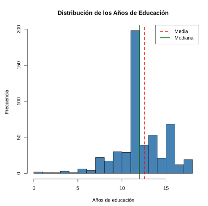
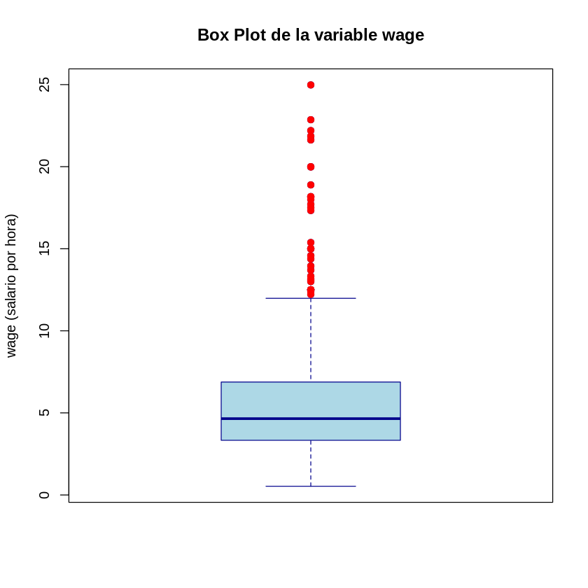

<!-- ARCHIVO GENERADO por tools/clases.py a partir de las diapositivas oficiales. No editar a mano: modifica tools/clases.py o el .tex y vuelve a generar. -->

# Ayudantía 1 · Repaso de estadística

<div class="usm-session-meta">
<span>📘 Ayudantía · Semana 1</span>
<span class="usm-tag-gold">Complementa la Clase 1 · Wooldridge, apéndice C</span>
</div>

!!! info "Contenido oficial de la ayudantía"
    Esta página reproduce **íntegros y en orden** los repasos de la semana 1 (`sem1/repaso_ayudantia.tex`
    y `sem1/repaso_estadistica.tex`). Se trabajan en la **ayudantía**, no en la cátedra del viernes
    ([Clase 1](../clases/clase1.md)). Las soluciones de los ejemplos aparecen plegadas para que intentes
    resolverlos antes.

!!! example "Cómo estudiar esta página"
    La ayudantía está ordenada en **4 temas**. Cada tema parte con una **pregunta guía**, sigue con las láminas
    y los simuladores, y termina con **✍️ preguntas de selección múltiple** (cada alternativa incorrecta explica
    por qué no lo es) y un **🧪 ejercicio de R** que puedes editar y ejecutar aquí mismo, sin instalar nada.
    Los 4 ejercicios de R en un solo archivo: [📥 ayudantia1.R](../r/ayudantia1.R).

## 🎯 Objetivos

- Repasar estadística descriptiva: localización, dispersión, histograma y boxplot.
- Usar el **Teorema Central del Límite** para construir intervalos de confianza para una media.
- Construir intervalos para proporciones y para la diferencia de dos medias, y calcular tamaños muestrales.

## 🗺️ Temas de la ayudantía

Haz clic en un tema para ir directo a él.

<ol class="econ-ruta is-ayudantia">
<li><span class="econ-ruta-h"></span><a class="econ-ruta-a" href="#tema-1"><span class="econ-ruta-n">1</span><span class="econ-ruta-t">Estadística descriptiva</span><span class="econ-ruta-l">Parte 1 · láminas 1–10 · ✍️ 2 preguntas · 🧪 R</span></a></li>
<li><span class="econ-ruta-h"></span><a class="econ-ruta-a" href="#tema-2"><span class="econ-ruta-n">2</span><span class="econ-ruta-t">TCL e intervalos de confianza para la media</span><span class="econ-ruta-l">Parte 2 · láminas 1–14 · ✍️ 2 preguntas · 🧪 R</span></a></li>
<li><span class="econ-ruta-h"></span><a class="econ-ruta-a" href="#tema-3"><span class="econ-ruta-n">3</span><span class="econ-ruta-t">Intervalos de confianza para proporciones</span><span class="econ-ruta-l">Parte 2 · láminas 15–24 · ✍️ 2 preguntas · 🧪 R</span></a></li>
<li><span class="econ-ruta-h"></span><a class="econ-ruta-a" href="#tema-4"><span class="econ-ruta-n">4</span><span class="econ-ruta-t">Intervalos para la diferencia de medias</span><span class="econ-ruta-l">Parte 2 · láminas 25–34 · ✍️ 2 preguntas · 🧪 R</span></a></li>
</ol>

## Repaso de estadística descriptiva { .econ-parte .is-ayudantia data-eyebrow="Parte 1 · Ayudantía" data-toc-label="Parte 1 · Ayudantía · Repaso de estadística descriptiva" }

<p class="econ-source">📄 Diapositivas: <code>sem1/repaso_ayudantia.tex</code> · 10 láminas</p>

### Estadística descriptiva { #tema-1 .econ-tema .is-ayudantia data-num="1" data-laminas="Parte 1 · láminas 1–10" data-toc-label="Tema 1 · Estadística descriptiva" }

<p class="econ-tema-q">¿Cómo resumir muchos datos en pocos números y gráficos?</p>

<div class="econ-lamina is-ayudantia" markdown>

#### Ramas de la Estadística { data-lamina="Lámina 1" }

<!-- sem1/repaso_ayudantia.tex · lámina 1 -->

La Estadística se divide en dos áreas:

-   **Estadística Descriptiva:** se emplea como una primera aproximación a los datos. Utiliza tablas y gráficos para resumir la información disponible.

-   **Estadística Inferencial:** va un poco más allá. A partir de los datos desarrolla mecanismos de decisión parar determinar si los datos sustentan o no una hipótesis. Permite hacer predicciones.

</div>

<div class="econ-lamina is-ayudantia" markdown>

#### Estadística Descriptiva { data-lamina="Lámina 2" }

<!-- sem1/repaso_ayudantia.tex · lámina 2 -->

-   Los **estadísticos** son funciones de los datos de una muestra:

    $$
    f(X_1,....,X_n)
    $$

-   **gráficos**: histogramas, gráficos de caja

-   **tablas**: de frecuencia, contingencia, etc.

</div>

<div class="econ-lamina is-ayudantia" markdown>

#### Estadísticos de Localización Central { data-lamina="Láminas 3–4" }

<!-- sem1/repaso_ayudantia.tex · lámina 3 -->

-   **Media empírica o promedio**:

    $$
    \bar{X}=\frac{1}{n}\sum_{i=1}^n X_i
    $$

-   **Mediana**: Si se tiene una muestra $X_1,...,X_n$, se ordenan los datos de menor a mayor: $X_{(1)},...X_{(n)}$. La mediana es la observación que queda en el medio.

    $$
    Med(X_1,....,X_n)=\left\{
    \begin{array}{ll}
    X_{(\frac{n+1}{2})}, & \hbox{si $n$ es impar} \\
    \frac{X_{(n/2)}+X_{(n/2+1)}}{2}, & \hbox{si $n$ es par}
    \end{array}
    \right.
    $$

<!-- sem1/repaso_ayudantia.tex · lámina 4 -->

-   Suponiendo que se tienen 13 datos (caso de $n$ impar):

    $$
    X_{(1)},......,\underbrace{X_{(7)}}_\text{mediana},......,X_{(13)}
    $$

-   Suponiendo que se tienen 12 datos (caso de $n$ par):

    $$
    X_{(1)},......,\underbrace{X_{(6)},X_{(7)}}_\text{mediana$=\frac{X_{(6)}+X_{(7)}}{2}$},......,X_{(12)}
    $$

</div>

<div class="econ-widget" data-widget="bar-gates"></div>

<div class="econ-lamina is-ayudantia" markdown>

#### Estadísticos de Localización { data-lamina="Lámina 5" }

<!-- sem1/repaso_ayudantia.tex · lámina 5 -->

-   Un percentil es una medida estadística que indica la posición de un dato dentro de un conjunto de observaciones, dividiendo los datos en 100 partes iguales.

-   Los percentiles más empleados son: $P_{25}$, $P_{50}=Mediana$, $P_{75}$ y se conocen como ***cuartiles*** ya que dividen a los datos en 4 partes (se suelen nombrar $q_1$, $q_2$ y $q_3$).

-   También existen los **quintiles** y **deciles**, según se dividan a los datos en 5 o 10 partes.

</div>

<div class="econ-lamina is-ayudantia" markdown>

#### Estadísticos de dispersión { data-lamina="Láminas 6–7" }

<!-- sem1/repaso_ayudantia.tex · lámina 6 -->

-   El ***rango intercuartílico***: se define como:

    $$
    RIQ(X_1,...,X_n)=q_3-q_1
    $$

-   La ***varianza muestral o empírica*** se define como:

    $$
    Var(X_1,...,X_n)=\frac{\sum_{i=1}^n (X_i-\bar{X})^2}{n-1}
    $$

<!-- sem1/repaso_ayudantia.tex · lámina 7 -->

-   La ***desviación estándar muestral o empírico*** es la raíz cuadrada de la varianza, es decir:

    $$
    S(X_1,...,X_n)=\sqrt{\frac{\sum_{i=1}^n (X_i-\bar{X})^2}{n-1}}
    $$

</div>

<div class="econ-lamina is-ayudantia" markdown>

#### Histograma { data-lamina="Lámina 8" }

<!-- sem1/repaso_ayudantia.tex · lámina 8 -->

El histograma resume los datos dentro de algunos rangos y se cuenta el número de observaciones dentro de cada rango.

{ .econ-slide-img }

[Colab](https://colab.research.google.com/drive/1fGx_sLiasa-psVeudjO5IgJPPJX0lB6t?usp=sharing){ .usm-btn target=_blank }

</div>

<div class="econ-lamina is-ayudantia" markdown>

#### Gráfico de caja - Boxplot { data-lamina="Láminas 9–10" }

<!-- sem1/repaso_ayudantia.tex · lámina 9 -->

{ .econ-slide-img }

<!-- sem1/repaso_ayudantia.tex · lámina 10 -->

-   <u>*Línea en medio de la caja*</u>: $Med$ (mediana).

-   <u>*Límite superior de la caja*</u>: $q_3$ (tercer cuartil).

-   <u>*Límite inferior de la caja*</u>: $q_1$ (primer cuartil).

-   notar que el largo de la caja representa el $RIQ$ (rango intercuartilico).

-   <u>*Bigote superior*</u>: es el mínimo entre $q_3+ 1.5RIQ$ y el máximo de los datos ($X_n$).

-   <u>*Bigote inferior*</u>: es el máximo entre $q_1 - 1.5RIQ$ y el mínimo de los datos ($X_1$).

-   <u>*Puntos fuera de los bigotes*</u>: Todos los puntos que exceden los bigotes se grafican. Son puntos extremos (atípicos).

</div>

<div class="econ-widget" data-widget="descriptiva"></div>

<div class="econ-practica" id="practica-1">
<p class="econ-practica-t"><span>✍️ Practica · Tema 1</span></p>
<div class="econ-quiz">
<p class="econ-quiz-q">En un boxplot, ¿qué representa la caja?</p>
<div class="econ-quiz-opts">
<button class="econ-quiz-opt" data-correct>El 50% central de los datos, entre el primer y el tercer cuartil.</button>
<button class="econ-quiz-opt" data-why="El rango completo lo marcan los bigotes y los atípicos, no la caja.">El rango completo de los datos.</button>
<button class="econ-quiz-opt" data-why="El boxplot se construye con cuartiles, no con la media ni la desviación estándar.">La media ± una desviación estándar.</button>
</div>
<p class="econ-quiz-fb">✅ Láminas 9–10: la caja va de q₁ a q₃ y la línea interior es la mediana.</p>
</div>
<div class="econ-quiz">
<p class="econ-quiz-q">Dos cursos tienen promedio 5.0. En el A las notas van de 4.8 a 5.2; en el B, de 2.0 a 7.0. ¿Qué estadístico los distingue?</p>
<div class="econ-quiz-opts">
<button class="econ-quiz-opt" data-correct>La desviación estándar.</button>
<button class="econ-quiz-opt" data-why="Ambas medias son 5.0.">La media.</button>
<button class="econ-quiz-opt" data-why="Mide la posición central, que puede ser igual en ambos; aquí lo que cambia es la dispersión.">La mediana.</button>
</div>
<p class="econ-quiz-fb">✅ Láminas 6–7: los estadísticos de dispersión miden cuán alejados están los datos de su centro.</p>
</div>
</div>

<div class="econ-r" markdown>

<p class="econ-r-t">🧪 Practica en R · Media, mediana y un atípico</p>

Calcula los estadísticos de localización y dispersión de 15 sueldos con un valor atípico, y dibuja su histograma y su boxplot.

```r
# 15 sueldos en miles de pesos; el último es un atípico (10 millones)
sueldos <- c(520, 610, 580, 700, 650, 590, 720, 680, 560, 630,
             600, 750, 640, 610, 10000)
c(media = mean(sueldos), mediana = median(sueldos))
c(desv_estandar = sd(sueldos), rango_intercuartil = IQR(sueldos))
quantile(sueldos)              # cuartiles: q1, mediana y q3

par(mfrow = c(1, 2))
hist(sueldos[-15], main = "Histograma (sin el atípico)", xlab = "miles de $")
boxplot(sueldos, main = "Boxplot: el atípico aparte")
par(mfrow = c(1, 1))
```

**🎯 Reto:** elimina el `10000` del vector. ¿Cuánto cambia la media? ¿Y la mediana?
{: .econ-r-reto }

</div>

## Repaso de estadística inferencial { .econ-parte .is-ayudantia data-eyebrow="Parte 2 · Ayudantía" data-toc-label="Parte 2 · Ayudantía · Repaso de estadística inferencial" }

<p class="econ-source">📄 Diapositivas: <code>sem1/repaso_estadistica.tex</code> · 34 láminas</p>

### TCL e intervalos de confianza para la media { #tema-2 .econ-tema .is-ayudantia data-num="2" data-laminas="Parte 2 · láminas 1–14" data-toc-label="Tema 2 · TCL e IC para la media" }

<p class="econ-tema-q">¿Cuánto podemos confiar en un promedio calculado con una muestra?</p>

<div class="econ-lamina is-ayudantia" markdown>

#### Estadística Inferencial { data-lamina="Lámina 1" }

<!-- sem1/repaso_estadistica.tex · lámina 1 -->

-   Utiliza los datos muestrales para ***inferir*** sobre la población.

-   Requiere hacer supuesto sobre la población de interés. Uso de las teoría de ***probabilidades***.

</div>

<div class="econ-lamina is-ayudantia" markdown>

#### Intervalos de confianza (IC) { data-lamina="Lámina 2" }

<!-- sem1/repaso_estadistica.tex · lámina 2 -->

-   En lugar de ofrecer un valor único, se ofrece un rango de valores donde es más probable que el parámetro se encuentre.

-   Este rango de valores lo llamaremos Intervalo de confianza (IC).

-   Ventaja: da una idea de la precisión que se tiene al estimar.

-   Para construir un IC hay que decidir previamente el nivel de confianza que se quiere tener.

</div>

<div class="econ-widget" data-widget="aro"></div>

<div class="econ-lamina is-ayudantia" markdown>

#### Teorema central del límite { data-lamina="Lámina 3" }

<!-- sem1/repaso_estadistica.tex · lámina 3 -->

-   La distribución muestral del promedio es la distribución de probabilidad de todos los posibles promedios de muestras de un determinado tamaño ($n$), seleccionadas desde una población.

-   Para una población con media $\mu$ y varianza $\sigma^2$ la distribución muestral de los promedios de todas las posibles muestras de tamaño n generadas desde la población serán, aproximadamente, normalmente distribuidas.

-   La media de la distribución muestral será igual a $\mu$ y la varianza igual a $\sigma^2/n$.

</div>

<div class="econ-widget" data-widget="galton"></div>

<div class="econ-lamina is-ayudantia" markdown>

#### Supuestos TCL { data-lamina="Lámina 4" }

<!-- sem1/repaso_estadistica.tex · lámina 4 -->

1.  **Muestreo aleatorio:** Las observaciones deben ser i.i.d. $(X_1, X_2, \ldots, X_n)$.

2.  **Tamaño muestral adecuado (regla de dedo):**

    $$
    n \text{ debe ser } \begin{cases}
    \geq 30 & \text{para distribuciones simétricas (normal)} \\
    \geq 50 & \text{para distribuciones  asimétricas} \\
    \geq 100 & \text{para distribuciones muy asimétricas}
    \end{cases}
    $$

3.  **Varianza finita:** $\sigma^2 < \infty$

4.  **Media finita:** $\mu < \infty$

</div>

<div class="econ-widget" data-widget="tcl"></div>

<div class="econ-lamina is-ayudantia" markdown>

#### IC. ejemplo1 { data-lamina="Láminas 5–7" }

<!-- sem1/repaso_estadistica.tex · lámina 5 -->

**Una tienda quiere obtener una estimación de las ventas mensuales promedio de un cierto producto. Supongamos que las ventas de este producto son bastante estables a los largo del año. Se dispone de una m.a. $X_1,...,X_{36}$ de datos de venta mensual y $\bar{x}=200$. Obtener un IC de 95% para la media poblacional.**

-   Como $n=36>30$ aplica el TCL.

    $$
    \bar{X} \stackrel{aprox.}\sim N(\mu,\frac{\sigma^2}{n})
    $$

-   $\mu$ es la media poblacional que desconocemos

-   $\sigma^2$ es la varianza poblacional (supongamos que es conocida por el momento)

    $$
    \sigma^2=60^2
    $$

<!-- sem1/repaso_estadistica.tex · lámina 6 -->

??? success "Solución"
    -   $$
        \frac{\bar{X}-\mu}{\frac{\sigma}{\sqrt{n}}}=\frac{\bar{X}-\mu}{\frac{60}{\sqrt{36}}}=\frac{\bar{X}-\mu}{10} \stackrel{aprox.}\sim N(0,1)
        $$

    -   Intervalo de confianza de 95%

        $$
        P(a\leq \frac{\bar{X}-\mu}{\frac{\sigma}{\sqrt{n}}}\leq b)=0.95
        $$

<!-- sem1/repaso_estadistica.tex · lámina 7 -->

??? success "Solución (continuación)"
    El intervalos de confianza de 95% para $\mu$ cuando $\sigma$ es conocido está dado por:

    $$
    \color{blue}{\bar{x} \pm 1.96\frac{\sigma}{\sqrt{n}}}
    $$

    $$
    a=z_{0.025}=-1.96 \text{ y } b=z_{0.975}=-z_{0.025}=1.96
    $$

    -   Esto es así si $n\geq 30$ o bien

    -   si $n<30$ pero la muestra es **normal**

    $$
    \color{red}{IC_{95\%}=(180.4;219.6})
    $$

    Haz clic: [Colab](https://colab.research.google.com/drive/14izMe-eFdclOhTeS3hiLE_0h_4E3Jkps?usp=sharing){ .usm-btn target=_blank } [Excel](https://docs.google.com/spreadsheets/d/1xAh-TitIncHH8uwblbpvgjYma7B6gUTWlk8C2z1BquQ/edit?usp=sharing){ .usm-btn target=_blank }

</div>

<div class="econ-lamina is-ayudantia" markdown>

#### Intervalo de confianza de 95% { data-lamina="Lámina 8" }

<!-- sem1/repaso_estadistica.tex · lámina 8 -->

El intervalo de confianza de 95% para $\mu$ cuando $\sigma$ es conocido está dado por:

$$
\color{blue}{\bar{x} \pm 1.96\frac{\sigma}{\sqrt{n}}}
$$

-   Esto es así si $n\geq 30$ o bien

-   si $n<30$ pero la muestra es **normal**

</div>

<div class="econ-lamina is-ayudantia" markdown>

#### Otros niveles de confianza { data-lamina="Láminas 9–10" }

<!-- sem1/repaso_estadistica.tex · lámina 9 -->

Si $\alpha$ es un número entre 0 y 1. El intervalo de confianza de $100(1-\alpha)\%$ para la media poblacional $\mu$ cuando $\sigma$ es conocido se obtiene de la siguiente forma:

-   Se identifica: $z_{\frac{\alpha}{2}}$

-   Finalmente el IC de $100(1-\alpha)\%$ es:

    $$
    \color{red}{\bar{x} \pm z_{\frac{\alpha}{2}}\frac{\sigma}{\sqrt{n}}}
    $$

<!-- sem1/repaso_estadistica.tex · lámina 10 -->

Suponga que se desea aumentar la confiabilidad y hacer un intervalo de 99%

-   $1-\alpha=0.99,$ entonces $\frac{\alpha}{2}=0.005$.:

    $$
    z_{0.005}=-2.57
    $$

-   $$
    IC_{99\%}=(\bar{x}+z_{0.005}\frac{\sigma}{\sqrt{n}};\bar{x}-z_{0.005}\frac{\sigma}{\sqrt{n}})
    $$

-   $$
    IC_{99\%}=(200-(2.57)10;200+(2.57)10)
    $$

-   $$
    \color{red}{IC_{99\%}=(174.3;225.7)}
    $$

Haz clic: [Excel](https://docs.google.com/spreadsheets/d/1xAh-TitIncHH8uwblbpvgjYma7B6gUTWlk8C2z1BquQ/edit?usp=sharing){ .usm-btn target=_blank }

</div>

<div class="econ-lamina is-ayudantia" markdown>

#### Comparación de IC con distintos niveles de confianza. { data-lamina="Lámina 11" }

<!-- sem1/repaso_estadistica.tex · lámina 11 -->

$$
\color{blue}{IC_{95\%}=(180.4;219.6) \text{, y } IC_{99\%}=(174.3;225.7)}
$$

**Si aumento el nivel de confianza y el intervalo se hace mayor!!!**

</div>

<div class="econ-lamina is-ayudantia" markdown>

#### Intervalos de confianza: nivel de confianza y precisión { data-lamina="Lámina 12" }

<!-- sem1/repaso_estadistica.tex · lámina 12 -->

Si tomamos como estimador puntual $\bar{X}$

-   Con un 95% de confianza el verdadero valor del parámetro $\mu$ no estará mas lejos de:

    $$
    E_{95}=(1.96)\frac{\sigma }{\sqrt{n}}
    $$

-   Con un 99% de confianza el verdadero valor del parámetro $\mu$ no estará mas lejos de:

    $$
    E_{99}=(2.58)\frac{\sigma }{\sqrt{n}}
    $$

-   Llamaremos a $E$ ***error absoluto*** de la estimación

</div>

<div class="econ-lamina is-ayudantia" markdown>

#### Nivel de confianza y precisión. { data-lamina="Lámina 13" }

<!-- sem1/repaso_estadistica.tex · lámina 13 -->

-   Si para una misma muestra aumentamos el nivel de confianza (por ejemplo de 95% a 99%) lograremos una mejora en la **confiabilidad**\... pero se pierde **precisión** (mayor error absoluto)

    -   el error absoluto ($E_{95}$) del IC de **95%**:

        $$
        {\color{blue}{E_{95}}}=(1.96)\frac{\sigma }{\sqrt{n}}
        $$

    -   el error absoluto ($E_{99}$) del IC de **99%**:

        $$
        {\color{blue}{E_{99}}}=(2.58)\frac{\sigma }{\sqrt{n}}
        $$

    -   confiabilidad $(1-\alpha)$ $\uparrow \Rightarrow$ precisión $\downarrow$

</div>

<div class="econ-widget" data-widget="ic-cobertura"></div>

<div class="econ-lamina is-ayudantia" markdown>

#### Intervalos de confianza: determinación del tamaño muestral { data-lamina="Lámina 14" }

<!-- sem1/repaso_estadistica.tex · lámina 14 -->

-   Antes de realizar un muestreo se puede definir el nivel de confianza y precisión (error absoluto) deseados y luego determinar el tamaño muestral ($n$)

-   suponiendo $\sigma$ conocido y eligiendo $E$ (el error absoluto) y $\alpha$:

    $$
    {\color{blue}{E}}=-z_{\frac{{\color{blue}{\alpha}}}{2}}\sigma/\sqrt{{\color{red}{n}}}
    $$

-   luego, despejando $n$:

    $$
    n=(z_{\frac{\alpha}{2}}\frac{\sigma}{E})^2
    $$

-   si el valor resultante no es entero se redondea hacia arriba.

</div>

<div class="econ-practica" id="practica-2">
<p class="econ-practica-t"><span>✍️ Practica · Tema 2</span></p>
<div class="econ-quiz">
<p class="econ-quiz-q">¿Qué dice el Teorema Central del Límite?</p>
<div class="econ-quiz-opts">
<button class="econ-quiz-opt" data-correct>Con n grande, X̄ es aproximadamente normal, aunque la población no lo sea.</button>
<button class="econ-quiz-opt" data-why="La población no cambia: lo que se vuelve normal es la distribución de X̄.">Con n grande, los datos de la población se vuelven normales.</button>
<button class="econ-quiz-opt" data-why="X̄ varía de muestra en muestra alrededor de μ, con varianza σ²/n.">X̄ siempre es igual a μ.</button>
</div>
<p class="econ-quiz-fb">✅ Láminas 3–4: X̄ ≈ N(μ, σ²/n) si n ≥ 30, o para cualquier n si la población es normal.</p>
</div>
<div class="econ-quiz">
<p class="econ-quiz-q">Con x̄ = 200, σ = 60 y n = 36, ¿cuál es el IC de 99% para μ?</p>
<div class="econ-quiz-opts">
<button class="econ-quiz-opt" data-why="Ese es el IC de 95% (z = 1.96).">(180.4; 219.6)</button>
<button class="econ-quiz-opt" data-correct>(174.2; 225.8)</button>
<button class="econ-quiz-opt" data-why="Ese es el de 90% (z = 1.645): más confianza exige un intervalo más ancho.">(183.6; 216.4)</button>
</div>
<p class="econ-quiz-fb">✅ 200 ± 2.576 · 60/√36 = 200 ± 25.8. Pruébalo en la calculadora de intervalos.</p>
</div>
</div>

<div class="econ-r" markdown>

<p class="econ-r-t">🧪 Practica en R · El TCL y el 95%</p>

Comprueba el TCL con una población muy asimétrica, reproduce el IC de la lámina 5 y verifica qué significa el 95%.

```r
# TCL: la población es muy asimétrica, pero el promedio de 36 datos no
set.seed(36)
promedios <- replicate(5000, mean(rexp(36, rate = 1 / 200)))  # μ = σ = 200
hist(promedios, breaks = 40, main = "5 000 promedios de n = 36",
     xlab = "x barra")
c(media = mean(promedios), sd = sd(promedios), sd_teorica = 200 / 6)

# IC de 95% de la lámina 5: x barra = 200, σ = 60, n = 36
200 + c(-1, 1) * qnorm(0.975) * 60 / sqrt(36)

# ¿Qué significa el 95%? El intervalo atrapa a μ en ~95% de las muestras
cubre <- replicate(5000, {
  x <- rnorm(36, mean = 200, sd = 60)
  abs(mean(x) - 200) <= 1.96 * 60 / sqrt(36)
})
mean(cubre)
```

**🎯 Reto:** cambia `0.975` por `0.995` en el IC. ¿El intervalo de 99% es más ancho o más angosto?
{: .econ-r-reto }

</div>

### Intervalos de confianza para proporciones { #tema-3 .econ-tema .is-ayudantia data-num="3" data-laminas="Parte 2 · láminas 15–24" data-toc-label="Tema 3 · IC para proporciones" }

<p class="econ-tema-q">¿Cómo estimar un porcentaje, como la tasa de productos defectuosos?</p>

<div class="econ-lamina is-ayudantia" markdown>

#### Intervalos de confianza para las proporciones { data-lamina="Láminas 15–19" }

<!-- sem1/repaso_estadistica.tex · lámina 15 -->

-   Sea $\bf{p}$ la proporción de *éxitos* en una población.

-   ***éxito:*** identifica a un individuo de una población con una determinada característica.

-   ejemplos:

    -   proporción de fallas en una población de un determinado artefacto.

    -   proporción de enfermos en una población.

    -   proporción de aprobados en un curso

<!-- sem1/repaso_estadistica.tex · lámina 16 -->

-   Recordemos que la v.a. :

    $$
    X\equiv \text{número de éxitos en una muestra de tamaño } n
    $$

    Distribuye $Bin(n,p)$

-   Además si $n\geq 30$

    $$
    X\stackrel{aprox.}\sim N(np,np(1-p))
    $$

-   Se pedirá adicionalmente que $np>5$ y $n(1-p)>5$

<!-- sem1/repaso_estadistica.tex · lámina 17 -->

-   Un buen estimador puntual para $p$ es $\hat{p}=\frac{X}{n}$ la fracción de éxitos en la muestra.

-   Ahora:

    $$
    \hat{p}\stackrel{aprox.}\sim N(p,\frac{p(1-p)}{n})
    $$

    y

    $$
    \frac{\hat{p}-p}{\sqrt{\frac{p(1-p)}{n}}}\stackrel{aprox.}\sim N(0,1)
    $$

<!-- sem1/repaso_estadistica.tex · lámina 18 -->

Entonces se puede emplear la distribución normal para armar un IC para las proporciones. En este caso:

$$
P(z_{\frac{\alpha}{2}}\leq \frac{\hat{p}-p}{\sqrt{\frac{p(1-p)}{n}}}\leq -z_{\frac{\alpha}{2}} )\simeq 1-\alpha
$$

<!-- sem1/repaso_estadistica.tex · lámina 19 -->

Es decir:

$$
P(z_{\frac{\alpha}{2}}\leq \frac{\hat{p}-p}{\sqrt{\frac{\hat{p}(1-\hat{p})}{n}}}\leq -z_{\frac{\alpha}{2}} )\simeq 1-\alpha
$$

$$
P(\hat{p}+z_{\frac{\alpha}{2}}\sqrt{\frac{\hat{p}(1-\hat{p})}{n}}\leq p \leq \hat{p}-z_{\frac{\alpha}{2}}\sqrt{\frac{\hat{p}(1-\hat{p})}{n}} )\simeq 1-\alpha
$$

El IC se construye como:

$$
\color{red}{IC_{(1-\alpha)100\%}=\hat{p}\pm z_{\frac{\alpha}{2}}\sqrt{\frac{\hat{p}(1-\hat{p})}{n}}}
$$

</div>

<div class="econ-lamina is-ayudantia" markdown>

#### IC para las proporciones: ejemplo { data-lamina="Lámina 20" }

<!-- sem1/repaso_estadistica.tex · lámina 20 -->

**Un fabricante asegura, a una compañía que le compra un producto en forma regular, que el porcentaje de productos defectuosos es 5%. La compañía decide comprobar la afirmación del fabricante seleccionando de su inventario 200 unidades del producto y probándolas. En este procedimiento se detectan 19 unidades defectuosas en la muestra. ¿Es coherente este resultado con la afirmación del proveedor? Utilice una confiabilidad de 95%.**

</div>

<div class="econ-lamina is-ayudantia" markdown>

#### IC para las proporciones. respuesta de ejemplo { data-lamina="Lámina 21" }

<!-- sem1/repaso_estadistica.tex · lámina 21 -->

??? success "Solución"
    $$
    \hat{p}=\frac{19}{200}=0.095
    $$

    $$
    IC_{95\%}=\hat{p}\pm z_{0.025}\sqrt{\frac{\hat{p}(1-\hat{p})}{n}}
    $$

    $$
    IC_{95\%}=0.095 \pm 1.96 \sqrt{\frac{0.095(1-0.095)}{200}}
    $$

    $$
    IC_{95\%}=(0.05433;0.1356)
    $$

    El proveedor afirma que $p$ es $0.05$. Este valor no cae dentro del IC.

    Haz clic: [Colab](https://colab.research.google.com/drive/14izMe-eFdclOhTeS3hiLE_0h_4E3Jkps?usp=sharing){ .usm-btn target=_blank } [Excel](https://docs.google.com/spreadsheets/d/1xAh-TitIncHH8uwblbpvgjYma7B6gUTWlk8C2z1BquQ/edit?usp=sharing){ .usm-btn target=_blank }

</div>

<div class="econ-lamina is-ayudantia" markdown>

#### IC para las proporciones: determinación del tamaño muestral { data-lamina="Lámina 22" }

<!-- sem1/repaso_estadistica.tex · lámina 22 -->

-   Aquí también se puede determinar $n$ fijando el nivel de confianza y el largo del intervalo.

-   se requiere una estimación inicial de $p$, $p^*$.

-   Para obtener $p^*$ se puede extraer una muestra preliminar (más pequeña), o usar $p^*=0.5$ (peor escenario).

-   En este caso el error absoluto es:

    $$
    E=-z_{\frac{\alpha}{2}}\sqrt{\frac{p^*(1-p^*)}{n}}
    $$

-   luego, despejando $n$:

    $$
    n=\frac{z_{\frac{\alpha}{2}}^2p^*(1-p^*)}{E^2}
    $$

</div>

<div class="econ-lamina is-ayudantia" markdown>

#### IC para las proporciones { data-lamina="Láminas 23–24" }

<!-- sem1/repaso_estadistica.tex · lámina 23 -->

**Un fabricante produce chips para computadores. Cada chip tiene una probabilidad $p$ de tener una calidad aceptable. Para obtener un IC de 95% para $p$ cuya longitud no exceda $0.05$, se toma una muestra inicial de 30 chips. De estos 30 chips, 26 resultaron con una calidad aceptable. ¿Cuál es el tamaño muestral necesario para obtener un intervalo con las características requeridas?**

<!-- sem1/repaso_estadistica.tex · lámina 24 -->

??? success "Solución"
    $$
    p^*=\frac{26}{30}=0.8667
    $$

    $$
    n=\frac{z_{\frac{\alpha}{2}}^2p^*(1-p^*)}{E^2}=\frac{(1.96)^2(0.8667)(1-0.8667)}{(0.025)^2}=710.12
    $$

    Se requiere un tamaño muestral de 711 chips.

    Haz clic: [Colab](https://colab.research.google.com/drive/14izMe-eFdclOhTeS3hiLE_0h_4E3Jkps?usp=sharing){ .usm-btn target=_blank } [Excel](https://docs.google.com/spreadsheets/d/1xAh-TitIncHH8uwblbpvgjYma7B6gUTWlk8C2z1BquQ/edit?usp=sharing){ .usm-btn target=_blank }

</div>

<div class="econ-practica" id="practica-3">
<p class="econ-practica-t"><span>✍️ Practica · Tema 3</span></p>
<div class="econ-quiz">
<p class="econ-quiz-q">Con 19 defectuosos en 200 unidades, el IC de 95% es (0.054; 0.136). El proveedor dice que p = 0.05. ¿Qué concluyes?</p>
<div class="econ-quiz-opts">
<button class="econ-quiz-opt" data-correct>Los datos no son coherentes con lo que afirma el proveedor: 0.05 queda fuera del intervalo.</button>
<button class="econ-quiz-opt" data-why="Lo que importa es si el valor queda dentro o fuera del intervalo.">El proveedor tiene razón, porque 0.05 está cerca de 0.054.</button>
<button class="econ-quiz-opt" data-why="El intervalo ya incorpora la incertidumbre de usar 200 unidades.">Con 200 unidades no se puede concluir nada.</button>
</div>
<p class="econ-quiz-fb">✅ Es la conclusión de la lámina 21.</p>
</div>
<div class="econ-quiz">
<p class="econ-quiz-q">Sin información previa sobre p, ¿qué p* conviene usar para calcular el tamaño muestral?</p>
<div class="econ-quiz-opts">
<button class="econ-quiz-opt" data-correct>0.5, porque maximiza p*(1 − p*) y da el n más conservador.</button>
<button class="econ-quiz-opt" data-why="Daría un n demasiado chico si en realidad p estuviera cerca de 0.5.">0.05</button>
<button class="econ-quiz-opt" data-why="Con p* = 1, p*(1 − p*) = 0 y el n calculado sería 0.">1</button>
</div>
<p class="econ-quiz-fb">✅ Lámina 22: p* = 0.5 es el peor escenario.</p>
</div>
</div>

<div class="econ-r" markdown>

<p class="econ-r-t">🧪 Practica en R · Productos defectuosos</p>

Reproduce el intervalo de la lámina 21 y calcula cuántas unidades harían falta para un error de ±3 puntos porcentuales.

```r
# Lámina 20: 19 defectuosos en 200 unidades
x <- 19
n <- 200
p <- x / n
p + c(-1, 1) * qnorm(0.975) * sqrt(p * (1 - p) / n)  # (0.0543; 0.1356)

# Tamaño muestral para un error E = 0.03 con p* = 0.5 (peor escenario)
E <- 0.03
ceiling(qnorm(0.975)^2 * 0.5 * (1 - 0.5) / E^2)
```

**🎯 Reto:** usa `p* = 0.095` en vez de `0.5` en el tamaño muestral. ¿Cuántas unidades necesitas ahora?
{: .econ-r-reto }

</div>

### Intervalos para la diferencia de medias { #tema-4 .econ-tema .is-ayudantia data-num="4" data-laminas="Parte 2 · láminas 25–34" data-toc-label="Tema 4 · IC para diferencia de medias" }

<p class="econ-tema-q">¿Ganan distinto, en promedio, los egresados de dos carreras?</p>

<div class="econ-lamina is-ayudantia" markdown>

#### Intervalos de confianza diferencia de media de dos poblaciones { data-lamina="Lámina 25" }

<!-- sem1/repaso_estadistica.tex · lámina 25 -->

Se cree que el salario promedio de recién egresados de la carrera de ingeniería industrial es mayor que el salario promedio de recién egresados de arquitectura. Se obtuvieron muestras aleatorias de cada grupo de egresados:

-   $X_1,....,X_{n_x}$: salarios de egresados de ing. industrial

-   $Y_1,....,Y_{n_y}$: salarios de egresados de arquitectura

-   Se supone que las muestras son **independientes** entre si

</div>

<div class="econ-lamina is-ayudantia" markdown>

#### Diferencia de media de dos poblaciones { data-lamina="Láminas 26–27" }

<!-- sem1/repaso_estadistica.tex · lámina 26 -->

Llamaremos:

-   $\mu_x$: media poblacional de salarios de egresados de ing. industrial

-   $\mu_y$: media poblacional de salarios de egresados de arquitectura

<!-- sem1/repaso_estadistica.tex · lámina 27 -->

La idea es armar un IC para:

$$
\mu_x-\mu_y
$$

-   Si el cero cae dentro del intervalo, los datos no dan evidencia de diferencia entre las medias

-   Si el cero cae fuera del intervalo, los datos dan evidencia de diferencia entre las medias

</div>

<div class="econ-lamina is-ayudantia" markdown>

#### Caso $\sigma_x^2$ y $\sigma_y^2$ conocidos, con $n_x$ y $n_y$ grandes { data-lamina="Láminas 28–31" data-toc-label="Caso σx² y σy² conocidos, con nx y ny grandes" }

<!-- sem1/repaso_estadistica.tex · lámina 28 -->

-   $\bar{X} \stackrel{aprox.}\sim N(\mu_x,\frac{\sigma_x^2}{n_x})$

-   $\bar{Y} \stackrel{aprox.}\sim N(\mu_y,\frac{\sigma_y^2}{n_y})$

-   $\bar{X}-\bar{Y}$ también es aproximadamente normal

-   $E(\bar{X}-\bar{Y})=E(\bar{X})-E(\bar{Y})=\mu_x-\mu_y$

-   $V(\bar{X}-\bar{Y})=V(\bar{X})+V(\bar{Y})=\frac{\sigma_x^2}{n_x}+\frac{\sigma_y^2}{n_y}$ (porque las muestras son independientes)

<!-- sem1/repaso_estadistica.tex · lámina 29 -->

Por ello,

$$
Z=\frac{(\bar{X}-\bar{Y})-(\mu_x-\mu_y)}{\sqrt{\frac{\sigma_x^2}{n_x}+\frac{\sigma_y^2}{n_y}}} \stackrel{aprox.}\sim N(0,1)
$$

<!-- sem1/repaso_estadistica.tex · lámina 30 -->

De aquí surge que:

$$
P(z_{\frac{\alpha}{2}}\leq Z\leq -z_{\frac{\alpha}{2}}) \simeq 1-\alpha
$$

$$
P(z_{\frac{\alpha}{2}}\leq \frac{(\bar{X}-\bar{Y})-(\mu_x-\mu_y)}{\sqrt{\frac{\sigma_x^2}{n_x}+\frac{\sigma_y^2}{n_y}}}\leq -z_{\frac{\alpha}{2}}) \simeq 1-\alpha
$$

$P((\bar{X}-\bar{Y}) + z_{\frac{\alpha}{2}}\sqrt{\frac{\sigma_x^2}{n_x}+\frac{\sigma_y^2}{n_y}}\leq \mu_x-\mu_y\leq (\bar{X}-\bar{Y})-z_{\frac{\alpha}{2}}\sqrt{\frac{\sigma_x^2}{n_x}+\frac{\sigma_y^2}{n_y}})$ $\simeq 1-\alpha$

<!-- sem1/repaso_estadistica.tex · lámina 31 -->

El IC de $(1-\alpha)100\%$ para la diferencia de medias $\mu_x-\mu_y$ es:

$$
\color{red}{IC_{(1-\alpha)100}=(\bar{X}-\bar{Y}) \pm z_{\frac{\alpha}{2}}\sqrt{\frac{\sigma_x^2}{n_x}+\frac{\sigma_y^2}{n_y}}}
$$

</div>

<div class="econ-lamina is-ayudantia" markdown>

#### Ejemplo { data-lamina="Láminas 32–34" }

<!-- sem1/repaso_estadistica.tex · lámina 32 -->

En el ejemplo de salarios. Supongamos que:

-   $\bar{X}=\$800000$

-   $\bar{Y}=\$680000$

-   $n_x=144$

-   $n_y=121$

-   $\sigma_x=60000$

-   $\sigma_y=50000$

Obtener un IC de 95% para la diferencia de medias.

<!-- sem1/repaso_estadistica.tex · lámina 33 -->

??? success "Solución"
    El IC de 95% es:

    $$
    IC_{95}=(\bar{X}-\bar{Y}) \pm z_{0.025}\sqrt{\frac{\sigma_x^2}{n_x}+\frac{\sigma_y^2}{n_y}}
    $$

    $$
    IC_{95}=(800000-680000)\pm(1.96)\sqrt{\frac{60000^2}{144}+\frac{50000^2}{121}}
    $$

    $$
    IC_{95}=(106756; 133244)
    $$

    Haz clic: [Colab](https://colab.research.google.com/drive/14izMe-eFdclOhTeS3hiLE_0h_4E3Jkps?usp=sharing){ .usm-btn target=_blank } [Excel](https://docs.google.com/spreadsheets/d/1xAh-TitIncHH8uwblbpvgjYma7B6gUTWlk8C2z1BquQ/edit?usp=sharing){ .usm-btn target=_blank }

<!-- sem1/repaso_estadistica.tex · lámina 34 -->

??? success "Conclusión"
    $$
    \color{red}{IC_{95}=(106.756; 133.244)}
    $$

    Como el intervalo para $\mu_x-\mu_y$ ***no contiene al cero***, el resultado nos está dando evidencia de que las medias poblacionales son diferentes. ***Los salarios promedio de los egresados de ingeniería son más altos en promedio que los de arquitectura.***

</div>

<div class="econ-widget" data-widget="ic-calc"></div>

<div class="econ-practica" id="practica-4">
<p class="econ-practica-t"><span>✍️ Practica · Tema 4</span></p>
<div class="econ-quiz">
<p class="econ-quiz-q">El IC de 95% para μₓ − μᵧ es (106 756; 133 244). ¿Qué significa que no contenga al cero?</p>
<div class="econ-quiz-opts">
<button class="econ-quiz-opt" data-correct>Que hay evidencia de que los salarios promedio de ambas carreras son distintos.</button>
<button class="econ-quiz-opt" data-why="El intervalo se refiere a las medias, no a cada persona.">Que todos los ingenieros ganan más que todos los arquitectos.</button>
<button class="econ-quiz-opt" data-why="120 000 es la estimación puntual; el intervalo da un rango de valores plausibles.">Que la diferencia es exactamente 120 000.</button>
</div>
<p class="econ-quiz-fb">✅ Es la conclusión de la lámina 34.</p>
</div>
<div class="econ-quiz">
<p class="econ-quiz-q">Si aumentas nₓ y nᵧ (y lo demás no cambia), el intervalo para μₓ − μᵧ…</p>
<div class="econ-quiz-opts">
<button class="econ-quiz-opt" data-correct>…se angosta.</button>
<button class="econ-quiz-opt" data-why="El error estándar √(σₓ²/nₓ + σᵧ²/nᵧ) baja al crecer las muestras.">…se ensancha.</button>
<button class="econ-quiz-opt" data-why="El error estándar depende de los tamaños muestrales.">…no cambia.</button>
</div>
<p class="econ-quiz-fb">✅ Más datos, menos incertidumbre: el error estándar disminuye.</p>
</div>
</div>

<div class="econ-r" markdown>

<p class="econ-r-t">🧪 Practica en R · Ingeniería contra arquitectura</p>

Reproduce el intervalo de la lámina 33 para la diferencia de salarios promedio.

```r
# Lámina 32: salarios de egresados de ingeniería (X) y arquitectura (Y)
xbar <- 800000; ybar <- 680000
nx   <- 144;    ny   <- 121
sx   <- 60000;  sy   <- 50000

ee <- sqrt(sx^2 / nx + sy^2 / ny)               # error estándar
(xbar - ybar) + c(-1, 1) * qnorm(0.975) * ee    # (106 756; 133 244)
```

**🎯 Reto:** ¿cuánto tendría que valer `ybar` para que el intervalo contuviera al cero? Pruébalo.
{: .econ-r-reto }

</div>

---

!!! abstract "🧠 Ideas clave"
    - La **media** se deja arrastrar por los atípicos; la **mediana** y el rango intercuartil, no.
    - Por el **TCL**, $\bar{X}$ es aproximadamente $N(\mu, \sigma^2/n)$ aunque la población no sea normal.
    - Un **IC de 95%** atrapa a μ en el 95% de las muestras; más confianza implica un intervalo más ancho.
    - Para reducir el error a la mitad se necesitan **cuatro veces** más datos.

## ✅ Autoevaluación

<div class="econ-quiz">
<p class="econ-quiz-q">Construiste un IC de 95% para μ y obtuviste (180.4 ; 219.6). ¿Cuál interpretación es correcta?</p>
<div class="econ-quiz-opts">
<button class="econ-quiz-opt">Hay 95% de probabilidad de que μ esté entre 180.4 y 219.6.</button>
<button class="econ-quiz-opt" data-correct>Si repitiéramos el muestreo muchas veces, el 95% de los intervalos construidos así contendría a μ.</button>
<button class="econ-quiz-opt">El 95% de los meses tiene ventas entre 180.4 y 219.6.</button>
</div>
<p class="econ-quiz-fb">✅ μ es fijo: un intervalo ya calculado lo contiene o no. El 95% es una propiedad del <strong>procedimiento</strong> (revisa el simulador de cobertura). La tercera opción confunde la distribución de x̄ con la de las ventas individuales.</p>
</div>

<div class="econ-quiz">
<p class="econ-quiz-q">Si cuadruplicas el tamaño muestral n (manteniendo σ y la confianza), el error absoluto E…</p>
<div class="econ-quiz-opts">
<button class="econ-quiz-opt">…se reduce a la cuarta parte.</button>
<button class="econ-quiz-opt" data-correct>…se reduce a la mitad.</button>
<button class="econ-quiz-opt">…no cambia.</button>
</div>
<p class="econ-quiz-fb">✅ E = z·σ/√n, y √(4n) = 2√n. Para reducir el error a la mitad necesitas cuatro veces más datos.</p>
</div>

<div class="econ-quiz">
<p class="econ-quiz-q">En una muestra de 15 sueldos aparece uno de 10 millones. ¿Qué estadístico cambia más?</p>
<div class="econ-quiz-opts">
<button class="econ-quiz-opt">La mediana</button>
<button class="econ-quiz-opt" data-correct>La media</button>
<button class="econ-quiz-opt">Ambos cambian lo mismo</button>
</div>
<p class="econ-quiz-fb">✅ La media usa el valor de cada dato, así que un atípico la arrastra; la mediana solo depende de la posición central. Pruébalo agregando un atípico en el simulador de estadística descriptiva.</p>
</div>

## 🔗 Volver a la cátedra

- [Clase 1 · Introducción y repaso de estadística](../clases/clase1.md)
