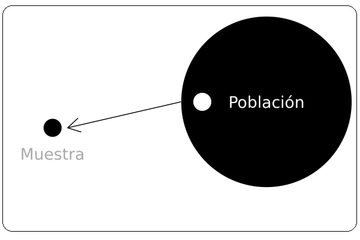
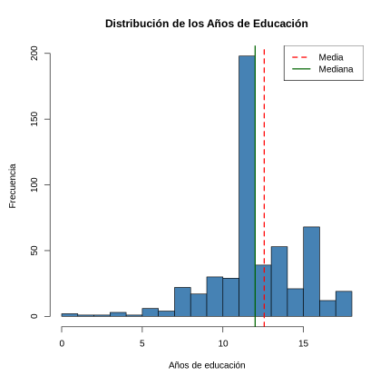
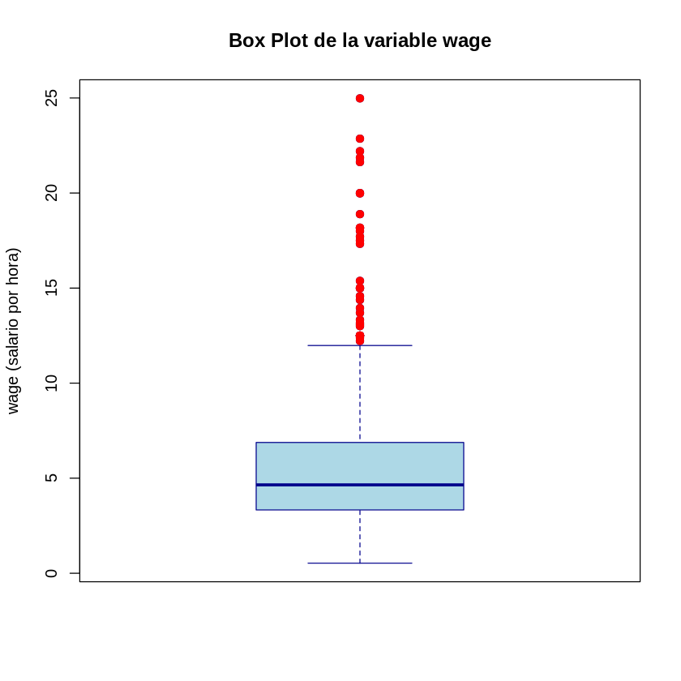

<!-- ARCHIVO GENERADO por tools/clases.py a partir de las diapositivas oficiales. No editar a mano: modifica tools/clases.py o el .tex y vuelve a generar. -->

# Clase 1 · Introducción y repaso de estadística

📅 Viernes 16 de octubre de 2026
⏱️ 18:40 – 21:25
Semana 1 · Contenidos 1, 2 y 3 del programa

!!! info "Contenido oficial de la semana"
    Esta página reproduce **íntegras y en orden** las diapositivas de la semana 1 (`sem1/`).
    **Cátedra del viernes:** Parte 1 (`clase1.tex`). **Ayudantía:** Partes 2 y 3
    (`repaso_ayudantia.tex` y `repaso_estadistica.tex`), que se ven otro día. Los bloques
    **Interactivo**, los casos y las preguntas de autoevaluación son material adicional para
    estudiar; las soluciones de los ejemplos aparecen plegadas para que intentes resolverlos antes.

## 🎯 Objetivos de la sesión

**Cátedra (viernes)**

- Entender qué es la econometría y qué tipo de preguntas permite responder.
- Distinguir **correlación** de **causalidad** y el rol del supuesto *ceteris paribus*.
- Reconocer los tipos de datos y los métodos de muestreo.

**Ayudantía**

- Repasar estadística descriptiva (localización, dispersión, histograma y boxplot) e inferencial
  (TCL e intervalos de confianza para medias, proporciones y diferencias de medias).

## 🗓️ Agenda de la cátedra (viernes 18:40 – 21:25)

| Hora | Bloque | Láminas |
|---|---|---|
| 18:40 – 19:00 | Presentación del curso: programa, evaluaciones, cátedra + ayudantía, trabajo práctico | — |
| 19:00 – 19:25 | ¿Qué es la econometría?, econometría moderna y método econométrico | 1 – 3 |
| 19:25 – 19:55 | Causalidad y correlación: caso de los helados y los tiburones; ejemplo de la universidad | 4 – 6 |
| 19:55 – 20:05 | *Receso* | |
| 20:05 – 20:25 | Econometría como herramienta aplicada: Worms y consultorías | 7 |
| 20:25 – 20:50 | Tipos de datos | 8 – 11 |
| 20:50 – 21:15 | Muestreo: población y muestra, métodos aleatorios y no probabilísticos | 12 – 19 |
| 21:15 – 21:25 | Estadística descriptiva vs. inferencial y cierre | 20 |

Las **Partes 2 y 3** (repaso de estadística) se trabajan en la **ayudantía**.

## Introducción a la econometría { .econ-parte data-eyebrow="Parte 1 · Cátedra" data-toc-label="Parte 1 · Introducción a la econometría" }

📄 Diapositivas: <code>sem1/clase1.tex</code> · 20 láminas

### ¿Qué es econometría? { data-lamina="Lámina 1" }

<!-- sem1/clase1.tex · lámina 1 -->

-   Es una disciplina que emplea la teoría económica y métodos estadísticos para contrastar distintas teorías, pronosticar variables y evaluar políticas públicas utilizando bases de datos.

-   Es una aplicación del metodo científico en economía. Nos permite refutar hipótesis económicas.

-   Nos permite contestar preguntas como por ejemplo:

    1.  Cuál es la brecha salarial por género?

    2.  Cuál es el efecto de haber completado la universidad en el salario?

### Econometría moderna { data-lamina="Lámina 2" }

<!-- sem1/clase1.tex · lámina 2 -->

La econometría moderna se enfoca en contestar 3 tipos de preguntas:

-   Estimar como la esperanza condicional de una variable depende de otra.

-   Estimar el impacto causal de una variable sobre la otra.

-   Predecir el comportamento de una variable hacia el futuro.

### Método econométrico { data-lamina="Lámina 3" }

<!-- sem1/clase1.tex · lámina 3 -->

-   Definir objetivo: qué quiero estudiar?

-   Estructura:

    1.  **Modelo Económico:** modelos que explican el comportamiento de una variable económica en función de otras. 
        $Y = f (x_1; x_2; ...; x_k)$ 
        Ejemplo 1: Función de producción $Y = AK^{\alpha}L^{\beta}$ 
        Ejemplo 2: Retornos educación 
        salario = f (educ; experiencia; ingfamiliar ; habilidad)

    2.  **Modelo econométrico:** permite cuantificar, contrastar y evaluar el modelo económico.

        1.  Especificar la funcion f (:).

        2.  Las variables económicas son aleatorias por lo que lo incorporamos con un termino de error: 
            $y = f (x_1; x_2;...; x_k) + u$

        3.  Los datos.

### Causalidad y correlación { data-lamina="Lámina 4" }

<!-- sem1/clase1.tex · lámina 4 -->

**Correlación no es causalidad**

-   Muchas veces nos interesa conocer el efecto causal de una variable sobre otra.

-   El concepto **ceteris paribus** es clave para la causalidad: efecto de X sobre Y *manteniendo todos los demas factores relevantes constantes*. Muy difícil en la práctica en ciencias sociales.

-   Vamos a ver en el curso los supuestos necesarios y técnicas para hacerlo.

**Correlación espuria:** existe una relación matemática pero los factores no presentan una relación lógica.

### Ejemplo { data-lamina="Láminas 5–6" }

<!-- sem1/clase1.tex · lámina 5 -->

-   Información: En una base de individuos de 35 años de Chile, encuentro que las personas que terminaron la universidad ganan 30% más que las que no la terminaron.

-   Pregunta: De lo anterior, puedo concluir que ir a la universidad causa un aumento del ingreso de los individuos?

<!-- sem1/clase1.tex · lámina 6 -->

??? success "Respuesta"
    No puedo concluir eso.

    -   Ir a la universidad está asociado con un montón de otras características que tambien afectan ingreso.

    -   Por ejemplo, la habilidad, el ingreso de los padres, etc.

### Econometría como herramienta aplicada { data-lamina="Lámina 7" }

<!-- sem1/clase1.tex · lámina 7 -->

-   **Pregunta: como solucionamos problemas de worms intestinales en Africa?** 
    Miguel y Kremer (2004), *Worms: Identifying Impacts on Education and Health in the Presence of Treatment Externalities*: Encuentran que repartir pildoras en colegios, mejora la salud, reduce el ausentismo educacional no solo de los tratados sino también de sus vecinos. Gracias a estos estudios la iniciativa deworming the world recauda billones de dólares para esta política.

-   **Pregunta: las consultoras de management pueden mejorar la productividad de las firmas?**

    Bloom et al. (2017) *Increasing Firm Productivity through Management Consulting Services in India*: Muestra que si y lo cuantifica.

    [ **JPAL**](https://www.povertyactionlab.org/evaluation/increasing-firm-productivity-through-management-consulting-services-india)

### Tipos de Datos { data-lamina="Láminas 8–11" }

<!-- sem1/clase1.tex · lámina 8 -->

-   **Experimentales**: el investigador asigna en forma aleatoria la exposición.

-   **Pseudo-experimental**: el investigador controla la exposición pero no asigna en forma aleatoria.

-   **Observacional (o no-experimental)**: el investigador no controla la exposición, depende de variables que el no controla.

**Rara vez usa datos experimentales extremadamente caros, problemas éticos.**

<!-- sem1/clase1.tex · lámina 9 -->

**Corte transversal:** Muestra de individuos, hogares, empresas, regiones, países, etc., recolectados en un tiempo dado. A veces el estudio no se realiza exactamente en el mismo periodo de tiempo para todos las unidades evaluadas, pero diferencias temporales menores se ignoran. Se asume que los datos fueron obtenidos por muestreo aleatorio (random sampling) desde la población subyacente.

<!-- sem1/clase1.tex · lámina 10 -->

**Series de tiempo:** Observaciones de una o más variables en el tiempo. Ej. Precios de acciones, dólar, IPC, ventas de automóviles, etc. Eventos pasados influencian eventos futuros. Rezagos en el comportamiento son prevalentes en ciencias sociales. Tiempo es una dimensión importante en datos de series de tiempo. Frecuencia $\Delta$ tiempo=1, día, año, semestre, trimestre, etc. A diferencia de datos de corte transversal, datos de series de tiempo no pueden asumirse independientes.

<!-- sem1/clase1.tex · lámina 11 -->

**Datos longitudinales o de panel:** Consiste en una serie de tiempo para cada miembro del set de datos. Ejemplo: 10 años de datos de salario, educación y empleo sobre un set de individuos. Diferencias con los anteriores es que los mismos individuos, firmas o países, son seguidos por varios años.

Varias ventajas: Control de ciertas características no observadas de individuos, firmas, etc. Facilita estudios de causa-efecto (inferencia causal). Permite estudiar los efectos del rezago en el comportamiento o resultado.

Tienes el PIB trimestral de Chile, Perú y Colombia entre 2000 y 2024. ¿Qué tipo de datos son?

<button class="econ-quiz-opt">Corte transversal</button>
<button class="econ-quiz-opt">Series de tiempo</button>
<button class="econ-quiz-opt" data-correct>Datos de panel</button>

✅ Es un <strong>panel</strong>: las mismas unidades (3 países) observadas en muchos períodos. Solo Chile sería una serie de tiempo; solo el año 2024 para muchos países, un corte transversal.

Una empresa sortea qué sucursales reciben un nuevo sistema de incentivos y compara las ventas. ¿Qué tipo de datos genera?

<button class="econ-quiz-opt" data-correct>Experimentales</button>
<button class="econ-quiz-opt">Pseudo-experimentales</button>
<button class="econ-quiz-opt">Observacionales</button>

✅ La exposición la asigna el investigador <strong>en forma aleatoria</strong>: es un experimento. Si el gerente eligiera las sucursales, sería pseudo-experimental; si cada sucursal decidiera adoptarlo, observacional.

### Muestreo { data-lamina="Láminas 12–13" }

<!-- sem1/clase1.tex · lámina 12 -->

Los datos experimentales son obtenidos sobre conjuntos de individuos u objetos, sobre los cuales se quiere conocer algunas características.

Llamaremos **unidad de observación** a estos individuos y la totalidad de estas unidades de observación se denomina **población.**

El Muestreo es la disciplina que trata con el conjunto de métodos, técnicas y procedimientos para tomar u obtener una muestra particular de la población a efecto de realizar inferencias a partir de la misma.

<!-- sem1/clase1.tex · lámina 13 -->

Se dice que una muestra es representativa de una población si toda unidad de observación podrá aparecer en la muestra, y esto con una probabilidad conocida.

{ .econ-slide-img }

### ¿Por qué muestrear la población? { data-lamina="Lámina 14" }

<!-- sem1/clase1.tex · lámina 14 -->

-   Imposibilidad física de chequear todos los ítems en la población.

-   El costo de estudiar todos los elementos en la población.

-   Los resultados del muestreo son normalmente adecuados.

### Objetivos del muestreo { data-lamina="Lámina 15" }

<!-- sem1/clase1.tex · lámina 15 -->

**Estimar los parámetros de la población.**

-   Variable: lo que se desea medir en la muestra. Ej. Nivel de educación, nivel de ingresos, etc.

-   Parámetros: valor numérico que describe una característica de una población completa. Promedio, desviación estándar, betas, etc.

-   Estadístico: calculado sobre la muestra.

-   Los parámetros normalmente son desconocidos, se estiman a través del estadístico.

### Muestreo aleatorio { data-lamina="Láminas 16–17" }

<!-- sem1/clase1.tex · lámina 16 -->

-   **Muestreo aleatorio simple:** muestra seleccionada de manera que cada elemento o individuo de la población tenga las mismas posibilidades de que se le incluya.

-   **Muestreo aleatorio sistemático:** Los elementos o individuos de la población se ordenan de alguna manera. Se selecciona un punto aleatorio de inicio y posteriormente se elige cada k-esimo miembro de la población. A nivel técnico, el muestreo sistemático no crea una muestra verdaderamente aleatoria. Sólo la selección del primer elemento de muestreo sistemático es una selección de probabilidad. Una vez que el primer elemento es seleccionado, algunos de los elementos tendrán una probabilidad cero de selección.

<!-- sem1/clase1.tex · lámina 17 -->

-   **Muestreo aleatorio estratificado:** La población se divide en subgrupos denominados estratos y se selecciona al azar una muestra de cada estrato.

-   **Muestreo por conglomerados (cluster):** La población se divide en conglomerados a partir de límites geográficos o de otra clase. Luego se seleccionan los conglomerados al azar y se toma una muestra aleatoria con elementos de cada grupo.

### Muestreo Estratificado vs. Muestreo por Conglomerados { data-lamina="Lámina 18" }

<!-- sem1/clase1.tex · lámina 18 -->

**Muestreo Estratificado** 
<svg class="econ-tikz-svg" viewBox="0 0 130 112" role="img" aria-label="Tres estratos homogéneos, uno por color"><rect x="6" y="4" width="118" height="28" fill="none" stroke="currentColor"/><circle cx="24" cy="18" r="9" fill="#2a9d55" stroke="currentColor"/><circle cx="64" cy="18" r="9" fill="#2a9d55" stroke="currentColor"/><circle cx="104" cy="18" r="9" fill="#2a9d55" stroke="currentColor"/><rect x="6" y="38" width="118" height="28" fill="none" stroke="currentColor"/><circle cx="24" cy="52" r="9" fill="#1d4ed8" stroke="currentColor"/><circle cx="64" cy="52" r="9" fill="#1d4ed8" stroke="currentColor"/><circle cx="104" cy="52" r="9" fill="#1d4ed8" stroke="currentColor"/><rect x="6" y="72" width="118" height="28" fill="none" stroke="currentColor"/><circle cx="24" cy="86" r="9" fill="#d62828" stroke="currentColor"/><circle cx="64" cy="86" r="9" fill="#d62828" stroke="currentColor"/><circle cx="104" cy="86" r="9" fill="#d62828" stroke="currentColor"/></svg>
Cada estrato es homogéneo. Se selecciona muestra dentro de cada uno.

**Muestreo por Conglomerados** 
<svg class="econ-tikz-svg" viewBox="0 0 240 70" role="img" aria-label="Tres conglomerados heterogéneos con varios colores cada uno"><rect x="10" y="6" width="58" height="58" fill="none" stroke="currentColor" stroke-width="2"/><circle cx="22" cy="35" r="9" fill="#d62828"/><circle cx="39" cy="18" r="9" fill="#1d4ed8"/><circle cx="56" cy="35" r="9" fill="#2a9d55"/><circle cx="39" cy="52" r="9" fill="#1d4ed8"/><rect x="86" y="6" width="58" height="58" fill="none" stroke="currentColor" stroke-width="2"/><circle cx="98" cy="35" r="9" fill="#d62828"/><circle cx="115" cy="18" r="9" fill="#1d4ed8"/><circle cx="132" cy="35" r="9" fill="#2a9d55"/><circle cx="115" cy="52" r="9" fill="#1d4ed8"/><rect x="162" y="6" width="58" height="58" fill="none" stroke="currentColor" stroke-width="2"/><circle cx="174" cy="35" r="9" fill="#d62828"/><circle cx="191" cy="18" r="9" fill="#1d4ed8"/><circle cx="208" cy="35" r="9" fill="#2a9d55"/><circle cx="191" cy="52" r="9" fill="#1d4ed8"/></svg>
Cada conglomerado es heterogéneo. Se seleccionan grupos completos.

**Comparación Clave**

-   **Estratos:** Internamente homogéneos. Se muestrea dentro de cada grupo.

-   **Conglomerados:** Internamente heterogéneos. Se seleccionan grupos enteros.

Quieres estimar el ingreso promedio en Santiago y la población se divide en comunas muy distintas entre sí, pero cada una bastante homogénea por dentro. ¿Qué método da estimaciones más precisas para un mismo n?

<button class="econ-quiz-opt" data-correct>Estratificado por comuna</button>
<button class="econ-quiz-opt">Por conglomerados (sortear algunas comunas)</button>
<button class="econ-quiz-opt">No probabilístico, en lugares concurridos</button>

✅ Grupos homogéneos por dentro y distintos entre sí funcionan como <strong>estratos</strong>: muestrear en todos reduce la varianza del estimador.

### Muestreo no probabilístico { data-lamina="Lámina 19" }

<!-- sem1/clase1.tex · lámina 19 -->

-   En muestreo no probabilístico inclusión en la muestra es basada en el juicio de la persona que selecciona los individuos o elementos.

### Estadística descriptiva e inferencial { data-lamina="Lámina 20" }

<!-- sem1/clase1.tex · lámina 20 -->

-   **Estadística Descriptiva o Deductiva.**

    Si al analizar una muestra sólo se obtenemos conclusiones válidas para la muestra sin que se puedan o se requieran generalizar sus resultados para toda la población.

-   **Estadística Inductiva o Inferencial.**

    A partir de una muestra, podemos inferir conclusiones estadísticamente válidas para todo la población.

## Repaso de estadística descriptiva { .econ-parte .is-ayudantia data-eyebrow="Parte 2 · Ayudantía" data-toc-label="Parte 2 · Ayudantía · Repaso de estadística descriptiva" }

📄 Diapositivas: <code>sem1/repaso_ayudantia.tex</code> · 10 láminas

!!! note "Material de ayudantía"
    Las Partes 2 y 3 no se ven en la cátedra del viernes: se trabajan en la **ayudantía** de la semana.

### Ramas de la Estadística { data-lamina="Lámina 1" }

<!-- sem1/repaso_ayudantia.tex · lámina 1 -->

La Estadística se divide en dos áreas:

-   **Estadística Descriptiva:** se emplea como una primera aproximación a los datos. Utiliza tablas y gráficos para resumir la información disponible.

-   **Estadística Inferencial:** va un poco más allá. A partir de los datos desarrolla mecanismos de decisión parar determinar si los datos sustentan o no una hipótesis. Permite hacer predicciones.

### Estadística Descriptiva { data-lamina="Lámina 2" }

<!-- sem1/repaso_ayudantia.tex · lámina 2 -->

-   Los **estadísticos** son funciones de los datos de una muestra:

    $$
    f(X_1,....,X_n)
    $$

-   **gráficos**: histogramas, gráficos de caja

-   **tablas**: de frecuencia, contingencia, etc.

### Estadísticos de Localización Central { data-lamina="Láminas 3–4" }

<!-- sem1/repaso_ayudantia.tex · lámina 3 -->

-   **Media empírica o promedio**:

    $$
    \bar{X}=\frac{1}{n}\sum_{i=1}^n X_i
    $$

-   **Mediana**: Si se tiene una muestra $X_1,...,X_n$, se ordenan los datos de menor a mayor: $X_{(1)},...X_{(n)}$. La mediana es la observación que queda en el medio.

    $$
    Med(X_1,....,X_n)=\left\{
    \begin{array}{ll}
    X_{(\frac{n+1}{2})}, & \hbox{si $n$ es impar} \\
    \frac{X_{(n/2)}+X_{(n/2+1)}}{2}, & \hbox{si $n$ es par}
    \end{array}
    \right.
    $$

<!-- sem1/repaso_ayudantia.tex · lámina 4 -->

-   Suponiendo que se tienen 13 datos (caso de $n$ impar):

    $$
    X_{(1)},......,\underbrace{X_{(7)}}_\text{mediana},......,X_{(13)}
    $$

-   Suponiendo que se tienen 12 datos (caso de $n$ par):

    $$
    X_{(1)},......,\underbrace{X_{(6)},X_{(7)}}_\text{mediana$=\frac{X_{(6)}+X_{(7)}}{2}$},......,X_{(12)}
    $$

### Estadísticos de Localización { data-lamina="Lámina 5" }

<!-- sem1/repaso_ayudantia.tex · lámina 5 -->

-   Un percentil es una medida estadística que indica la posición de un dato dentro de un conjunto de observaciones, dividiendo los datos en 100 partes iguales.

-   Los percentiles más empleados son: $P_{25}$, $P_{50}=Mediana$, $P_{75}$ y se conocen como ***cuartiles*** ya que dividen a los datos en 4 partes (se suelen nombrar $q_1$, $q_2$ y $q_3$).

-   También existen los **quintiles** y **deciles**, según se dividan a los datos en 5 o 10 partes.

### Estadísticos de dispersión { data-lamina="Láminas 6–7" }

<!-- sem1/repaso_ayudantia.tex · lámina 6 -->

-   El ***rango intercuartílico***: se define como:

    $$
    RIQ(X_1,...,X_n)=q_3-q_1
    $$

-   La ***varianza muestral o empírica*** se define como:

    $$
    Var(X_1,...,X_n)=\frac{\sum_{i=1}^n (X_i-\bar{X})^2}{n-1}
    $$

<!-- sem1/repaso_ayudantia.tex · lámina 7 -->

-   La ***desviación estándar muestral o empírico*** es la raíz cuadrada de la varianza, es decir:

    $$
    S(X_1,...,X_n)=\sqrt{\frac{\sum_{i=1}^n (X_i-\bar{X})^2}{n-1}}
    $$

### Histograma { data-lamina="Lámina 8" }

<!-- sem1/repaso_ayudantia.tex · lámina 8 -->

El histograma resume los datos dentro de algunos rangos y se cuenta el número de observaciones dentro de cada rango.

{ .econ-slide-img }

[Colab](https://colab.research.google.com/drive/1fGx_sLiasa-psVeudjO5IgJPPJX0lB6t?usp=sharing){ .usm-btn target=_blank }

### Gráfico de caja - Boxplot { data-lamina="Láminas 9–10" }

<!-- sem1/repaso_ayudantia.tex · lámina 9 -->

{ .econ-slide-img }

<!-- sem1/repaso_ayudantia.tex · lámina 10 -->

-   <u>*Línea en medio de la caja*</u>: $Med$ (mediana).

-   <u>*Límite superior de la caja*</u>: $q_3$ (tercer cuartil).

-   <u>*Límite inferior de la caja*</u>: $q_1$ (primer cuartil).

-   notar que el largo de la caja representa el $RIQ$ (rango intercuartilico).

-   <u>*Bigote superior*</u>: es el mínimo entre $q_3+ 1.5RIQ$ y el máximo de los datos ($X_n$).

-   <u>*Bigote inferior*</u>: es el máximo entre $q_1 - 1.5RIQ$ y el mínimo de los datos ($X_1$).

-   <u>*Puntos fuera de los bigotes*</u>: Todos los puntos que exceden los bigotes se grafican. Son puntos extremos (atípicos).

## Repaso de estadística inferencial { .econ-parte .is-ayudantia data-eyebrow="Parte 3 · Ayudantía" data-toc-label="Parte 3 · Ayudantía · Repaso de estadística inferencial" }

📄 Diapositivas: <code>sem1/repaso_estadistica.tex</code> · 34 láminas

### Estadística Inferencial { data-lamina="Lámina 1" }

<!-- sem1/repaso_estadistica.tex · lámina 1 -->

-   Utiliza los datos muestrales para ***inferir*** sobre la población.

-   Requiere hacer supuesto sobre la población de interés. Uso de las teoría de ***probabilidades***.

### Intervalos de confianza (IC) { data-lamina="Lámina 2" }

<!-- sem1/repaso_estadistica.tex · lámina 2 -->

-   En lugar de ofrecer un valor único, se ofrece un rango de valores donde es más probable que el parámetro se encuentre.

-   Este rango de valores lo llamaremos Intervalo de confianza (IC).

-   Ventaja: da una idea de la precisión que se tiene al estimar.

-   Para construir un IC hay que decidir previamente el nivel de confianza que se quiere tener.

### Teorema central del límite { data-lamina="Lámina 3" }

<!-- sem1/repaso_estadistica.tex · lámina 3 -->

-   La distribución muestral del promedio es la distribución de probabilidad de todos los posibles promedios de muestras de un determinado tamaño ($n$), seleccionadas desde una población.

-   Para una población con media $\mu$ y varianza $\sigma^2$ la distribución muestral de los promedios de todas las posibles muestras de tamaño n generadas desde la población serán, aproximadamente, normalmente distribuidas.

-   La media de la distribución muestral será igual a $\mu$ y la varianza igual a $\sigma^2/n$.

### Supuestos TCL { data-lamina="Lámina 4" }

<!-- sem1/repaso_estadistica.tex · lámina 4 -->

1.  **Muestreo aleatorio:** Las observaciones deben ser i.i.d. $(X_1, X_2, \ldots, X_n)$.

2.  **Tamaño muestral adecuado (regla de dedo):**

    $$
    n \text{ debe ser } \begin{cases}
    \geq 30 & \text{para distribuciones simétricas (normal)} \\
    \geq 50 & \text{para distribuciones  asimétricas} \\
    \geq 100 & \text{para distribuciones muy asimétricas}
    \end{cases}
    $$

3.  **Varianza finita:** $\sigma^2 < \infty$

4.  **Media finita:** $\mu < \infty$

### IC. ejemplo1 { data-lamina="Láminas 5–7" }

<!-- sem1/repaso_estadistica.tex · lámina 5 -->

**Una tienda quiere obtener una estimación de las ventas mensuales promedio de un cierto producto. Supongamos que las ventas de este producto son bastante estables a los largo del año. Se dispone de una m.a. $X_1,...,X_{36}$ de datos de venta mensual y $\bar{x}=200$. Obtener un IC de 95% para la media poblacional.**

-   Como $n=36>30$ aplica el TCL.

    $$
    \bar{X} \stackrel{aprox.}\sim N(\mu,\frac{\sigma^2}{n})
    $$

-   $\mu$ es la media poblacional que desconocemos

-   $\sigma^2$ es la varianza poblacional (supongamos que es conocida por el momento)

    $$
    \sigma^2=60^2
    $$

<!-- sem1/repaso_estadistica.tex · lámina 6 -->

??? success "Solución"
    -   $$
        \frac{\bar{X}-\mu}{\frac{\sigma}{\sqrt{n}}}=\frac{\bar{X}-\mu}{\frac{60}{\sqrt{36}}}=\frac{\bar{X}-\mu}{10} \stackrel{aprox.}\sim N(0,1)
        $$

    -   Intervalo de confianza de 95%

        $$
        P(a\leq \frac{\bar{X}-\mu}{\frac{\sigma}{\sqrt{n}}}\leq b)=0.95
        $$

<!-- sem1/repaso_estadistica.tex · lámina 7 -->

??? success "Solución (continuación)"
    El intervalos de confianza de 95% para $\mu$ cuando $\sigma$ es conocido está dado por:

    $$
    \color{blue}{\bar{x} \pm 1.96\frac{\sigma}{\sqrt{n}}}
    $$

    $$
    a=z_{0.025}=-1.96 \text{ y } b=z_{0.975}=-z_{0.025}=1.96
    $$

    -   Esto es así si $n\geq 30$ o bien

    -   si $n<30$ pero la muestra es **normal**

    $$
    \color{red}{IC_{95\%}=(180.4;219.6})
    $$

    Haz clic: [Colab](https://colab.research.google.com/drive/14izMe-eFdclOhTeS3hiLE_0h_4E3Jkps?usp=sharing){ .usm-btn target=_blank } [Excel](https://docs.google.com/spreadsheets/d/1xAh-TitIncHH8uwblbpvgjYma7B6gUTWlk8C2z1BquQ/edit?usp=sharing){ .usm-btn target=_blank }

### Intervalo de confianza de 95% { data-lamina="Lámina 8" }

<!-- sem1/repaso_estadistica.tex · lámina 8 -->

El intervalo de confianza de 95% para $\mu$ cuando $\sigma$ es conocido está dado por:

$$
\color{blue}{\bar{x} \pm 1.96\frac{\sigma}{\sqrt{n}}}
$$

-   Esto es así si $n\geq 30$ o bien

-   si $n<30$ pero la muestra es **normal**

### Otros niveles de confianza { data-lamina="Láminas 9–10" }

<!-- sem1/repaso_estadistica.tex · lámina 9 -->

Si $\alpha$ es un número entre 0 y 1. El intervalo de confianza de $100(1-\alpha)\%$ para la media poblacional $\mu$ cuando $\sigma$ es conocido se obtiene de la siguiente forma:

-   Se identifica: $z_{\frac{\alpha}{2}}$

-   Finalmente el IC de $100(1-\alpha)\%$ es:

    $$
    \color{red}{\bar{x} \pm z_{\frac{\alpha}{2}}\frac{\sigma}{\sqrt{n}}}
    $$

<!-- sem1/repaso_estadistica.tex · lámina 10 -->

Suponga que se desea aumentar la confiabilidad y hacer un intervalo de 99%

-   $1-\alpha=0.99,$ entonces $\frac{\alpha}{2}=0.005$.:

    $$
    z_{0.005}=-2.57
    $$

-   $$
    IC_{99\%}=(\bar{x}+z_{0.005}\frac{\sigma}{\sqrt{n}};\bar{x}-z_{0.005}\frac{\sigma}{\sqrt{n}})
    $$

-   $$
    IC_{99\%}=(200-(2.57)10;200+(2.57)10)
    $$

-   $$
    \color{red}{IC_{99\%}=(174.3;225.7)}
    $$

Haz clic: [Excel](https://docs.google.com/spreadsheets/d/1xAh-TitIncHH8uwblbpvgjYma7B6gUTWlk8C2z1BquQ/edit?usp=sharing){ .usm-btn target=_blank }

### Comparación de IC con distintos niveles de confianza. { data-lamina="Lámina 11" }

<!-- sem1/repaso_estadistica.tex · lámina 11 -->

$$
\color{blue}{IC_{95\%}=(180.4;219.6) \text{, y } IC_{99\%}=(174.3;225.7)}
$$

**Si aumento el nivel de confianza y el intervalo se hace mayor!!!**

### Intervalos de confianza: nivel de confianza y precisión { data-lamina="Lámina 12" }

<!-- sem1/repaso_estadistica.tex · lámina 12 -->

Si tomamos como estimador puntual $\bar{X}$

-   Con un 95% de confianza el verdadero valor del parámetro $\mu$ no estará mas lejos de:

    $$
    E_{95}=(1.96)\frac{\sigma }{\sqrt{n}}
    $$

-   Con un 99% de confianza el verdadero valor del parámetro $\mu$ no estará mas lejos de:

    $$
    E_{99}=(2.58)\frac{\sigma }{\sqrt{n}}
    $$

-   Llamaremos a $E$ ***error absoluto*** de la estimación

### Nivel de confianza y precisión. { data-lamina="Lámina 13" }

<!-- sem1/repaso_estadistica.tex · lámina 13 -->

-   Si para una misma muestra aumentamos el nivel de confianza (por ejemplo de 95% a 99%) lograremos una mejora en la **confiabilidad**\... pero se pierde **precisión** (mayor error absoluto)

    -   el error absoluto ($E_{95}$) del IC de **95%**:

        $$
        {\color{blue}{E_{95}}}=(1.96)\frac{\sigma }{\sqrt{n}}
        $$

    -   el error absoluto ($E_{99}$) del IC de **99%**:

        $$
        {\color{blue}{E_{99}}}=(2.58)\frac{\sigma }{\sqrt{n}}
        $$

    -   confiabilidad $(1-\alpha)$ $\uparrow \Rightarrow$ precisión $\downarrow$

### Intervalos de confianza: determinación del tamaño muestral { data-lamina="Lámina 14" }

<!-- sem1/repaso_estadistica.tex · lámina 14 -->

-   Antes de realizar un muestreo se puede definir el nivel de confianza y precisión (error absoluto) deseados y luego determinar el tamaño muestral ($n$)

-   suponiendo $\sigma$ conocido y eligiendo $E$ (el error absoluto) y $\alpha$:

    $$
    {\color{blue}{E}}=-z_{\frac{{\color{blue}{\alpha}}}{2}}\sigma/\sqrt{{\color{red}{n}}}
    $$

-   luego, despejando $n$:

    $$
    n=(z_{\frac{\alpha}{2}}\frac{\sigma}{E})^2
    $$

-   si el valor resultante no es entero se redondea hacia arriba.

### Intervalos de confianza para las proporciones { data-lamina="Láminas 15–19" }

<!-- sem1/repaso_estadistica.tex · lámina 15 -->

-   Sea $\bf{p}$ la proporción de *éxitos* en una población.

-   ***éxito:*** identifica a un individuo de una población con una determinada característica.

-   ejemplos:

    -   proporción de fallas en una población de un determinado artefacto.

    -   proporción de enfermos en una población.

    -   proporción de aprobados en un curso

<!-- sem1/repaso_estadistica.tex · lámina 16 -->

-   Recordemos que la v.a. :

    $$
    X\equiv \text{número de éxitos en una muestra de tamaño } n
    $$

    Distribuye $Bin(n,p)$

-   Además si $n\geq 30$

    $$
    X\stackrel{aprox.}\sim N(np,np(1-p))
    $$

-   Se pedirá adicionalmente que $np>5$ y $n(1-p)>5$

<!-- sem1/repaso_estadistica.tex · lámina 17 -->

-   Un buen estimador puntual para $p$ es $\hat{p}=\frac{X}{n}$ la fracción de éxitos en la muestra.

-   Ahora:

    $$
    \hat{p}\stackrel{aprox.}\sim N(p,\frac{p(1-p)}{n})
    $$

    y

    $$
    \frac{\hat{p}-p}{\sqrt{\frac{p(1-p)}{n}}}\stackrel{aprox.}\sim N(0,1)
    $$

<!-- sem1/repaso_estadistica.tex · lámina 18 -->

Entonces se puede emplear la distribución normal para armar un IC para las proporciones. En este caso:

$$
P(z_{\frac{\alpha}{2}}\leq \frac{\hat{p}-p}{\sqrt{\frac{p(1-p)}{n}}}\leq -z_{\frac{\alpha}{2}} )\simeq 1-\alpha
$$

<!-- sem1/repaso_estadistica.tex · lámina 19 -->

Es decir:

$$
P(z_{\frac{\alpha}{2}}\leq \frac{\hat{p}-p}{\sqrt{\frac{\hat{p}(1-\hat{p})}{n}}}\leq -z_{\frac{\alpha}{2}} )\simeq 1-\alpha
$$

$$
P(\hat{p}+z_{\frac{\alpha}{2}}\sqrt{\frac{\hat{p}(1-\hat{p})}{n}}\leq p \leq \hat{p}-z_{\frac{\alpha}{2}}\sqrt{\frac{\hat{p}(1-\hat{p})}{n}} )\simeq 1-\alpha
$$

El IC se construye como:

$$
\color{red}{IC_{(1-\alpha)100\%}=\hat{p}\pm z_{\frac{\alpha}{2}}\sqrt{\frac{\hat{p}(1-\hat{p})}{n}}}
$$

### IC para las proporciones: ejemplo { data-lamina="Lámina 20" }

<!-- sem1/repaso_estadistica.tex · lámina 20 -->

**Un fabricante asegura, a una compañía que le compra un producto en forma regular, que el porcentaje de productos defectuosos es 5%. La compañía decide comprobar la afirmación del fabricante seleccionando de su inventario 200 unidades del producto y probándolas. En este procedimiento se detectan 19 unidades defectuosas en la muestra. ¿Es coherente este resultado con la afirmación del proveedor? Utilice una confiabilidad de 95%.**

### IC para las proporciones. respuesta de ejemplo { data-lamina="Lámina 21" }

<!-- sem1/repaso_estadistica.tex · lámina 21 -->

??? success "Solución"
    $$
    \hat{p}=\frac{19}{200}=0.095
    $$

    $$
    IC_{95\%}=\hat{p}\pm z_{0.025}\sqrt{\frac{\hat{p}(1-\hat{p})}{n}}
    $$

    $$
    IC_{95\%}=0.095 \pm 1.96 \sqrt{\frac{0.095(1-0.095)}{200}}
    $$

    $$
    IC_{95\%}=(0.05433;0.1356)
    $$

    El proveedor afirma que $p$ es $0.05$. Este valor no cae dentro del IC.

    Haz clic: [Colab](https://colab.research.google.com/drive/14izMe-eFdclOhTeS3hiLE_0h_4E3Jkps?usp=sharing){ .usm-btn target=_blank } [Excel](https://docs.google.com/spreadsheets/d/1xAh-TitIncHH8uwblbpvgjYma7B6gUTWlk8C2z1BquQ/edit?usp=sharing){ .usm-btn target=_blank }

### IC para las proporciones: determinación del tamaño muestral { data-lamina="Lámina 22" }

<!-- sem1/repaso_estadistica.tex · lámina 22 -->

-   Aquí también se puede determinar $n$ fijando el nivel de confianza y el largo del intervalo.

-   se requiere una estimación inicial de $p$, $p^*$.

-   Para obtener $p^*$ se puede extraer una muestra preliminar (más pequeña), o usar $p^*=0.5$ (peor escenario).

-   En este caso el error absoluto es:

    $$
    E=-z_{\frac{\alpha}{2}}\sqrt{\frac{p^*(1-p^*)}{n}}
    $$

-   luego, despejando $n$:

    $$
    n=\frac{z_{\frac{\alpha}{2}}^2p^*(1-p^*)}{E^2}
    $$

### IC para las proporciones { data-lamina="Láminas 23–24" }

<!-- sem1/repaso_estadistica.tex · lámina 23 -->

**Un fabricante produce chips para computadores. Cada chip tiene una probabilidad $p$ de tener una calidad aceptable. Para obtener un IC de 95% para $p$ cuya longitud no exceda $0.05$, se toma una muestra inicial de 30 chips. De estos 30 chips, 26 resultaron con una calidad aceptable. ¿Cuál es el tamaño muestral necesario para obtener un intervalo con las características requeridas?**

<!-- sem1/repaso_estadistica.tex · lámina 24 -->

??? success "Solución"
    $$
    p^*=\frac{26}{30}=0.8667
    $$

    $$
    n=\frac{z_{\frac{\alpha}{2}}^2p^*(1-p^*)}{E^2}=\frac{(1.96)^2(0.8667)(1-0.8667)}{(0.025)^2}=710.12
    $$

    Se requiere un tamaño muestral de 711 chips.

    Haz clic: [Colab](https://colab.research.google.com/drive/14izMe-eFdclOhTeS3hiLE_0h_4E3Jkps?usp=sharing){ .usm-btn target=_blank } [Excel](https://docs.google.com/spreadsheets/d/1xAh-TitIncHH8uwblbpvgjYma7B6gUTWlk8C2z1BquQ/edit?usp=sharing){ .usm-btn target=_blank }

### Intervalos de confianza diferencia de media de dos poblaciones { data-lamina="Lámina 25" }

<!-- sem1/repaso_estadistica.tex · lámina 25 -->

Se cree que el salario promedio de recién egresados de la carrera de ingeniería industrial es mayor que el salario promedio de recién egresados de arquitectura. Se obtuvieron muestras aleatorias de cada grupo de egresados:

-   $X_1,....,X_{n_x}$: salarios de egresados de ing. industrial

-   $Y_1,....,Y_{n_y}$: salarios de egresados de arquitectura

-   Se supone que las muestras son **independientes** entre si

### Diferencia de media de dos poblaciones { data-lamina="Láminas 26–27" }

<!-- sem1/repaso_estadistica.tex · lámina 26 -->

Llamaremos:

-   $\mu_x$: media poblacional de salarios de egresados de ing. industrial

-   $\mu_y$: media poblacional de salarios de egresados de arquitectura

<!-- sem1/repaso_estadistica.tex · lámina 27 -->

La idea es armar un IC para:

$$
\mu_x-\mu_y
$$

-   Si el cero cae dentro del intervalo, los datos no dan evidencia de diferencia entre las medias

-   Si el cero cae fuera del intervalo, los datos dan evidencia de diferencia entre las medias

### Caso $\sigma_x^2$ y $\sigma_y^2$ conocidos, con $n_x$ y $n_y$ grandes { data-lamina="Láminas 28–31" data-toc-label="Caso σx² y σy² conocidos, con nx y ny grandes" }

<!-- sem1/repaso_estadistica.tex · lámina 28 -->

-   $\bar{X} \stackrel{aprox.}\sim N(\mu_x,\frac{\sigma_x^2}{n_x})$

-   $\bar{Y} \stackrel{aprox.}\sim N(\mu_y,\frac{\sigma_y^2}{n_y})$

-   $\bar{X}-\bar{Y}$ también es aproximadamente normal

-   $E(\bar{X}-\bar{Y})=E(\bar{X})-E(\bar{Y})=\mu_x-\mu_y$

-   $V(\bar{X}-\bar{Y})=V(\bar{X})+V(\bar{Y})=\frac{\sigma_x^2}{n_x}+\frac{\sigma_y^2}{n_y}$ (porque las muestras son independientes)

<!-- sem1/repaso_estadistica.tex · lámina 29 -->

Por ello,

$$
Z=\frac{(\bar{X}-\bar{Y})-(\mu_x-\mu_y)}{\sqrt{\frac{\sigma_x^2}{n_x}+\frac{\sigma_y^2}{n_y}}} \stackrel{aprox.}\sim N(0,1)
$$

<!-- sem1/repaso_estadistica.tex · lámina 30 -->

De aquí surge que:

$$
P(z_{\frac{\alpha}{2}}\leq Z\leq -z_{\frac{\alpha}{2}}) \simeq 1-\alpha
$$

$$
P(z_{\frac{\alpha}{2}}\leq \frac{(\bar{X}-\bar{Y})-(\mu_x-\mu_y)}{\sqrt{\frac{\sigma_x^2}{n_x}+\frac{\sigma_y^2}{n_y}}}\leq -z_{\frac{\alpha}{2}}) \simeq 1-\alpha
$$

$P((\bar{X}-\bar{Y}) + z_{\frac{\alpha}{2}}\sqrt{\frac{\sigma_x^2}{n_x}+\frac{\sigma_y^2}{n_y}}\leq \mu_x-\mu_y\leq (\bar{X}-\bar{Y})-z_{\frac{\alpha}{2}}\sqrt{\frac{\sigma_x^2}{n_x}+\frac{\sigma_y^2}{n_y}})$ $\simeq 1-\alpha$

<!-- sem1/repaso_estadistica.tex · lámina 31 -->

El IC de $(1-\alpha)100\%$ para la diferencia de medias $\mu_x-\mu_y$ es:

$$
\color{red}{IC_{(1-\alpha)100}=(\bar{X}-\bar{Y}) \pm z_{\frac{\alpha}{2}}\sqrt{\frac{\sigma_x^2}{n_x}+\frac{\sigma_y^2}{n_y}}}
$$

### Ejemplo { data-lamina="Láminas 32–34" }

<!-- sem1/repaso_estadistica.tex · lámina 32 -->

En el ejemplo de salarios. Supongamos que:

-   $\bar{X}=\$800000$

-   $\bar{Y}=\$680000$

-   $n_x=144$

-   $n_y=121$

-   $\sigma_x=60000$

-   $\sigma_y=50000$

Obtener un IC de 95% para la diferencia de medias.

<!-- sem1/repaso_estadistica.tex · lámina 33 -->

??? success "Solución"
    El IC de 95% es:

    $$
    IC_{95}=(\bar{X}-\bar{Y}) \pm z_{0.025}\sqrt{\frac{\sigma_x^2}{n_x}+\frac{\sigma_y^2}{n_y}}
    $$

    $$
    IC_{95}=(800000-680000)\pm(1.96)\sqrt{\frac{60000^2}{144}+\frac{50000^2}{121}}
    $$

    $$
    IC_{95}=(106756; 133244)
    $$

    Haz clic: [Colab](https://colab.research.google.com/drive/14izMe-eFdclOhTeS3hiLE_0h_4E3Jkps?usp=sharing){ .usm-btn target=_blank } [Excel](https://docs.google.com/spreadsheets/d/1xAh-TitIncHH8uwblbpvgjYma7B6gUTWlk8C2z1BquQ/edit?usp=sharing){ .usm-btn target=_blank }

<!-- sem1/repaso_estadistica.tex · lámina 34 -->

??? success "Conclusión"
    $$
    \color{red}{IC_{95}=(106.756; 133.244)}
    $$

    Como el intervalo para $\mu_x-\mu_y$ ***no contiene al cero***, el resultado nos está dando evidencia de que las medias poblacionales son diferentes. ***Los salarios promedio de los egresados de ingeniería son más altos en promedio que los de arquitectura.***

---

!!! abstract "🧠 Ideas clave"
    - La econometría combina **teoría económica y estadística** para describir relaciones, estimar efectos causales y predecir.
    - **Correlación no es causalidad**: un efecto causal compara situaciones *ceteris paribus* (helados, tiburones y temperatura).
    - Los datos pueden ser **experimentales u observacionales**, y de **corte transversal, series de tiempo o panel**.
    - Lo que hace representativa a una muestra es **cómo se elige** (aleatoriamente), no su tamaño: la sopa revuelta y el Literary Digest.
    - *Ayudantía:* por el **TCL**, $\bar{X}$ es aproximadamente $N(\mu, \sigma^2/n)$; un **IC de 95%** atrapa a μ en el 95% de las muestras.

## ✅ Autoevaluación

Construiste un IC de 95% para μ y obtuviste (180.4 ; 219.6). ¿Cuál interpretación es correcta?

<button class="econ-quiz-opt">Hay 95% de probabilidad de que μ esté entre 180.4 y 219.6.</button>
<button class="econ-quiz-opt" data-correct>Si repitiéramos el muestreo muchas veces, el 95% de los intervalos construidos así contendría a μ.</button>
<button class="econ-quiz-opt">El 95% de los meses tiene ventas entre 180.4 y 219.6.</button>

✅ μ es fijo: un intervalo ya calculado lo contiene o no. El 95% es una propiedad del <strong>procedimiento</strong> (revisa el simulador de cobertura). La tercera opción confunde la distribución de x̄ con la de las ventas individuales.

Si cuadruplicas el tamaño muestral n (manteniendo σ y la confianza), el error absoluto E…

<button class="econ-quiz-opt">…se reduce a la cuarta parte.</button>
<button class="econ-quiz-opt" data-correct>…se reduce a la mitad.</button>
<button class="econ-quiz-opt">…no cambia.</button>

✅ E = z·σ/√n, y √(4n) = 2√n. Para reducir el error a la mitad necesitas cuatro veces más datos.

En una muestra de 15 sueldos aparece uno de 10 millones. ¿Qué estadístico cambia más?

<button class="econ-quiz-opt">La mediana</button>
<button class="econ-quiz-opt" data-correct>La media</button>
<button class="econ-quiz-opt">Ambos cambian lo mismo</button>

✅ La media usa el valor de cada dato, así que un atípico la arrastra; la mediana solo depende de la posición central. Pruébalo agregando un atípico en el simulador de estadística descriptiva.

## 📚 Para la próxima clase

- **Wooldridge**, capítulo 1 (*La naturaleza de la econometría y los datos económicos*) y apéndice C
  (repaso de estadística).
- Próxima clase: **Regresión lineal simple**.
