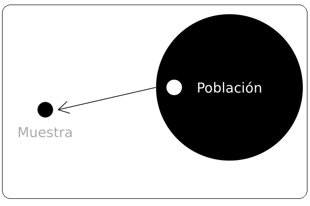

<!-- ARCHIVO GENERADO por tools/clases.py a partir de las diapositivas oficiales. No editar a mano: modifica tools/clases.py o el .tex y vuelve a generar. -->

# Clase 1 · Introducción y repaso de estadística

<div class="usm-session-meta">
<span>📅 Viernes 16 de octubre de 2026</span>
<span>⏱️ 18:40 – 21:25</span>
<span class="usm-tag-gold">Semana 1 · Contenidos 1, 2 y 3 del programa</span>
</div>

!!! info "Contenido oficial de la semana"
    Esta página reproduce **íntegras y en orden** las diapositivas de la cátedra del viernes de la
    semana 1 (`sem1/clase1.tex`). El repaso de estadística (`repaso_ayudantia.tex` y
    `repaso_estadistica.tex`) se trabaja en la ayudantía y tiene su propia página:
    [📘 Ayudantía 1](../ayudantias/ayudantia1.md). Los bloques **Interactivo**, los casos y las
    preguntas son material adicional para estudiar.

!!! example "Cómo estudiar esta página"
    La clase está ordenada en **7 temas**. Cada tema parte con una **pregunta guía**, sigue con las láminas
    y los simuladores, y termina con **✍️ preguntas de selección múltiple** (cada alternativa incorrecta explica
    por qué no lo es) y, en casi todos, un **🧪 ejercicio de R** que puedes editar y ejecutar aquí mismo, sin instalar nada.
    Los 5 ejercicios de R en un solo archivo: [📥 clase1.R](../r/clase1.R).

## 🎯 Objetivos de la sesión

- Entender qué es la econometría y qué tipo de preguntas permite responder.
- Distinguir **correlación** de **causalidad** y el rol del supuesto *ceteris paribus*.
- Reconocer los tipos de datos y los métodos de muestreo.

## 🗓️ Agenda de la cátedra (viernes 18:40 – 21:25)

Haz clic en un tema para ir directo a él.

<ol class="econ-ruta">
<li class="is-break"><span class="econ-ruta-h">18:40</span><span class="econ-ruta-t">🎓 Presentación del curso: programa, evaluaciones, cátedra + ayudantía y trabajo práctico</span></li>
<li><span class="econ-ruta-h">19:00</span><a class="econ-ruta-a" href="#tema-1"><span class="econ-ruta-n">1</span><span class="econ-ruta-t">¿Qué es la econometría?</span><span class="econ-ruta-l">Parte 1 · láminas 1–3 · ✍️ 2 preguntas</span></a></li>
<li><span class="econ-ruta-h">19:25</span><a class="econ-ruta-a" href="#tema-2"><span class="econ-ruta-n">2</span><span class="econ-ruta-t">Correlación no es causalidad</span><span class="econ-ruta-l">Parte 1 · láminas 4–6 · ✍️ 2 preguntas · 🧪 R</span></a></li>
<li class="is-break"><span class="econ-ruta-h">19:55</span><span class="econ-ruta-t">☕ Receso</span></li>
<li><span class="econ-ruta-h">20:05</span><a class="econ-ruta-a" href="#tema-3"><span class="econ-ruta-n">3</span><span class="econ-ruta-t">La econometría en acción</span><span class="econ-ruta-l">Parte 1 · lámina 7 · ✍️ 2 preguntas</span></a></li>
<li><span class="econ-ruta-h">20:25</span><a class="econ-ruta-a" href="#tema-4"><span class="econ-ruta-n">4</span><span class="econ-ruta-t">Tipos de datos</span><span class="econ-ruta-l">Parte 1 · láminas 8–11 · ✍️ 2 preguntas · 🧪 R</span></a></li>
<li><span class="econ-ruta-h">20:50</span><a class="econ-ruta-a" href="#tema-5"><span class="econ-ruta-n">5</span><span class="econ-ruta-t">Población, muestra y parámetros</span><span class="econ-ruta-l">Parte 1 · láminas 12–15 · ✍️ 2 preguntas · 🧪 R</span></a></li>
<li><span class="econ-ruta-h">21:00</span><a class="econ-ruta-a" href="#tema-6"><span class="econ-ruta-n">6</span><span class="econ-ruta-t">Métodos de muestreo</span><span class="econ-ruta-l">Parte 1 · láminas 16–19 · ✍️ 3 preguntas · 🧪 R</span></a></li>
<li><span class="econ-ruta-h">21:15</span><a class="econ-ruta-a" href="#tema-7"><span class="econ-ruta-n">7</span><span class="econ-ruta-t">Estadística descriptiva e inferencial</span><span class="econ-ruta-l">Parte 1 · lámina 20 · ✍️ 2 preguntas · 🧪 R</span></a></li>
<li class="is-break"><span class="econ-ruta-h">21:25</span><span class="econ-ruta-t">✅ Ideas clave, autoevaluación y cierre</span></li>
</ol>

📘 **Ayudantía de la semana** · se trabaja otro día, en su propia página: [Ir a la Ayudantía 1 →](../ayudantias/ayudantia1.md)
{: .econ-ruta-sub }

## Introducción a la econometría { .econ-parte data-eyebrow="Parte 1 · Cátedra" data-toc-label="Parte 1 · Introducción a la econometría" }

<p class="econ-source">📄 Diapositivas: <code>sem1/clase1.tex</code> · 20 láminas</p>

### ¿Qué es la econometría? { #tema-1 .econ-tema data-num="1" data-laminas="Parte 1 · láminas 1–3" data-toc-label="Tema 1 · ¿Qué es la econometría?" }

<p class="econ-tema-q">¿Qué tipo de preguntas podemos responder combinando teoría económica, estadística y datos?</p>

<div class="econ-lamina" markdown>

#### ¿Qué es econometría? { data-lamina="Lámina 1" }

<!-- sem1/clase1.tex · lámina 1 -->

-   Es una disciplina que emplea la teoría económica y métodos estadísticos para contrastar distintas teorías, pronosticar variables y evaluar políticas públicas utilizando bases de datos.

-   Es una aplicación del metodo científico en economía. Nos permite refutar hipótesis económicas.

-   Nos permite contestar preguntas como por ejemplo:

    1.  Cuál es la brecha salarial por género?

    2.  Cuál es el efecto de haber completado la universidad en el salario?

</div>

<div class="econ-lamina" markdown>

#### Econometría moderna { data-lamina="Lámina 2" }

<!-- sem1/clase1.tex · lámina 2 -->

La econometría moderna se enfoca en contestar 3 tipos de preguntas:

-   Estimar como la esperanza condicional de una variable depende de otra.

-   Estimar el impacto causal de una variable sobre la otra.

-   Predecir el comportamento de una variable hacia el futuro.

</div>

<div class="econ-lamina" markdown>

#### Método econométrico { data-lamina="Lámina 3" }

<!-- sem1/clase1.tex · lámina 3 -->

-   Definir objetivo: qué quiero estudiar?

-   Estructura:

    1.  **Modelo Económico:** modelos que explican el comportamiento de una variable económica en función de otras.<br>
        $Y = f (x_1; x_2; ...; x_k)$<br>
        Ejemplo 1: Función de producción $Y = AK^{\alpha}L^{\beta}$<br>
        Ejemplo 2: Retornos educación<br>
        salario = f (educ; experiencia; ingfamiliar ; habilidad)

    2.  **Modelo econométrico:** permite cuantificar, contrastar y evaluar el modelo económico.

        1.  Especificar la funcion f (:).

        2.  Las variables económicas son aleatorias por lo que lo incorporamos con un termino de error:<br>
            $y = f (x_1; x_2;...; x_k) + u$

        3.  Los datos.

</div>

<div class="econ-practica" id="practica-1">
<p class="econ-practica-t"><span>✍️ Practica · Tema 1</span></p>
<div class="econ-quiz">
<p class="econ-quiz-q">¿Cuál de estas preguntas es de <strong>predicción</strong>, uno de los tres tipos de la lámina 2?</p>
<div class="econ-quiz-opts">
<button class="econ-quiz-opt" data-why="Esa es una pregunta de impacto causal.">¿Cuánto aumenta el salario por terminar la universidad?</button>
<button class="econ-quiz-opt" data-correct>¿Cuál será la inflación en Chile el próximo año?</button>
<button class="econ-quiz-opt" data-why="Esa describe una esperanza condicional.">¿Cómo cambia el salario promedio según los años de educación?</button>
</div>
<p class="econ-quiz-fb">✅ Lámina 2: la econometría moderna estima esperanzas condicionales, impactos causales y predicciones.</p>
</div>
<div class="econ-quiz">
<p class="econ-quiz-q">En y = f(x₁, …, xₖ) + u, ¿por qué aparece el término u?</p>
<div class="econ-quiz-opts">
<button class="econ-quiz-opt" data-correct>Porque las variables económicas son aleatorias: hay factores que el modelo no captura.</button>
<button class="econ-quiz-opt" data-why="u puede incluir errores de medición, pero sobre todo reúne los factores que no están en f.">Porque los datos siempre tienen errores de digitación.</button>
<button class="econ-quiz-opt" data-why="u aparece aunque f no sea lineal; por ejemplo, en la función de producción.">Para que el modelo sea lineal.</button>
</div>
<p class="econ-quiz-fb">✅ Lámina 3: el modelo econométrico agrega un término de error al modelo económico.</p>
</div>
</div>

### Correlación no es causalidad { #tema-2 .econ-tema data-num="2" data-laminas="Parte 1 · láminas 4–6" data-toc-label="Tema 2 · Correlación y causalidad" }

<p class="econ-tema-q">Si dos variables se mueven juntas, ¿una causa la otra?</p>

<div class="econ-lamina" markdown>

#### Causalidad y correlación { data-lamina="Lámina 4" }

<!-- sem1/clase1.tex · lámina 4 -->

**Correlación no es causalidad**

-   Muchas veces nos interesa conocer el efecto causal de una variable sobre otra.

-   El concepto **ceteris paribus** es clave para la causalidad: efecto de X sobre Y *manteniendo todos los demas factores relevantes constantes*. Muy difícil en la práctica en ciencias sociales.

-   Vamos a ver en el curso los supuestos necesarios y técnicas para hacerlo.

**Correlación espuria:** existe una relación matemática pero los factores no presentan una relación lógica.

</div>

<div class="econ-widget" data-widget="espuria"></div>

<div class="econ-lamina" markdown>

#### Ejemplo { data-lamina="Láminas 5–6" }

<!-- sem1/clase1.tex · lámina 5 -->

-   Información: En una base de individuos de 35 años de Chile, encuentro que las personas que terminaron la universidad ganan 30% más que las que no la terminaron.

-   Pregunta: De lo anterior, puedo concluir que ir a la universidad causa un aumento del ingreso de los individuos?

<!-- sem1/clase1.tex · lámina 6 -->

??? success "Respuesta"
    No puedo concluir eso.

    -   Ir a la universidad está asociado con un montón de otras características que tambien afectan ingreso.

    -   Por ejemplo, la habilidad, el ingreso de los padres, etc.

</div>

<div class="econ-widget" data-widget="confusores"></div>

<div class="econ-practica" id="practica-2">
<p class="econ-practica-t"><span>✍️ Practica · Tema 2</span></p>
<div class="econ-quiz">
<p class="econ-quiz-q">En los días con más venta de helados hay más ataques de tiburón. ¿Qué lo explica mejor?</p>
<div class="econ-quiz-opts">
<button class="econ-quiz-opt" data-why="No hay un mecanismo lógico: es una correlación espuria.">Los helados atraen a los tiburones.</button>
<button class="econ-quiz-opt" data-correct>Un tercer factor, la temperatura, aumenta ambas cosas.</button>
<button class="econ-quiz-opt" data-why="Una correlación alta no implica causalidad.">Es causal, porque la correlación es muy alta.</button>
</div>
<p class="econ-quiz-fb">✅ El calor lleva a comprar helados y a bañarse en el mar. Manteniendo la temperatura constante (ceteris paribus), la relación desaparece.</p>
</div>
<div class="econ-quiz">
<p class="econ-quiz-q">Las personas de 35 años que terminaron la universidad ganan 30% más. ¿Qué haría falta para afirmar que la universidad <em>causa</em> ese 30%?</p>
<div class="econ-quiz-opts">
<button class="econ-quiz-opt" data-correct>Comparar ceteris paribus: personas iguales en habilidad, ingreso de los padres, etc., que solo difieren en la universidad.</button>
<button class="econ-quiz-opt" data-why="Más datos no eliminan las diferencias entre quienes terminan la universidad y quienes no.">Una muestra más grande.</button>
<button class="econ-quiz-opt" data-why="El tamaño de la diferencia no dice nada sobre su causa.">Que la diferencia fuera mayor a 30%.</button>
</div>
<p class="econ-quiz-fb">✅ Es la respuesta de la lámina 6: ir a la universidad está asociado con otras características que también afectan el ingreso.</p>
</div>
</div>

<div class="econ-r" markdown>

<p class="econ-r-t">🧪 Practica en R · Helados, tiburones y temperatura</p>

Simula 200 días en que la temperatura aumenta las ventas de helados y los ataques de tiburón, pero los helados **no** afectan los ataques. Compara la regresión con y sin la temperatura.

```r
# Un día caluroso hace que se vendan más helados Y que más gente se bañe en el mar
set.seed(1)
dias        <- 200
temperatura <- runif(dias, 10, 35)
helados     <- 20 + 3 * temperatura + rnorm(dias, sd = 8)
ataques     <- 0.1 * temperatura + rnorm(dias, sd = 0.5)  # sin helados

cor(helados, ataques)                        # correlación alta…
coef(lm(ataques ~ helados))["helados"]       # …y pendiente positiva
coef(lm(ataques ~ helados + temperatura))    # con temperatura fija: ≈ 0

plot(helados, ataques, pch = 19, col = "steelblue",
     main = "¿Los helados provocan ataques de tiburón?")
```

**🎯 Reto:** cambia `0.1 * temperatura` por `0 * temperatura`. ¿Qué pasa con la correlación entre helados y ataques?
{: .econ-r-reto }

</div>

### La econometría en acción { #tema-3 .econ-tema data-num="3" data-laminas="Parte 1 · lámina 7" data-toc-label="Tema 3 · Econometría aplicada" }

<p class="econ-tema-q">¿Cómo ayuda la econometría a decidir qué políticas funcionan?</p>

<div class="econ-lamina" markdown>

#### Econometría como herramienta aplicada { data-lamina="Lámina 7" }

<!-- sem1/clase1.tex · lámina 7 -->

-   **Pregunta: como solucionamos problemas de worms intestinales en Africa?**<br>
    Miguel y Kremer (2004), *Worms: Identifying Impacts on Education and Health in the Presence of Treatment Externalities*: Encuentran que repartir pildoras en colegios, mejora la salud, reduce el ausentismo educacional no solo de los tratados sino también de sus vecinos. Gracias a estos estudios la iniciativa deworming the world recauda billones de dólares para esta política.

-   **Pregunta: las consultoras de management pueden mejorar la productividad de las firmas?**

    Bloom et al. (2017) *Increasing Firm Productivity through Management Consulting Services in India*: Muestra que si y lo cuantifica.

    [ **JPAL**](https://www.povertyactionlab.org/evaluation/increasing-firm-productivity-through-management-consulting-services-india)

</div>

<div class="econ-widget" data-widget="casos-reales"></div>

<div class="econ-practica" id="practica-3">
<p class="econ-practica-t"><span>✍️ Practica · Tema 3</span></p>
<div class="econ-quiz">
<p class="econ-quiz-q">Según Miguel y Kremer (2004), ¿qué pasó al repartir pastillas antiparasitarias en colegios?</p>
<div class="econ-quiz-opts">
<button class="econ-quiz-opt" data-correct>Mejoró la salud y bajó el ausentismo escolar, no solo de los tratados sino también de sus vecinos.</button>
<button class="econ-quiz-opt" data-why="El estudio encontró efectos también en los vecinos de los tratados: externalidades.">Solo mejoró la salud de quienes tomaron la pastilla.</button>
<button class="econ-quiz-opt" data-why="La lámina 7 resume efectos en salud y asistencia que impulsaron la iniciativa Deworm the World.">No tuvo efectos medibles.</button>
</div>
<p class="econ-quiz-fb">✅ Por eso el título habla de <em>Treatment Externalities</em>: el tratamiento también beneficia a quienes no lo recibieron.</p>
</div>
<div class="econ-quiz">
<p class="econ-quiz-q">¿Qué tienen en común el estudio de Worms y el de consultorías en India (Bloom et al.)?</p>
<div class="econ-quiz-opts">
<button class="econ-quiz-opt" data-correct>En ambos, el tratamiento se asignó por sorteo para medir su efecto causal.</button>
<button class="econ-quiz-opt" data-why="Ambos comparan grupos de colegios o empresas, no una sola serie en el tiempo.">Ambos usan solo series de tiempo.</button>
<button class="econ-quiz-opt" data-why="Justamente, al sortear el tratamiento pueden interpretar la diferencia como causal.">Ambos miden solo correlaciones.</button>
</div>
<p class="econ-quiz-fb">✅ Son experimentos aleatorizados: la herramienta que veremos en la Clase 3 para eliminar el sesgo de selección.</p>
</div>
</div>

### Tipos de datos { #tema-4 .econ-tema data-num="4" data-laminas="Parte 1 · láminas 8–11" data-toc-label="Tema 4 · Tipos de datos" }

<p class="econ-tema-q">¿De dónde vienen los datos y qué forma tienen?</p>

<div class="econ-lamina" markdown>

#### Tipos de Datos { data-lamina="Láminas 8–11" }

<!-- sem1/clase1.tex · lámina 8 -->

-   **Experimentales**: el investigador asigna en forma aleatoria la exposición.

-   **Pseudo-experimental**: el investigador controla la exposición pero no asigna en forma aleatoria.

-   **Observacional (o no-experimental)**: el investigador no controla la exposición, depende de variables que el no controla.

**Rara vez usa datos experimentales extremadamente caros, problemas éticos.**

<!-- sem1/clase1.tex · lámina 9 -->

**Corte transversal:** Muestra de individuos, hogares, empresas, regiones, países, etc., recolectados en un tiempo dado. A veces el estudio no se realiza exactamente en el mismo periodo de tiempo para todos las unidades evaluadas, pero diferencias temporales menores se ignoran. Se asume que los datos fueron obtenidos por muestreo aleatorio (random sampling) desde la población subyacente.

<!-- sem1/clase1.tex · lámina 10 -->

**Series de tiempo:** Observaciones de una o más variables en el tiempo. Ej. Precios de acciones, dólar, IPC, ventas de automóviles, etc. Eventos pasados influencian eventos futuros. Rezagos en el comportamiento son prevalentes en ciencias sociales. Tiempo es una dimensión importante en datos de series de tiempo. Frecuencia $\Delta$ tiempo=1, día, año, semestre, trimestre, etc. A diferencia de datos de corte transversal, datos de series de tiempo no pueden asumirse independientes.

<!-- sem1/clase1.tex · lámina 11 -->

**Datos longitudinales o de panel:** Consiste en una serie de tiempo para cada miembro del set de datos. Ejemplo: 10 años de datos de salario, educación y empleo sobre un set de individuos. Diferencias con los anteriores es que los mismos individuos, firmas o países, son seguidos por varios años.

Varias ventajas: Control de ciertas características no observadas de individuos, firmas, etc. Facilita estudios de causa-efecto (inferencia causal). Permite estudiar los efectos del rezago en el comportamiento o resultado.

</div>

<div class="econ-widget" data-widget="tipos-datos"></div>

<div class="econ-practica" id="practica-4">
<p class="econ-practica-t"><span>✍️ Practica · Tema 4</span></p>
<div class="econ-quiz">
<p class="econ-quiz-q">Tienes el PIB trimestral de Chile, Perú y Colombia entre 2000 y 2024. ¿Qué tipo de datos son?</p>
<div class="econ-quiz-opts">
<button class="econ-quiz-opt" data-why="Sería corte transversal si fuera un solo período para muchos países.">Corte transversal</button>
<button class="econ-quiz-opt" data-why="Sería una serie de tiempo si fuera un solo país.">Series de tiempo</button>
<button class="econ-quiz-opt" data-correct>Datos de panel</button>
</div>
<p class="econ-quiz-fb">✅ Es un <strong>panel</strong>: las mismas unidades (3 países) observadas en muchos períodos.</p>
</div>
<div class="econ-quiz">
<p class="econ-quiz-q">Una empresa sortea qué sucursales reciben un nuevo sistema de incentivos y compara las ventas. ¿Qué tipo de datos genera?</p>
<div class="econ-quiz-opts">
<button class="econ-quiz-opt" data-correct>Experimentales</button>
<button class="econ-quiz-opt" data-why="Serían pseudo-experimentales si el gerente eligiera las sucursales sin sorteo.">Pseudo-experimentales</button>
<button class="econ-quiz-opt" data-why="Serían observacionales si cada sucursal decidiera si adoptarlo.">Observacionales</button>
</div>
<p class="econ-quiz-fb">✅ La exposición la asigna el investigador <strong>en forma aleatoria</strong>: es un experimento (lámina 8).</p>
</div>
</div>

<div class="econ-r" markdown>

<p class="econ-r-t">🧪 Practica en R · Tres formas de datos</p>

Arma un ejemplo pequeño de cada tipo de datos de las láminas 9 a 11 y fíjate en qué cambia: las unidades, los períodos o ambos.

```r
set.seed(4)
# Corte transversal: muchas unidades en un mismo momento
corte <- data.frame(persona = c("Ana", "Beto", "Carla"),
                    salario = c(850, 620, 1100), anio = 2024)
# Serie de tiempo: una unidad a lo largo del tiempo
serie <- data.frame(anio = 2020:2024,
                    dolar = c(792, 759, 873, 840, 944))  # promedio anual aprox.
# Panel: las MISMAS unidades en varios momentos
panel <- expand.grid(persona = c("Ana", "Beto", "Carla"), anio = 2022:2024)
panel$salario <- round(700 + 60 * (panel$anio - 2022) + rnorm(9, sd = 40))

corte
serie
panel
table(panel$persona)   # cada persona aparece una vez por año
```

**🎯 Reto:** agrega el año 2025 al panel (cambia `2022:2024` por `2022:2025` y `9` por `12`). ¿Cuántas filas tiene ahora?
{: .econ-r-reto }

</div>

### Población, muestra y parámetros { #tema-5 .econ-tema data-num="5" data-laminas="Parte 1 · láminas 12–15" data-toc-label="Tema 5 · Población y muestra" }

<p class="econ-tema-q">¿Cómo podemos conocer a toda una población mirando solo una parte?</p>

<div class="econ-lamina" markdown>

#### Muestreo { data-lamina="Láminas 12–13" }

<!-- sem1/clase1.tex · lámina 12 -->

Los datos experimentales son obtenidos sobre conjuntos de individuos u objetos, sobre los cuales se quiere conocer algunas características.

Llamaremos **unidad de observación** a estos individuos y la totalidad de estas unidades de observación se denomina **población.**

El Muestreo es la disciplina que trata con el conjunto de métodos, técnicas y procedimientos para tomar u obtener una muestra particular de la población a efecto de realizar inferencias a partir de la misma.

<!-- sem1/clase1.tex · lámina 13 -->

Se dice que una muestra es representativa de una población si toda unidad de observación podrá aparecer en la muestra, y esto con una probabilidad conocida.

{ .econ-slide-img }

</div>

<div class="econ-widget" data-widget="sopa"></div>

<div class="econ-lamina" markdown>

#### ¿Por qué muestrear la población? { data-lamina="Lámina 14" }

<!-- sem1/clase1.tex · lámina 14 -->

-   Imposibilidad física de chequear todos los ítems en la población.

-   El costo de estudiar todos los elementos en la población.

-   Los resultados del muestreo son normalmente adecuados.

</div>

<div class="econ-lamina" markdown>

#### Objetivos del muestreo { data-lamina="Lámina 15" }

<!-- sem1/clase1.tex · lámina 15 -->

**Estimar los parámetros de la población.**

-   Variable: lo que se desea medir en la muestra. Ej. Nivel de educación, nivel de ingresos, etc.

-   Parámetros: valor numérico que describe una característica de una población completa. Promedio, desviación estándar, betas, etc.

-   Estadístico: calculado sobre la muestra.

-   Los parámetros normalmente son desconocidos, se estiman a través del estadístico.

</div>

<div class="econ-practica" id="practica-5">
<p class="econ-practica-t"><span>✍️ Practica · Tema 5</span></p>
<div class="econ-quiz">
<p class="econ-quiz-q">El ingreso promedio de <em>todos</em> los hogares de Chile es un…</p>
<div class="econ-quiz-opts">
<button class="econ-quiz-opt" data-correct>Parámetro</button>
<button class="econ-quiz-opt" data-why="Un estadístico se calcula sobre una muestra.">Estadístico</button>
<button class="econ-quiz-opt" data-why="La variable es el ingreso; su promedio en toda la población es el parámetro.">Variable</button>
</div>
<p class="econ-quiz-fb">✅ Lámina 15: los parámetros describen a la población y normalmente se estiman con estadísticos muestrales.</p>
</div>
<div class="econ-quiz">
<p class="econ-quiz-q">Una fábrica de ampolletas quiere saber cuántas horas duran. ¿Por qué no las prueba todas?</p>
<div class="econ-quiz-opts">
<button class="econ-quiz-opt" data-correct>Porque probarlas implica gastarlas: revisar toda la población es imposible en la práctica.</button>
<button class="econ-quiz-opt" data-why="Un censo perfecto sería exacto; se muestrea por costo o imposibilidad.">Porque una muestra siempre es más exacta que la población.</button>
<button class="econ-quiz-opt" data-why="No hay tal regla: se muestrea por razones prácticas.">Porque la estadística lo prohíbe.</button>
</div>
<p class="econ-quiz-fb">✅ Lámina 14: imposibilidad física, costo y resultados que normalmente son adecuados.</p>
</div>
</div>

<div class="econ-r" markdown>

<p class="econ-r-t">🧪 Practica en R · Muestra grande pero sesgada</p>

Una población de 100 000 votantes. Compara una muestra enorme tomada solo entre quienes tienen teléfono con una pequeña muestra aleatoria.

```r
set.seed(1936)
N <- 100000
# Población: quienes tienen teléfono (más ricos) prefieren más al candidato A
telefono <- rbinom(N, 1, 0.35)
vota_A   <- rbinom(N, 1, ifelse(telefono == 1, 0.60, 0.30))
mean(vota_A)                 # parámetro (en la práctica, desconocido)

grande_sesgada <- sample(which(telefono == 1), 20000)  # solo con teléfono
pequena_azar   <- sample(N, 1000)                      # aleatoria simple
c(sesgada_n20000 = mean(vota_A[grande_sesgada]),
  azar_n1000     = mean(vota_A[pequena_azar]))
```

**🎯 Reto:** aumenta la muestra sesgada de `20000` a `30000`. ¿Se acerca al parámetro?
{: .econ-r-reto }

</div>

### Métodos de muestreo { #tema-6 .econ-tema data-num="6" data-laminas="Parte 1 · láminas 16–19" data-toc-label="Tema 6 · Métodos de muestreo" }

<p class="econ-tema-q">¿Cuál es la mejor manera de elegir la muestra?</p>

<div class="econ-lamina" markdown>

#### Muestreo aleatorio { data-lamina="Láminas 16–17" }

<!-- sem1/clase1.tex · lámina 16 -->

-   **Muestreo aleatorio simple:** muestra seleccionada de manera que cada elemento o individuo de la población tenga las mismas posibilidades de que se le incluya.

-   **Muestreo aleatorio sistemático:** Los elementos o individuos de la población se ordenan de alguna manera. Se selecciona un punto aleatorio de inicio y posteriormente se elige cada k-esimo miembro de la población. A nivel técnico, el muestreo sistemático no crea una muestra verdaderamente aleatoria. Sólo la selección del primer elemento de muestreo sistemático es una selección de probabilidad. Una vez que el primer elemento es seleccionado, algunos de los elementos tendrán una probabilidad cero de selección.

<!-- sem1/clase1.tex · lámina 17 -->

-   **Muestreo aleatorio estratificado:** La población se divide en subgrupos denominados estratos y se selecciona al azar una muestra de cada estrato.

-   **Muestreo por conglomerados (cluster):** La población se divide en conglomerados a partir de límites geográficos o de otra clase. Luego se seleccionan los conglomerados al azar y se toma una muestra aleatoria con elementos de cada grupo.

</div>

<div class="econ-widget" data-widget="muestreo-casos"></div>

<div class="econ-lamina" markdown>

#### Muestreo Estratificado vs. Muestreo por Conglomerados { data-lamina="Lámina 18" }

<!-- sem1/clase1.tex · lámina 18 -->

**Muestreo Estratificado**<br>
<svg class="econ-tikz-svg" viewBox="0 0 130 112" role="img" aria-label="Tres estratos homogéneos, uno por color"><rect x="6" y="4" width="118" height="28" fill="none" stroke="currentColor"/><circle cx="24" cy="18" r="9" fill="#2a9d55" stroke="currentColor"/><circle cx="64" cy="18" r="9" fill="#2a9d55" stroke="currentColor"/><circle cx="104" cy="18" r="9" fill="#2a9d55" stroke="currentColor"/><rect x="6" y="38" width="118" height="28" fill="none" stroke="currentColor"/><circle cx="24" cy="52" r="9" fill="#1d4ed8" stroke="currentColor"/><circle cx="64" cy="52" r="9" fill="#1d4ed8" stroke="currentColor"/><circle cx="104" cy="52" r="9" fill="#1d4ed8" stroke="currentColor"/><rect x="6" y="72" width="118" height="28" fill="none" stroke="currentColor"/><circle cx="24" cy="86" r="9" fill="#d62828" stroke="currentColor"/><circle cx="64" cy="86" r="9" fill="#d62828" stroke="currentColor"/><circle cx="104" cy="86" r="9" fill="#d62828" stroke="currentColor"/></svg>
Cada estrato es homogéneo. Se selecciona muestra dentro de cada uno.

**Muestreo por Conglomerados**<br>
<svg class="econ-tikz-svg" viewBox="0 0 240 70" role="img" aria-label="Tres conglomerados heterogéneos con varios colores cada uno"><rect x="10" y="6" width="58" height="58" fill="none" stroke="currentColor" stroke-width="2"/><circle cx="22" cy="35" r="9" fill="#d62828"/><circle cx="39" cy="18" r="9" fill="#1d4ed8"/><circle cx="56" cy="35" r="9" fill="#2a9d55"/><circle cx="39" cy="52" r="9" fill="#1d4ed8"/><rect x="86" y="6" width="58" height="58" fill="none" stroke="currentColor" stroke-width="2"/><circle cx="98" cy="35" r="9" fill="#d62828"/><circle cx="115" cy="18" r="9" fill="#1d4ed8"/><circle cx="132" cy="35" r="9" fill="#2a9d55"/><circle cx="115" cy="52" r="9" fill="#1d4ed8"/><rect x="162" y="6" width="58" height="58" fill="none" stroke="currentColor" stroke-width="2"/><circle cx="174" cy="35" r="9" fill="#d62828"/><circle cx="191" cy="18" r="9" fill="#1d4ed8"/><circle cx="208" cy="35" r="9" fill="#2a9d55"/><circle cx="191" cy="52" r="9" fill="#1d4ed8"/></svg>
Cada conglomerado es heterogéneo. Se seleccionan grupos completos.

**Comparación Clave**

-   **Estratos:** Internamente homogéneos. Se muestrea dentro de cada grupo.

-   **Conglomerados:** Internamente heterogéneos. Se seleccionan grupos enteros.

</div>

<div class="econ-widget" data-widget="muestreo"></div>

<div class="econ-lamina" markdown>

#### Muestreo no probabilístico { data-lamina="Lámina 19" }

<!-- sem1/clase1.tex · lámina 19 -->

-   En muestreo no probabilístico inclusión en la muestra es basada en el juicio de la persona que selecciona los individuos o elementos.

</div>

<div class="econ-widget" data-widget="no-prob"></div>

<div class="econ-widget" data-widget="digest"></div>

<div class="econ-practica" id="practica-6">
<p class="econ-practica-t"><span>✍️ Practica · Tema 6</span></p>
<div class="econ-quiz">
<p class="econ-quiz-q">Sorteas uno de los primeros 10 clientes de una lista y luego eliges a cada décimo cliente. ¿Qué método es?</p>
<div class="econ-quiz-opts">
<button class="econ-quiz-opt" data-why="En el simple todas las muestras posibles tienen la misma probabilidad; aquí solo se sortea el punto de inicio.">Aleatorio simple</button>
<button class="econ-quiz-opt" data-correct>Aleatorio sistemático</button>
<button class="econ-quiz-opt" data-why="No se eligen grupos completos.">Por conglomerados</button>
</div>
<p class="econ-quiz-fb">✅ Lámina 16: se ordena la población, se elige un inicio al azar y luego cada k-ésimo elemento.</p>
</div>
<div class="econ-quiz">
<p class="econ-quiz-q">Quieres estimar el ingreso promedio en Santiago. Las comunas son muy distintas entre sí, pero bastante homogéneas por dentro. ¿Qué método es más preciso para un mismo n?</p>
<div class="econ-quiz-opts">
<button class="econ-quiz-opt" data-correct>Estratificado por comuna</button>
<button class="econ-quiz-opt" data-why="Los conglomerados funcionan bien cuando cada grupo es heterogéneo, como un mini reflejo de la población.">Por conglomerados (sortear algunas comunas)</button>
<button class="econ-quiz-opt" data-why="Sin selección aleatoria, la muestra no es representativa.">No probabilístico, en lugares concurridos</button>
</div>
<p class="econ-quiz-fb">✅ Grupos homogéneos por dentro y distintos entre sí funcionan como <strong>estratos</strong>: muestrear en todos reduce la varianza (lámina 18).</p>
</div>
<div class="econ-quiz">
<p class="econ-quiz-q">El Literary Digest encuestó a más de 2 millones de personas y se equivocó. ¿Por qué?</p>
<div class="econ-quiz-opts">
<button class="econ-quiz-opt" data-correct>La muestra no era representativa: muchas personas no podían aparecer en ella.</button>
<button class="econ-quiz-opt" data-why="Era gigantesca; el tamaño no corrige un mal método de selección.">La muestra era demasiado pequeña.</button>
<button class="econ-quiz-opt" data-why="El problema principal fue quién podía ser encuestado.">Los encuestados mintieron.</button>
</div>
<p class="econ-quiz-fb">✅ Lámina 13: una muestra es representativa si toda unidad puede aparecer con una probabilidad conocida.</p>
</div>
</div>

<div class="econ-r" markdown>

<p class="econ-r-t">🧪 Practica en R · Estratificado contra aleatorio simple</p>

Simula tres comunas con ingresos muy distintos y compara 2 000 muestras de cada método: ¿cuál se equivoca menos?

```r
set.seed(18)
# Ingresos en 3 comunas muy distintas entre sí, pero parecidas por dentro
comuna  <- rep(c("A", "B", "C"), each = 2000)
ingreso <- c(rnorm(2000, 500, 50), rnorm(2000, 900, 60),
             rnorm(2000, 1600, 80))
mean(ingreso)                                  # parámetro

simple <- replicate(2000, mean(sample(ingreso, 60)))
estratificado <- replicate(2000, mean(c(
  sample(ingreso[comuna == "A"], 20),
  sample(ingreso[comuna == "B"], 20),
  sample(ingreso[comuna == "C"], 20))))
c(simple = sd(simple), estratificado = sd(estratificado))  # error típico

boxplot(list(Simple = simple, Estratificado = estratificado),
        ylab = "Promedio estimado (n = 60)")
abline(h = mean(ingreso), lty = 2)
```

**🎯 Reto:** haz que las comunas se parezcan (cambia `500` y `1600` por `900`). ¿Sigue ganando el estratificado?
{: .econ-r-reto }

</div>

### Estadística descriptiva e inferencial { #tema-7 .econ-tema data-num="7" data-laminas="Parte 1 · lámina 20" data-toc-label="Tema 7 · Descriptiva e inferencial" }

<p class="econ-tema-q">¿Cuándo una conclusión vale solo para los datos y cuándo para toda la población?</p>

<div class="econ-lamina" markdown>

#### Estadística descriptiva e inferencial { data-lamina="Lámina 20" }

<!-- sem1/clase1.tex · lámina 20 -->

-   **Estadística Descriptiva o Deductiva.**

    Si al analizar una muestra sólo se obtenemos conclusiones válidas para la muestra sin que se puedan o se requieran generalizar sus resultados para toda la población.

-   **Estadística Inductiva o Inferencial.**

    A partir de una muestra, podemos inferir conclusiones estadísticamente válidas para todo la población.

</div>

<div class="econ-practica" id="practica-7">
<p class="econ-practica-t"><span>✍️ Practica · Tema 7</span></p>
<div class="econ-quiz">
<p class="econ-quiz-q">Un profesor calcula el promedio de notas de <em>su</em> curso para informárselo al curso. ¿Qué estadística usa?</p>
<div class="econ-quiz-opts">
<button class="econ-quiz-opt" data-correct>Descriptiva: la conclusión vale solo para ese curso.</button>
<button class="econ-quiz-opt" data-why="Sería inferencial si usara su curso para concluir algo sobre todos los estudiantes del país.">Inferencial</button>
</div>
<p class="econ-quiz-fb">✅ Lámina 20: la estadística descriptiva saca conclusiones válidas solo para la muestra analizada.</p>
</div>
<div class="econ-quiz">
<p class="econ-quiz-q">Con una encuesta a 1 000 personas estimas la tasa de desempleo del país y su intervalo de confianza. ¿Qué estadística usas?</p>
<div class="econ-quiz-opts">
<button class="econ-quiz-opt" data-correct>Inferencial</button>
<button class="econ-quiz-opt" data-why="Estás generalizando de la muestra a toda la población.">Descriptiva</button>
</div>
<p class="econ-quiz-fb">✅ Generalizar a la población con un margen de error es inferencia: es lo que repasa la ayudantía.</p>
</div>
</div>

<div class="econ-r" markdown>

<p class="econ-r-t">🧪 Practica en R · Describir e inferir</p>

Con 36 meses de ventas, primero describe la muestra y luego infiere la media poblacional, como en el ejemplo de la ayudantía.

```r
set.seed(7)
ventas <- round(rnorm(36, mean = 200, sd = 60))   # 36 meses de ventas

# Descriptiva: resume ESTA muestra
summary(ventas)
sd(ventas)

# Inferencial: dice algo de la POBLACIÓN (la media μ, que no conocemos)
mean(ventas) + c(-1, 1) * 1.96 * 60 / sqrt(36)    # IC 95%, σ = 60 conocido
```

**🎯 Reto:** cambia los dos `36` por `144`. ¿Qué pasa con el ancho del intervalo?
{: .econ-r-reto }

</div>

---

!!! abstract "🧠 Ideas clave"
    - La econometría combina **teoría económica y estadística** para describir relaciones, estimar efectos causales y predecir.
    - **Correlación no es causalidad**: un efecto causal compara situaciones *ceteris paribus* (helados, tiburones y temperatura).
    - Los datos pueden ser **experimentales u observacionales**, y de **corte transversal, series de tiempo o panel**.
    - Lo que hace representativa a una muestra es **cómo se elige** (aleatoriamente), no su tamaño: la sopa revuelta y el Literary Digest.

## ✅ Autoevaluación

<div class="econ-quiz">
<p class="econ-quiz-q">Los barrios con más bomberos registran más incendios. ¿Qué concluyes?</p>
<div class="econ-quiz-opts">
<button class="econ-quiz-opt" data-why="No hay un mecanismo lógico para eso: es la misma trampa de los helados y los tiburones.">Que los bomberos provocan incendios.</button>
<button class="econ-quiz-opt" data-correct>Que probablemente un tercer factor (barrios más grandes o con más riesgo) aumenta ambas cosas.</button>
<button class="econ-quiz-opt" data-why="La correlación no permite concluir nada causal, ni a favor ni en contra.">Que la relación prueba que los bomberos no sirven.</button>
</div>
<p class="econ-quiz-fb">✅ Correlación no es causalidad: hay que comparar barrios <em>ceteris paribus</em>.</p>
</div>

<div class="econ-quiz">
<p class="econ-quiz-q">Una encuesta por Instagram sobre uso de redes sociales recibe 50 000 respuestas. ¿Es representativa de los chilenos?</p>
<div class="econ-quiz-opts">
<button class="econ-quiz-opt" data-correct>No: responde quien quiere y quien ve la publicación; es un muestreo no probabilístico.</button>
<button class="econ-quiz-opt" data-why="El tamaño no corrige la forma de selección: es el error del Literary Digest.">Sí, porque 50 000 es una muestra enorme.</button>
<button class="econ-quiz-opt" data-why="Ponderar ayuda, pero quienes nunca ven la publicación no pueden aparecer en la muestra.">Sí, si se pondera por edad.</button>
</div>
<p class="econ-quiz-fb">✅ Una muestra es representativa si toda unidad puede aparecer con probabilidad conocida (lámina 13).</p>
</div>

<div class="econ-quiz">
<p class="econ-quiz-q">Tienes las notas de los mismos 200 estudiantes en cada semestre durante 4 años. ¿Qué tipo de datos son?</p>
<div class="econ-quiz-opts">
<button class="econ-quiz-opt" data-why="Habría un solo período.">Corte transversal</button>
<button class="econ-quiz-opt" data-why="Habría una sola unidad.">Serie de tiempo</button>
<button class="econ-quiz-opt" data-correct>Datos de panel</button>
</div>
<p class="econ-quiz-fb">✅ Las mismas unidades observadas en varios períodos: un panel (lámina 11).</p>
</div>

## 📚 Para la próxima clase

- **Wooldridge**, capítulo 1 (*La naturaleza de la econometría y los datos económicos*).
- 📘 En la **[Ayudantía 1](../ayudantias/ayudantia1.md)** se repasa la estadística que usaremos todo el curso
  (Wooldridge, apéndice C).
- Próxima clase: **Regresión lineal simple**.
