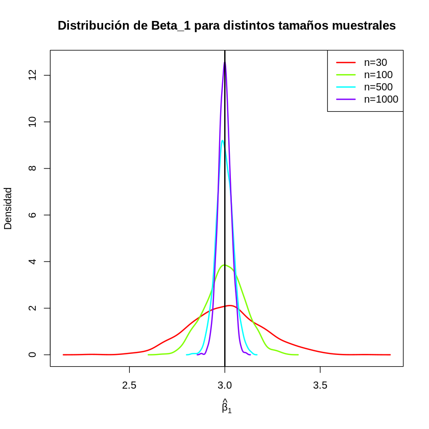
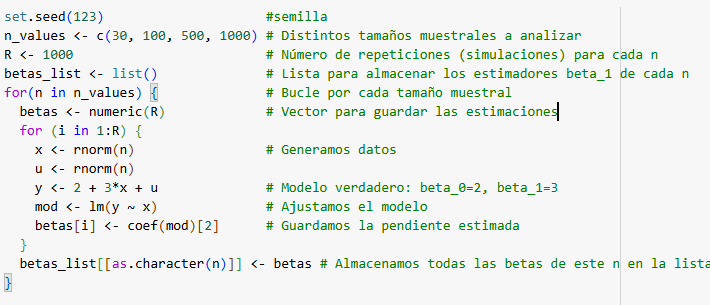

<!-- ARCHIVO GENERADO por tools/clases.py a partir de las diapositivas oficiales. No editar a mano: modifica tools/clases.py o el .tex y vuelve a generar. -->

# Clase 10 · Propiedades asintóticas

<div class="usm-session-meta">
<span>📅 Viernes 18 de diciembre de 2026</span>
<span>⏱️ 18:40 – 21:25</span>
<span class="usm-tag-gold">Semana 10 · Contenido 5 · Análisis de regresión múltiple</span>
<span class="usm-tag-red">📝 Semana del Certamen 2 (lunes 14)</span>
</div>

!!! info "Contenido oficial de la semana"
    Esta página reproduce **íntegras y en orden** las diapositivas de la cátedra del viernes de la
    semana 10 (`sem10/clase11.tex`, 17 láminas). Los bloques **Interactivo**, los casos y las preguntas
    son material adicional para estudiar.

!!! example "Cómo estudiar esta página"
    La clase está ordenada en **4 temas**. Cada tema parte con una **pregunta guía**, sigue con las láminas
    y los simuladores, y termina con **✍️ preguntas de selección múltiple** (cada alternativa incorrecta explica
    por qué no lo es) y un **🧪 ejercicio de R** que puedes editar y ejecutar aquí mismo, sin instalar nada.
    Los 4 ejercicios de R en un solo archivo: [📥 clase10.R](../r/clase10.R).

## 🎯 Objetivos de la sesión

- Distinguir propiedades de **muestra finita** (insesgamiento) de propiedades **asintóticas** (consistencia).
- Entender la **consistencia** de MCO y por qué basta la exogeneidad débil $E(x'u) = 0$.
- Usar la **normalidad asintótica** para justificar tests e intervalos aunque $u$ no sea normal.
- Conocer la **eficiencia asintótica** de MCO y qué cambia con heterocedasticidad.

## 🗓️ Agenda de la cátedra (viernes 18:40 – 21:25)

Haz clic en un tema para ir directo a él.

<ol class="econ-ruta">
<li><span class="econ-ruta-h">18:40</span><a class="econ-ruta-a" href="#tema-1"><span class="econ-ruta-n">1</span><span class="econ-ruta-t">Muestras grandes y los supuestos de la consistencia</span><span class="econ-ruta-l">láminas 1–4 · ✍️ 2 preguntas · 🧪 R</span></a></li>
<li><span class="econ-ruta-h">19:05</span><a class="econ-ruta-a" href="#tema-2"><span class="econ-ruta-n">2</span><span class="econ-ruta-t">¿Qué es la consistencia?</span><span class="econ-ruta-l">láminas 5–6 · ✍️ 2 preguntas · 🧪 R</span></a></li>
<li><span class="econ-ruta-h">19:25</span><a class="econ-ruta-a" href="#tema-3"><span class="econ-ruta-n">3</span><span class="econ-ruta-t">Normalidad asintótica y sus consecuencias</span><span class="econ-ruta-l">láminas 7–10 · ✍️ 2 preguntas · 🧪 R</span></a></li>
<li class="is-break"><span class="econ-ruta-h">19:55</span><span class="econ-ruta-t">☕ Receso</span></li>
<li><span class="econ-ruta-h">20:05</span><a class="econ-ruta-a" href="#tema-4"><span class="econ-ruta-n">4</span><span class="econ-ruta-t">Eficiencia asintótica, resumen y aplicación</span><span class="econ-ruta-l">láminas 11–17 · ✍️ 2 preguntas · 🧪 R</span></a></li>
<li class="is-break"><span class="econ-ruta-h">21:00</span><span class="econ-ruta-t">🧪 Práctica guiada con R y cierre</span></li>
</ol>

## Propiedades asintóticas { .econ-parte data-eyebrow="Parte 1 · Cátedra" data-toc-label="Parte 1 · Propiedades asintóticas" }

<p class="econ-source">📄 Diapositivas: <code>sem10/clase11.tex</code> · 17 láminas</p>

### Muestras grandes y los supuestos de la consistencia { #tema-1 .econ-tema data-num="1" data-laminas="láminas 1–4" data-toc-label="Tema 1 · Muestras grandes" }

<p class="econ-tema-q">¿Qué le pasa a MCO cuando la muestra crece sin límite?</p>

<div class="econ-lamina" markdown>

#### Introducción { data-lamina="Lámina 1" }

<!-- sem10/clase11.tex · lámina 1 -->

**Pregunta clave:** ¿Cómo se comporta el estimador de MCO cuando el tamaño de la muestra crece indefinidamente?

-   El análisis asintótico nos permite estudiar el comportamiento del estimador en muestras grandes.

-   Es útil para justificar inferencias cuando la normalidad exacta de los errores no se cumple.

</div>

<div class="econ-lamina" markdown>

#### Muestras finitas vs. muestras grandes { data-lamina="Lámina 2" }

<!-- sem10/clase11.tex · lámina 2 -->

-   Propiedades de muestras finitas: válidas para cualquier $n$, como la insesgadez bajo Gauss-Markov.

-   Propiedades asintóticas: válidas cuando $n \to \infty$.

-   Nos interesa estudiar el comportamiento de los estimadores cuando el tamaño de la muestra crece.

</div>

<div class="econ-lamina" markdown>

#### Supuestos para la consistencia de MCO { data-lamina="Lámina 3" }

<!-- sem10/clase11.tex · lámina 3 -->

-   1\) Linealidad en los parámetros.

-   2\) Muestreo aleatorio.

-   3\) No hay multicolinealidad perfecta.

-   4\) Exogeneidad: $E[u | x_1, x_2, x_3, ..., x_k] = 0$

Estos supuestos son los mismos del insesgamiento.

No asumimos que la distribución de los u es normal.

</div>

<div class="econ-lamina" markdown>

#### Un supuesto 4': exogeneidad débil { data-lamina="Lámina 4" }

<!-- sem10/clase11.tex · lámina 4 -->

-   Para la **consistencia** basta con

    $$
    E(x_i' u_i) = 0 \quad \text{(no correlación / exogeneidad débil)}
    $$

-   Una manera de caracterizar el supuesto de media condicional cero, $E(u|x_1, ..., x_k)=0$ es que ninguna **función** de las variables explicativas está correlacionada con u. El supuesto 4' sólo requiere que ninguna $x_j$ esté correlacionada con u.

-   Consecuencia práctica: la **omisión de variables relevantes** correlacionadas con los regresores incluidos genera **inconsistencia** (no solo sesgo), y ese sesgo asintótico *no desaparece* al aumentar $n$.

</div>

<div class="econ-practica" id="practica-1">
<p class="econ-practica-t"><span>✍️ Practica · Tema 1</span></p>
<div class="econ-quiz">
<p class="econ-quiz-q">¿Qué supuesto es suficiente para la consistencia de MCO, según la lámina 4?</p>
<div class="econ-quiz-opts">
<button class="econ-quiz-opt" data-correct>E(x′u) = 0: que las x no estén correlacionadas con el error.</button>
<button class="econ-quiz-opt" data-why="La consistencia no requiere normalidad (lámina 3).">Que u sea normal.</button>
<button class="econ-quiz-opt" data-why="La homocedasticidad no se necesita para la consistencia.">Homocedasticidad.</button>
</div>
<p class="econ-quiz-fb">✅ Es la exogeneidad débil, más débil que E(u | x) = 0.</p>
</div>
<div class="econ-quiz">
<p class="econ-quiz-q">Si se omite una variable relevante correlacionada con x, al aumentar n…</p>
<div class="econ-quiz-opts">
<button class="econ-quiz-opt" data-correct>…el sesgo no desaparece: MCO es inconsistente.</button>
<button class="econ-quiz-opt" data-why="Más datos no corrigen la correlación entre x y el error.">…el sesgo desaparece gracias al TCL.</button>
<button class="econ-quiz-opt" data-why="Ni insesgado ni consistente: E(x′u) ≠ 0.">…MCO se vuelve insesgado.</button>
</div>
<p class="econ-quiz-fb">✅ Lámina 4: la omisión genera inconsistencia.</p>
</div>
</div>

<div class="econ-r" markdown>

<p class="econ-r-t">🧪 Practica en R · El sesgo que no se va</p>

Estima β₁ con una variable omitida para muestras cada vez más grandes.

```r
# Con una variable omitida correlacionada con x, el sesgo NO desaparece al crecer n
set.seed(10)
sesgo <- function(n) {
  x <- rnorm(n)
  z <- 0.7 * x + rnorm(n)              # omitida, correlacionada con x
  y <- 1 + 2 * x + 1 * z + rnorm(n)
  unname(coef(lm(y ~ x))[2])           # verdadero: 2
}
sapply(c(50, 500, 5000, 50000), sesgo)  # se acerca a 2.7, no a 2
```

**🎯 Reto:** cambia `0.7 * x` por `0 * x` (la omitida ya no se correlaciona con x). ¿Hacia dónde converge ahora?
{: .econ-r-reto }

</div>

### ¿Qué es la consistencia? { #tema-2 .econ-tema data-num="2" data-laminas="láminas 5–6" data-toc-label="Tema 2 · Consistencia" }

<p class="econ-tema-q">¿Qué significa que un estimador se acerque al valor verdadero?</p>

<div class="econ-lamina" markdown>

#### ¿Qué es la consistencia? { data-lamina="Lámina 5" }

<!-- sem10/clase11.tex · lámina 5 -->

**Un estimador es **consistente** si:**

al aumentar el tamaño de la muestra, el estimador se aproxima al valor verdadero del parámetro:

$$
\hat{\beta}_j^n \xrightarrow{p} \beta_j
$$

-   En términos probabilísticos: su distribución se concentra en torno al parámetro.

-   A medida que el tamaño de la muestra aumenta ($n\rightarrow \infty$), la probabilidad de que el estimador esté muy cerca del parámetro se aproxima a 1. Es decir, los valores del estimador se agrupan cada vez más cerca del valor del parámetro conforme n crece.

-   **$Prob(|\hat{\beta}_j^n-\beta_j|>\epsilon)\rightarrow 0$ cuando $n\rightarrow \infty \quad \forall \epsilon$**

    Se escribe usando la notación **plim**: $\plim \hat{\beta}_j^n = \beta_j$

</div>

<div class="econ-lamina" markdown>

#### Consistencia { data-lamina="Lámina 6" }

<!-- sem10/clase11.tex · lámina 6 -->

{ .econ-slide-img }

</div>

<div class="econ-widget" data-widget="consistencia"></div>

<div class="econ-practica" id="practica-2">
<p class="econ-practica-t"><span>✍️ Practica · Tema 2</span></p>
<div class="econ-quiz">
<p class="econ-quiz-q">plim β̂ⱼ = βⱼ significa que…</p>
<div class="econ-quiz-opts">
<button class="econ-quiz-opt" data-correct>…la probabilidad de que β̂ⱼ esté lejos de βⱼ tiende a cero cuando n crece.</button>
<button class="econ-quiz-opt" data-why="En cada muestra hay error; lo que tiende a cero es la probabilidad de un error grande.">…β̂ⱼ = βⱼ en toda muestra grande.</button>
<button class="econ-quiz-opt" data-why="Eso es insesgamiento, una propiedad distinta.">…E(β̂ⱼ) = βⱼ.</button>
</div>
<p class="econ-quiz-fb">✅ Lámina 5.</p>
</div>
<div class="econ-quiz">
<p class="econ-quiz-q">¿Puede un estimador ser consistente pero sesgado en muestras pequeñas?</p>
<div class="econ-quiz-opts">
<button class="econ-quiz-opt" data-correct>Sí: consistencia e insesgamiento son propiedades distintas.</button>
<button class="econ-quiz-opt" data-why="La lámina 13 dice explícitamente que consistencia ≠ insesgamiento.">No: todo estimador consistente es insesgado.</button>
<button class="econ-quiz-opt" data-why="La normalidad no tiene relación con esto.">Solo si u es normal.</button>
</div>
<p class="econ-quiz-fb">✅ Lámina 13, punto 1.</p>
</div>
</div>

<div class="econ-r" markdown>

<p class="econ-r-t">🧪 Practica en R · Consistencia por simulación</p>

Como en la aplicación de la lámina 17: estima β₁ en 300 muestras para cada n y mira cómo se concentra la distribución.

```r
# Como la aplicación en R de la lámina 17: β̂1 para muestras cada vez más grandes
set.seed(11)
ns <- c(10, 50, 200, 1000, 5000)
beta_hat <- sapply(ns, function(n) {
  replicate(300, {
    x <- rnorm(n)
    u <- rexp(n) - 1                    # error muy asimétrico, media 0
    y <- 1 + 2 * x + u
    coef(lm(y ~ x))[2]
  })
})
colnames(beta_hat) <- ns
round(apply(beta_hat, 2, sd), 4)                      # la dispersión cae
round(colMeans(abs(beta_hat - 2) > 0.1), 3)            # P(|β̂1 − 2| > 0.1) → 0
boxplot(beta_hat, xlab = "n", ylab = "beta1 estimado"); abline(h = 2, lty = 2)
```

**🎯 Reto:** cambia el error por `rnorm(n) * 3`. ¿Converge igual?
{: .econ-r-reto }

</div>

### Normalidad asintótica y sus consecuencias { #tema-3 .econ-tema data-num="3" data-laminas="láminas 7–10" data-toc-label="Tema 3 · Normalidad asintótica" }

<p class="econ-tema-q">¿Podemos usar t y F si los errores no son normales?</p>

<div class="econ-lamina" markdown>

#### Distribución normal asintótica { data-lamina="Lámina 7" }

<!-- sem10/clase11.tex · lámina 7 -->

Una secuencia de variables aleatorias $\{Z_n\}$ tiene una **distribución normal estándar asintótica** si para todo $z$:

$$
P(Z_n \le z) \to \Phi(z) \quad \text{cuando } n \to \infty,
$$

donde $\Phi(\cdot)$ es la función de distribución acumulada normal estándar. Se escribe

$$
Z_n \; \dot\sim \; \text{Normal}(0,1).
$$

-   Base del **Teorema Central del Límite (TCL)**: la suma (estandarizada) de v.a.i.i.d. converge a una normal, sin importar la distribución original.

</div>

<div class="econ-lamina" markdown>

#### Normalidad asintótica de MCO { data-lamina="Lámina 8" }

<!-- sem10/clase11.tex · lámina 8 -->

Bajo los supuestos de Gauss-Markov (sin requerir normalidad de $u$):

$$
\sqrt{n}(\hat\beta_j - \beta_j) \;\dot\sim\; \text{Normal}(0, \sigma^2 a_j^{-2})
$$

En notación matricial:

$$
\sqrt{n}(\hat\beta - \beta) \;\dot\sim\; \text{Normal}\big(0,\; \sigma^2 A^{-1}\big), \qquad A = E(x_i'x_i)
$$

**Interpretación:** para $n$ suficientemente grande, $\hat\beta$ se distribuye **aproximadamente** normal, aun si $u$ no es normal.

</div>

<div class="econ-lamina" markdown>

#### Idea de la demostración (caso simple) { data-lamina="Lámina 9" }

<!-- sem10/clase11.tex · lámina 9 -->

Se puede escribir:

$$
\sqrt{n}(\hat\beta_1 - \beta_1) = (1/s_x^2)\, n^{-1/2}\sum_{i=1}^n (x_i - \bar x)u_i
$$

1.  Por LGN: $s_x^2 \xrightarrow{p} \sigma_x^2 = \text{Var}(x)$

2.  $\{(x_i-\mu)u_i\}$ es i.i.d., media 0, varianza $\sigma^2\sigma_x^2$ (bajo homocedasticidad)

3.  Por el **TCL**: $n^{-1/2}\sum_i (x_i-\mu)u_i \;\dot\sim\; \text{Normal}(0,\sigma^2\sigma_x^2)$

4.  El término $(\mu-\bar x)\,n^{-1/2}\sum_i u_i \xrightarrow{p} 0$ (no afecta la distribución límite)

$$
\Rightarrow \sqrt{n}(\hat\beta_1-\beta_1) \;\dot\sim\; \text{Normal}(0, \sigma^2/\sigma_x^2)
$$

</div>

<div class="econ-lamina" markdown>

#### Consecuencias prácticas { data-lamina="Lámina 10" }

<!-- sem10/clase11.tex · lámina 10 -->

-   Los estadísticos $t$ y $F$ tienen distribuciones **asintóticamente** $t$ / $\chi^2$, incluso sin normalidad de $u$.

-   Justifica el uso de inferencia estándar (IC, valores-$p$) en **muestras grandes**, aun si los errores no son normales.

-   El **Multiplicador de Lagrange (LM)** y el **estadístico de Wald** se basan en estos mismos resultados de convergencia.

-   Con heterocedasticidad, se reemplaza $\sigma^2 A^{-1}$ por una matriz de varianza-covarianza **robusta**:

    $$
    \widehat{\text{Avar}}(\hat\beta) = (X'X)^{-1}\left(\sum_i \hat u_i^2\, x_i'x_i\right)(X'X)^{-1}
    $$

</div>

<div class="econ-widget" data-widget="normal-asintotica"></div>

<div class="econ-practica" id="practica-3">
<p class="econ-practica-t"><span>✍️ Practica · Tema 3</span></p>
<div class="econ-quiz">
<p class="econ-quiz-q">¿Qué justifica usar tests t e intervalos con errores no normales?</p>
<div class="econ-quiz-opts">
<button class="econ-quiz-opt" data-correct>Que β̂ es asintóticamente normal: en muestras grandes se distribuye aproximadamente normal.</button>
<button class="econ-quiz-opt" data-why="No es necesario suponerlo con n grande (lámina 8).">Que los errores siempre son normales en la práctica.</button>
<button class="econ-quiz-opt" data-why="El insesgamiento no da la distribución de β̂.">Que MCO es insesgado.</button>
</div>
<p class="econ-quiz-fb">✅ Láminas 8 y 10.</p>
</div>
<div class="econ-quiz">
<p class="econ-quiz-q">La normalidad asintótica de MCO proviene del…</p>
<div class="econ-quiz-opts">
<button class="econ-quiz-opt" data-correct>…Teorema Central del Límite.</button>
<button class="econ-quiz-opt" data-why="Gauss-Markov habla de varianza mínima, no de distribución.">…teorema de Gauss-Markov.</button>
<button class="econ-quiz-opt" data-why="Justamente no se requiere ese supuesto.">…supuesto de normalidad del error.</button>
</div>
<p class="econ-quiz-fb">✅ La LGN da la consistencia; el TCL, la normalidad asintótica (lámina 13).</p>
</div>
</div>

<div class="econ-r" markdown>

<p class="econ-r-t">🧪 Practica en R · La t con errores asimétricos</p>

Con errores asimétricos, compara la tasa de rechazo de una H₀ verdadera con n = 10 y n = 500.

```r
set.seed(12)
t_stats <- function(n) replicate(4000, {
  x <- abs(rnorm(n))
  y <- 1 + 2 * x + (rexp(n) - 1) * 2      # errores asimétricos
  s <- coef(summary(lm(y ~ x)))
  (s[2, 1] - 2) / s[2, 2]
})
t10  <- t_stats(10)
t500 <- t_stats(500)
c(rechazo_n10 = mean(abs(t10) > 1.96), rechazo_n500 = mean(abs(t500) > 1.96))  # meta: 0.05
hist(t500, breaks = 50, freq = FALSE, main = "t con n = 500")
curve(dnorm(x), add = TRUE, lwd = 3, col = "goldenrod")
```

**🎯 Reto:** prueba n = 30. ¿Se acerca al 5%?
{: .econ-r-reto }

</div>

### Eficiencia asintótica, resumen y aplicación { #tema-4 .econ-tema data-num="4" data-laminas="láminas 11–17" data-toc-label="Tema 4 · Eficiencia asintótica" }

<p class="econ-tema-q">Si varios estimadores son consistentes, ¿cuál conviene usar?</p>

<div class="econ-lamina" markdown>

#### Eficiencia asintótica de MCO (Teorema 5.3) { data-lamina="Lámina 11" }

<!-- sem10/clase11.tex · lámina 11 -->

-   Bajo los supuestos de Gauss-Markov **más** homocedasticidad, MCO no solo es MELI (Gauss-Markov) en muestra finita.

-   Es también **asintóticamente eficiente** entre una clase amplia de estimadores (no solo lineales) que son consistentes bajo los mismos supuestos.

-   Compara la matriz de varianza-covarianza asintótica de MCO con la de cualquier otro estimador consistente y asintóticamente normal: MCO tiene la menor varianza asintótica.

</div>

<div class="econ-lamina" markdown>

#### Resumen: muestra finita vs.\ asintótica { data-lamina="Lámina 12" }

<!-- sem10/clase11.tex · lámina 12 -->

|                     | **Muestra finita**                    | **Asintótico**                                     |
|:--------------------|:--------------------------------------|:---------------------------------------------------|
| Propiedad           | Insesgamiento                         | Consistencia                                       |
| Requiere normalidad | Sí (para $t$, $F$ exactas)            | No                                                 |
| Supuesto clave      | $E(u\mid x) = 0$                      | $E(x'u) = 0$                                       |
| Herramienta         | Álgebra exacta                        | LGN + TCL                                          |
| Resultado           | $\hat\beta \sim \text{Normal exacta}$ | $\sqrt{n}(\hat\beta-\beta) \dot\sim \text{Normal}$ |

</div>

<div class="econ-lamina" markdown>

#### Puntos clave para recordar { data-lamina="Lámina 13" }

<!-- sem10/clase11.tex · lámina 13 -->

1.  **Consistencia** $\neq$ insesgamiento: son propiedades distintas.

2.  La **LGN** da consistencia; el **TCL** da normalidad asintótica.

3.  MCO es consistente bajo supuestos **más débiles** que los necesarios para el insesgamiento.

4.  La normalidad asintótica **no requiere** que $u$ sea normal --- solo tamaño de muestra grande.

5.  Estos resultados justifican la inferencia estándar (t, F, IC) en la práctica aplicada.

</div>

<div class="econ-lamina" markdown>

#### Normalidad Asintótica { data-lamina="Lámina 14" }

<!-- sem10/clase11.tex · lámina 14 -->

$$
\hat{\beta}  \xrightarrow{d} N(\beta, \Sigma)
$$

donde $\Sigma = \sigma^2 (X'X)^{-1}$.

**La convergencia en distribución se debe al Teorema Central del Límite.**

**Implicaciones:**

-   Permite construir intervalos de confianza asintóticos.

-   Justifica la inferencia estadística en muestras grandes aun cuando no se cumpla la normalidad de los errores.

</div>

<div class="econ-lamina" markdown>

#### Eficiencia Asintótica { data-lamina="Lámina 15" }

<!-- sem10/clase11.tex · lámina 15 -->

**Definición:** Un estimador es asintóticamente eficiente si minimiza la varianza dentro de la clase de estimadores consistentes y asintóticamente normales.

-   Bajo homocedasticidad, MCO es eficiente (Gauss-Markov).

-   Bajo heterocedasticidad, MCO sigue siendo consistente, pero no eficiente (no se soluciona con muestra grande).

</div>

<div class="econ-lamina" markdown>

#### Importancia práctica { data-lamina="Lámina 16" }

<!-- sem10/clase11.tex · lámina 16 -->

-   En la práctica, siempre usamos muestras finitas.

-   La consistencia indica que con suficientes datos, podemos acercarnos al valor verdadero.

-   Granger (Nobel Economía 2003): *"Si usted no puede obtener un resultado correcto a medida que $n$ tiende a infinito, es mejor que se dedique a otra cosa."*

</div>

<div class="econ-lamina" markdown>

#### Aplicación en R: Bucle { data-lamina="Lámina 17" }

<!-- sem10/clase11.tex · lámina 17 -->

[Colab](https://colab.research.google.com/drive/1sgiL5ubKRmtMeEIaTwql5VA4dO5qxoNL?usp=sharing){ .usm-btn target=_blank }

{ .econ-slide-img }

</div>

<div class="econ-practica" id="practica-4">
<p class="econ-practica-t"><span>✍️ Practica · Tema 4</span></p>
<div class="econ-quiz">
<p class="econ-quiz-q">Bajo heterocedasticidad, MCO…</p>
<div class="econ-quiz-opts">
<button class="econ-quiz-opt" data-correct>…sigue siendo consistente, pero ya no es eficiente.</button>
<button class="econ-quiz-opt" data-why="La consistencia no requiere homocedasticidad (lámina 15).">…deja de ser consistente.</button>
<button class="econ-quiz-opt" data-why="La lámina 15 dice que no se soluciona con muestra grande.">…recupera la eficiencia con muestras grandes.</button>
</div>
<p class="econ-quiz-fb">✅ Lámina 15.</p>
</div>
<div class="econ-quiz">
<p class="econ-quiz-q">En la tabla de la lámina 12, ¿qué herramienta da la consistencia?</p>
<div class="econ-quiz-opts">
<button class="econ-quiz-opt" data-correct>La Ley de los Grandes Números.</button>
<button class="econ-quiz-opt" data-why="El álgebra exacta corresponde a las propiedades de muestra finita.">El álgebra exacta.</button>
<button class="econ-quiz-opt" data-why="No se usa normalidad en lo asintótico.">El supuesto de normalidad.</button>
</div>
<p class="econ-quiz-fb">✅ Láminas 12 y 13: LGN + TCL.</p>
</div>
</div>

<div class="econ-r" markdown>

<p class="econ-r-t">🧪 Practica en R · MCO contra otro estimador consistente</p>

Compara MCO con un estimador que divide la muestra en dos grupos: ambos son consistentes, pero ¿cuál varía menos?

```r
# MCO tiene menor varianza que otro estimador consistente (eficiencia asintótica)
set.seed(13)
n <- 400
sim <- replicate(2000, {
  x <- rnorm(n); y <- 1 + 2 * x + rnorm(n)
  mco <- coef(lm(y ~ x))[2]
  alto <- x > median(x)                   # estimador alternativo: compara dos grupos
  grupos <- (mean(y[alto]) - mean(y[!alto])) / (mean(x[alto]) - mean(x[!alto]))
  c(MCO = unname(mco), grupos = grupos)
})
rowMeans(sim)          # ambos ≈ 2: los dos son consistentes
apply(sim, 1, var)     # pero MCO tiene menor varianza
```

**🎯 Reto:** aumenta n a 4000. ¿Siguen ambos cerca de 2? ¿Se mantiene la diferencia de varianzas?
{: .econ-r-reto }

</div>

---

!!! abstract "🧠 Ideas clave"
    - **Insesgamiento** es una propiedad de muestra finita; **consistencia** ($\operatorname*{plim} \hat{\beta}_j = \beta_j$) es asintótica: son distintas.
    - MCO es consistente con supuestos más débiles: basta $E(x'u) = 0$. Una variable omitida correlacionada con $x$ produce **inconsistencia**.
    - Por el TCL, $\hat{\beta}$ es **asintóticamente normal** aunque $u$ no lo sea: los tests $t$ y $F$ valen en muestras grandes.
    - Con homocedasticidad, MCO es **asintóticamente eficiente**; con heterocedasticidad sigue siendo consistente, pero no eficiente.

## ✅ Autoevaluación

<div class="econ-quiz">
<p class="econ-quiz-q">Un estimador tiene E(β̃) = β + 1/n. ¿Es insesgado? ¿Es consistente (si su varianza tiende a cero)?</p>
<div class="econ-quiz-opts">
<button class="econ-quiz-opt" data-correct>Sesgado, pero consistente.</button>
<button class="econ-quiz-opt" data-why="E(β̃) ≠ β para todo n finito: tiene sesgo 1/n.">Insesgado y consistente.</button>
<button class="econ-quiz-opt" data-why="El sesgo 1/n desaparece cuando n crece, y la varianza también.">Sesgado e inconsistente.</button>
</div>
<p class="econ-quiz-fb">✅ Consistencia ≠ insesgamiento (lámina 13).</p>
</div>

<div class="econ-quiz">
<p class="econ-quiz-q">¿Qué se necesita para usar el test t en una muestra de 5 000 observaciones con errores no normales?</p>
<div class="econ-quiz-opts">
<button class="econ-quiz-opt" data-correct>Los supuestos de Gauss-Markov: por la normalidad asintótica, el test t es aproximadamente válido.</button>
<button class="econ-quiz-opt" data-why="Con n grande no se requiere normalidad (lámina 10).">Que los errores sean normales.</button>
<button class="econ-quiz-opt" data-why="Requiere al menos los supuestos de Gauss-Markov.">Nada: el test t nunca necesita supuestos.</button>
</div>
<p class="econ-quiz-fb">✅ Láminas 8 y 10.</p>
</div>

<div class="econ-quiz">
<p class="econ-quiz-q">Duplicas el tamaño de una muestra en que hay una variable omitida correlacionada con x. El sesgo de β̂₁…</p>
<div class="econ-quiz-opts">
<button class="econ-quiz-opt" data-correct>…se mantiene aproximadamente igual.</button>
<button class="econ-quiz-opt" data-why="El sesgo asintótico no depende de n.">…se reduce a la mitad.</button>
<button class="econ-quiz-opt" data-why="Solo desaparecería si la omitida no se correlacionara con x.">…desaparece.</button>
</div>
<p class="econ-quiz-fb">✅ Lámina 4.</p>
</div>

## 📚 Para la próxima clase

- **Wooldridge**, capítulo 5 (análisis de regresión múltiple: MCO asintótico).
- Próxima clase: **Variables binarias, test de Chow y modelo de probabilidad lineal**.
