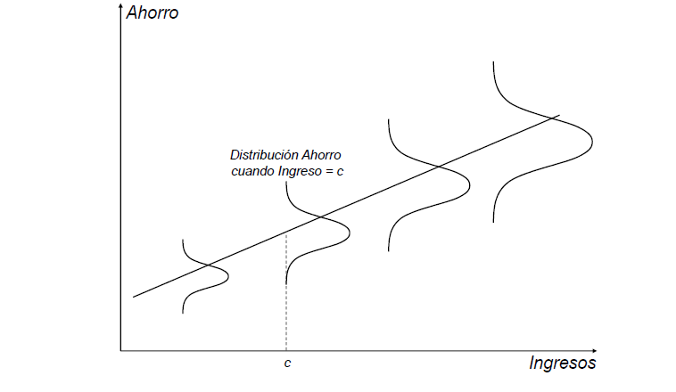
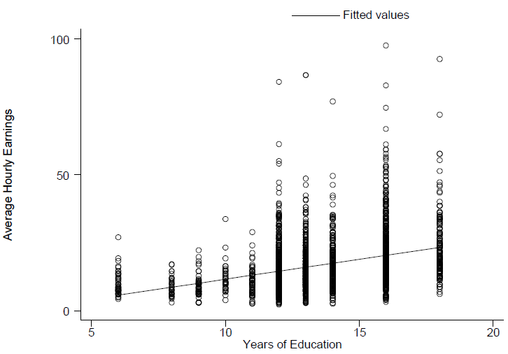
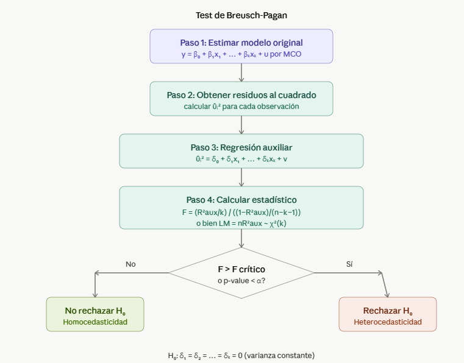
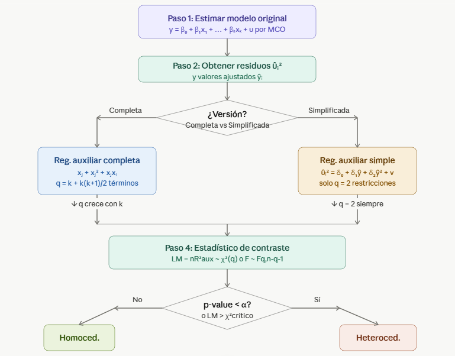
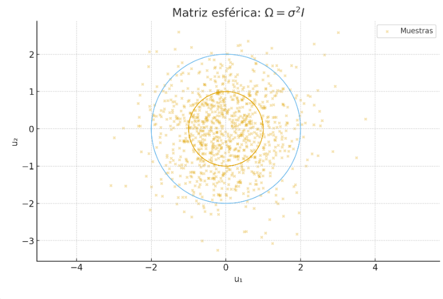
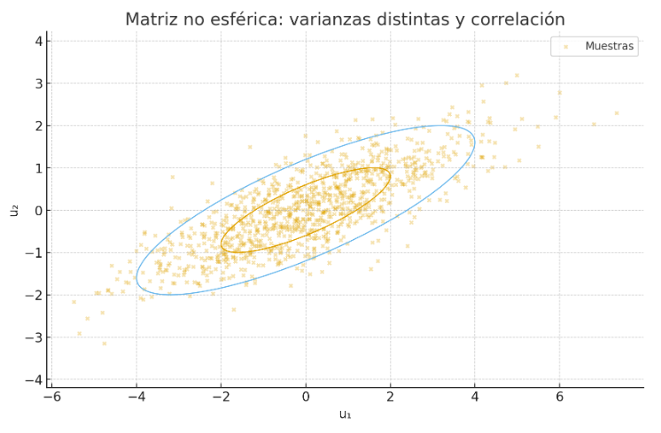
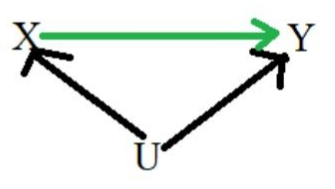
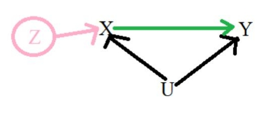
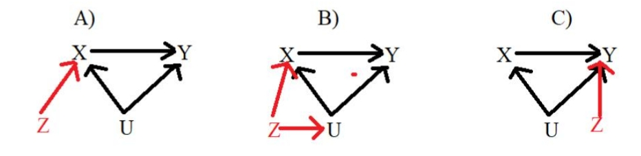

<!-- ARCHIVO GENERADO por tools/clases.py a partir de las diapositivas oficiales. No editar a mano: modifica tools/clases.py o el .tex y vuelve a generar. -->

# Clase 12 · Heterocedasticidad y variables instrumentales

<div class="usm-session-meta">
<span>📅 Fecha por confirmar (el viernes 1 de enero es feriado)</span>
<span class="usm-tag-gold">Semana 12 · Heterocedasticidad, endogeneidad y variables instrumentales</span>
<span class="usm-tag-red">🛠️ Semana del Taller 3</span>
</div>

!!! info "Contenido oficial de la semana"
    Esta página reproduce **íntegras y en orden** las diapositivas de la cátedra de la semana 12:
    `sem12/Clase14.tex` (Parte 1), `sem12/varianza_estimador_heteroce.tex` (Parte 2) y `sem12/Clase15.tex`
    (Parte 3). Los ejercicios de la semana están en la [📘 Ayudantía 12](../ayudantias/ayudantia12.md).

!!! example "Cómo estudiar esta página"
    La clase está ordenada en **5 temas**. Cada tema parte con una **pregunta guía**, sigue con las láminas
    y los simuladores, y termina con **✍️ preguntas de selección múltiple** (cada alternativa incorrecta explica
    por qué no lo es) y un **🧪 ejercicio de R** que puedes editar y ejecutar aquí mismo, sin instalar nada.
    Los 5 ejercicios de R en un solo archivo: [📥 clase12.R](../r/clase12.R).

## 🎯 Objetivos de la sesión

- Reconocer la **heterocedasticidad** y sus consecuencias para la inferencia.
- Detectarla con los tests de **Breusch-Pagan** y de **White**.
- Corregir la inferencia con **errores estándar robustos** de White.
- Entender la **endogeneidad** y estimar con **variables instrumentales** y **MC2E**.

## 🗓️ Agenda de la cátedra (3 horas)

La fecha se confirmará porque el viernes de la semana es feriado. Haz clic en un tema para ir directo a él.

<ol class="econ-ruta">
<li><span class="econ-ruta-h">18:40</span><a class="econ-ruta-a" href="#tema-1"><span class="econ-ruta-n">1</span><span class="econ-ruta-t">Heterocedasticidad y sus consecuencias</span><span class="econ-ruta-l">Parte 1 · láminas 1–5 · ✍️ 2 preguntas · 🧪 R</span></a></li>
<li><span class="econ-ruta-h">19:05</span><a class="econ-ruta-a" href="#tema-2"><span class="econ-ruta-n">2</span><span class="econ-ruta-t">Detectarla: Breusch-Pagan y White</span><span class="econ-ruta-l">Parte 1 · láminas 6–14 · ✍️ 3 preguntas · 🧪 R</span></a></li>
<li><span class="econ-ruta-h">19:35</span><a class="econ-ruta-a" href="#tema-3"><span class="econ-ruta-n">3</span><span class="econ-ruta-t">Errores estándar robustos</span><span class="econ-ruta-l">Partes 1 y 2 · varianza y errores robustos · ✍️ 2 preguntas · 🧪 R</span></a></li>
<li class="is-break"><span class="econ-ruta-h">19:55</span><span class="econ-ruta-t">☕ Receso</span></li>
<li><span class="econ-ruta-h">20:05</span><a class="econ-ruta-a" href="#tema-4"><span class="econ-ruta-n">4</span><span class="econ-ruta-t">Endogeneidad e instrumentos</span><span class="econ-ruta-l">Parte 3 · láminas 1–7 · ✍️ 2 preguntas · 🧪 R</span></a></li>
<li><span class="econ-ruta-h">20:40</span><a class="econ-ruta-a" href="#tema-5"><span class="econ-ruta-n">5</span><span class="econ-ruta-t">Estimación por VI y MC2E</span><span class="econ-ruta-l">Parte 3 · láminas 8–19 · ✍️ 2 preguntas · 🧪 R</span></a></li>
<li class="is-break"><span class="econ-ruta-h">21:15</span><span class="econ-ruta-t">✅ Ideas clave, autoevaluación y cierre</span></li>
</ol>

📘 **Ayudantía de la semana** · se trabaja otro día, en su propia página: [Ir a la Ayudantía 12 →](../ayudantias/ayudantia12.md)
{: .econ-ruta-sub }

## Heterocedasticidad { .econ-parte data-eyebrow="Parte 1 · Cátedra" data-toc-label="Parte 1 · Heterocedasticidad" }

<p class="econ-source">📄 Diapositivas: <code>sem12/Clase14.tex</code> · 19 láminas</p>

### Heterocedasticidad y sus consecuencias { #tema-1 .econ-tema data-num="1" data-laminas="Parte 1 · láminas 1–5" data-toc-label="Tema 1 · Heterocedasticidad" }

<p class="econ-tema-q">¿Qué se rompe cuando la varianza del error no es constante?</p>

<div class="econ-lamina" markdown>

#### Homocedasticidad vs Heterocedasticidad { data-lamina="Lámina 1" }

<!-- sem12/Clase14.tex · lámina 1 -->

Los errores $u_i$ son heterocedásticos si la varianza condicional de $u_i$ dado $X_i$, $Var[u_i|X_i]$ no es constante.

{ .econ-slide-img }

</div>

<div class="econ-lamina" markdown>

#### Consecuencias de la heterocedastidad { data-lamina="Lámina 2" }

<!-- sem12/Clase14.tex · lámina 2 -->

-   El estimador MCO sigue siendo insesgado y consistente, $E[\hat{\beta}|X]=\beta$.

-   Pero el estimador de MCO no es MELI.

-   Los estimadores de las varianzas, $Var(\hat{\beta})$, serían sesgados.

-   También, los estadísticos t no distribuirán t, ni los estadísticos F distribuirán F.

-    **Estos problemas no se resuelven con tamaños de muestra grande.**

</div>

<div class="econ-lamina" markdown>

#### Homocedasticidad vs Heterocedasticidad { data-lamina="Lámina 3" }

<!-- sem12/Clase14.tex · lámina 3 -->

| **Propiedad**                              | **Homocedasticidad** | **Heterocedasticidad**                                           |
|:-------------------------------------------|:---------------------|:-----------------------------------------------------------------|
| Insesgadez y consistencia de $\hat{\beta}$ | Se mantienen         | Se mantienen                                                     |
| Eficiencia (MELI)                          | Sí                   | No (hay estimadores lineales más eficientes)                     |
| Var($\hat{\beta}$)                         | Estimada sin sesgo   | Sesgada $\Rightarrow$ estadísticas $t$ y $F$ no fiables          |
| Inferencia asintótica                      | Correcta             | Las varianzas sesgadas persisten, por tanto los tests no mejoran |

</div>

<div class="econ-lamina" markdown>

#### Ejemplo { data-lamina="Láminas 4–5" }

<!-- sem12/Clase14.tex · lámina 4 -->

Considere el siguiente modelo lineal:

$$
Salario_i = \beta_0 + \beta_1 \cdot educacion_i + u_i
$$

En este contexto, analizamos si se cumple la **suposición de homocedasticidad** del término de error $u_i$. Esta condición implica que la varianza del término de error, condicional a los años de educación, sea constante:

-   Para que haya homocedasticidad, debe cumplirse que:

    $$
    \text{Var}[u_i \mid educacion_i] = \sigma^2
    $$

-   Es decir, la varianza del término de error no debe depender del número de años de educación.

-   Bajo homocedasticidad, los errores tienen varianza constante y no sistemáticamente relacionada con los niveles de educación.

<!-- sem12/Clase14.tex · lámina 5 -->

{ .econ-slide-img }

</div>

<div class="econ-practica" id="practica-1">
<p class="econ-practica-t"><span>✍️ Practica · Tema 1</span></p>
<div class="econ-quiz">
<p class="econ-quiz-q">Con heterocedasticidad, ¿qué le pasa a β̂ de MCO?</p>
<div class="econ-quiz-opts">
<button class="econ-quiz-opt" data-correct>Sigue siendo insesgado y consistente, pero deja de ser MELI y sus varianzas usuales quedan sesgadas.</button>
<button class="econ-quiz-opt" data-why="La heterocedasticidad no afecta el insesgamiento (lámina 2).">Queda sesgado.</button>
<button class="econ-quiz-opt" data-why="Los errores estándar usuales y los tests t y F dejan de ser válidos.">Nada: todo sigue igual.</button>
</div>
<p class="econ-quiz-fb">✅ Láminas 2 y 3.</p>
</div>
<div class="econ-quiz">
<p class="econ-quiz-q">¿Se resuelven los problemas de la heterocedasticidad con una muestra más grande?</p>
<div class="econ-quiz-opts">
<button class="econ-quiz-opt" data-correct>No: la lámina 2 lo dice explícitamente.</button>
<button class="econ-quiz-opt" data-why="El sesgo de los errores estándar usuales no desaparece al crecer n.">Sí, por el TCL.</button>
<button class="econ-quiz-opt" data-why="La normalidad no corrige el problema.">Solo si los errores son normales.</button>
</div>
<p class="econ-quiz-fb">✅ Lámina 2.</p>
</div>
</div>

<div class="econ-r" markdown>

<p class="econ-r-t">🧪 Practica en R · El abanico de los residuos</p>

Simula salarios cuya varianza crece con la educación y grafica los residuos.

```r
set.seed(31)
n    <- 300
educ <- runif(n, 6, 20)
salario <- 2 + 0.8 * educ + rnorm(n, sd = 0.3 * educ)    # Var(u | educ) crece
m <- lm(salario ~ educ)
plot(educ, resid(m), pch = 19, col = "steelblue", ylab = "residuo",
     main = "Heterocedasticidad: el abanico se abre")
abline(h = 0, lty = 2)
```

**🎯 Reto:** cambia `sd = 0.3 * educ` por `sd = 3`. ¿Cómo cambia el gráfico?
{: .econ-r-reto }

</div>

### Detectarla: Breusch-Pagan y White { #tema-2 .econ-tema data-num="2" data-laminas="Parte 1 · láminas 6–14" data-toc-label="Tema 2 · Breusch-Pagan y White" }

<p class="econ-tema-q">¿Cómo sabemos si hay heterocedasticidad?</p>

<div class="econ-lamina" markdown>

#### Test para la heterocedasticidad (Breusch-Pagan) { data-lamina="Lámina 6" }

<!-- sem12/Clase14.tex · lámina 6 -->

-   Considere el modelo MRL múltiple:

    $$
    y=\beta_0+\beta_1x_1+\beta_2x_2+...+\beta_kx_k+u
    $$

-   La hipótesis nula de homocedasticidad es:

    $$
    H_0:E(u^2|x_1,...,x_k)=E(u^2)=\sigma^2
    $$

-   Se busca probar si $u^2$ se relaciona con las variables explicativas.

-   Se puede suponer la siguiente relación:

    $$
    u^2=\delta_0+\delta_1x_1++...+\delta_kx_k+v
    $$

-   Con la hipótesis nula:

    $$
    H_0: \delta_1=\delta_2=...=\delta_3=0
    $$

-   No se conocen los errores de MLR original, pero se usan los residuos $\hat{u_i}$. Se estima:

    $$
    \hat{u}^2_i= \delta_0 +\delta_1x_1+...+\delta_kx_k+v
    $$

-   Uitilizamos el test F de significancia global.

</div>

<div class="econ-lamina" markdown>

#### Estadístico $F$ global (Breusch-Pagan) { data-lamina="Lámina 7" data-toc-label="Estadístico F global (Breusch-Pagan)" }

<!-- sem12/Clase14.tex · lámina 7 -->

**Hipótesis**

$H_0$: $\delta_1 = \dots = \delta_k = 0$ (homocedasticidad)

$H_1$: Al menos un $\delta_j \neq 0$ (heterocedasticidad)

**Regresión auxiliar**

$$
\hat u_i^{2} = \delta_0 + \delta_1 x_{1i} + \dots + \delta_k x_{ki} + v_i
$$

**Estadístico F**

$$
F = \frac{R_{\text{aux}}^{2}/k}{(1 - R_{\text{aux}}^{2})/(n - k - 1)} \quad \sim \quad F_{k,\, n - k - 1}
$$

**Decisión**

-   Rechazar $H_0$ si $F > F_{1-\alpha,k, n-k-1,}$.

-   Cuanto **más** grande sea el valor de $F$, mayor será la probabilidad de *rechazar* la hipótesis nula; es decir, de concluir que existe heterocedasticidad.

</div>

<div class="econ-lamina" markdown>

#### Breusch-Pagan { data-lamina="Lámina 8" }

<!-- sem12/Clase14.tex · lámina 8 -->

{ .econ-slide-img }

</div>

<div class="econ-lamina" markdown>

#### Estadístico global (Breusch– Pagan) { data-lamina="Lámina 9" }

<!-- sem12/Clase14.tex · lámina 9 -->

-   Las pruebas de **Lagrange Multiplier (LM)** constituyen una alternativa equivalente para detectar heterocedasticidad :

    $$
    LM = n R_{\text{aux}}^{2} \;\sim\; \chi^{2}_{(k)}.
    $$

-   Es una alternativa asintótica al test F.

-   En <span class="sans-serif">R</span> puede utilizarse la función ***bptest*** del paquete ***lmtest*** para aplicar esta prueba mediante el estadístico **LM**.

</div>

<div class="econ-lamina" markdown>

#### Test F vs test LM { data-lamina="Lámina 10" }

<!-- sem12/Clase14.tex · lámina 10 -->

|                 |                     **Test F**                      |       **Test LM**        |
|:----------------|:---------------------------------------------------:|:------------------------:|
| Distribución    |               $F_{k, n-k-1}$ (exacta)               | $\chi^2(k)$ (asintótica) |
| Muestra pequeña |                        Mejor                        |     Menos confiable      |
| Muestra grande  |                     Equivalente                     |                          |
| Fórmula         | $F = \frac{(SCR_r - SCR_{nr})/k}{SCR_{nr}/(n-k-1)}$ | $LM = n \cdot R^2_{aux}$ |

</div>

<div class="econ-lamina" markdown>

#### Test de White para la heterocedasticidad { data-lamina="Lámina 11" }

<!-- sem12/Clase14.tex · lámina 11 -->

-   Extiende BP: la regresión auxiliar incluye cada regresora $x_j$, sus cuadrados $x_j^{2}$ y los productos cruzados $x_jx_{\ell}$.

-   Hipótesis nula: $\delta_1=\dots=\delta_q=0$ (homocedasticidad).

-   Estadísticos equivalentes:

    $$
    \text{LM}=nR_{\text{aux}}^{2}\;\sim\;\chi^{2}_{(q)},\quad
    F=\frac{R_{\text{aux}}^{2}/q}{(1-R_{\text{aux}}^{2})/(n-q-1)}\;\sim\;F_{q,\,n-q-1}.
    $$

-   $q$ crece rápidamente: $q=k+\tfrac{k(k+1)}{2}$ si incluyes todos los términos.

</div>

<div class="econ-lamina" markdown>

#### Regresión auxiliar (Test de White, $k=3$) { data-lamina="Lámina 12" data-toc-label="Regresión auxiliar (Test de White, k=3)" }

<!-- sem12/Clase14.tex · lámina 12 -->

Sea

$$
y_i \;=\;\beta_0+\beta_1x_{1i}+\beta_2x_{2i}+\beta_3x_{3i}+u_i ,
\qquad i=1,\dots,n .
$$

**Paso 2 del test (regresión auxiliar):**

$$
\hat{u}_i^{\,2}\;=\;
\delta_0
+\delta_1 x_{1i}+\delta_2 x_{2i}+\delta_3 x_{3i}
+\delta_4 x_{1i}^{2}+\delta_5 x_{2i}^{2}+\delta_6 x_{3i}^{2} \\
+\delta_7 x_{1i}x_{2i}+\delta_8 x_{1i}x_{3i}+\delta_9 x_{2i}x_{3i}
+ v_i .
$$

-   Incluye: los 3 regresores originales, sus 3 cuadrados y los 3 productos cruzados.

-   Número de restricciones simultáneas: $q =k+ \tfrac{k(k+1)}{2} = 9$.

-   Contraste global: $LM=nR_{aux}^{2}\sim\chi^{2}_{(9)}$ o bien $F=\dfrac{R_{aux}^{2}/9}{(1-R_{aux}^{2})/(n-9-1)}
              \sim F_{9,\;n-10}$.

</div>

<div class="econ-lamina" markdown>

#### Test de White simplificado { data-lamina="Lámina 13" }

<!-- sem12/Clase14.tex · lámina 13 -->

-   Una alternativa simplificada es emplear los valores ajustados $\hat{y}$ (y $\hat{y}^{2}$) como regresores auxiliares.

    $$
    \hat{u}^2=\delta_0 + \delta_1\hat{y}+\delta_2\hat{y}^2+v
    $$

-   Esto implica evaluar sólo 2 restricciones, sin importar el número de variables explicativas en el modelo original.

-   Se construye el valor

    $$
    LM = nR_{\hat{u}^2}^2\sim X_{2}^2
    $$

-   Ventajas:

    -   Reduce $q$, siendo igual a 2.

    -   Sigue capturando dependencias cuadráticas de la varianza.

-   Desventaja: menos claro en la forma de la heterocedasticidad, cuando depende de variables específicas.

</div>

<div class="econ-lamina" markdown>

#### White { data-lamina="Lámina 14" }

<!-- sem12/Clase14.tex · lámina 14 -->

{ .econ-slide-img }

</div>

<div class="econ-practica" id="practica-2">
<p class="econ-practica-t"><span>✍️ Practica · Tema 2</span></p>
<div class="econ-quiz">
<p class="econ-quiz-q">En el test de Breusch-Pagan, ¿qué variable dependiente tiene la regresión auxiliar?</p>
<div class="econ-quiz-opts">
<button class="econ-quiz-opt" data-correct>Los residuos al cuadrado, û².</button>
<button class="econ-quiz-opt" data-why="Se busca si la varianza (û²) se relaciona con las x.">La variable y original.</button>
<button class="econ-quiz-opt" data-why="Los residuos tienen media cero: lo relevante es su cuadrado.">Los residuos sin elevar al cuadrado.</button>
</div>
<p class="econ-quiz-fb">✅ Lámina 6.</p>
</div>
<div class="econ-quiz">
<p class="econ-quiz-q">En el test de White con k = 3 regresores, ¿cuántas restricciones (q) hay?</p>
<div class="econ-quiz-opts">
<button class="econ-quiz-opt" data-correct>9</button>
<button class="econ-quiz-opt" data-why="Faltan los 3 productos cruzados.">6</button>
<button class="econ-quiz-opt" data-why="Esas son solo las variables originales.">3</button>
</div>
<p class="econ-quiz-fb">✅ q = k + k(k + 1)/2 = 3 + 6 = 9 (lámina 12).</p>
</div>
<div class="econ-quiz">
<p class="econ-quiz-q">¿Cuál es el estadístico LM del test de Breusch-Pagan?</p>
<div class="econ-quiz-opts">
<button class="econ-quiz-opt" data-correct>n·R²_aux, que se distribuye χ² con k grados de libertad.</button>
<button class="econ-quiz-opt" data-why="Esa expresión es parte del F, no el LM.">R²_aux/(1 − R²_aux).</button>
<button class="econ-quiz-opt" data-why="Se usa la regresión auxiliar, no la original.">El F de la regresión original.</button>
</div>
<p class="econ-quiz-fb">✅ Lámina 9.</p>
</div>
</div>

<div class="econ-r" markdown>

<p class="econ-r-t">🧪 Practica en R · Breusch-Pagan y White a mano</p>

Simula errores heterocedásticos y calcula los tests de Breusch-Pagan (F y LM) y de White.

```r
set.seed(32)
n  <- 300
x1 <- runif(n, 0, 10); x2 <- rnorm(n)
y  <- 1 + 0.5 * x1 + 0.3 * x2 + rnorm(n, sd = 0.2 + 0.3 * x1)
m  <- lm(y ~ x1 + x2)
u2 <- resid(m)^2

# Breusch-Pagan: u² sobre las x
aux <- lm(u2 ~ x1 + x2)
R2a <- summary(aux)$r.squared; k <- 2
c(F  = R2a / k / ((1 - R2a) / (n - k - 1)), p_F  = pf(R2a / k / ((1 - R2a) / (n - k - 1)), k, n - k - 1, lower.tail = FALSE),
  LM = n * R2a,                            p_LM = pchisq(n * R2a, k, lower.tail = FALSE))

# White: agrega cuadrados y productos cruzados (q = k + k(k + 1)/2 = 5)
auxW <- lm(u2 ~ x1 + x2 + I(x1^2) + I(x2^2) + I(x1 * x2))
c(LM_White = n * summary(auxW)$r.squared, critico = qchisq(0.95, 5))
```

**🎯 Reto:** cambia `sd = 0.2 + 0.3 * x1` por `sd = 1`. ¿Se rechaza la homocedasticidad?
{: .econ-r-reto }

</div>

### Errores estándar robustos { #tema-3 .econ-tema data-num="3" data-laminas="Partes 1 y 2 · varianza y errores robustos" data-toc-label="Tema 3 · Errores robustos" }

<p class="econ-tema-q">Si la varianza usual está mal, ¿cómo hacemos inferencia válida?</p>

<div class="econ-lamina" markdown>

#### Varianza del estimador de MCO con heterocedasticidad { data-lamina="Lámina 15" }

<!-- sem12/Clase14.tex · lámina 15 -->

-   Considere el modelo de regresión lineal

    $$
    y \;=\; X\beta + u,
    $$

    donde $y$ es el vector de $n$ observaciones de la variable dependiente, $X$ es la matriz de diseño $n\times k$, $\beta$ el vector de parámetros y $u$ el vector de errores.

-   Suponemos <span class="alert">heterocedasticidad</span>: la matriz de varianzas--covarianzas de los errores no es esférica,

    $$
    \mathbb{E}(u u') \;=\; \Omega
    \quad\text{(general\, $n\times n$).}
    $$

    Si fuera homocedástica tendríamos $\Omega = \sigma^{2} I_n$.

</div>

<div class="econ-lamina" markdown>

#### Estimador MCO y su descomposición { data-lamina="Lámina 16" }

<!-- sem12/Clase14.tex · lámina 16 -->

$$
\begin{aligned}
\hat{\beta}_{\text{MCO}}
&= (X'X)^{-1} X' y \\
&= (X'X)^{-1} X' (X\beta + u) \\
&= \beta \;+\; (X'X)^{-1} X' u.
\end{aligned}
$$

-   El término aleatorio es $(X'X)^{-1}X'u$.

-   Para evaluar la precisión de $\hat{\beta}_{\text{MCO}}$ necesitamos su varianza condicional en presencia de $\Omega$.

</div>

<div class="econ-lamina" markdown>

#### Varianza general y caso homocedástico { data-lamina="Lámina 17" }

<!-- sem12/Clase14.tex · lámina 17 -->

**Varianza con heterocedasticidad**

$$
\operatorname{Var}(\hat{\beta}_{\text{MCO}}|X)
\;=\;
(X'X)^{-1} X' \,\Omega\, X (X'X)^{-1}.
$$

**Caso particular (homocedasticidad)**

Si $\Omega = \sigma^{2} I_n$, se reduce a

$$
\operatorname{Var}(\hat{\beta}_{\text{MCO}}|X)
\;=\;
\sigma^{2} (X'X)^{-1}.
$$

</div>

<div class="econ-lamina" markdown>

#### Errores robustos { data-lamina="Lámina 18" }

<!-- sem12/Clase14.tex · lámina 18 -->

En la práctica trabajamos con:

$$
\widehat{\operatorname{Var}}(\hat{\boldsymbol{\beta}}|X) =
(X'X)^{-1} X' \hat{\Omega} X (X'X)^{-1}
$$

$$
\hat{\Omega} =
\begin{bmatrix}
\hat{u}_1^2 & 0 & \cdots & 0 \\
0 & \hat{u}_2^2 & \cdots & 0 \\
\vdots & \vdots & \ddots & \vdots \\
0 & 0 & \cdots & \hat{u}_n^2
\end{bmatrix}
= \operatorname{diag}(\hat{u}_1^2, \hat{u}_2^2, \dots, \hat{u}_n^2)
$$

$$
\widehat{\operatorname{Var}}(\hat{\boldsymbol{\beta}}|X) =
(X'X)^{-1} \left( \sum_{i=1}^n \hat{u}_i^2 x_i x_i' \right) (X'X)^{-1}
$$

Los **errores estándar robustos de White** son iguales a la raíz cuadrada de los elementos en la diagonal de la matriz $\widehat{\operatorname{Var}}(\hat{\beta}_{\text{MCO}})$

</div>

<div class="econ-lamina" markdown>

#### Errores robustos White { data-lamina="Lámina 19" }

<!-- sem12/Clase14.tex · lámina 19 -->

-   $$
    \widehat{\text{Var}}[\hat{\beta}_j|X] = \frac{\sum_{i=1}^n \hat{r}_{ij}^2 \hat{u}_i^2}{SSR_j^2}
    $$

    donde $\hat{r}_{ij}^2$ es el i-ésimo residuo de la regresión de $x_j$ sobre las otras variables independientes, y $SSR_j^2$ es la suma residual de cuadrados de esa regresión.

-   Usando estos errores estándar robustos se puede calcular los tests de hipótesis tal como lo hacíamos antes. Por ejemplo, un estadístico $t$ robusto a la heterocedasticidad como

    $$
    t = \frac{\text{estimador} - \text{valor hipotético}}{\text{error estándar robusto}}
    $$

</div>

## Varianza del estimador MCO con heterocedasticidad { .econ-parte data-eyebrow="Parte 2 · Cátedra" data-toc-label="Parte 2 · Varianza del estimador MCO con heterocedasticidad" }

<p class="econ-source">📄 Documento: <code>sem12/varianza_estimador_heteroce.tex</code> · 2 secciones</p>

<div class="econ-lamina" markdown>

#### Varianza del estimador de MCO con heterocedasticidad { data-lamina="Lámina 1" }

<!-- sem12/varianza_estimador_heteroce.tex · lámina 1 -->

Consideremos el modelo de regresión lineal:

$$
y = X \beta + u
$$

donde: - $y$ es el vector de $n$ observaciones de la variable dependiente, - $X$ es la matriz de diseño de $n \times k$ que incluye las variables explicativas, - $\beta$ es el vector de $k$ parámetros a estimar, - $u$ es el vector de errores aleatorios de tamaño $n$.

En este caso, suponemos que existe heterocedasticidad en los errores, lo que significa que la matriz de varianzas-covarianzas de los errores $u$ no es esférica. En lugar de asumir homocedasticidad ($\mathbb{E}(uu') = \sigma^2 I$), asumimos que:

$$
\mathbb{E}(uu') = \Omega
$$

donde $\Omega$ es una matriz de varianzas-covarianzas $n \times n$, que refleja que las varianzas pueden cambiar entre las observaciones.

$$
\boldsymbol{\Omega} =
\begin{bmatrix}
\sigma_1^2 & 0 & \cdots & 0 \\
0 & \sigma_2^2 & \cdots & 0 \\
\vdots & \vdots & \ddots & \vdots \\
0 & 0 & \cdots & \sigma_n^2
\end{bmatrix}
$$

El estimador de mínimos cuadrados ordinarios (MCO) para $\beta$ se define como:

$$
\hat{\beta}_{\text{MCO}} = (X'X)^{-1} X'y
$$

Sustituyendo $y = X \beta + u$ en esta expresión, obtenemos:

$$
\hat{\beta}_{\text{MCO}} = (X'X)^{-1} X'(X \beta + u)
$$

Al desarrollar, esto se convierte en:

$$
\hat{\beta}_{\text{MCO}} = \beta + (X'X)^{-1} X'u
$$

Queremos encontrar la varianza de $\hat{\beta}_{MCO}$, es decir, $Var(\hat{\beta}_{MCO})$.

Dado que $\hat{\beta}_{MCO} = \beta + (X'X)^{-1} X'u$, podemos escribir:

$$
\text{Var}(\hat{\beta}_{\text{MCO}}) = \text{Var}((X'X)^{-1} X'u)
$$

Utilizando la propiedad de que $Var(A u) = A \, Var(u) \, A'$, tenemos:

$$
\text{Var}(\hat{\beta}_{\text{MCO}}) = (X'X)^{-1} X' \, \text{Var}(u) \, X (X'X)^{-1}
$$

Como hemos supuesto que $Var(u) = \Omega$, sustituimos esto en la expresión anterior:

$$
\text{Var}(\hat{\beta}_{\text{MCO}}) = (X'X)^{-1} X' \Omega X (X'X)^{-1}
$$

Si $\Omega = \sigma^2 I$ (homocedasticidad), entonces la expresión se reduce a:

$$
\text{Var}(\hat{\beta}_{\text{MCO}}) = \sigma^2 (X'X)^{-1}
$$

</div>

<div class="econ-lamina" markdown>

#### Perturbaciones esféricas y no esféricas { data-lamina="Lámina 2" }

<!-- sem12/varianza_estimador_heteroce.tex · lámina 2 -->

{ .econ-slide-img }

{ .econ-slide-img }

Comparación de perturbaciones esféricas y no esféricas.

**Curvas de isoprobabilidad:** Las líneas del gráfico representan *curvas de isoprobabilidad* (o de igual densidad) de la distribución conjunta de los errores. Cada curva une los puntos $(u_1,u_2)$ que tienen la misma probabilidad de ocurrencia bajo la distribución de los errores.

En el caso de errores normales con matriz de varianzas--covarianzas $\Omega$, la densidad conjunta se expresa como

$$
f(u) = \frac{1}{2\pi |\Omega|^{1/2}}
\exp\!\left(-\tfrac{1}{2}u'\Omega^{-1}u\right).
$$

De esta forma, las curvas de nivel que satisfacen $u'\Omega^{-1}u = c$ describen las regiones de igual probabilidad.

La **mayor probabilidad** se encuentra en el centro de la distribución, en el punto $(0,0)$, donde la densidad es máxima. Es decir, las curvas más cercanas al centro representan valores más probables, mientras que las curvas más externas corresponden a valores menos probables.

</div>

<div class="econ-widget" data-widget="robustos"></div>

<div class="econ-practica" id="practica-3">
<p class="econ-practica-t"><span>✍️ Practica · Tema 3</span></p>
<div class="econ-quiz">
<p class="econ-quiz-q">¿Cuál es la varianza de β̂ de MCO con heterocedasticidad general?</p>
<div class="econ-quiz-opts">
<button class="econ-quiz-opt" data-correct>(X′X)⁻¹X′ΩX(X′X)⁻¹</button>
<button class="econ-quiz-opt" data-why="Ese es el caso particular homocedástico, Ω = σ²I.">σ²(X′X)⁻¹</button>
<button class="econ-quiz-opt" data-why="Falta el término X′ΩX en el centro.">Ω(X′X)⁻¹</button>
</div>
<p class="econ-quiz-fb">✅ Lámina 17.</p>
</div>
<div class="econ-quiz">
<p class="econ-quiz-q">¿Qué se usa en lugar de Ω para calcular los errores robustos de White?</p>
<div class="econ-quiz-opts">
<button class="econ-quiz-opt" data-correct>Una matriz diagonal con los residuos al cuadrado, ûᵢ².</button>
<button class="econ-quiz-opt" data-why="Eso reproduce los errores usuales.">La identidad multiplicada por σ̂².</button>
<button class="econ-quiz-opt" data-why="Ω es la varianza de los errores, no de las x.">La matriz de correlaciones de las x.</button>
</div>
<p class="econ-quiz-fb">✅ Lámina 18.</p>
</div>
</div>

<div class="econ-r" markdown>

<p class="econ-r-t">🧪 Practica en R · Errores robustos con matrices</p>

Calcula los errores estándar usuales y los robustos de White con la fórmula de la lámina 18.

```r
set.seed(33)
n <- 200
x <- runif(n, 0, 3)
y <- 1 + 2 * x + rnorm(n, sd = 0.2 + 1.2 * x^2)
m <- lm(y ~ x)
X <- model.matrix(m); u <- resid(m)
XtXi <- solve(t(X) %*% X)

V_usual   <- sum(u^2) / (n - 2) * XtXi                      # σ̂²(X'X)⁻¹
V_robusta <- XtXi %*% t(X) %*% diag(u^2) %*% X %*% XtXi     # lámina 18
cbind(se_usual = sqrt(diag(V_usual)), se_robusto = sqrt(diag(V_robusta)))
```

**🎯 Reto:** cambia el error por `rnorm(n, sd = 1)` (homocedástico). ¿Se parecen ahora ambos errores estándar?
{: .econ-r-reto }

</div>

## Endogeneidad y variables instrumentales { .econ-parte data-eyebrow="Parte 3 · Cátedra" data-toc-label="Parte 3 · Endogeneidad y variables instrumentales" }

<p class="econ-source">📄 Diapositivas: <code>sem12/Clase15.tex</code> · 19 láminas</p>

### Endogeneidad e instrumentos { #tema-4 .econ-tema data-num="4" data-laminas="Parte 3 · láminas 1–7" data-toc-label="Tema 4 · Endogeneidad e instrumentos" }

<p class="econ-tema-q">¿Qué hacer cuando x está correlacionada con el error?</p>

<div class="econ-lamina" markdown>

#### Introducción { data-lamina="Lámina 1" }

<!-- sem12/Clase15.tex · lámina 1 -->

-   En las clases pasadas vimos que cuando omitimos una variable $x_{2}$ que se correlaciona con $x_{1}$, se viola el supuesto $E\left[u \mid x_{1}\right]=0$ y nuestro estimador MCO estará sesgado.

-   Cuando esto sucede, decimos que $x_{1}$ es **endógena (está correlacionada con el error)**.

-   **Una variable explicativa es endógena cuando su valor está parcialmente determinado dentro del sistema por relaciones que también afectan a la variable dependiente, lo que se manifiesta estadísticamente como correlación con el término de error.**

-   **Qué podemos hacer**?

-   Método 1: variables instrumentales (IV).

-   Método 2: mínimos cuadrados en 2 etapas (MC2E).

</div>

<div class="econ-lamina" markdown>

#### Causas de la endogeneidad { data-lamina="Lámina 2" }

<!-- sem12/Clase15.tex · lámina 2 -->

Generalmente observamos problemas de endogeneidad en una de estas tres situaciones:

1.  Variables omitidas:

    -   Son variables que están correlacionadas con las $x$ (los regresores) pero no las podemos incluir por ser inobservables.

2.  Simultaneidad: $x \rightarrow y$ y $y \rightarrow x$.

3.  Error de medida en las $x$.

</div>

<div class="econ-lamina" markdown>

#### Endogeneidad { data-lamina="Lámina 3" }

<!-- sem12/Clase15.tex · lámina 3 -->

El problema de la endogeneidad:

{ .econ-slide-img }

$$
E\left[\hat{\beta}_{1}^{M C O}\right]=\beta_{1}+\delta_{1} \beta_{2}
$$

Con variable omitida.

</div>

<div class="econ-lamina" markdown>

#### Solución 1: Variables instrumentales { data-lamina="Lámina 4" }

<!-- sem12/Clase15.tex · lámina 4 -->

Una variable instrumental válida es una variable $\mathbf{Z}$ que se correlaciona con $X$, pero no con el error.

{ .econ-slide-img }

Formalmente, un instrumento es válido si cumple con **dos** supuestos clave:

1.  **Relevancia:** $\operatorname{Cov}(X, Z) \neq 0$. La variable $Z$ afecta a $X$. Como observamos $Z$ y $X$, este supuesto es testeable.

2.  **Exogeneidad o restricción de exclusión:** $\operatorname{Cov}(Z, U)=0$.

    -   El instrumento no se correlaciona con el error.

    -   $E[Y \mid X]=E[Y \mid X, Z]$: el instrumento $Z$ no afecta directamente a $Y$, sólo lo hace a través de su efecto en $X$.

</div>

<div class="econ-lamina" markdown>

#### Intuición { data-lamina="Lámina 5" }

<!-- sem12/Clase15.tex · lámina 5 -->

-   La intuición es que $X$ tiene dos componentes: una parte exógena y una parte endógena (que está correlacionada con $u$).

-   El instrumento $Z$, al no estar correlacionado con $u$, nos permitirá utilizar solamente la parte exógena de $X$ para identificar su efecto en $Y$.

</div>

<div class="econ-lamina" markdown>

#### Buenos y malos instrumentos { data-lamina="Lámina 6" }

<!-- sem12/Clase15.tex · lámina 6 -->

-   **Cuál de los siguientes $Z$ es un buen instrumento**?

    { .econ-slide-img }

-   Sólo el gráfico A muestra un instrumento válido, ya que cumple con:<br>
    1) **Relevancia:** $\operatorname{Cov}(z,x) \neq 0$ y 2) **Exogeneidad:** $\operatorname{Cov}(z,u)=0$.

-   El caso B viola la exogeneidad porque el instrumento se correlaciona con el error ($\operatorname{Cov}(z,u) \neq 0$).

-   El caso C viola la relevancia. Si bien el instrumento no se correlaciona con el error, tampoco lo hace con $X$ ($\operatorname{Cov}(x,z)=0$).

</div>

<div class="econ-lamina" markdown>

#### Ejemplos de variables endógenas e instrumentos en la literatura { data-lamina="Lámina 7" }

<!-- sem12/Clase15.tex · lámina 7 -->

-   **Retornos de la educación:**

    $$
    \log \bigl(\text{salario}\bigr)_{i}=\beta_{0}+\beta_{1} \,\text{educ}_{i}+u_{i}.
    $$

    -   $Z$: trimestre de nacimiento (Angrist y Krueger, 1991).

    -   $Z$: proximidad geográfica a una universidad (Card, 1995).

-   **Efecto de las instituciones en el PIB per cápita:**

    $$
    \text{GDP}_{2015,i}=\beta_{0}+\beta_{1}\, \text{instituciones}_{2015,i}+u_{i}.
    $$

    -   $Z$: mortalidad por enfermedades en el paı́s cuando llegaron los europeos siglos atrás (Acemoglu *et al.*, 2001).

</div>

<div class="econ-practica" id="practica-4">
<p class="econ-practica-t"><span>✍️ Practica · Tema 4</span></p>
<div class="econ-quiz">
<p class="econ-quiz-q">¿Cuáles son las tres fuentes habituales de endogeneidad?</p>
<div class="econ-quiz-opts">
<button class="econ-quiz-opt" data-correct>Variables omitidas, simultaneidad y error de medida en las x.</button>
<button class="econ-quiz-opt" data-why="Ninguna de ellas hace que Cov(x, u) ≠ 0 por sí sola.">Heterocedasticidad, multicolinealidad y autocorrelación.</button>
<button class="econ-quiz-opt" data-why="No son causas de endogeneidad.">Muestras pequeñas, R² bajo y valores atípicos.</button>
</div>
<p class="econ-quiz-fb">✅ Lámina 2.</p>
</div>
<div class="econ-quiz">
<p class="econ-quiz-q">¿Qué dos condiciones debe cumplir un instrumento válido z?</p>
<div class="econ-quiz-opts">
<button class="econ-quiz-opt" data-correct>Relevancia, Cov(x, z) ≠ 0, y exogeneidad, Cov(z, u) = 0.</button>
<button class="econ-quiz-opt" data-why="Es al revés.">Cov(x, z) = 0 y Cov(z, u) ≠ 0.</button>
<button class="econ-quiz-opt" data-why="La restricción de exclusión exige que z afecte a y solo a través de x.">Que z afecte directamente a y.</button>
</div>
<p class="econ-quiz-fb">✅ Lámina 4.</p>
</div>
</div>

<div class="econ-r" markdown>

<p class="econ-r-t">🧪 Practica en R · MCO con endogeneidad</p>

Simula retornos a la educación con la habilidad omitida y mira el sesgo de MCO aun con n = 5 000.

```r
# Endogeneidad por variable omitida: MCO sesgado aunque n sea grande
set.seed(34)
n <- 5000
habilidad <- rnorm(n)
educ <- 12 + 2 * habilidad + rnorm(n)
lsalario <- 1 + 0.08 * educ + 0.10 * habilidad + rnorm(n, sd = 0.3)
coef(lm(lsalario ~ educ))["educ"]      # verdadero: 0.08
cor(educ, 0.10 * habilidad)            # educ se correlaciona con el error
```

**🎯 Reto:** cambia `2 * habilidad` por `0 * habilidad` en la educación. ¿Desaparece el sesgo?
{: .econ-r-reto }

</div>

### Estimación por VI y MC2E { #tema-5 .econ-tema data-num="5" data-laminas="Parte 3 · láminas 8–19" data-toc-label="Tema 5 · VI y MC2E" }

<p class="econ-tema-q">¿Cómo se usa el instrumento para estimar β?</p>

<div class="econ-lamina" markdown>

#### Implementación del método IV { data-lamina="Lámina 8" }

<!-- sem12/Clase15.tex · lámina 8 -->

-   Métodos para estimar $\hat{\beta}^{IV}$:

    1.  Estimación por Variables Instrumentales (VI) *per se*.

    2.  Mínimos Cuadrados en Dos Etapas (MC2E),

</div>

<div class="econ-lamina" markdown>

#### Estimación por Variables Instrumentales (VI) { data-lamina="Lámina 9" }

<!-- sem12/Clase15.tex · lámina 9 -->

-   Consideremos el modelo de regresión simple:

    $$
    y_{i}=\beta_{0}+\beta_{1} x_{i}+u_{i}, \quad i=1,\ldots,N.
    $$

-   Problema: $\operatorname{Cov}\left(u_{i},x_{i}\right) \neq 0$.

-   Contamos con un instrumento $z$ que cumple:

    1.  $\operatorname{Cov}\left(u_{i},z_{i}\right)=0$.

    2.  $\operatorname{Cov}\left(x_{i},z_{i}\right)\neq 0$.

-   Entonces:

    $$
    \begin{aligned}
    \operatorname{Cov}\left(y_{i},z_{i}\right) &= \operatorname{Cov}\bigl(\underbrace{\beta_{0}+\beta_{1}x_{i}+u_{i}}_{y_{i}}, z_{i}\bigr) \\
    &= \underbrace{\operatorname{Cov}\left(\beta_{0},z_{i}\right)}_{0} + \beta_{1}\, \operatorname{Cov}\left(x_{i},z_{i}\right) + \underbrace{\operatorname{Cov}\left(u_{i},z_{i}\right)}_{0} \\
    &= \beta_{1}\, \operatorname{Cov}\left(x_{i},z_{i}\right).
    \end{aligned}
    $$

-   Despejando: $\beta_{1}=\frac{\operatorname{Cov}\left(y_{i},z_{i}\right)}{\operatorname{Cov}\left(x_{i},z_{i}\right)}.$

</div>

<div class="econ-lamina" markdown>

#### Relación poblacional y análogo muestral { data-lamina="Lámina 10" }

<!-- sem12/Clase15.tex · lámina 10 -->

-   La **identificación** del parámetro en este contexto significa que se puede escribir $\beta_1$ en términos de los momentos poblacionales que se pueden estimar mediante una muestra de datos.

    $$
    \hat{\beta}_{VI}=\frac{S_{y_{i},z_{i}}}{S_{x_{i},z_{i}}}=\frac{\sum_{i=1}^{N}(y_{i}-\bar{y})(z_{i}-\bar{z})}{\sum_{i=1}^{N}(x_{i}-\bar{x})(z_{i}-\bar{z})}.
    $$

-   Todo esto es observable, por lo que podemos estimarlo (`R` lo hace por ustedes).

-   Además, si se cumplen los supuestos sobre el instrumento $Z$, el estimador es consistente:

    $$
    \hat{\beta}_{VI} \xrightarrow{p} \beta.
    $$

</div>

<div class="econ-lamina" markdown>

#### Estimación con VI en modelos de regresión múltiple { data-lamina="Lámina 11" }

<!-- sem12/Clase15.tex · lámina 11 -->

-   La estimación por IV se extiende fácilmente a modelos con múltiples regresores.

-   Nos centraremos en el caso con un **único** regresor endógeno y varios controles exógenos, aunque es posible tener más de una variable endógena.

<u>**Estimación por VI con una endógena y varias exógenas**</u><br>

$$
\ln \bigl(\text{salario}_{i}\bigr)=\beta_{0}+\beta_{1}\, \text{educ}_{i}+\beta_{2}\, \text{mujer}_{i}+u_{i}.
$$

-   Idea: usar las exógenas como sus propios instrumentos; la matriz $Z$ incluirá (i) la constante; (ii) el instrumento para *educ*; y (iii) *mujer*.

-   Aplicamos la fórmula anterior:

    $$
    \hat{\beta}_{VI}=(Z^{T}X)^{-1}Z^{T}Y,
    $$

    donde $Z$ es de $N\times k+1$, $X$ es de $N\times k+1$, $Y$ es de $N\times 1$ y $\hat{\beta}^{IV}$ de $k+1\times 1$.

</div>

<div class="econ-lamina" markdown>

#### Resumen { data-lamina="Lámina 12" }

<!-- sem12/Clase15.tex · lámina 12 -->

-   Decimos que una variable es endógena cuando $\operatorname{Cov}(u,x) \neq 0$.

-   En presencia de endogeneidad se viola uno de los supuestos de Gauss--Markov, y $\hat{\beta}_{\text{MCO}}$ será:

    -   Sesgado.

    -   Inconsistente.

    -   No eficiente.

-   Existen tres fuentes habituales de endogeneidad en economı́a:

    1.  Omisión de variables relevantes.

    2.  Simultaneidad.

    3.  Errores de medida.

-   Para estimar de manera consistente necesitaremos un **instrumento**.

-   Un instrumento válido es una tercera variable $z$ que cumple:

    -   **Exogeneidad:** $\operatorname{Cov}(u,z)=0$.

    -   **Relevancia:** $\operatorname{Cov}(x,z) \neq 0$.

-   El método de IV permite estimar $\beta$ de forma consistente.

</div>

<div class="econ-lamina" markdown>

#### Inferencia y estimación por Variables Instrumentales { data-lamina="Láminas 13–14" }

<!-- sem12/Clase15.tex · lámina 13 -->

-   Al igual que MCO, VI es un método de estimación

    → Un método para obtener un estimador de nuestro parámetro de interés $\beta$

-   Tal como con MCO, una vez obtenidas las estimaciones $\hat{\beta}_{VI}$ queremos hacer inferencia estadística sobre las mismas. Necesitamos errores estándar.

    → Ej. pruebas t de significación de los parámetros

-   Tal como en MCO, vamos a asumir homoscedasticidad, ahora condicional en el instrumento $z$: $Var(u \mid z) = \sigma^2$

<!-- sem12/Clase15.tex · lámina 14 -->

-   Se puede demostrar que se puede estimar la varianza de $\hat{\beta}_{VI}$ como:

    $$
    \text{Var}(\hat{\beta}_{VI}) = \frac{\hat{\sigma}^2}{\text{SST}_x R^2_{x,z}}
    $$

    donde

    1.  $\hat{\sigma}^2 = \frac{1}{n-2} \sum_{i=1}^{n} \hat{u}_i^2$

    2.  $R^2_{x,z}$ es el $R^2$ de la regresión: $X_i = \alpha_0 + \alpha_1 Z_i + v$

    3.  $SST_x = \sum_{i=1}^{n} (x_i - \bar{x})^2$ es la suma de cuadrados total de $X$.

</div>

<div class="econ-lamina" markdown>

#### Estimador para la varianza de las estimaciones por VI { data-lamina="Lámina 15" }

<!-- sem12/Clase15.tex · lámina 15 -->

-   Noten que:

    $$
    \text{Var}(\hat{\beta}_{VI}) = \frac{\hat{\sigma}^2}{\text{SST}_x R^2_{x,z}}
    $$

-   Noto: Mientras más débil la relación entre $x$ y su instrumento $z$, menor $R^2_{x,z}$→ mayor $Var(\hat{\beta}_{VI})$.

-   l Modelo de Regresión Simple:

    $$
    \text{Var}(\hat{\beta}_{MCO}) = \frac{\hat{\sigma}^2}{\text{SST}_x}
    $$

-   Dado que $R^2_{x,z} \leq 1$, la varianza de las estimaciones por VI será mayor o igual a la varianza de los estimadores MCO.

    -   Mientras más fuerte la relación entre $x$ y $z$, más se acercarán las varianzas.

    -   Caso extremo: $x$ es exógena, $x$ es el instrumento de $x$ → $R^2_{x,z} = 1$ → $Var(\hat{\beta}_{VI}) = Var(\hat{\beta}_{MCO})$.

</div>

<div class="econ-widget" data-widget="iv-sim"></div>

<div class="econ-lamina" markdown>

#### Estimación por mínimos cuadrados en dos etapas { data-lamina="Lámina 16" }

<!-- sem12/Clase15.tex · lámina 16 -->

-   Otro método para estimar consistentemente los parámetros con instrumentos es el Mínimos Cuadrados en 2 etapas (MC2E). El coeficiente que obtenemos será el mismo.

-   Comenzamos con el siguiente modelo donde estamos interesados en el efecto de $x_1$ en $y_1$:

    $$
    y_i = \beta_0 + \beta_1 x_{1i} \text{(endo)} + \beta_2 x_{2i} \text{(exog)} + u_i \quad \forall i = 1, \ldots, N
    $$

    Con:

    (i) $Cov(x_{1i}, u_i) \neq 0$,

    (ii) $Cov(x_{2i}, u_i) = 0$,

    (iii) $Cov(z_i, u_i) = 0$

-   Por ejemplo:

    $$
    \ln(\text{salario}_i) = \beta_0 + \beta_1 \text{educ}_i + \beta_2 \text{mujer} + u_i
    $$

-   Y podemos usar como instrumento de *educ* la distancia al establecimiento educativo más cercano.

</div>

<div class="econ-lamina" markdown>

#### MC2E - Etapa 1 { data-lamina="Lámina 17" }

<!-- sem12/Clase15.tex · lámina 17 -->

Primera etapa: $Z \rightarrow X$ Regresamos la variable endógena sobre todas las exógenas incluido el instrumento

-   **Paso 1:** Estimamos la siguiente ecuación por MCO.

    $$
    x_{1i} = \beta_0 + \beta_1 z_i + \beta_2 x_{2i} + v_i
    $$

-   **Paso 2:** Obtenemos los $\hat{\beta}$ y construimos el valor predicho de $x_1$:

    $$
    \hat{x}_{1i} = \hat{\beta}_0 + \hat{\beta}_1 z_i + \hat{\beta}_2 x_{2i}
    $$

-   Noten que $\hat{x}_1$ es una función de $z$ y $x_2$ que son variables exógenas. Por lo tanto, no correlaciona con el error $(u)$. El instrumento permite quedarnos con la parte exógena de $x$.

-   **Intuición:** $x_i = \hat{x}_i + \hat{v}_i$. Solo usamos la parte exógena: $\hat{x}_i$ y nos deshacemos de la endógena.

-   **Paso 3:** Noten que durante este paso, se aprovecha para testear la relevancia del instrumento. Haciendo un test de $\hat{\beta}_1 \neq 0$.

</div>

<div class="econ-lamina" markdown>

#### MC2E - Etapa 2 { data-lamina="Lámina 18" }

<!-- sem12/Clase15.tex · lámina 18 -->

Segunda etapa: $\hat{x} \rightarrow y$

-   En la ecuación original, reemplazamos la variable endógena $x_1$ por la predicción de esta variable que obtuvimos en la primera etapa $\hat{x}_1$ (Ec.2).

-   Nuestra ecuación original (Ec.1) la podemos escribir entonces:

    $$
    y_i = \beta_0 + \beta_1 \hat{x}_{1i} + \beta_2 x_{2i} + u_i
    $$

-   $\hat{x}_{1i}$ es exógena, ya que es una combinación lineal de variables exógenas (Ec.2).

-   Ahora, ¡podemos estimar Ec.3 por MCO!

    $$
    \hat{\beta}_{MC2E} = (\hat{X}^T \hat{X})^{-1} \hat{X}^T Y
    $$

-   Con $\hat{X} =    \begin{bmatrix}
        1 & \hat{x}_{1,1} & x_{2,1} \\
        1 & \hat{x}_{1,2} & x_{2,2} \\
        \vdots & \vdots & \vdots \\
        1 & \hat{x}_{1,n} & x_{2,n} \\
        \end{bmatrix}$

-   El $\hat{\beta}_1$ hallado de esta manera se conoce como $\hat{\beta}_{1,MC2E}$.

</div>

<div class="econ-lamina" markdown>

#### Conclusiones { data-lamina="Lámina 19" }

<!-- sem12/Clase15.tex · lámina 19 -->

-   Vimos dos métodos para estimar consistentemente los parámetros cuando el regresor es endógeno y contamos con un instrumento válido:

    -   VI

    -   MC2E

-   En el Modelo de Regresión Simple (MRS), con un solo instrumento, ambos métodos nos darán las mismas estimaciones puntuales y los mismos errores estándar.

-   Los resultados serán distintos cuando tengamos más de un instrumento para la variable endógena.

-   Estimar por estos métodos nos asegura la consistencia de las estimaciones siempre que los instrumentos sean válidos.

-   Pero pagaremos el precio de menos precisión en esas estimaciones (errores estándar más grandes que en MCO).

</div>

<div class="econ-practica" id="practica-5">
<p class="econ-practica-t"><span>✍️ Practica · Tema 5</span></p>
<div class="econ-quiz">
<p class="econ-quiz-q">En la regresión simple, el estimador de VI es…</p>
<div class="econ-quiz-opts">
<button class="econ-quiz-opt" data-correct>Cov(y, z)/Cov(x, z)</button>
<button class="econ-quiz-opt" data-why="Ese es el estimador de MCO.">Cov(y, x)/Var(x)</button>
<button class="econ-quiz-opt" data-why="Está invertido.">Cov(x, z)/Cov(y, z)</button>
</div>
<p class="econ-quiz-fb">✅ Láminas 9 y 10.</p>
</div>
<div class="econ-quiz">
<p class="econ-quiz-q">¿Qué pasa con la varianza de β̂_VI si el instrumento es débil (R²ₓ,z bajo)?</p>
<div class="econ-quiz-opts">
<button class="econ-quiz-opt" data-correct>Aumenta mucho: Var(β̂_VI) = σ̂²/(SSTₓ·R²ₓ,z).</button>
<button class="econ-quiz-opt" data-why="R²ₓ,z está en el denominador.">Disminuye.</button>
<button class="econ-quiz-opt" data-why="Depende directamente de R²ₓ,z.">No cambia.</button>
</div>
<p class="econ-quiz-fb">✅ Lámina 15.</p>
</div>
</div>

<div class="econ-r" markdown>

<p class="econ-r-t">🧪 Practica en R · VI y MC2E paso a paso</p>

Estima los retornos a la educación con un instrumento binario por VI y por MC2E, y compáralos con MCO.

```r
set.seed(35)
n <- 5000
habilidad <- rnorm(n)
z    <- rbinom(n, 1, 0.5)                          # instrumento: p. ej., vivir cerca de una universidad
educ <- 12 + 2 * z + 2 * habilidad + rnorm(n)      # relevancia: z afecta educ
lsalario <- 1 + 0.08 * educ + 0.10 * habilidad + rnorm(n, sd = 0.3)

b_mco <- coef(lm(lsalario ~ educ))["educ"]
b_vi  <- cov(lsalario, z) / cov(educ, z)            # lámina 10
# MC2E: primera etapa y segunda etapa (láminas 17 y 18)
educ_hat <- fitted(lm(educ ~ z))
b_mc2e <- coef(lm(lsalario ~ educ_hat))["educ_hat"]
c(MCO = unname(b_mco), VI = b_vi, MC2E = unname(b_mc2e))   # verdadero: 0.08
summary(lm(educ ~ z))$r.squared                     # R² de la primera etapa
```

**🎯 Reto:** cambia `2 * z` por `0.05 * z` (instrumento débil). ¿Qué pasa con el R² de la primera etapa y con la estimación?
{: .econ-r-reto }

</div>

---

!!! abstract "🧠 Ideas clave"
    - Con **heterocedasticidad**, MCO sigue insesgado y consistente, pero no es MELI y los errores estándar usuales (y los tests t y F) fallan, aun con muestras grandes.
    - Se detecta con **Breusch-Pagan** ($\hat{u}^2$ sobre las $x$) o **White** (agrega cuadrados y productos cruzados).
    - Se corrige la inferencia con **errores robustos de White**: $(X'X)^{-1}\big(\sum_i \hat{u}_i^2 x_i x_i'\big)(X'X)^{-1}$.
    - Con **endogeneidad**, MCO es sesgado e inconsistente; un instrumento **relevante** y **exógeno** permite estimar con VI o MC2E, con más varianza.

## ✅ Autoevaluación

<div class="econ-quiz">
<p class="econ-quiz-q">En una regresión con n = 200, el R² de la regresión auxiliar de Breusch-Pagan (k = 2) es 0.05. ¿Cuánto vale el LM?</p>
<div class="econ-quiz-opts">
<button class="econ-quiz-opt" data-correct>10, que supera el valor crítico χ²(2) al 5% (5.99): se rechaza la homocedasticidad.</button>
<button class="econ-quiz-opt" data-why="Hay que multiplicar por n.">0.05</button>
<button class="econ-quiz-opt" data-why="LM = n·R² = 200·0.05.">2.5</button>
</div>
<p class="econ-quiz-fb">✅ LM = n·R²_aux (lámina 9).</p>
</div>

<div class="econ-quiz">
<p class="econ-quiz-q">Un coeficiente tiene s.e. usual 0.10 y s.e. robusto 0.16, con β̂ = 0.25. ¿Qué concluyes al 5%?</p>
<div class="econ-quiz-opts">
<button class="econ-quiz-opt" data-correct>Con el s.e. usual parece significativo (t = 2.5), pero con el robusto no (t = 1.56).</button>
<button class="econ-quiz-opt" data-why="Con el robusto, t = 0.25/0.16 = 1.56 &lt; 1.96.">Es significativo con ambos errores estándar.</button>
<button class="econ-quiz-opt" data-why="Basta calcular ambos t.">No se puede saber.</button>
</div>
<p class="econ-quiz-fb">✅ Con heterocedasticidad, hay que usar el robusto.</p>
</div>

<div class="econ-quiz">
<p class="econ-quiz-q">Un instrumento z está muy correlacionado con x, pero también con el error. ¿Qué ocurre con VI?</p>
<div class="econ-quiz-opts">
<button class="econ-quiz-opt" data-correct>Queda sesgado: el instrumento no es exógeno.</button>
<button class="econ-quiz-opt" data-why="La relevancia sola no basta: también se requiere exogeneidad.">Es consistente, porque z es relevante.</button>
<button class="econ-quiz-opt" data-why="Con un instrumento inválido, VI ni siquiera es consistente.">Es más eficiente que MCO.</button>
</div>
<p class="econ-quiz-fb">✅ Lámina 6, gráfico B.</p>
</div>

## 📚 Para la próxima clase

- **Wooldridge**, capítulos 8 (heterocedasticidad) y 15 (variables instrumentales y MC2E).
- 🛠️ Esta semana es el **Taller 3**. Ejercicios en la **[Ayudantía 12](../ayudantias/ayudantia12.md)**.
- Próxima clase: **Series de tiempo**.
