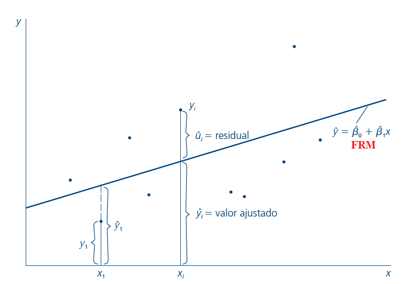

# Clase 2 · Regresión lineal simple

📅 Viernes 23 de octubre de 2026
⏱️ 18:40 – 21:25
Contenido 4 · El modelo de regresión simple
📝 Semana del Control 1

## 🎯 Objetivos de la sesión

- Plantear el modelo de regresión lineal simple (RLS) e interpretar sus parámetros.
- Entender el supuesto clave $E[u \mid x] = 0$ y la función de regresión poblacional.
- Derivar e interpretar los estimadores de **Mínimos Cuadrados Ordinarios (MCO)**.
- Descomponer la variabilidad de $y$ ($SST = SSE + SSR$) y medir la bondad de ajuste con el $R^2$.
- Conocer los supuestos RLS.1–RLS.5 y las propiedades de insesgamiento y varianza de MCO.

---

## 🗓️ Agenda

| Hora | Bloque |
|---|---|
| 18:40 – 18:55 | Repaso y motivación: la esperanza condicional |
| 18:55 – 19:25 | El modelo de regresión lineal simple y el supuesto $E[u\mid x]=0$ |
| 19:25 – 19:55 | Mínimos Cuadrados Ordinarios — *simulador: encuentra la recta* |
| 19:55 – 20:05 | *Receso* |
| 20:05 – 20:25 | Propiedades algebraicas de MCO y método de momentos |
| 20:25 – 20:50 | Descomposición de la varianza y $R^2$ — cambio de unidades |
| 20:50 – 21:15 | Supuestos RLS, insesgamiento y varianza de los estimadores |
| 21:15 – 21:25 | Cierre y tarea |

---

## 1. La esperanza condicional

La **función de esperanza condicional (FEC)** es el valor esperado (la media poblacional) de $Y$
cuando $X$ está fijo en un valor dado.

| Individuo | Años de educación | Ingreso |
|---|:-:|:-:|
| María | 5 | 120 |
| Juan | 5 | 100 |
| Pedro | 4 | 80 |
| Catalina | 2 | 50 |

$$
E[Y \mid X=5] = 110 \qquad E[Y \mid X=4] = 80 \qquad E[Y \mid X=2] = 50 \qquad E[Y] = 87.5
$$

La regresión es, en esencia, una forma de **aproximar la esperanza condicional** con una recta.

---

## 2. El modelo de regresión lineal simple

Queremos estudiar la relación entre dos variables $x$ e $y$ **en la población**: explicar $y$ en
términos de $x$, o cómo cambia $y$ cuando cambia $x$.

$$
y = \beta_0 + \beta_1 x + u
$$

| Término | Nombres |
|---|---|
| $y$ | variable dependiente, explicada, de respuesta, predicha o **regresando** |
| $x$ | variable independiente, explicativa, de control, predictora o **regresor** |
| $\beta_1$ | **pendiente**: cómo cambia $y$ cuando cambia $x$, con los demás factores (en $u$) constantes |
| $\beta_0$ | **intercepto** o término constante; permite suponer $E(u)=0$ |
| $u$ | **término de error** o perturbación: todos los factores distintos de $x$ que afectan a $y$ (*"unobserved"*) |

**Ejemplo:** $\text{salario} = \beta_0 + \beta_1\,\text{educación} + u$. Si los demás factores se
mantienen constantes ($\Delta u = 0$), entonces $\Delta\text{salario} = \beta_1\,\Delta\text{educación}$.

!!! question "Pero… ¿los factores no observados son realmente constantes?"
    ¿Qué hay en $u$ en la ecuación de salarios? Habilidad, experiencia, motivación, contactos,
    educación de los padres… ¿Se relacionan con los años de educación?

### El supuesto clave: media condicional cero

Como no observamos $u$, es difícil afirmar que se mantiene constante. Para estimar el efecto
*ceteris paribus* $\beta_1$ necesitamos:

$$
E[u \mid x] = E[u] = 0
$$

El valor promedio de los factores no observables **es el mismo para cualquier valor de $x$** (y es
cero): $u$ es **media-independiente** de $x$. Esto implica que $x$ no está correlacionada con los
factores no observables.

### Función de regresión poblacional (FRP)

Si se cumplen linealidad y $E[u\mid x]=0$:

$$
E[y \mid x] = \beta_0 + \beta_1 x
$$

<figure markdown>
{ width="520" }
<figcaption>Para cada valor de x, y se distribuye alrededor de la recta E(y|x) = β₀ + β₁x.</figcaption>
</figure>

**Interpretación:**

- $\beta_1 = \dfrac{\Delta E[y\mid x]}{\Delta x}$: cuando $x$ aumenta en una unidad, el **valor esperado** de $y$ cambia en $\beta_1$ unidades.
- $\beta_0 = E[y \mid x = 0]$: el valor medio de $y$ cuando $x$ es cero.

---

## 3. Estimación por Mínimos Cuadrados Ordinarios (MCO)

Con una muestra $\{(x_i, y_i): i = 1,\dots,n\}$ escribimos $y_i = \beta_0 + \beta_1 x_i + u_i$.
Para cada observación definimos:

- $\hat{y}_i = \hat{\beta}_0 + \hat{\beta}_1 x_i$: **valor ajustado** o predicho.
- $\hat{u}_i = y_i - \hat{y}_i$: **residuo**, el análogo muestral del error.

MCO elige los $\hat{\beta}$ que **minimizan la suma de los residuos al cuadrado**:

$$
\min_{\hat{\beta}_0,\,\hat{\beta}_1} \sum_{i=1}^{n} \hat{u}_i^2 = \min_{\hat{\beta}_0,\,\hat{\beta}_1} \sum_{i=1}^{n} \left(y_i - \hat{\beta}_0 - \hat{\beta}_1 x_i\right)^2
$$

**Condiciones de primer orden:**

$$
\begin{aligned}
[\hat{\beta}_0]&: \quad \sum_{i=1}^{n} \left(y_i - \hat{\beta}_0 - \hat{\beta}_1 x_i\right) = 0
\quad\Rightarrow\quad \hat{\beta}_0 = \bar{y} - \hat{\beta}_1 \bar{x} \\[4pt]
[\hat{\beta}_1]&: \quad \sum_{i=1}^{n} x_i\left(y_i - \hat{\beta}_0 - \hat{\beta}_1 x_i\right) = 0
\quad\Rightarrow\quad \hat{\beta}_1 = \frac{\sum_{i=1}^{n} (x_i - \bar{x})\,y_i}{\sum_{i=1}^{n} (x_i - \bar{x})^2} = \frac{\widehat{\text{Cov}}(x,y)}{\widehat{\text{Var}}(x)}
\end{aligned}
$$

Todo lo que aparece en estas fórmulas está en los datos, así que podemos calcular los estimadores.

La **función de regresión muestral (FRM)** $\hat{y} = \hat{\beta}_0 + \hat{\beta}_1 x$ es la versión
estimada de la FRP, que en general es desconocida.

<figure markdown>
{ width="520" }
<figcaption>La recta de MCO, los valores ajustados ŷᵢ y los residuos ûᵢ.</figcaption>
</figure>

!!! example "Ejemplo: educación y salarios en EE. UU."
    Regresando el salario por hora (dólares) en años de educación, se obtiene una pendiente de
    aproximadamente $\hat{\beta}_1 = 0.54$: **cada año adicional de educación se asocia, en
    promedio, con 54 centavos más por hora.** ¿Es este un efecto causal? Lo discutiremos en la
    [Clase 3](clase3.md).

    [Abrir el ejemplo en Colab](https://colab.research.google.com/drive/1fGx_sLiasa-psVeudjO5IgJPPJX0lB6t?usp=sharing){ .usm-btn }

### Método de momentos

Llegamos a los mismos estimadores partiendo de los supuestos poblacionales $E(u)=0$ y $E(xu)=0$:

$$
E(y - \beta_0 - \beta_1 x) = 0 \qquad\qquad E\left[x\,(y - \beta_0 - \beta_1 x)\right] = 0
$$

y eligiendo $\hat{\beta}_0, \hat{\beta}_1$ que resuelvan sus **contrapartes muestrales** — que son
exactamente las condiciones de primer orden de MCO.

### Propiedades algebraicas de MCO

1. Los residuos suman cero: $\sum_i \hat{u}_i = 0 \;\Rightarrow\; \bar{\hat{u}} = 0$.
2. $x$ es ortogonal a los residuos: $\sum_i x_i \hat{u}_i = 0$.
3. El promedio de los valores ajustados es igual al de $y$: $\bar{\hat{y}} = \bar{y}$.
4. La recta de regresión pasa por el punto de promedios: $\bar{y} = \hat{\beta}_0 + \hat{\beta}_1 \bar{x}$.

*Compruébalas en el simulador de arriba activando "Mostrar recta MCO".*

---

## 4. Descomposición de la varianza y bondad de ajuste

$$
\underbrace{\sum_{i=1}^{n} (y_i - \bar{y})^2}_{SST\text{ (total)}}
= \underbrace{\sum_{i=1}^{n} (\hat{y}_i - \bar{y})^2}_{SSE\text{ (explicada)}}
+ \underbrace{\sum_{i=1}^{n} \hat{u}_i^2}_{SSR\text{ (residual)}}
$$

A partir de esta relación se define el **coeficiente de determinación**:

$$
R^2 = \frac{SSE}{SST} = 1 - \frac{SSR}{SST}, \qquad 0 \leq R^2 \leq 1
$$

Es la **proporción de la variación muestral de $y$ explicada por $x$**. Cuanto más cerca de 1,
más variabilidad de $y$ explica el modelo.

!!! warning "Un $R^2$ bajo no invalida la regresión"
    En ciencias sociales es común obtener $R^2$ bajos: muchos factores afectan a $y$. Un $R^2$ bajo
    **no significa** que $\hat{\beta}_1$ esté mal estimado, y un $R^2$ alto **no garantiza** un
    efecto causal.

### Cambio de unidades de medición

- Si $y$ se multiplica por una constante $c$, **ambos** coeficientes se multiplican por $c$.
- Si $x$ se multiplica (divide) por $c$, la **pendiente** se divide (multiplica) por $c$; el
  intercepto no cambia.
- La bondad de ajuste **no depende** de las unidades de medición.

---

## 5. Supuestos del modelo RLS y propiedades de MCO

| Supuesto | Enunciado |
|---|---|
| **RLS.1 — Linealidad en los parámetros** | En la población, $y = \beta_0 + \beta_1 x + u$. |
| **RLS.2 — Muestreo aleatorio** | Contamos con una muestra aleatoria $\{(x_i, y_i): i=1,\dots,n\}$. |
| **RLS.3 — Variación muestral en $x$** | No todos los $x_i$ tienen el mismo valor. |
| **RLS.4 — Media condicional cero** | $E(u \mid x) = 0$. |
| **RLS.5 — Homocedasticidad** | $\text{Var}(u \mid x) = \sigma^2$: la varianza del error no depende de $x$. |

**Insesgamiento (RLS.1–RLS.4):**

$$
E(\hat{\beta}_0 \mid x) = \beta_0 \qquad\qquad E(\hat{\beta}_1 \mid x) = \beta_1
$$

El insesgamiento es una propiedad de la **distribución muestral** de los estimadores: no dice nada
sobre la estimación obtenida con una muestra en particular, sino que, en promedio sobre muchas
muestras, acertamos.

**Varianza de los estimadores (RLS.1–RLS.5):**

$$
\text{Var}(\hat{\beta}_1 \mid x) = \frac{\sigma^2}{\sum_{i=1}^n (x_i - \bar{x})^2} = \frac{\sigma^2}{SST_x}
\qquad\qquad
\text{Var}(\hat{\beta}_0 \mid x) = \frac{\sigma^2 \sum_{i=1}^n x_i^2}{n \sum_{i=1}^n (x_i - \bar{x})^2}
$$

!!! danger "Cuando falla RLS.4: correlación espuria"
    Si $u$ contiene factores que afectan a $y$ **y están correlacionados con $x$**, MCO encuentra una
    relación entre $x$ e $y$ que en realidad se debe a esos factores no observados. Ese es el tema de
    la próxima clase.

---

## ✅ Autoevaluación

Estimas salario = −0.90 + 0.54·educ. ¿Cuál es la interpretación correcta de 0.54?

<button class="econ-quiz-opt">Un año más de educación causa un aumento de 0.54 dólares por hora en el salario de cada persona.</button>
<button class="econ-quiz-opt" data-correct>Un año más de educación se asocia, en promedio, con 0.54 dólares más por hora.</button>
<button class="econ-quiz-opt">El 54% de la variación del salario se explica por la educación.</button>

✅ β̂₁ describe cómo cambia el salario <strong>esperado</strong>. Solo es causal si E[u|educ] = 0, lo que es dudoso (habilidad). La tercera opción describe un R², no una pendiente.

En una regresión, SST = 400 y SSR = 300. ¿Cuánto vale el R²?

<button class="econ-quiz-opt">0.75</button>
<button class="econ-quiz-opt" data-correct>0.25</button>
<button class="econ-quiz-opt">No se puede calcular sin SSE</button>

✅ R² = 1 − SSR/SST = 1 − 300/400 = 0.25. (Y SSE = SST − SSR = 100.)

¿Cuál de estos cambios <strong>no</strong> reduce la varianza de β̂₁?

<button class="econ-quiz-opt">Aumentar el tamaño muestral</button>
<button class="econ-quiz-opt">Tener más variabilidad en x</button>
<button class="econ-quiz-opt" data-correct>Medir y en centavos en vez de dólares</button>

✅ Cambiar las unidades de y multiplica β̂₁ y su desviación estándar por la misma constante: la precisión <em>relativa</em> no cambia. Más n y más SSTₓ sí reducen Var(β̂₁) = σ²/SSTₓ.

---

## 📝 Tarea

Muestre que:

$$
\sum_{i=1}^n (x_i - \bar{x})(y_i - \bar{y}) = \sum_{i=1}^n (x_i - \bar{x})\,y_i = \sum_{i=1}^n (y_i - \bar{y})\,x_i
$$

??? tip "Pista"
    Desarrolla el producto y usa que $\sum_{i=1}^n (x_i - \bar{x}) = 0$.

## 📚 Para la próxima clase

- **Wooldridge**, capítulo 2 (*El modelo de regresión simple*).
- Próxima clase: **Causalidad y variable omitida** — ¿cuándo podemos interpretar $\hat{\beta}_1$
  como un efecto causal?
