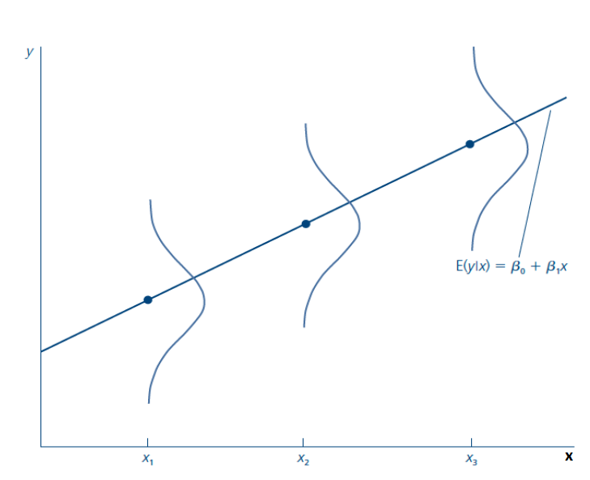
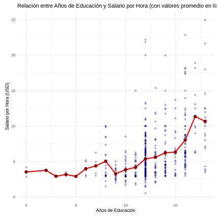
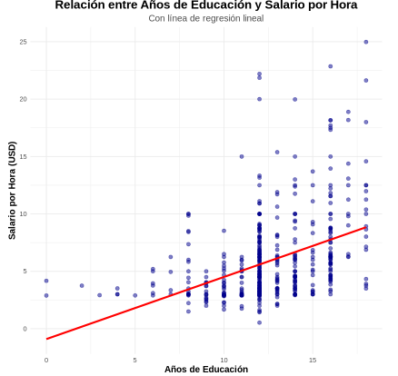

<!-- ARCHIVO GENERADO por tools/clases.py a partir de las diapositivas oficiales. No editar a mano: modifica tools/clases.py o el .tex y vuelve a generar. -->

# Clase 2 · Regresión lineal simple

📅 Viernes 23 de octubre de 2026
⏱️ 18:40 – 21:25
Semana 2 · Contenido 4 · El modelo de regresión simple
📝 Semana del Control 1

!!! info "Contenido oficial de la semana"
    Esta página reproduce **íntegras y en orden** las diapositivas de la semana 2
    (`sem2/clase2.tex`). Los bloques **Interactivo**, **Complemento** y las preguntas de
    autoevaluación son material adicional para estudiar.

## 🎯 Objetivos de la sesión

- Plantear el modelo de regresión lineal simple (RLS) e interpretar sus parámetros.
- Entender el supuesto clave $E[u \mid x] = 0$ y la función de regresión poblacional.
- Derivar e interpretar los estimadores de **Mínimos Cuadrados Ordinarios (MCO)**.
- Descomponer la variabilidad de $y$ ($SST = SSE + SSR$) y medir la bondad de ajuste con el $R^2$.
- Conocer los supuestos RLS 1–5 y las propiedades de insesgamiento y varianza de MCO.

## 🗓️ Agenda

| Hora | Bloque |
|---|---|
| 18:40 – 19:15 | Modelo RLS, término de error, supuestos, regresión poblacional y esperanza condicional |
| 19:15 – 19:55 | Estimación por MCO, regresión muestral y ejemplo educación–sueldos |
| 19:55 – 20:05 | *Receso* |
| 20:05 – 20:30 | Propiedades aritméticas de MCO y método de momentos |
| 20:30 – 20:50 | Descomposición de la varianza, $R^2$ y cambio de unidades |
| 20:50 – 21:15 | Supuestos RLS, insesgamiento y varianza de los estimadores |
| 21:15 – 21:25 | Autoevaluación, tarea y cierre |

---

## Regresión lineal simple

📄 Diapositivas: <code>sem2/clase2.tex</code> · 34 láminas

### Modelo de regresión lineal simple

<!-- sem2/clase2.tex · lámina 1 -->

-   Queremos estudiar la relación entre dos variables x e y en la población.

-   Explicar y en terminos de x o como cambia y cuando cambia x.

-   Modelo de regresión lineal simple (RLS):

    $$
    y = \beta_0 + \beta_1 x + u
    $$

-   $\beta_0$, $\beta_1$ son parámetros poblacionales.

-   u: término de error o perturbación, factores no-observables que afectan a y.

-   El coeficiente $\beta_0$, permite suponer que E(u) = 0.

-   $\beta_1$ captura como cambia y cuando cambia x.

<!-- sem2/clase2.tex · lámina 2 -->

$$
y = \beta_0 + \beta_1 x + u
$$

Terminología:

-   y: variable dependiente, variable explicada, variable de respuesta, variable predicha o el regresando.

-   x: variable independiente, variable explicativa, variable de control, variable predictora o el regresor.

-   $\beta_1$: es el parámetro de la pendiente en la relación entre y y x, cuando todos los demás factores en u permanecen constantes, este parámetro es de interés primordial en la economía aplicada.

-   $\beta_0$: es el parámetro del intercepto, algunas veces llamado término constante.

### Termino de error

<!-- sem2/clase2.tex · lámina 3 -->

-   La variable u, llamada **término de error**, o **perturbación** en la relación, representa factores distintos a x que afectan a y.

-   Un análisis de regresión simple en realidad trata a todos los factores que afectan a y, y que son distintos a x como factores no observados.

-   Es útil considerar a u como abreviación de "unobserved".

### Ejemplo

<!-- sem2/clase2.tex · lámina 4 -->

-   Por ejemplo:

    $$
    \text{salario} = \beta_0 + \beta_1 \text{educación} + u
    $$

-   Noten que si todos los demás factores son constantes ($\Delta u = 0$), entonces:

    $$
    \Delta \text{salario} = \beta_1 \Delta \text{educación}
    $$

-   $\beta_1$ es el parámetro de la pendiente en la relación entre $y$ y $x$, cuando los factores **no observables** son constantes. **PERO, en general, ¿son constantes?**

### Modelo de regresión lineal simple

<!-- sem2/clase2.tex · lámina 5 -->

-   Modelo de regresión lineal simple:

    $$
    y = \beta_0 + \beta_1 x + u \tag{2}
    $$

-   **PERO, en general, ¿son constantes?**

-   Difícil decir que $u$ es constante cuando no lo observamos.

-   El supuesto clave para estimar $\beta_1$ (cómo $x$ afecta a $y$) es que:

    $$
    E[u|x] = 0
    $$

    $\rightarrow$ el valor promedio de $u$ es igual para cualquier valor de $x$. Además, es igual a cero, implicando que $x$ no está correlacionada con los factores no observables.

-   Sin esa restricción, no es posible estimar el efecto *ceteris paribus* $\beta_1$.

### Supuestos

<!-- sem2/clase2.tex · lámina 6 -->

1.  Linealidad en los parámetros: la función que relaciona $y$ con $x$ es lineal.

2.  Media condicional cero:

    $$
    E[u|x] = E[u] = 0
    $$

    $\rightarrow$ El valor esperado de los factores inobservables no depende de los valores de $x$, y dicho promedio es igual a 0, **u es media independiente de x.**

### Ejemplo

<!-- sem2/clase2.tex · lámina 7 -->

$$
Salario = \beta_0 + \beta_1 educ + u
$$

¿Qué hay en u? ¿Como se relaciona con x?

### Regresión Poblacional

<!-- sem2/clase2.tex · lámina 8 -->

-   Si se cumplen los supuestos anteriores (linealidad y $E[u|x] = 0$):

-   Entonces:

    $$
    y = \beta_0 + \beta_1x + u
    $$

    $$
    E[y|x] = \beta_0 + \beta_1E[x|x] + E[u|x]
    $$

    $$
    E[y|x] = \beta_0 + \beta_1x
    $$

-   Por lo tanto, el MRS aproxima la esperanza condicional de y.

-   A la línea $E[y|x]$ se le llama Función de Regresión Poblacional (FRP).

### Esperanza condicional

<!-- sem2/clase2.tex · lámina 9 -->

La función de esperanza condicional es la esperanza de una variable $Y_i$ (o su media poblacional) cuando $X_i$ está fijo.

| Individuo | Años educ. | Ingreso |
|----------:|:-----------|:--------|
|     María | 5          | 120     |
|      Juan | 5          | 100     |
|     Pedro | 4          | 80      |
|  Catalina | 2          | 50      |

FEC para cada nivel de educación: 
$E[Y_i|X_i = 5] = 110$ 
$E[Y_i|X_i = 4] = 80$ 
$E[Y_i|X_i = 2] = 50$ 
$E[Y_i] = 87.5$

### Regresión Poblacional: FRP

<!-- sem2/clase2.tex · lámina 10 -->

{ .econ-slide-img }

### Interpretación

<!-- sem2/clase2.tex · lámina 11 -->

$$
y = \beta_0 + \beta_1x + u
$$

$$
E[y|x] = \beta_0 + \beta_1x
$$

Noten que:

$$
\beta_1 = \frac{\Delta E[y|x]}{\Delta x}
$$

$\rightarrow$ es la pendiente de la Función de la FRP, cuando $x$ aumenta en una unidad, el valor esperado de $y$ cambia en $\beta_1$ unidades.

$$
\beta_0 = E[y|x = 0]
$$

$\rightarrow$ es el intercepto de la FRP, el valor medio de $y$ cuando $x$ es igual a cero.

### Estimación

<!-- sem2/clase2.tex · lámina 12 -->

-   Objetivo: estimar los parámetros poblacionales a partir de una muestra.

-   Sea el modelo poblacional: $y = \beta_0 + \beta_1x + u$

-   Entonces, para cada $i = 1, \ldots, n$ de una muestra podemos escribir:

    $$
    y_i = \beta_0 + \beta_1x_i + u_i
    $$

    donde $u_i$ es el término de error para la observación $i$.

### Mínimos Cuadrados Ordinarios

<!-- sem2/clase2.tex · lámina 13 -->

$$
{y}_i = \hat{\beta}_0 + \hat{\beta}_1 x_i + \hat{u}_i \quad \forall i = 1, \ldots, n
$$

Definiciones:

-   $\hat{\beta}_0$: estimador de $\beta_0$

-   $\hat{\beta}_1$: estimador de $\beta_1$

-   $\hat{y}_i = \hat{\beta}_0 + \hat{\beta}_1 x_i$: valor predicho/estimado de $y_i$

-   $\hat{u}_i = y_i - \hat{y}_i$ residuo. El residuo es el análogo muestral del error.

<!-- -->
-   Objetivo: encontrar los estimadores $\hat{\beta}$ más parecidos a los parámetros $\beta$, los $\hat{y}_i$ más parecidos a $y_i$, los $\hat{u}_i$ más cercanos a 0. 

-   MCO (Mínimos Cuadrados Ordinarios): encuentra los $\beta$'s que minimizan la suma de los residuos al cuadrado:

    $$
    \min_{\hat{\beta}_0, \hat{\beta}_1} \sum_{i=1}^{n} \hat{u}_i^2 = \min_{\hat{\beta}_0, \hat{\beta}_1} \sum_{i=1}^{n} (y_i - \hat{\beta}_0 - \hat{\beta}_1 x_i)^2
    $$

### Estimación de $\beta$ MCO

<!-- sem2/clase2.tex · lámina 14 -->

$$
\quad \min_{\hat{\beta}_0, \hat{\beta}_1} \sum_{i=1}^{n} \hat{u}_i^2 = \min_{\hat{\beta}_0, \hat{\beta}_1} \sum_{i=1}^{n} (y_i - \hat{\beta}_0 - \hat{\beta}_1 x_i)^2
$$

Condiciones de primer orden:

$$
{}[\hat{\beta}_0] : \quad \sum_{i=1}^{n} (y_i - \hat{\beta}_0 - \hat{\beta}_1 x_i) = 0 \quad \Rightarrow \quad \hat{\beta}_0 = \bar{y} - \hat{\beta}_1 \bar{x}
$$

$$
{}[\hat{\beta}_1] : \quad \sum_{i=1}^{n} x_i(y_i - \hat{\beta}_0 - \hat{\beta}_1 x_i) = 0 \Rightarrow \hat{\beta}_1 = \frac{\sum_{i=1}^{n}(x_i - \bar{x})y_i}{\sum_{i=1}^{n}(x_i - \bar{x})^2} = \frac{\widehat{\text{Cov}}(x, y)}{\widehat{\text{Var}}(x)}
$$

Noten que todas estas variables están en la data. Entonces podemos obtener estos estimadores.

### Tarea

<!-- sem2/clase2.tex · lámina 15 -->

-   Muestre que:

    $\sum_{i}^n(x_i - \bar{x})(y_i - \bar{y}) = \sum_{i}^n(x_i - \bar{x})y_i= \sum_{i}^n(y_i - \bar{y})x_i$.

!!! tip "Complemento · Pista para la tarea"
    Desarrolla el producto y usa que $\sum_{i=1}^n (x_i - \bar{x}) = 0$ y $\sum_{i=1}^n (y_i - \bar{y}) = 0$.

### Regresión Muestral (FRM)

<!-- sem2/clase2.tex · lámina 16 -->

1.  Una vez que estimamos $\hat{\beta}_0$ y $\hat{\beta}_1$, obtenemos la función de regresión muestral (FRM):

    $$
    \hat{y} = \hat{\beta}_0 + \hat{\beta}_1 x
    $$

2.  La FRM que se obtiene de una muestra es la versión estimada de la función de regresión poblacional (FRP).

3.  En general, la FRP es desconocida y uno se basa en una muestra para estimarla.

4.  **Valor ajustado o predicho: $\hat{y}$.**

### Mínimos Cuadrados Ordinarios

<!-- sem2/clase2.tex · lámina 17 -->

{ .econ-slide-img }

### Un ejemplo: relación entre educación y sueldos

<!-- sem2/clase2.tex · lámina 18 -->

-   Tomamos la relación entre años de educación y sueldos por hora en EE. UU.

    $$
    salario_i = \beta_0 + \beta_1 \text{educación}_i + \epsilon_i
    $$

[Colab](https://colab.research.google.com/drive/1fGx_sLiasa-psVeudjO5IgJPPJX0lB6t?usp=sharing){ .usm-btn target=_blank }

{ .econ-slide-img }

### Un ejemplo

<!-- sem2/clase2.tex · lámina 19 -->

-   Años de educación y salarios por hora en Estados Unidos.

    $$
    \text {MCO: } \hat{\text{salario}} = 0.095 + 0.54 \text{educación}
    $$

-   La línea de regresión minimiza los residuos al cuadrado.

{ .econ-slide-img }

### Propiedades aritméticas de MCO

<!-- sem2/clase2.tex · lámina 20 -->

1.  Los residuales suman cero:

    $$
    \sum_{i} \hat{u}_i = 0 \quad \Rightarrow \quad \bar{\hat{u}} = 0
    $$

2.  $x$ es ortogonal a los residuos:

    $$
    \sum_{i} x_{i} \hat{u}_i = 0
    $$

3.  El promedio muestral de la variable dependiente $y_i$ es igual al promedio muestral de la estimación $\hat{y}_i: \bar{y} = \bar{\hat{y}}$

4.  La línea de regresión pasa por el promedio de los datos:

    $$
    \bar{y} = \hat{\beta}_0 + \hat{\beta}_1 \bar{x}
    $$

!!! tip "Complemento · Compruébalo"
    En el simulador *encuentra la recta de mínimos cuadrados* activa **Mostrar recta MCO**: verás que $\sum_i \hat{u}_i = 0$, $\sum_i x_i\hat{u}_i = 0$ y que la recta pasa por $(\bar{x}, \bar{y})$, incluso si arrastras los puntos.

### Método de momentos

<!-- sem2/clase2.tex · lámina 21 -->

$$
\begin{aligned}
y=\beta_0+\beta_1x+u\\
E(u)= 0= E(y-\beta_0-\beta_1x) \\
E(xu)=0=E[x(y-\beta_0-\beta_1x)]
\end{aligned}
$$

Se eligen estimaciones de los parámetros $\beta_0$ y $\beta_1$ que resuelvan las contrapartes muestrales.

<!-- sem2/clase2.tex · lámina 22 -->

$$
\begin{aligned}
\sum_{i=1}^{n} (y_i - \hat{\beta}_0 - \hat{\beta}_1 x_i) = 0  \\
\sum_{i=1}^{n} x_i(y_i - \hat{\beta}_0 - \hat{\beta}_1 x_i) = 0
\end{aligned}
$$

### Estimación de $\beta$ MCO

<!-- sem2/clase2.tex · lámina 23 -->

$$
\quad \min_{\hat{\beta}_0, \hat{\beta}_1} \sum_{i=1}^{n} \hat{u}_i^2 = \min_{\hat{\beta}_0, \hat{\beta}_1} \sum_{i=1}^{n} (y_i - \hat{\beta}_0 - \hat{\beta}_1 x_i)^2
$$

Condiciones de primer orden:

$$
{}[\hat{\beta}_0] : \quad \sum_{i=1}^{n} (y_i - \hat{\beta}_0 - \hat{\beta}_1 x_i) = 0
$$

$$
{}[\hat{\beta}_1] : \quad \sum_{i=1}^{n} x_i(y_i - \hat{\beta}_0 - \hat{\beta}_1 x_i) = 0
$$

### Descomposición de la varianza muestral

<!-- sem2/clase2.tex · lámina 24 -->

-   Sea SST la suma de cuadrados totales (total sum of squares):

    $$
    SST = \sum_{i=1}^{n} (y_i - \bar{y})^2
    $$

-   Sea SSE la suma de cuadrados explicados (explained sum of squares):

    $$
    SSE = \sum_{i=1}^{n} (\hat{y}_i - \bar{y})^2
    $$

-   Sea SSR la suma de cuadrados no explicados (residual sum of squares):

    $$
    SSR = \sum_{i=1}^{n} \hat{u}_i^2
    $$

Se puede demostrar que:

$$
SST = SSE + SSR
$$

### Bondad de Ajuste: $R^2$

<!-- sem2/clase2.tex · lámina 25 -->

-   A partir de esta relación se define:

    $$
    R^2 = \frac{SSE}{SST} = 1 - \frac{SSR}{SST}
    $$

-   Bondad de ajuste: la proporción de la varianza muestral de $y$ que es explicada por $x$.

-   Como $0 \leq SSE \leq SST$, entonces $0 \leq R^2 \leq 1$.

-   Cuanto más cercano a $1$, más de la variabilidad de $y$ es explicada por el modelo.

### Cambio de unidades de medición

<!-- sem2/clase2.tex · lámina 26 -->

-   Si la variable independiente se divide o se multiplica por una constante distinta de cero, c, entonces el coeficiente de la pendiente de MCO se multiplica por c o se divide entre c, respectivamente.

-   Cambiar sólo las unidades de medición de la variable independiente no afecta el intercepto.

-   La bondad de ajuste del modelo no depende de las unidades de medición de las variables.

### Supuesto 1 RLS

<!-- sem2/clase2.tex · lámina 27 -->

En el modelo poblacional, la variable dependiente, y, está relacionada con la variable independiente, x, y con el error (o perturbación), u, de la manera siguiente: 

$$
y=\beta_0 +\beta_1x+ u
$$

donde $\beta_0$ y $\beta_1$ representan los parámetros poblacionales, del intercepto y pendiente, respectivamente. $u$ contiene los efectos no observables que afectan a $y$, $u$ no debe confundirse con los residuales.

### Supuesto 2 RLS

<!-- sem2/clase2.tex · lámina 28 -->

Se cuenta con una muestra **aleatoria** de tamaño n, $\lbrace(x_i,y_i): i = 1, 2, ..., n\rbrace$.

### Supuesto 3 RLS

<!-- sem2/clase2.tex · lámina 29 -->

No todos los valores muestrales de x, a saber $\lbrace x_i, i = 1,.., n\rbrace$, son iguales, es decir, no todos tienen el mismo valor.

### Supuesto 4 RLS

<!-- sem2/clase2.tex · lámina 30 -->

Para todo valor de la variable explicativa, el valor esperado del error u es cero.

$E(u|x) = 0$.

### Insesgamiento de los estimadores de MCO

<!-- sem2/clase2.tex · lámina 31 -->

Si se cumplen los supuestos 1-4 RLS, los estimadores $\hat{\beta_0}$ y $\hat{\beta_1}$ son insesgados:

$$
E(\hat{\beta_0}|x)=\beta_0
$$

$$
E(\hat{\beta_1}|x)=\beta_1
$$

El insesgamiento es una propiedad de las distribuciones muestrales de $\hat{\beta_0}$ y $\hat{\beta_1}$. No dice nada acerca de las estimaciones que se obtienen a partir de una determinada muestra. Se espera que, si la muestra es de alguna manera "representativa", la estimación estará "cerca" del valor poblacional.

<!-- sem2/clase2.tex · lámina 32 -->

-   Si u contiene factores que afectan a y que están correlacionados con x, puede obtenerse una **correlación espuria**.

-   Es decir, se encuentra una relación entre x e y que en realidad se debe a factores no observados que afectan a y que resultan estar correlacionados con x.

### Supuesto 5 RLS

<!-- sem2/clase2.tex · lámina 33 -->

El error u tiene la misma varianza para cualquier valor de la variable explicativa.

$$
Var(u|x)=\sigma^2
$$

La varianza de los factores inobservables, u, condicionales en x, es constante. Esto se conoce como el supuesto de **homocedasticidad o de varianza constante.**

### Varianza de los estimadores de mínimos cuadrados ordinarios

<!-- sem2/clase2.tex · lámina 34 -->

Considerando el supuesto 5 RLS, tenemos:

$$
Var(\hat{\beta_1}|x)={\sigma^2\over \sum_{i=1}^n(x_i-\bar{x})^2}
$$

$$
Var(\hat{\beta_0}|x)={\sigma^2 \sum_{i=1}^nx_i^2\over n\sum_{i=1}^n(x_i-\bar{x})^2 }
$$

---

## ✅ Autoevaluación

Con los datos de EE. UU. se estimó salario = 0.095 + 0.54·educación. ¿Cuál es la interpretación correcta de 0.54?

<button class="econ-quiz-opt">Un año más de educación causa un aumento de 0.54 dólares por hora en el salario de cada persona.</button>
<button class="econ-quiz-opt" data-correct>Un año más de educación se asocia, en promedio, con 0.54 dólares más por hora.</button>
<button class="econ-quiz-opt">El 54% de la variación del salario se explica por la educación.</button>

✅ β̂₁ describe cómo cambia el salario <strong>esperado</strong>. Solo es causal si E[u|x] = 0 (supuesto 4), lo que es dudoso: ¿qué hay en u? La tercera opción describe un R², no una pendiente.

En una regresión, SST = 400 y SSR = 300. ¿Cuánto vale el R²?

<button class="econ-quiz-opt">0.75</button>
<button class="econ-quiz-opt" data-correct>0.25</button>
<button class="econ-quiz-opt">No se puede calcular sin SSE</button>

✅ R² = 1 − SSR/SST = 1 − 300/400 = 0.25 (y SSE = SST − SSR = 100).

Según Var(β̂₁|x) = σ² / Σ(xᵢ − x̄)², ¿cuál de estos cambios <strong>no</strong> reduce la varianza de β̂₁?

<button class="econ-quiz-opt">Aumentar el tamaño muestral</button>
<button class="econ-quiz-opt">Tener más variabilidad en x</button>
<button class="econ-quiz-opt" data-correct>Que el error u tenga mayor varianza σ²</button>

✅ Un σ² mayor <em>aumenta</em> la varianza. Más observaciones y más dispersión en x aumentan Σ(xᵢ − x̄)² y la reducen (pruébalo en el simulador de insesgamiento).

## 📚 Para la próxima clase

- **Wooldridge**, capítulo 2 (*El modelo de regresión simple*).
- Próxima clase: **Causalidad y variable omitida** — ¿cuándo podemos interpretar $\hat{\beta}_1$
  como un efecto causal?
