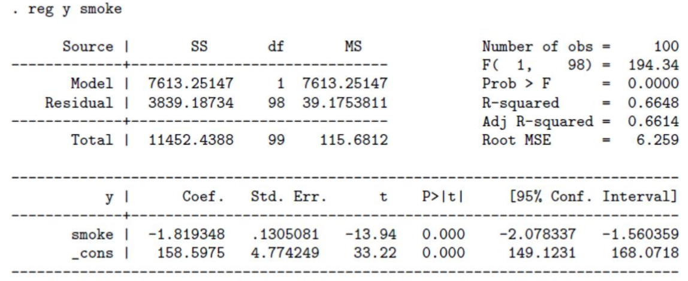
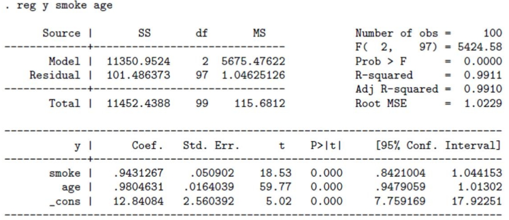

<!-- ARCHIVO GENERADO por tools/clases.py a partir de las diapositivas oficiales. No editar a mano: modifica tools/clases.py o el .tex y vuelve a generar. -->

# Clase 3 · Causalidad y variable omitida

📅 Viernes 30 de octubre de 2026
⏱️ 18:40 – 21:25
Semana 3 · Causalidad, variable omitida

!!! info "Contenido oficial de la semana"
    Esta página reproduce **íntegras y en orden** las diapositivas de la semana 3 (`sem3/`):
    `Clase3.tex` y `Clase4.tex`. Los bloques **Interactivo**, **Complemento** y las preguntas de
    autoevaluación son material adicional para estudiar.

## 🎯 Objetivos de la sesión

- Distinguir entre **esperanza condicional** (lo que describe una regresión) y **efecto causal**.
- Usar el modelo de **outcomes potenciales** de Rubin para definir el ATE y el ATT.
- Descomponer una diferencia de promedios en **efecto causal + sesgo de selección**.
- Entender por qué la **aleatorización** elimina el sesgo de selección.
- Derivar el **sesgo por variable omitida** y predecir su signo.

## 🗓️ Agenda

| Hora | Bloque |
|---|---|
| 18:40 – 19:20 | **Parte 1** · Esperanza condicional vs. causalidad, contrafactual, modelo de Rubin, ATE y ATT |
| 19:20 – 19:55 | **Parte 1** · ATT y sesgo de selección; ejemplo de las alarmas |
| 19:55 – 20:05 | *Receso* |
| 20:05 – 20:20 | **Parte 1** · Aleatorización |
| 20:20 – 21:00 | **Parte 2** · Sesgo de selección y MCO; sesgo por omisión de variable y su signo |
| 21:00 – 21:20 | **Parte 2** · Controles, ejemplos (fumar y edad), ¿más es mejor?, conclusiones |
| 21:20 – 21:25 | Autoevaluación y cierre |

---

## Parte 1 · Causalidad y sesgo de selección

📄 Diapositivas: <code>sem3/Clase3.tex</code> · 16 láminas

### Esperanza condicional versus causalidad

<!-- sem3/Clase3.tex · lámina 1 -->

-   Hasta ahora, hemos visto como funciona el modelo de regresión lineal que nos entrega la esperanza condicional de una variable condicional a la otra.

-   Nos permite describir muchas realidades empíricas. Ejemplos:

    -   ¿Las personas con más educación reciben sueldos mayores?

    -   ¿Estudiar Economía está asociado con un mayor sueldo?

-   Pero, ¿son las relaciones estimadas causales?

-   ¿Es la educación lo que aumenta el salario, o simplemente observamos que las personas que se educan más tienen más salario por otros motivos?

-   Construiremos un marco analítico para pensar el problema de causalidad.

### Contrafactual

<!-- sem3/Clase3.tex · lámina 2 -->

-   Para pensar en causalidad, tenemos que imaginar un mundo contrafactual.

-   ¿Qué pasaría si pudieramos observar a las personas que fueron a la universidad en un mundo alternativo en que no hubieran ido?

    -   **Problema fundamental: No podemos calcular directamente el impacto causal de un tratamiento para un individuo $i$ porque no podemos observar al mismo individuo en los dos estados (con y sin tratamiento)**

-   **Definición de Contrafactual:** El resultado que los mismos participantes de un programa hubieran obtenido en el caso hipotético de no haber participado.

### El marco teórico de Rubin

<!-- sem3/Clase3.tex · lámina 3 -->

-   Estamos interesados en medir el impacto de un "Tratamiento" que es una variable binaria (recibirlo o no) en $y$.

    -   El tratamiento podria ser un subsidio del gobierno, participar en un programa determinado, becas para la universidad, recibir vacunas, etc.

    -   Vamos a definir dos grupos: los tratados (T) y el grupo no tratado o control (NT).

### Modelo de outcomes potenciales (Rubin)

<!-- sem3/Clase3.tex · lámina 4 -->

-   Buscamos saber el impacto causal del tratamiento (T) en una variable $Y$.

    -   $Y_i$: outcome observado para la persona $i$.

    -   $T_i$: variable aleatoria binaria que toma valor $1$ si fue tratado y $0$ si no lo fue.

    -   $Y_i^T$: es el outcome potencial del individuo si fue tratado.

    -   $Y_i^{NT}$: es el outcome potencial del individuo si NO fue tratado.

-   El impacto de recibir $T$ para cada individuo sería $Y_i^T - Y_i^{NT}$. ¿Puedo observar esto?

-   **Nunca observaremos ambos outcomes (o estados) a la vez**.

### ATE y ATT

<!-- sem3/Clase3.tex · lámina 5 -->

-   El impacto promedio causal (Average Treatment Effect, ATE) es:

    $$
    ATE = E[Y_i^T - Y_i^{NT}]
    $$

-   **No observable** porque a cada $i$ lo observamos en un solo estado (tratado o no).

-   El impacto promedio causal para los tratados (Average Treatment Effect on the Treated, ATT) es: $E[Y_i^T - Y_i^{NT} | T_i=1]$.

-   **Tampoco lo observamos porque $E[Y_i^{NT}|T_i=1]$ no es observable.**

### Observado y no observado

<!-- sem3/Clase3.tex · lámina 6 -->

Ejemplo de que vemos y que no vemos:

|          |      Datos       |                  | Outcomes Potenciales  |                      |
|:---------|:----------------:|:----------------:|:---------------------:|:--------------------:|
|          | $\mathrm{T}_{i}$ | $\mathrm{Y}_{i}$ | $\mathrm{Y}_{i}^{NT}$ | $\mathrm{Y}_{i}^{T}$ |
| Sofia    |        1         |       100        |         $? ?$         |         100          |
| Paula    |        0         |        40        |          40           |        $? ?$         |
| Ezequiel |        1         |        80        |         $? ?$         |          80          |
| Juan     |        0         |        20        |          20           |        $? ?$         |
| Caro     |        1         |        60        |         $? ?$         |          60          |

El efecto causal promedio, Average Treatment Effect, sería

$$
ATE = E[Y_i^T - Y_i^{NT}]
$$

NO observable. Ej: no puedo saber $Y_i^{NT}$ para Caro porque no sé como hubiese sido su vida si no hubiera recibido el tratamiento. 

Al menos nos gustaría identificar el efecto del tratamiento para el grupo de tratados $ATT = E[Y_i^T - Y_i^{NT}|T_i=1]$. Tampoco se puede observar porque $E[Y_i^{NT}|T_i=1]$ es no observable.

### Problema estimación del impacto causal

<!-- sem3/Clase3.tex · lámina 7 -->

Individuo \(i\)

↙↘

\(T_i=1\): observamos \(Y_i^{T}\)

\(T_i=0\): observamos \(Y_i^{NT}\)

⇣⇣

\(Y_i^{NT}\) contrafactual

\(Y_i^{T}\) contrafactual

-   Cada individuo recorre una sola rama (línea sólida); la rama contrafactual (roja, punteada) nunca se observa.

-   Este es el problema fundamental de la inferencia causal: para cada $i$ solo vemos $Y_i^{T}$ o $Y_i^{NT}$, nunca ambos.

### Usar datos observacionales para inferir el ATE

<!-- sem3/Clase3.tex · lámina 8 -->

-   No podemos estimar el ATE o el ATT directamente.

-   Usamos datos que si observamos para estimar el efecto del tratamiento y pensar qué supuestos necesitamos para que eso nos de el ATE.

-   Como no puedo comparar las mismas personas en el mundo alternativo, la magia del supuesto esta en encontrar un grupo de comparación (contrafactual) que hubiera sido similar al grupo tratado en ausencia del tratamiento.

### ATT y sesgo de selección

<!-- sem3/Clase3.tex · lámina 9 -->

-   Supongamos que queremos calcular el efecto del tratamiento $T$ en la variable $y$. Ejemplo: el efecto de ir a la universidad (T) en el salario.

-   No podemos ver directamente el ATE o ATT.

-   Podemos comparar el promedio de Y para el grupo de personas que fue a la universidad contra el promedio de y para los que no fueron (los vamos a llamar control). Esto es lo que hacemos en MCO.

    $$
    \beta_1=E\left[Y_{i} \mid T_{i}=1\right]-E\left[Y_{i} \mid T_{i}=0\right]
    $$

-   Es esto el ATE? En general, No! Porque en contextos no experimentales, los tratados eligen participar del programa y entonces difieren en muchas características con los del grupo no tratado.

<!-- sem3/Clase3.tex · lámina 10 -->

-   **Ejemplo:** La decisión de asistir a la universidad es voluntaria y puede estar influenciada por diversos factores, como intereses personales, recursos económicos y oportunidades previas. Debido a esto, las personas que no cursaron estudios universitarios pueden diferir en varias características de aquellas que sí lo hicieron. Compararlas directamente podría no ser adecuado, ya que no constituyen un buen contrafactual para evaluar el impacto de la educación universitaria.

<!-- sem3/Clase3.tex · lámina 11 -->

Vamos a descomponer $\beta_1$ en el efecto causal del tratamiento y un sesgo:

$$
\beta_1=E\left(Y_{i}^{T} \mid T_{i}=1\right)-E\left(Y_{i}^{\mathrm{NT}} \mid T_{i}=0\right)
$$

sumamos y restamos el término: $E\left[Y_{i}^{\mathrm{NT}} \mid T_{i}=1\right]$

$$
\begin{gathered}
E\left(Y_{i}^{T} \mid T_{i}=1\right)-E\left(Y_{i}^{\mathrm{NT}} \mid T_{i}=0\right)+E\left(Y_{i}^{\mathrm{NT}} \mid T_{i}=1\right)-E\left(Y_{i}^{\mathrm{NT}} \mid T_{i}=1\right) \\
\beta_1=E\left(Y_{i}^{T}-Y_{i}^{\mathrm{NT}} \mid T_{i}=1\right)+E\left(Y_{i}^{\mathrm{NT}} \mid T_{i}=1\right)-E\left(Y_{i}^{\mathrm{NT}} \mid T_{i}=0\right)
\end{gathered}
$$

-   El primer término corresponde a ATT: El efecto causal del tratamiento para los tratados.

<!-- sem3/Clase3.tex · lámina 12 -->

-   Al segundo término se lo llama sesgo de selección. Surge porque el grupo que recibió tratamiento ya era diferente al control.

-   Intuición del sesgo: En el mundo contrafactual en el que nadie tuvo tratamiento, el grupo que obtuvo tratamiendo igual hubiera tenido un diferente outcome porque ya era diferente al grupo que no obtuvo el tratamiento.

### Sesgo de selección

<!-- sem3/Clase3.tex · lámina 13 -->

-   Las personas que toman una acción tienen características distintas a las personas que no lo hacen.

-   Por ejemplo, la gente que va a la universidad tiene alguna característica que hace que incluso en ausencia de ir a la universidad, hubieran tenido mayores salarios.

-   Hay sesgo de selección cuando, incluso en ausencia de una intervención, los resultados promedio de las unidades tratadas y no tratadas son distintos después del programa.

-   ¿Qué signo toma el sesgo de selección?

### Ejemplo: una alarma para las casas

<!-- sem3/Clase3.tex · lámina 14 -->

-   Queremos saber si las alarmas para las casas bajan el delito.

-   El problema es que cada individuo decide si poner una alarma o no en su casa.

-   ¿En qué podrían diferir los que ponen alarmas o no?

-   ¿Cómo sería el sesgo de selección?

-   ¿Qué pasaría entonces si comparamos la cantidad de robos en casas con y sin alarmas?

-   ¿Sería el efecto causal?

### Aleatorización

<!-- sem3/Clase3.tex · lámina 15 -->

-   ¿Qué supuesto necesito para que no haya sesgo de selección?

-   El supuesto clave es que los outcomes potenciales sean independientes del tratamiento.

-   Aleatorizar: determinar aleatoriamente quien recibe el tratamiento y quien no, resuelve el problema.

-   Esto implica que quien recibe el tratamiento, en promedio, hubiera sido igual a quien no lo recibe si no hubiera recibido el tratamiento.

-   Es decir: $E\left(Y_{i}^{\mathrm{NT}} \mid T_{i}=1\right)=E\left(Y_{i}^{\mathrm{NT}} \mid T_{i}=0\right)$

<!-- sem3/Clase3.tex · lámina 16 -->

-   En este caso:

    $$
    \beta=A T E=A T T
    $$

-   Y obtenemos el efecto causal.

-   Muy usado en medicina para evaluar drogas y vacunas.

-   En ciencias sociales, cada vez es más usado tanto en evaluación de políticas públicas, como en el mundo empresarial.

---

## Parte 2 · Sesgo por variable omitida

📄 Diapositivas: <code>sem3/Clase4.tex</code> · 12 láminas

### Sesgo de selección y MCO

<!-- sem3/Clase4.tex · lámina 1 -->

-   Supongamos que tenemos el siguiente modelo lineal donde nos interesa el efecto de $x_{i}$ en $y_{i}$.

    $$
    y_{i}=\alpha+\beta x_{i}+\varepsilon_{i}
    $$

-   El supuesto clásico crucial de MCO para que $\beta$ sea el efecto causal es que:

    $$
    E\left[\epsilon \mid x\right]=0
    $$

-   Es decir, que todo lo que esta en el error no correlaciona con x.

-   Si esto no se cumple, nuestro coeficiente estará sesgado.

### Sesgo por Variables omitidas

<!-- sem3/Clase4.tex · lámina 2 -->

-   ¿Qué pasa si omitimos una variable que afecta a $x$?

-   ¿En términos de grupo tratamiento y control, que pasa si omitimos una variable que determina si el individuo es tratado o no?

-   En este caso, no se cumple que $E\left[\epsilon \mid x\right]=0$ y vamos a tener sesgo de selección.

-   Ejemplo: quiero estudiar el efecto de la consultoría en la productividad de la empresa. Sea $x_{i}$ una variable binaria que toma valor 1 si la empresa recibió asesoramiento por la consultora.

    $$
    \text{productividad}_{i}=\alpha+\beta \cdot x_{i}+\epsilon_{i}
    $$

-   es el $\hat{\beta}$ estimado por OLS el efecto causal? Qué variables estoy omitiendo?

-   Podemos pensar que en el error está el tamaño de la empresa. Solo empresas más grandes pueden pagar por consultoría. Es decir, el tamaño correlaciona positivamente con la x. Al estar en el error, nuestro $\hat{\beta}$ MCO estará sesgado.

### Omitiendo variables

<!-- sem3/Clase4.tex · lámina 3 -->

-   Suponga que la población sigue la siguiente ecuación (verdadera),

    $$
    y=\alpha+ \beta_{1}x_{1}+\beta_{2} x_{2}+u \tag{A}
    $$

    donde $E[u \mid x]=0$.

-   (auxiliar) Suponga también que se sabe que $x_{2}$ esta relacionada con $x_{1}$ de la siguiente manera:

    $$
    x_{2}=\delta_{0}+\delta_{1} x_{1}+v \tag{B}
    $$

-   Si no observamos $x_{2}$, estimamos el modelo MCO omitiendola (mandandola al error):

    $$
    y=\tilde{\alpha}+x_{1} \tilde{\beta}_{1}+\epsilon \tag{C}
    $$

-   ¿Qué supuesto no se cumpliría en este caso?

-   Noten que comparando con (A), sabemos que $\epsilon=\beta_{2} x_{2}+u$. Por (B), sabemos que $x_{1}$ correlaciona con $x_{2}$, entonces no se cumple $E\left[\epsilon \mid x_{1}\right]=0$.

-   Entonces, ¿qué esta capturando $\tilde{\beta}_{1}$?

<!-- sem3/Clase4.tex · lámina 4 -->

-   Reemplazando (B) en (A):

    $$
    y=\alpha+x_{1} \beta_{1}+\beta_{2}\left(\delta_{0}+\delta_{1} x_{1}+v\right)+u
    $$

-   Reordenando:

    $$
    y=\left(\alpha+\beta_2\delta_{0}\right)+x_{1}\left(\beta_{1}+\beta_{2} \delta_{1}\right)+\left(u+\beta_{2} v\right)
    $$

-   Es decir, que cuando omitimos una variable y estimamos un modelo como (C). El coeficiente que estimamos es:

    $$
    \tilde{\beta}_{1}=\beta_{1}+\beta_{2} \delta_{1}
    $$

-   Entonces, capturamos el efecto causal $\left(\beta_{1}\right)$ y un sesgo dado por $\beta_{2} \delta_{1}$.

-   ¿De qué depende el sesgo? ¿Cuándo es 0?

### Sesgo por omisión de variable

<!-- sem3/Clase4.tex · lámina 5 -->

1.  <svg class="econ-tikz-svg econ-dag" viewBox="0 0 170 92" role="img" aria-label="Diagrama causal entre X1, X2 e Y"><defs><marker id="ahb10" viewBox="0 0 10 10" refX="9" refY="5" markerWidth="7" markerHeight="7" orient="auto"><path d="M0,0 L10,5 L0,10 z" fill="#8b5a2b"/></marker><marker id="ahr10" viewBox="0 0 10 10" refX="9" refY="5" markerWidth="7" markerHeight="7" orient="auto"><path d="M0,0 L10,5 L0,10 z" fill="#d62828"/></marker></defs><text x="14" y="24" font-weight="700" fill="currentColor">X1</text><text x="150" y="24" font-weight="700" fill="currentColor">Y</text><text x="84" y="84" font-weight="700" fill="currentColor">X2</text><line x1="38" y1="20" x2="142" y2="20" stroke="#8b5a2b" stroke-width="2.5" marker-end="url(#ahb10)"/><line x1="102" y1="70" x2="148" y2="30" stroke="#d62828" stroke-width="2.5" marker-end="url(#ahr10)"/><text x="132" y="62" fill="#d62828" font-style="italic">β₂</text></svg>
2.  <svg class="econ-tikz-svg econ-dag" viewBox="0 0 170 92" role="img" aria-label="Diagrama causal entre X1, X2 e Y"><defs><marker id="ahb01" viewBox="0 0 10 10" refX="9" refY="5" markerWidth="7" markerHeight="7" orient="auto"><path d="M0,0 L10,5 L0,10 z" fill="#8b5a2b"/></marker><marker id="ahr01" viewBox="0 0 10 10" refX="9" refY="5" markerWidth="7" markerHeight="7" orient="auto"><path d="M0,0 L10,5 L0,10 z" fill="#d62828"/></marker></defs><text x="14" y="24" font-weight="700" fill="currentColor">X1</text><text x="150" y="24" font-weight="700" fill="currentColor">Y</text><text x="84" y="84" font-weight="700" fill="currentColor">X2</text><line x1="38" y1="20" x2="142" y2="20" stroke="#8b5a2b" stroke-width="2.5" marker-end="url(#ahb01)"/><line x1="82" y1="70" x2="34" y2="30" stroke="#d62828" stroke-width="2.5" marker-end="url(#ahr01)"/><text x="36" y="62" fill="#d62828" font-style="italic">δ</text></svg>
3.  <svg class="econ-tikz-svg econ-dag" viewBox="0 0 170 92" role="img" aria-label="Diagrama causal entre X1, X2 e Y"><defs><marker id="ahb11" viewBox="0 0 10 10" refX="9" refY="5" markerWidth="7" markerHeight="7" orient="auto"><path d="M0,0 L10,5 L0,10 z" fill="#8b5a2b"/></marker><marker id="ahr11" viewBox="0 0 10 10" refX="9" refY="5" markerWidth="7" markerHeight="7" orient="auto"><path d="M0,0 L10,5 L0,10 z" fill="#d62828"/></marker></defs><text x="14" y="24" font-weight="700" fill="currentColor">X1</text><text x="150" y="24" font-weight="700" fill="currentColor">Y</text><text x="84" y="84" font-weight="700" fill="currentColor">X2</text><line x1="38" y1="20" x2="142" y2="20" stroke="#8b5a2b" stroke-width="2.5" marker-end="url(#ahb11)"/><line x1="102" y1="70" x2="148" y2="30" stroke="#d62828" stroke-width="2.5" marker-end="url(#ahr11)"/><text x="132" y="62" fill="#d62828" font-style="italic">β₂</text><line x1="82" y1="70" x2="34" y2="30" stroke="#d62828" stroke-width="2.5" marker-end="url(#ahr11)"/><text x="36" y="62" fill="#d62828" font-style="italic">δ</text></svg>
<!-- -->

-   Cuando una variable omitida provocará un sesgo entonces?

    $$
    \tilde{\beta}_{1}=\beta_{1}+\beta_{2} \delta_{1}
    $$

-   Solo en el caso (3) tenemos sesgo. Cuando omitimos una variable que afecta a X y a Y al mismo tiempo (en general lo segundo siempre pasa).

-   Ejemplo: 
    $x_{1}$ : educación, $Y=$ salario, $x_{2}$ : Habilidad. 
    En ese caso, $\beta_{2}>0$, $\delta_{1}>0$. Por lo que $\tilde{\beta}_{1}$ sobre-estimará el verdadero valor del parámetro.

<!-- sem3/Clase4.tex · lámina 6 -->

$$
\tilde{\beta}_{1}=\beta_{1}+\beta_{2} \delta_{1}
$$

-   Pensando en los signos de $\beta_{2}$ (como afecta la omitida a y) y $\delta_{1}$ (como afecta la omitida a $x_{1}$ ), podemos comprender la direccion del sesgo. (los ejemplos con regresión de educación y salario)

    1.  Si $\delta_{1}>0, \beta_{2}>0$ : Sesgo positivo. Ejemplo omitida: Inteligencia.

    2.  Si $\delta_{1}<0, \beta_{2}<0$ : Sesgo positivo.

    3.  $\delta_{1}<0, \beta_{2}>0$ : Sesgo negativo.

    4.  $\delta_{1}>0, \beta_{2}<0$ : Sesgo negativo.

-   La intuición es fácil. Piensen el caso (1). La gente mas inteligente va más a la universidad $\left(\delta_{1}>0\right) y$, además, la inteligencia mejora tu salario ( $\beta_{2}>0$ ). Entonces, al omitir inteligencia, el coeficiente de educación se captura no solo el efecto causal sino también el hecho de que gente mas inteligente va más a la universidad y esa gente gana más (sin importar el efecto de la educación en si misma).

### Soluciones a variables omitidas: Controles

<!-- sem3/Clase4.tex · lámina 7 -->

-   Cuál es la manera más obvia de solucionar el problema anterior?

-   Si tengo la variable $x_{2}$, la puedo incluir como control en la regresión y soluciono el problema.

-   Vuelvo al caso en que $E[u \mid {\bf x}]=0$ porque ahora estoy dejando ceteris paribus $x_{2}$.

-   En este caso, resuelve el problema porque conozco exacto el modelo verdadero y se que solo omitía $x_{2}$. Sin embargo, muchas veces no alcanza porque hay otras variables omitidas.

### Ejemplo 1

<!-- sem3/Clase4.tex · lámina 8 -->

-   Appleton, French and Vanderpump (1996): relación entre consumo de cigarillos y muerte.

{ .econ-slide-img }

-   $\hat{\tilde{\beta}}_{1}=-1.81$

-   ¿Qué variables estamos omitiendo aca?

### Ejemplo 2

<!-- sem3/Clase4.tex · lámina 9 -->

-   ¿Y si agregamos edad?

    { .econ-slide-img }

<!-- -->
-   Si este fuera el modelo verdadero, $\hat{\beta}_{1}=0.94>\hat{\tilde{\beta}}_{1}=-1.81$. Si $\hat{\beta}_{2}>0$, ¿qué me dice esto sobre el signo de relación entre edad y fumar cigarrillos $\delta_{2}$?

-   Recuerden: $\tilde{\beta}_{1}=\beta_{1}+\beta_{2} \delta_{2}$

-   Es negativa: cuanto mayor es la persona, menos fuma.

!!! tip "Complemento · Compruébalo con los números"
    De $\tilde{\beta}_1 = \beta_1 + \beta_2\delta_2$: $-1.82 = 0.94 + 0.98\,\delta_2 \Rightarrow \delta_2 \approx -2.8 < 0$. Prueba el botón **Fumar y edad** en el simulador de variable omitida: reproduce estas dos regresiones.

### ¿Más es mejor?

<!-- sem3/Clase4.tex · lámina 10 -->

-   Uno podría pensar que tiene que agregar todas las variables posibles al modelo, para evitar omitir variables.

-   Sin embargo, esto trae problemas.

-   Se dice que un modelo está sobreespecificado cuando se incluye en la regresión variables que no forman parte del modelo poblacional.

-   Incluir variables irrelevantes en el modelo no influye en el insesgamiento de los estimadores, pero incrementa la varianza de los estimadores.

### Sin sesgo de selección

<!-- sem3/Clase4.tex · lámina 11 -->

-   Si tenemos la suerte de tener una aleatorización que nos garantiza que no haya sesgo de selección, ¿importa agregar variables adicionales?

-   Si $X_{1}$ (o $T_{i}$ en términos de tratamiento) se determina de forma aleatoria, nos garantiza que $E\left[\epsilon_{i} \mid X_{i}\right]=0$

-   ¡La correlación entre cualquier variable no incluida en el modelo y el tratamiento será 0!

-   Entonces, no necesitamos incluir otras variables en el modelo para evitar sesgos.

### Conclusiones

<!-- sem3/Clase4.tex · lámina 12 -->

-   Incluir variables a un modelo cambia la interpretación de nuestra variable de interés.

-   El impacto de la exclusión de una variable relevante depende de la correlación entre la variable de interés y la variable omitida y la relación entre la variable omitida y el outcome.

-   El supuesto clave de MCO para que no haya sesgo es que $E[\epsilon \mid X]=0$.

-   Es poco frequente que tengamos TODAS las variables que determinan la asignación y entonces, es poco probable que la inclusión de variables nos permita dar una interpretación causal a una regresión lineal.

---

## ✅ Autoevaluación

Comparas el salario de quienes hicieron un MBA con el de quienes no. ¿Qué representa el sesgo de selección?

<button class="econ-quiz-opt">La diferencia entre el salario con y sin MBA de quienes lo hicieron.</button>
<button class="econ-quiz-opt" data-correct>La diferencia de salario que habría existido entre ambos grupos aun si nadie hubiera hecho el MBA.</button>
<button class="econ-quiz-opt">El error de muestreo de la diferencia de promedios.</button>

✅ Sesgo de selección = E[Yᴺᵀ | T=1] − E[Yᴺᵀ | T=0]. La primera opción es el ATT; la tercera es variabilidad muestral.

Estimas el efecto de las horas de estudio sobre la nota omitiendo las horas de trabajo remunerado. Quienes trabajan más estudian menos, y trabajar más reduce la nota. ¿Qué signo tiene el sesgo?

<button class="econ-quiz-opt" data-correct>Positivo: la regresión corta sobreestima el efecto del estudio.</button>
<button class="econ-quiz-opt">Negativo: la regresión corta subestima el efecto del estudio.</button>
<button class="econ-quiz-opt">No hay sesgo, porque la variable omitida no es la de interés.</button>

✅ δ₁ &lt; 0 (más estudio, menos trabajo) y β₂ &lt; 0 (trabajar baja la nota) ⇒ β₂·δ₁ &gt; 0: caso 2 de la tabla de signos.

Un programa de capacitación se asignó por sorteo. ¿Es necesario agregar controles para obtener un estimador insesgado del efecto?

<button class="econ-quiz-opt">Sí, siempre hay que controlar por todas las características observables.</button>
<button class="econ-quiz-opt" data-correct>No: con aleatorización la correlación entre el tratamiento y cualquier variable omitida es 0.</button>
<button class="econ-quiz-opt">Solo si el R² de la regresión es bajo.</button>

✅ Es la lámina <em>Sin sesgo de selección</em>: con aleatorización δ₁ = 0 para cualquier omitida, así que β₂·δ₁ = 0.

## 📚 Para la próxima clase

- **Wooldridge**, capítulo 3, secciones 3.1–3.3 (*Análisis de regresión múltiple: estimación*).
- 📖 Comienza la lectura del **Certamen 1** (lunes 16 de noviembre): Miguel, E. y Kremer, M. (2004).
  *Worms: Identifying Impacts on Education and Health in the Presence of Treatment
  Externalities.* Econometrica, 72(1).
- Próxima clase: **Regresión lineal múltiple y Teorema de Gauss-Markov**.
