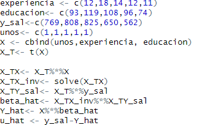
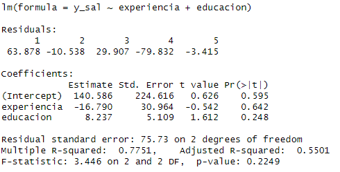

<!-- ARCHIVO GENERADO por tools/clases.py a partir de las diapositivas oficiales. No editar a mano: modifica tools/clases.py o el .tex y vuelve a generar. -->

# Clase 4 · Regresión lineal múltiple

<div class="usm-session-meta">
<span>📅 Viernes 6 de noviembre de 2026</span>
<span>⏱️ 18:40 – 21:25</span>
<span class="usm-tag-gold">Semana 4 · Contenido 5 · Análisis de regresión múltiple</span>
<span class="usm-tag-red">🛠️ Semana del Taller 1</span>
</div>

!!! info "Contenido oficial de la semana"
    Esta página reproduce **íntegros y en orden** los materiales de la semana 4 (`sem4/`).
    **Cátedra del viernes:** Parte 1 (`Clase5.tex`, 25 láminas). **Ayudantía/taller:** Parte 2
    (`calculo_matrices.tex`, ejercicio de la inversa de $X^\top X$). Los bloques **Interactivo**, los casos
    y las preguntas de autoevaluación son material adicional para estudiar.

!!! example "Cómo estudiar esta clase"
    La clase está ordenada en **7 temas**. Cada tema parte con una **pregunta guía**, sigue con las láminas
    y los simuladores, y termina con **✍️ preguntas de selección múltiple** (cada alternativa incorrecta explica
    por qué no lo es) y un **🧪 ejercicio de R** que puedes editar y ejecutar aquí mismo, sin instalar nada.
    Los 7 ejercicios de R en un solo archivo: [📥 clase4.R](../r/clase4.R).

## 🎯 Objetivos de la sesión

**Cátedra (viernes)**

- Pasar del modelo simple al **modelo de regresión lineal múltiple** e interpretar cada $\beta_j$ *ceteris paribus*.
- Plantear la estimación por MCO con $k$ variables y escribir el modelo en **notación matricial**, $y = X\beta + u$.
- Derivar $\hat{\beta} = (X^\top X)^{-1} X^\top y$ y reconocer sus propiedades algebraicas.
- Distinguir entre $R^2$ y $R^2$ ajustado, y leer la salida de una regresión en R.

**Ayudantía**

- Calcular a mano $(X^\top X)^{-1}$ por cofactores y obtener $\hat{\beta}$ con los datos del ejemplo.

## 🗓️ Agenda de la cátedra (viernes 18:40 – 21:25)

Haz clic en un tema para ir directo a él.

<ol class="econ-ruta">
<li><span class="econ-ruta-h">18:40</span><a class="econ-ruta-a" href="#tema-1"><span class="econ-ruta-n">1</span><span class="econ-ruta-t">Del modelo simple al múltiple</span><span class="econ-ruta-l">Parte 1 · láminas 1–3 · ✍️ 2 preguntas · 🧪 R</span></a></li>
<li><span class="econ-ruta-h">19:05</span><a class="econ-ruta-a" href="#tema-2"><span class="econ-ruta-n">2</span><span class="econ-ruta-t">MCO con k variables</span><span class="econ-ruta-l">Parte 1 · láminas 4–5 · ✍️ 2 preguntas · 🧪 R</span></a></li>
<li><span class="econ-ruta-h">19:25</span><a class="econ-ruta-a" href="#tema-3"><span class="econ-ruta-n">3</span><span class="econ-ruta-t">Notación matricial</span><span class="econ-ruta-l">Parte 1 · láminas 6–9 · ✍️ 2 preguntas · 🧪 R</span></a></li>
<li class="is-break"><span class="econ-ruta-h">19:55</span><span class="econ-ruta-t">☕ Receso</span></li>
<li><span class="econ-ruta-h">20:05</span><a class="econ-ruta-a" href="#tema-4"><span class="econ-ruta-n">4</span><span class="econ-ruta-t">La fórmula de MCO y sus propiedades</span><span class="econ-ruta-l">Parte 1 · láminas 10–12 · ✍️ 2 preguntas · 🧪 R</span></a></li>
<li><span class="econ-ruta-h">20:35</span><a class="econ-ruta-a" href="#tema-5"><span class="econ-ruta-n">5</span><span class="econ-ruta-t">R² y R² ajustado</span><span class="econ-ruta-l">Parte 1 · láminas 13–14 · ✍️ 2 preguntas · 🧪 R</span></a></li>
<li><span class="econ-ruta-h">20:55</span><a class="econ-ruta-a" href="#tema-6"><span class="econ-ruta-n">6</span><span class="econ-ruta-t">El ejemplo numérico y la salida en R</span><span class="econ-ruta-l">Parte 1 · láminas 15–25 · ✍️ 2 preguntas · 🧪 R</span></a></li>
<li class="is-break"><span class="econ-ruta-h">21:20</span><span class="econ-ruta-t">✅ Ideas clave, autoevaluación y cierre</span></li>
</ol>

<p class="econ-ruta-sub">📘 <strong>Ayudantía</strong> · se trabaja otro día de la semana, no en la cátedra del viernes</p>
<ol class="econ-ruta is-ayudantia">
<li><span class="econ-ruta-h"></span><a class="econ-ruta-a" href="#tema-7"><span class="econ-ruta-n">7</span><span class="econ-ruta-t">La inversa de XᵀX por cofactores</span><span class="econ-ruta-l">Parte 2 · Ayudantía · secciones 1–7 · ✍️ 2 preguntas · 🧪 R</span></a></li>
</ol>

## Regresión lineal múltiple: estimación { .econ-parte data-eyebrow="Parte 1 · Cátedra" data-toc-label="Parte 1 · Regresión lineal múltiple: estimación" }

<p class="econ-source">📄 Diapositivas: <code>sem4/Clase5.tex</code> · 25 láminas</p>

### Del modelo simple al múltiple { #tema-1 .econ-tema data-num="1" data-laminas="Parte 1 · láminas 1–3" data-toc-label="Tema 1 · Del simple al múltiple" }

<p class="econ-tema-q">¿Cómo medir el efecto de la educación dejando fija la inteligencia?</p>

<div class="econ-lamina" markdown>

#### Modelo de Regresión Múltiple: Introducción { data-lamina="Lámina 1" }

<!-- sem4/Clase5.tex · lámina 1 -->

-   En las clases anteriores, vimos el modelo de regresión lineal simple:

    $$
    y = \beta_0 + \beta_1x + u
    $$

-   Sin embargo, el supuesto de que $E[u|x] = 0$ en dicho modelo es muy fuerte, ya que todas las variables no incluidas van al error.

-   Además, si nos interesa la predicción, es muy difícil predecir la variable $y$ en base a una sola variable.

-   El modelo de regresión lineal múltiple (RLM) permite esto.

</div>

<div class="econ-lamina" markdown>

#### Modelo de Regresión Lineal Múltiple { data-lamina="Lámina 2" }

<!-- sem4/Clase5.tex · lámina 2 -->

-   A nivel poblacional, el modelo RLM se define como:

    $$
    y = \beta_0 + \beta_1x_1 + \beta_2x_2 + \ldots + \beta_kx_k + u
    $$

-   Asumamos que $E[u|x_1, x_2, \ldots, x_k] = 0$.

-   Interpretación de los parámetros $\beta$:

-   Por ejemplo, si todas las variables excepto $x_1$ permanecen constantes:

    $$
    \Delta E[y|x_1, x_2, \ldots, x_k] = \beta_1 \Delta x_1
    $$

    $\Rightarrow$ $\beta_1 = \frac{\Delta E[y|x_1, x_2, \ldots, x_k]}{\Delta x_1}$

-   Interpretación: Cuando $x_1$ cambia en una unidad, el valor esperado de $y$ cambia en $\beta_1$ unidades, **manteniendo todas las demás variables incluidas constantes**.<br>
    Es como una derivada parcial!

</div>

<div class="econ-widget" data-widget="plano"></div>

<div class="econ-lamina" markdown>

#### Modelo de Regresión Múltiple: Estimación MCO { data-lamina="Lámina 3" }

<!-- sem4/Clase5.tex · lámina 3 -->

-   Al agregar más variables al modelo para poder estudiar el efecto de $x$, ceteris paribus estas otras variables.

-   Por ejemplo, al estudiar el efecto de educación en salario, queremos dejar la inteligencia constante (IQ).

-   Al incluir esta variable en la regresión, podemos ver cuánto afecta un año más de educación en salario, dejando constante IQ.

-   De hecho, si agregamos la variable IQ, el coeficiente de educación que obtenemos se hace más pequeño.

*MCO Simple:* $\hat{salario} = 0.09 + 0.54 \cdot educacion$<br>

*MCO Múltiple:* $\hat{salario} = 0.065 + 0.37 \cdot educacion + 0.20 \cdot IQ$

-   Ahora vamos a ver cómo estimar los $\hat{\beta}$ del modelo de regresión múltiple.

</div>

<div class="econ-widget" data-widget="iq-control"></div>

<div class="econ-practica" id="practica-1">
<p class="econ-practica-t"><span>✍️ Practica · Tema 1</span></p>
<div class="econ-quiz">
<p class="econ-quiz-q">Con salario = 0.065 + 0.37·educación + 0.20·IQ, dos personas tienen el mismo IQ y una tiene un año más de educación. ¿Cuánto difiere su salario esperado?</p>
<div class="econ-quiz-opts">
<button class="econ-quiz-opt" data-correct>0.37</button>
<button class="econ-quiz-opt" data-why="Ese es el coeficiente de la regresión simple, que no deja fijo el IQ.">0.54</button>
<button class="econ-quiz-opt" data-why="No se suman los coeficientes: el IQ está fijo.">0.57</button>
</div>
<p class="econ-quiz-fb">✅ Lámina 2: cada β es una derivada parcial, con las demás variables incluidas constantes.</p>
</div>
<div class="econ-quiz">
<p class="econ-quiz-q">¿Por qué el coeficiente de educación baja de 0.54 a 0.37 al agregar el IQ?</p>
<div class="econ-quiz-opts">
<button class="econ-quiz-opt" data-correct>Porque en la regresión simple la educación captaba también parte del efecto del IQ.</button>
<button class="econ-quiz-opt" data-why="Pueden subir, bajar o quedar igual: depende de β₂ y δ₁.">Porque agregar variables siempre achica los coeficientes.</button>
<button class="econ-quiz-opt" data-why="Comparar 0.37 con 0.20 no dice eso: las variables están en unidades distintas.">Porque el IQ importa más que la educación.</button>
</div>
<p class="econ-quiz-fb">✅ Es el sesgo por variable omitida de la Clase 3: β̃₁ = β₁ + β₂δ₁ con β₂ &gt; 0 y δ₁ &gt; 0.</p>
</div>
</div>

<div class="econ-r" markdown>

<p class="econ-r-t">🧪 Practica en R · Simple contra múltiple</p>

Simula educación, IQ y salario. Compara el coeficiente de educación sin y con el IQ en la regresión.

```r
set.seed(1)
n         <- 1000
IQ        <- rnorm(n, 100, 15)
educacion <- 12 + 0.1 * (IQ - 100) + rnorm(n, sd = 2)   # más IQ, más educación
salario   <- 1 + 0.37 * educacion + 0.05 * IQ + rnorm(n, sd = 2)

coef(lm(salario ~ educacion))        # simple: mezcla educación e IQ
coef(lm(salario ~ educacion + IQ))   # múltiple: educación con IQ fijo
```

**🎯 Reto:** cambia `0.1 * (IQ - 100)` por `0 * (IQ - 100)`. ¿Siguen siendo distintos los dos coeficientes?
{: .econ-r-reto }

</div>

### MCO con k variables { #tema-2 .econ-tema data-num="2" data-laminas="Parte 1 · láminas 4–5" data-toc-label="Tema 2 · MCO con k variables" }

<p class="econ-tema-q">¿Qué cambia en MCO cuando hay más de una variable explicativa?</p>

<div class="econ-lamina" markdown>

#### Modelo de Regresión Lineal Múltiple: Estimación { data-lamina="Lámina 4" }

<!-- sem4/Clase5.tex · lámina 4 -->

Dada una muestra de $n$ individuos, tenemos la siguiente ecuación:

$$
y_i = \hat{\beta_0} + \hat{\beta_1}x_{i1} + \hat{\beta_2}x_{i2} + \ldots + \hat{\beta_k}x_{ik} + \hat{u_i}, \quad \forall i = 1, \ldots, n
$$

Igual que en el modelo RLS, los **residuos** vienen dados por:

$$
\hat{u}_i = y_i - \hat{y}_i
$$

$$
\hat{u_i}= y_i - (\hat{\beta}_0 + \hat{\beta}_1x_{i1} + \hat{\beta}_2x_{i2} + \ldots + \hat{\beta}_kx_{ik})
$$

</div>

<div class="econ-lamina" markdown>

#### MCO para el Modelo Lineal Múltiple { data-lamina="Lámina 5" }

<!-- sem4/Clase5.tex · lámina 5 -->

$$
\min_{\hat{\beta}_0, \hat{\beta}_1, \ldots, \hat{\beta}_k} \sum_i \hat{u}_i^2
$$

Es decir,

$$
\min_{\hat{\beta}_0, \hat{\beta}_1, \ldots, \hat{\beta}_k} \sum_i \left( y_i - \hat{\beta}_0 - \hat{\beta}_1x_{i1} - \hat{\beta}_2x_{i2} - \ldots - \hat{\beta}_kx_{ik} \right)^2
$$

**CPO:**

$$
\hat{\beta}_0: \sum_i \left( y_i - \hat{\beta}_0 - \hat{\beta}_1x_{i1} - \hat{\beta}_2x_{i2} - \ldots - \hat{\beta}_kx_{ik} \right) = 0
$$

$$
\hat{\beta}_1: \sum_i x_{i1} \left( y_i - \hat{\beta}_0 - \hat{\beta}_1x_{i1} - \hat{\beta}_2x_{i2} - \ldots - \hat{\beta}_kx_{ik} \right) = 0
$$

...

$$
\hat{\beta}_k:
\sum_i x_{ik} \left( y_i - \hat{\beta}_0 - \hat{\beta}_1x_{i1} - \hat{\beta}_2x_{i2} - \ldots - \hat{\beta}_kx_{ik} \right) = 0
$$

Existen $k + 1$ condiciones de primer orden para $k + 1$ incógnitas.

</div>

<div class="econ-practica" id="practica-2">
<p class="econ-practica-t"><span>✍️ Practica · Tema 2</span></p>
<div class="econ-quiz">
<p class="econ-quiz-q">Con k variables explicativas, ¿cuántas condiciones de primer orden tiene MCO?</p>
<div class="econ-quiz-opts">
<button class="econ-quiz-opt" data-why="Falta la condición del intercepto.">k</button>
<button class="econ-quiz-opt" data-correct>k + 1</button>
<button class="econ-quiz-opt" data-why="Hay una por parámetro, no una por observación.">n</button>
</div>
<p class="econ-quiz-fb">✅ Lámina 5: una ecuación por cada β̂, incluido β̂₀.</p>
</div>
<div class="econ-quiz">
<p class="econ-quiz-q">Las condiciones de primer orden implican que los residuos…</p>
<div class="econ-quiz-opts">
<button class="econ-quiz-opt" data-correct>…suman cero y no están correlacionados con ninguna x incluida.</button>
<button class="econ-quiz-opt" data-why="Los residuos individuales no son cero; lo son sus sumas ponderadas.">…son todos iguales a cero.</button>
<button class="econ-quiz-opt" data-why="Las condiciones de primer orden no dicen nada sobre la distribución.">…tienen distribución normal.</button>
</div>
<p class="econ-quiz-fb">✅ Son las mismas propiedades de la regresión simple, ahora para cada xⱼ.</p>
</div>
</div>

<div class="econ-r" markdown>

<p class="econ-r-t">🧪 Practica en R · Las k + 1 condiciones</p>

Estima un modelo con tres variables y comprueba que se cumplen las cuatro condiciones de primer orden.

```r
set.seed(2)
n  <- 200
x1 <- rnorm(n)
x2 <- rnorm(n)
x3 <- rnorm(n)
y  <- 1 + 2 * x1 - 1 * x2 + 0.5 * x3 + rnorm(n)

m <- lm(y ~ x1 + x2 + x3)
coef(m)
u <- resid(m)
# Las k + 1 = 4 condiciones de primer orden: Σû = 0 y Σ xj û = 0
round(c(sum(u), sum(x1 * u), sum(x2 * u), sum(x3 * u)), 10)
```

**🎯 Reto:** agrega una cuarta variable `x4 <- rnorm(n)` al modelo. ¿Cuántas condiciones hay que verificar ahora?
{: .econ-r-reto }

</div>

### Notación matricial { #tema-3 .econ-tema data-num="3" data-laminas="Parte 1 · láminas 6–9" data-toc-label="Tema 3 · Notación matricial" }

<p class="econ-tema-q">¿Cómo escribir n ecuaciones en una sola línea?</p>

<div class="econ-lamina" markdown>

#### Notación matricial modelo poblacional { data-lamina="Lámina 6" }

<!-- sem4/Clase5.tex · lámina 6 -->

-   El modelo de regresión lineal múltiple cada individuo $i$ es:

    $$
    y_i = \beta_0 + \beta_1 x_{i1} + \beta_2 x_{i2} + \dots + \beta_k x_{ik} + u_i \quad \forall i = 1, \dots, n
    $$

-   Matricialmente, lo podemos expresar:

    $$
    y_i = \mathbf{x}_i^\top \mathbf{\beta} + u_i \quad \forall i = 1, \dots, n
    $$

    con

    $$
    \mathbf{x}_i = \begin{pmatrix}
    1 \\
    x_{i1} \\
    \vdots \\
    x_{ik}
    \end{pmatrix}, \quad
    \mathbf{\beta} = \begin{pmatrix}
    \beta_0 \\
    \beta_1 \\
    \vdots \\
    \beta_k
    \end{pmatrix}
    $$

-   Noten que son $n$ ecuaciones (una para cada individuo).

</div>

<div class="econ-lamina" markdown>

#### Notación { data-lamina="Lámina 7" }

<!-- sem4/Clase5.tex · lámina 7 -->

-   $$
    y = X\beta + u
    $$

    con

    $$
    y = \begin{pmatrix}
    y_1 \\
    \vdots \\
    y_n
    \end{pmatrix}, \quad
    X = \begin{pmatrix}
    \mathbf{x}_1^\top \\
    \vdots \\
    \mathbf{x}_n^\top
    \end{pmatrix} = \begin{pmatrix}
    1 & x_{11} & \dots & x_{1k} \\
    \vdots & \vdots & \ddots & \vdots \\
    1 & x_{n1} & \dots & x_{nk}
    \end{pmatrix}, \quad
    u = \begin{pmatrix}
    u_1 \\
    \vdots \\
    u_n
    \end{pmatrix}
    $$

    donde $u$ y $y$ son vectores de $n \times 1$ y $X$ es una matriz de $n \times (k + 1)$.

</div>

<div class="econ-lamina" markdown>

#### Ejemplo: $n=5$, dos variables: $x_1$, $x_2$ { data-lamina="Lámina 8" data-toc-label="Ejemplo: n=5, dos variables: x1, x2" }

<!-- sem4/Clase5.tex · lámina 8 -->

$$
\begin{bmatrix}
y_1 \\
y_2 \\
\hdots \\
y_5
\end{bmatrix}
=
\beta_0
\begin{bmatrix}
1 \\
1 \\
\hdots \\
1
\end{bmatrix}
+
\beta_1
\begin{bmatrix}
x_{11} \\
x_{12}\\
\hdots\\
x_{15}\\
\end{bmatrix}
+
\beta_2
\begin{bmatrix}
x_{21} \\
x_{22} \\
\hdots \\
x_{25}
\end{bmatrix}
+
\begin{bmatrix}
u_1 \\
u_2 \\
\hdots \\
u_5
\end{bmatrix}
$$

Re-escribiendo:

$$
\begin{bmatrix}
y_1 \\
y_2 \\
\hdots \\
y_5
\end{bmatrix}
=
\begin{bmatrix}
1 & x_{11} & x_{12} \\
1 & x_{12} & x_{22} \\
\hdots & \hdots & \hdots \\
1 & x_{15} & x_{25}
\end{bmatrix}
\begin{bmatrix}
\beta_0 \\
\beta_1 \\
\beta_2
\end{bmatrix}
+
\begin{bmatrix}
u_1 \\
u_2 \\
\hdots \\
u_5
\end{bmatrix}
$$

$$
y = X\beta + u
$$

</div>

<div class="econ-widget" data-widget="matriz-x"></div>

<div class="econ-lamina" markdown>

#### Mínimos Cuadrados Ordinarios (MRL Múltiple) { data-lamina="Lámina 9" }

<!-- sem4/Clase5.tex · lámina 9 -->

-   Como antes, podemos definir:

    -   $\hat{\beta}$: estimadores de los $\beta$ dimensión, $(k+1) \times 1$

    -   $\hat{y} = X \hat{\beta}$: Valores predichos de $y$, dimensión $n \times 1$

    -   Por lo tanto, los residuos en forma matricial:

        $$
        \hat{u} = y - \hat{y} = y - X \hat{\beta}
        $$

</div>

<div class="econ-practica" id="practica-3">
<p class="econ-practica-t"><span>✍️ Practica · Tema 3</span></p>
<div class="econ-quiz">
<p class="econ-quiz-q">En y = Xβ + u, con n = 5 y dos variables explicativas, ¿qué dimensión tiene β?</p>
<div class="econ-quiz-opts">
<button class="econ-quiz-opt" data-correct>3 × 1</button>
<button class="econ-quiz-opt" data-why="Falta β₀: la columna de unos también tiene su parámetro.">2 × 1</button>
<button class="econ-quiz-opt" data-why="Esa es la dimensión de y y de u.">5 × 1</button>
</div>
<p class="econ-quiz-fb">✅ β tiene un elemento por parámetro: k + 1 = 3.</p>
</div>
<div class="econ-quiz">
<p class="econ-quiz-q">¿Para qué sirve la columna de unos en X?</p>
<div class="econ-quiz-opts">
<button class="econ-quiz-opt" data-correct>Para que el modelo tenga intercepto, β₀.</button>
<button class="econ-quiz-opt" data-why="Los unos no cambian las variables: acompañan a β₀.">Para normalizar las variables.</button>
<button class="econ-quiz-opt" data-why="XᵀX es simétrica siempre, tenga o no la columna de unos.">Para que XᵀX sea simétrica.</button>
</div>
<p class="econ-quiz-fb">✅ Láminas 7–8: la primera columna de X es de unos.</p>
</div>
</div>

<div class="econ-r" markdown>

<p class="econ-r-t">🧪 Practica en R · Arma X con los datos de la lámina</p>

Construye la matriz X del ejemplo de la lámina 8 y calcula XᵀX y Xᵀy. Compara Xᵀy con la lámina 22.

```r
# Datos de la lámina 8 (y del ejercicio de la ayudantía)
experiencia <- c(12, 18, 14, 12, 11)
educacion   <- c(93, 119, 108, 96, 74)
salario     <- c(769, 808, 825, 650, 562)

X <- cbind(unos = 1, experiencia, educacion)   # n × (k + 1)
y <- salario
X
dim(X)
t(X) %*% X        # XᵀX: (k + 1) × (k + 1)
t(X) %*% y        # Xᵀy
```

**🎯 Reto:** agrega una tercera variable, por ejemplo `edad <- c(30, 41, 35, 29, 26)`, a X. ¿Qué dimensión tiene ahora XᵀX?
{: .econ-r-reto }

</div>

### La fórmula de MCO y sus propiedades { #tema-4 .econ-tema data-num="4" data-laminas="Parte 1 · láminas 10–12" data-toc-label="Tema 4 · β̂ = (XᵀX)⁻¹Xᵀy" }

<p class="econ-tema-q">¿De dónde sale β̂ = (XᵀX)⁻¹Xᵀy?</p>

<div class="econ-lamina" markdown>

#### Recordar { data-lamina="Lámina 10" }

<!-- sem4/Clase5.tex · lámina 10 -->

-   **Derivadas**

    Si $a$ y $\beta$ son vectores y $A$ una matriz simétrica, entonces:

    1.  $\frac{da^\top \beta}{d\beta} = a$

    2.  $\frac{d\beta^\top A\beta}{d\beta} = 2A\beta$

-   **Propiedades de la traspuesta**

    Sean $D$ y $E$ matrices: $(DE)^\top = E^\top D^\top$

-   **Potencias**

    $\sum_{i} (s_i)^2 = s^\top s$

</div>

<div class="econ-lamina" markdown>

#### Mínimos Cuadrados Ordinarios (MRL Múltiple) { data-lamina="Lámina 11" }

<!-- sem4/Clase5.tex · lámina 11 -->

$$
\min \sum_{i=1}^{n} \hat{u}_i^2 \quad \Rightarrow \quad \min_{\hat{\beta}} \hat{u}^\top \hat{u}
$$

-   La suma de los residuos al cuadrado es:

    $$
    \hat{u}^\top \hat{u} = (y - X \hat{\beta})^\top (y - X \hat{\beta})
    $$

    $$
    = y^\top y - \hat{\beta}^\top X^\top y - y^\top X \hat{\beta} + \hat{\beta}^\top X^\top X \hat{\beta}
    $$

    $$
    = y^\top y - 2 y^\top X \hat{\beta} + \hat{\beta}^\top X^\top X \hat{\beta}
    $$

-   Entonces, condiciones de primer orden:

    $$
    \frac{\partial \hat{u}^\top \hat{u}}{\partial \hat{\beta}} = 0 \quad \Rightarrow \quad -2X^\top y + 2X^\top X \hat{\beta} = 0 \quad \Rightarrow \quad \hat{\beta} = (X^\top X)^{-1} X^\top y
    $$

-   Note que precisamos suponer que $X$ tiene rango $(k+1)$ completo $\Rightarrow X^\top X$ es invertible.

-   Las $k + 1$ ecuaciones $X^\top y = X^\top X \hat{\beta}$ son llamadas ecuaciones normales para MCO.

-   Condición de segundo grado: $\frac{d^2 \hat{u}^\top \hat{u}}{d \hat{\beta} d \hat{\beta}} = 2X^\top X$ positiva definida.

</div>

<div class="econ-lamina" markdown>

#### Propiedades algebraicas { data-lamina="Lámina 12" }

<!-- sem4/Clase5.tex · lámina 12 -->

-   Al igual que el caso de regresión simple, las propiedades algebraicas se derivan de las CPO.

-   Propiedades 1 y 2: $X^\top \hat{u} = 0$:

    $$
    \sum_{i} \hat{u}_i = 0 \quad (\text{propiedad 1})
    $$

    $$
    \sum_{i} x_{i1} \hat{u}_i = 0 \quad (\text{propiedad 2})
    $$

    $$
    \sum_{i} x_{i2} \hat{u}_i = 0 \quad (\text{propiedad 2})
    $$

    $$
    \dots
    $$

    $$
    \sum_{i} x_{ik} \hat{u}_i = 0 \quad (\text{propiedad 2})
    $$

-   Propiedad 3: La media de la variable observada $y$ es igual a la media de la variable predicha $\hat{y}$:

    $$
    \bar{y} = \bar{\hat{y}}
    $$

-   Propiedad 4: El punto $(\bar{x}_1, \bar{x}_2, \dots, \bar{x}_k, \bar{y})$ pasa por la curva de regresión.

</div>

<div class="econ-practica" id="practica-4">
<p class="econ-practica-t"><span>✍️ Practica · Tema 4</span></p>
<div class="econ-quiz">
<p class="econ-quiz-q">Si X es n × (k + 1), ¿qué dimensión tiene XᵀX?</p>
<div class="econ-quiz-opts">
<button class="econ-quiz-opt" data-correct>(k + 1) × (k + 1)</button>
<button class="econ-quiz-opt" data-why="Ese sería XXᵀ.">n × n</button>
<button class="econ-quiz-opt" data-why="Esa es la dimensión de X.">n × (k + 1)</button>
</div>
<p class="econ-quiz-fb">✅ XᵀX es cuadrada, del tamaño del número de parámetros.</p>
</div>
<div class="econ-quiz">
<p class="econ-quiz-q">La condición Xᵀû = 0 significa que…</p>
<div class="econ-quiz-opts">
<button class="econ-quiz-opt" data-correct>…los residuos son ortogonales a cada columna de X, incluida la de unos.</button>
<button class="econ-quiz-opt" data-why="Cada residuo puede ser distinto de cero.">…todos los residuos son cero.</button>
<button class="econ-quiz-opt" data-why="Xᵀû = 0 vale siempre en MCO; es XᵀX la que debe ser invertible.">…X no tiene inversa.</button>
</div>
<p class="econ-quiz-fb">✅ Lámina 12: propiedades algebraicas de MCO en forma matricial.</p>
</div>
</div>

<div class="econ-r" markdown>

<p class="econ-r-t">🧪 Practica en R · La fórmula en R</p>

Calcula β̂ = (XᵀX)⁻¹Xᵀy con matrices, compáralo con `lm()` y verifica que Xᵀû = 0.

```r
experiencia <- c(12, 18, 14, 12, 11)
educacion   <- c(93, 119, 108, 96, 74)
salario     <- c(769, 808, 825, 650, 562)
X <- cbind(1, experiencia, educacion)
y <- salario

beta <- solve(t(X) %*% X) %*% t(X) %*% y     # (XᵀX)⁻¹ Xᵀy
beta
coef(lm(salario ~ experiencia + educacion))  # lo mismo

u_hat <- y - X %*% beta
round(t(X) %*% u_hat, 8)                     # Xᵀû = 0
```

**🎯 Reto:** duplica una columna: usa `X <- cbind(1, experiencia, experiencia)`. ¿Qué error da `solve()` y por qué?
{: .econ-r-reto }

</div>

### R² y R² ajustado { #tema-5 .econ-tema data-num="5" data-laminas="Parte 1 · láminas 13–14" data-toc-label="Tema 5 · R² y R² ajustado" }

<p class="econ-tema-q">¿Mejora el modelo cada vez que agregamos una variable?</p>

<div class="econ-lamina" markdown>

#### Bondad de Ajuste: $R^2$ { data-lamina="Lámina 13" data-toc-label="Bondad de Ajuste: R²" }

<!-- sem4/Clase5.tex · lámina 13 -->

El $R^2$ nos dice que la proporción de la varianza muestral de $y$ es explicada por nuestra regresión MCO. Recordando las definiciones:

-   Suma de cuadrados explicada: $SSE = \sum_{i=1}^{n} (\hat{y}_i - \bar{y})^2$

-   Suma de cuadrados residual: $SSR = \sum_{i=1}^{n} \hat{u}_i^2$

-   Suma de cuadrados total: $SST = \sum_{i=1}^{n} (y_i - \bar{y})^2$

La fórmula para el $R^2$ es igual que en el caso de la regresión simple:

$$
R^2 = \frac{SSE}{SST} = 1 - \frac{SSR}{SST}
$$

</div>

<div class="econ-lamina" markdown>

#### Bondad de Ajuste: $R^2$ ajustado { data-lamina="Lámina 14" data-toc-label="Bondad de Ajuste: R² ajustado" }

<!-- sem4/Clase5.tex · lámina 14 -->

-   $R^2$ crece (o queda igual) a medida que se agregan más variables al modelo. Esto ocurre incluso si la variable agregada no es relevante en el modelo poblacional.

-   Necesitamos una medida que penalice agregar variables irrelevantes.

-   Se define el $R^2$ ajustado como:

    $$
    \overline{R^2} = 1 - \frac{n - 1}{n - k - 1} \frac{SSR}{SST}
    $$

</div>

<div class="econ-widget" data-widget="r2-trampa"></div>

<div class="econ-practica" id="practica-5">
<p class="econ-practica-t"><span>✍️ Practica · Tema 5</span></p>
<div class="econ-quiz">
<p class="econ-quiz-q">Con n = 5, k = 2 y R² = 0.7751, ¿cuánto vale el R² ajustado?</p>
<div class="econ-quiz-opts">
<button class="econ-quiz-opt" data-correct>0.5501</button>
<button class="econ-quiz-opt" data-why="Ese es el R² sin ajustar.">0.7751</button>
<button class="econ-quiz-opt" data-why="El R² ajustado nunca supera al R².">0.8876</button>
</div>
<p class="econ-quiz-fb">✅ 1 − (4/2)·(1 − 0.7751) = 0.5501, como en la salida de R de la lámina 25.</p>
</div>
<div class="econ-quiz">
<p class="econ-quiz-q">¿Puede el R² ajustado ser negativo?</p>
<div class="econ-quiz-opts">
<button class="econ-quiz-opt" data-correct>Sí, cuando el modelo explica muy poco y tiene muchas variables respecto de n.</button>
<button class="econ-quiz-opt" data-why="Eso vale para el R²; el ajustado puede quedar bajo cero.">No, siempre está entre 0 y 1.</button>
</div>
<p class="econ-quiz-fb">✅ La penalización (n − 1)/(n − k − 1) puede superar lo que explica el modelo.</p>
</div>
</div>

<div class="econ-r" markdown>

<p class="econ-r-t">🧪 Practica en R · La trampa del R²</p>

Agrega 10 variables sin ninguna relación con y y compara el R² con el R² ajustado.

```r
set.seed(5)
n <- 30
x <- rnorm(n)
y <- 1 + 2 * x + rnorm(n, sd = 2)
r2 <- function(m) c(R2 = summary(m)$r.squared,
                    R2_ajustado = summary(m)$adj.r.squared)

basura <- matrix(rnorm(n * 10), n, 10)  # 10 variables sin relación con y
rbind(solo_x     = r2(lm(y ~ x)),
      x_y_basura = r2(lm(y ~ x + basura)))
```

**🎯 Reto:** agrega 20 variables basura (cambia los dos `10` por `20`). ¿Qué pasa con el R² ajustado?
{: .econ-r-reto }

</div>

### El ejemplo numérico y la salida en R { #tema-6 .econ-tema data-num="6" data-laminas="Parte 1 · láminas 15–25" data-toc-label="Tema 6 · Ejemplo y salida en R" }

<p class="econ-tema-q">¿Cómo se ven todos estos cálculos en una salida de R?</p>

<div class="econ-lamina" markdown>

#### Ejemplo: obtener $\hat{\beta} = (X^\top X)^{-1}X^\top y$ { data-lamina="Láminas 15–22" data-toc-label="Ejemplo: obtener hatβ = (X^top X)^-1X^top y" }

<p class="econ-lamina-cont">Lámina progresiva · recórrela paso a paso, como en la presentación</p>

=== "Paso 1"

    <!-- sem4/Clase5.tex · lámina 15 -->

    Modelo: $y_i = \beta_0 + \beta_1 x_{i1} + \beta_2 x_{i2} + u_i$, $n=5$.

    Base de datos:

    | Individuos | unos | $x_1$ (experiencia) | $x_2$ (educación) | $y$ (salario) |
    |:----------:|:----:|:-------------------:|:-----------------:|:-------------:|
    |    Juan    |  1   |         12          |        93         |      769      |
    |   Pedro    |  1   |         18          |        119        |      808      |
    |   Sofia    |  1   |         14          |        108        |      825      |
    |    Caro    |  1   |         12          |        96         |      650      |
    |    Alex    |  1   |         11          |        74         |      562      |

=== "Paso 2"

    <!-- sem4/Clase5.tex · lámina 16 -->

    Modelo: $y_i = \beta_0 + \beta_1 x_{i1} + \beta_2 x_{i2} + u_i$, $n=5$.

    Base de datos:

    | Individuos | unos | $x_1$ (experiencia) | $x_2$ (educación) | $y$ (salario) |
    |:----------:|:----:|:-------------------:|:-----------------:|:-------------:|
    |    Juan    |  1   |         12          |        93         |      769      |
    |   Pedro    |  1   |         18          |        119        |      808      |
    |   Sofia    |  1   |         14          |        108        |      825      |
    |    Caro    |  1   |         12          |        96         |      650      |
    |    Alex    |  1   |         11          |        74         |      562      |

    $$
    X = \begin{bmatrix}
    1 & 12 & 93 \\
    1 & 18 & 119 \\
    1 & 14 & 108 \\
    1 & 12 & 96 \\
    1 & 11 & 74 \\
    \end{bmatrix} \quad
    X^\top = \begin{bmatrix}
    1 & 1 & 1 & 1 & 1 \\
    12 & 18 & 14 & 12 & 11 \\
    93 & 119 & 108 & 96 & 74 \\
    \end{bmatrix}
    $$

    $$
    X^\top X = \begin{bmatrix}
    5 & 67 & 490 \\
    67 & 929 & 6736 \\
    490 & 6736 & 49166 \\
    \end{bmatrix}
    $$

=== "Paso 3"

    <!-- sem4/Clase5.tex · lámina 17 -->

    Modelo: $y_i = \beta_0 + \beta_1 x_{i1} + \beta_2 x_{i2} + u_i$, $n=5$.

    Base de datos:

    | Individuos | unos | $x_1$ (experiencia) | $x_2$ (educación) | $y$ (salario) |
    |:----------:|:----:|:-------------------:|:-----------------:|:-------------:|
    |    Juan    |  1   |         12          |        93         |      769      |
    |   Pedro    |  1   |         18          |        119        |      808      |
    |   Sofia    |  1   |         14          |        108        |      825      |
    |    Caro    |  1   |         12          |        96         |      650      |
    |    Alex    |  1   |         11          |        74         |      562      |

    $$
    X = \begin{bmatrix}
    1 & 12 & 93 \\
    1 & 18 & 119 \\
    1 & 14 & 108 \\
    1 & 12 & 96 \\
    1 & 11 & 74 \\
    \end{bmatrix} \quad
    X^\top = \begin{bmatrix}
    1 & 1 & 1 & 1 & 1 \\
    12 & 18 & 14 & 12 & 11 \\
    93 & 119 & 108 & 96 & 74 \\
    \end{bmatrix}
    $$

    $$
    X^\top X = \begin{bmatrix}
    5 & 67 & 490 \\
    67 & 929 & 6736 \\
    490 & 6736 & 49166 \\
    \end{bmatrix}
    \quad  (X^\top X)^{-1} =
    \begin{bmatrix}
    8.80 & 0.19 & -0.11 \\
    0.19 & 0.17 & -0.02 \\
    -0.11 & -0.02 & 0.00 \\
    \end{bmatrix}
    $$

=== "Paso 4"

    <!-- sem4/Clase5.tex · lámina 18 -->

    $$
    X^\top y =
    \begin{bmatrix}
    1 & 1 & 1 & 1 & 1 \\
    12 & 18 & 14 & 12 & 11 \\
    93 & 119 & 108 & 96 & 74 \\
    \end{bmatrix}
    \times
    \begin{bmatrix}
    769 \\
    808 \\
    825 \\
    650 \\
    562 \\
    \end{bmatrix}
    = \begin{bmatrix}
    3614 \\
    49304 \\
    360757 \\
    \end{bmatrix}
    $$

=== "Paso 5"

    <!-- sem4/Clase5.tex · lámina 19 -->

    $$
    X^\top y =
    \begin{bmatrix}
    1 & 1 & 1 & 1 & 1 \\
    12 & 18 & 14 & 12 & 11 \\
    93 & 119 & 108 & 96 & 74 \\
    \end{bmatrix}
    \times
    \begin{bmatrix}
    769 \\
    808 \\
    825 \\
    650 \\
    562 \\
    \end{bmatrix}
    = \begin{bmatrix}
    3614 \\
    49304 \\
    360757 \\
    \end{bmatrix} =
    $$

=== "Paso 6"

    <!-- sem4/Clase5.tex · lámina 20 -->

    Entonces tenemos: $(X^{\top}X)^{-1} = 
    \begin{bmatrix}
    8.80 & 0.19 & -0.11 \\
    0.19 & 0.17 & -0.02 \\
    -0.11 & -0.02 & 0.00 \\
    \end{bmatrix}$

    $X^{\top}y = 
    \begin{bmatrix}
    3614 \\
    49304 \\
    360757 \\
    \end{bmatrix}$

=== "Paso 7"

    <!-- sem4/Clase5.tex · lámina 21 -->

    Entonces tenemos: $(X^{\top}X)^{-1} = 
    \begin{bmatrix}
    8.80 & 0.19 & -0.11 \\
    0.19 & 0.17 & -0.02 \\
    -0.11 & -0.02 & 0.00 \\
    \end{bmatrix}$

    $X^{\top}y = 
    \begin{bmatrix}
    3614 \\
    49304 \\
    360757 \\
    \end{bmatrix}$

    Multiplicando obtenemos los estimadores: $\hat{\beta} = (X^{\top}X)^{-1}X^{\top}y=
    \begin{bmatrix}
    \hat{\beta}_0 \\
    \hat{\beta}_1 \\
    \hat{\beta}_2 \\
    \end{bmatrix}=
    \begin{bmatrix}
    140.59 \\
    -16.79 \\
    8.24 \\
    \end{bmatrix}$<br>

=== "Paso 8"

    <!-- sem4/Clase5.tex · lámina 22 -->

    Entonces tenemos: $(X^{\top}X)^{-1} = 
    \begin{bmatrix}
    8.80 & 0.19 & -0.11 \\
    0.19 & 0.17 & -0.02 \\
    -0.11 & -0.02 & 0.00 \\
    \end{bmatrix}$

    $X^{\top}y = 
    \begin{bmatrix}
    3614 \\
    49304 \\
    360757 \\
    \end{bmatrix}$

    Multiplicando obtenemos los estimadores: $\hat{\beta} = (X^{\top}X)^{-1}X^{\top}y=
    \begin{bmatrix}
    \hat{\beta}_0 \\
    \hat{\beta}_1 \\
    \hat{\beta}_2 \\
    \end{bmatrix}=
    \begin{bmatrix}
    140.59 \\
    -16.79 \\
    8.24 \\
    \end{bmatrix}$<br>
    Si quisieramos la matrix de prediccion de y, simplemente calculamos:

    $$
    \hat{y}=X\hat{\beta}
    $$

</div>

<div class="econ-widget" data-widget="calc-matricial"></div>

<div class="econ-lamina" markdown>

#### En general { data-lamina="Lámina 23" }

<!-- sem4/Clase5.tex · lámina 23 -->

$$
X^T X =
\begin{pmatrix}
n & \sum_{i=1}^{n} x_{i1} & \sum_{i=1}^{n} x_{i2} & \cdots & \sum_{i=1}^{n} x_{ik} \\
\sum_{i=1}^{n} x_{i1} & \sum_{i=1}^{n} x_{i1}^2 & \sum_{i=1}^{n} x_{i1}x_{i2} & \cdots & \sum_{i=1}^{n} x_{i1}x_{ik} \\
\sum_{i=1}^{n} x_{i2} & \sum_{i=1}^{n} x_{i1}x_{i2} & \sum_{i=1}^{n} x_{i2}^2 & \cdots & \sum_{i=1}^{n} x_{i2}x_{ik} \\
\vdots & \vdots & \vdots & \ddots & \vdots \\
\sum_{i=1}^{n} x_{ik} & \sum_{i=1}^{n} x_{i1}x_{ik} & \sum_{i=1}^{n} x_{i2}x_{ik} & \cdots & \sum_{i=1}^{n} x_{ik}^2
\end{pmatrix}
$$

$$
X^Ty=\begin{pmatrix}
\sum_{i=1}^n y_i \\
\sum_{i=1}^n x_{i1}y_i \\
\vdots\\
\sum_{i=1}^n x_{ik}y_i \\
\end{pmatrix}
$$

</div>

<div class="econ-lamina" markdown>

#### En R { data-lamina="Lámina 24" }

<!-- sem4/Clase5.tex · lámina 24 -->

{ .econ-slide-img }

</div>

<div class="econ-lamina" markdown>

#### Regresión { data-lamina="Lámina 25" }

<!-- sem4/Clase5.tex · lámina 25 -->

{ .econ-slide-img }

</div>

<div class="econ-widget" data-widget="salida-r"></div>

<div class="econ-practica" id="practica-6">
<p class="econ-practica-t"><span>✍️ Practica · Tema 6</span></p>
<div class="econ-quiz">
<p class="econ-quiz-q">En la lámina 25, el coeficiente de experiencia es −16.79 con p-valor 0.642. ¿Qué indica?</p>
<div class="econ-quiz-opts">
<button class="econ-quiz-opt" data-correct>Que con 5 datos la estimación es muy imprecisa: no hay evidencia de un efecto de la experiencia.</button>
<button class="econ-quiz-opt" data-why="El p-valor alto indica justamente que la estimación es muy incierta.">Que un año más de experiencia baja el salario en 16.79, con certeza.</button>
<button class="econ-quiz-opt" data-why="Con tan pocos datos un signo inesperado es posible: el cálculo es correcto.">Que hay un error de cálculo.</button>
</div>
<p class="econ-quiz-fb">✅ Con n = 5 y 3 parámetros quedan 2 grados de libertad: los errores estándar son enormes.</p>
</div>
<div class="econ-quiz">
<p class="econ-quiz-q">Una vez calculado β̂, ¿cómo se obtienen las predicciones ŷ?</p>
<div class="econ-quiz-opts">
<button class="econ-quiz-opt" data-correct>ŷ = Xβ̂</button>
<button class="econ-quiz-opt" data-why="Esa matriz, multiplicada por y, da β̂, no ŷ.">ŷ = (XᵀX)⁻¹Xᵀ</button>
<button class="econ-quiz-opt" data-why="Xᵀy es un vector de k + 1 sumas, no de n predicciones.">ŷ = Xᵀy</button>
</div>
<p class="econ-quiz-fb">✅ Lámina 22.</p>
</div>
</div>

<div class="econ-r" markdown>

<p class="econ-r-t">🧪 Practica en R · La salida de la lámina 25</p>

Reproduce la regresión de la lámina 25 con los 5 datos y calcula el R² ajustado a mano.

```r
datos <- data.frame(
  experiencia = c(12, 18, 14, 12, 11),
  educacion   = c(93, 119, 108, 96, 74),
  y_sal       = c(769, 808, 825, 650, 562)
)
m <- lm(y_sal ~ experiencia + educacion, data = datos)
summary(m)                 # compárala con la lámina 25

# R² ajustado a mano, con n = 5 y k = 2
R2 <- summary(m)$r.squared
1 - (5 - 1) / (5 - 2 - 1) * (1 - R2)
fitted(m)                  # ŷ = X beta gorro
```

**🎯 Reto:** agrega un sexto individuo a los datos (por ejemplo, 15, 100 y 700). ¿Cómo cambian los errores estándar?
{: .econ-r-reto }

</div>

## Ejercicio: la inversa de XᵀX por cofactores { .econ-parte .is-ayudantia data-eyebrow="Parte 2 · Ayudantía" data-toc-label="Parte 2 · Ayudantía · Ejercicio: la inversa de XᵀX por cofactores" }

<p class="econ-source">📄 Documento: <code>sem4/calculo_matrices.tex</code> · 7 secciones</p>

!!! note "Material de ayudantía/taller"
    Este ejercicio no se ve en la cátedra del viernes: se trabaja en la **ayudantía/taller** de la semana. Mantiene el formato numérico del documento original (punto para los miles, coma decimal).

### La inversa de XᵀX por cofactores { #tema-7 .econ-tema .is-ayudantia data-num="7" data-laminas="Parte 2 · Ayudantía · secciones 1–7" data-toc-label="Tema 7 · Inversa por cofactores" }

<p class="econ-tema-q">¿Cómo se invierte a mano una matriz de 3 × 3?</p>

<div class="econ-lamina is-ayudantia" markdown>

#### Modelo y datos { data-lamina="Lámina 1" }

<!-- sem4/calculo_matrices.tex · lámina 1 -->

Modelo de regresión lineal múltiple con $n=5$ individuos:

$$
y_i = \beta_0 + \beta_1 x_{i1} + \beta_2 x_{i2} + u_i, \qquad i=1,\dots,5,
$$

donde $x_{1}=$ experiencia (años) y $x_{2}=$ educación (años).

| Individuo | *unos* | $x_1$ (experiencia) | $x_2$ (educación) | $y$ (salario) |
|:----------|:------:|:-------------------:|:-----------------:|:-------------:|
| Juan      |   1    |         12          |        93         |      769      |
| Pedro     |   1    |         18          |        119        |      808      |
| Sofía     |   1    |         14          |        108        |      825      |
| Caro      |   1    |         12          |        96         |      650      |
| Alex      |   1    |         11          |        74         |      562      |

Matrices del modelo:

$$
X=\begin{bmatrix}
1 & 12 & 93\\
1 & 18 & 119\\
1 & 14 & 108\\
1 & 12 & 96\\
1 & 11 & 74
\end{bmatrix},
\qquad
X^\top=\begin{bmatrix}
1 & 1 & 1 & 1 & 1\\
12 & 18 & 14 & 12 & 11\\
93 & 119 & 108 & 96 & 74
\end{bmatrix}.
$$

Multiplicando $X^\top X$ (cada entrada es la suma de productos correspondiente: $n$, $\sum x_1$, $\sum x_2$, $\sum x_1^2$, $\sum x_1 x_2$, $\sum x_2^2$):

$$
A \;=\; X^\top X \;=\;
\begin{bmatrix}
5 & 67 & 490\\
67 & 929 & 6.736\\
490 & 6.736 & 49.166
\end{bmatrix}.
$$

El objetivo de este documento es obtener $A^{-1}=(X^\top X)^{-1}$ **paso a paso, usando el método de cofactores**:

$$
A^{-1} = \frac{1}{\det(A)}\,\operatorname{adj}(A),
\qquad
\operatorname{adj}(A) = C^\top,
$$

donde $C$ es la matriz de cofactores de $A$.

</div>

<div class="econ-lamina is-ayudantia" markdown>

#### Paso 1: Matriz de menores { data-lamina="Lámina 2" }

<!-- sem4/calculo_matrices.tex · lámina 2 -->

El menor $M_{ij}$ es el determinante de la submatriz $2\times 2$ que resulta de eliminar la fila $i$ y la columna $j$ de $A$.

$$
M_{11}=\begin{vmatrix}929 & 6.736\\ 6.736 & 49.166\end{vmatrix}
= 929\times 49.166 - 6.736\times 6.736
= 45.675.214-45.373.696=301.518
$$

$$
M_{12}=\begin{vmatrix}67 & 6.736\\ 490 & 49.166\end{vmatrix}
= 67\times 49.166 - 6.736\times 490
= 3.294.122-3.300.640=-6.518
$$

$$
M_{13}=\begin{vmatrix}67 & 929\\ 490 & 6.736\end{vmatrix}
= 67\times 6.736 - 929\times 490
= 451.312-455.210=-3.898
$$

$$
M_{21}=\begin{vmatrix}67 & 490\\ 6.736 & 49.166\end{vmatrix}
= 67\times 49.166 - 490\times 6.736
= 3.294.122-3.300.640=-6.518
$$

$$
M_{22}=\begin{vmatrix}5 & 490\\ 490 & 49.166\end{vmatrix}
= 5\times 49.166 - 490\times 490
= 245.830-240.100=5.730
$$

$$
M_{23}=\begin{vmatrix}5 & 67\\ 490 & 6.736\end{vmatrix}
= 5\times 6.736 - 67\times 490
= 33.680-32.830=850
$$

$$
M_{31}=\begin{vmatrix}67 & 490\\ 929 & 6.736\end{vmatrix}
= 67\times 6.736 - 490\times 929
= 451.312-455.210=-3.898
$$

$$
M_{32}=\begin{vmatrix}5 & 490\\ 67 & 6.736\end{vmatrix}
= 5\times 6.736 - 490\times 67
= 33.680-32.830=850
$$

$$
M_{33}=\begin{vmatrix}5 & 67\\ 67 & 929\end{vmatrix}
= 5\times 929 - 67\times 67
= 4.645-4.489=156
$$

Por lo tanto, la matriz de menores es:

$$
M=\begin{bmatrix}
301.518 & -6.518 & -3.898\\
-6.518 & 5.730 & 850\\
-3.898 & 850 & 156
\end{bmatrix}.
$$

*(Nota: como $A=X^\top X$ es simétrica, se cumple $M_{12}=M_{21}$ y $M_{13}=M_{31}$, $M_{23}=M_{32}$, lo cual sirve como chequeo intermedio.)*

</div>

<div class="econ-widget" data-widget="cofactores"></div>

<div class="econ-lamina is-ayudantia" markdown>

#### Paso 2: Matriz de cofactores { data-lamina="Lámina 3" }

<!-- sem4/calculo_matrices.tex · lámina 3 -->

Cada cofactor se obtiene aplicando el patrón de signos (tablero de ajedrez) a los menores:

$$
\operatorname{sgn}(i,j)=(-1)^{i+j}
\;\Longrightarrow\;
\begin{bmatrix}
+ & - & +\\
- & + & -\\
+ & - & +
\end{bmatrix}.
$$

$$
C_{11}=+M_{11}=301.518, \quad
C_{12}=-M_{12}=6.518, \quad
C_{13}=+M_{13}=-3.898,
$$

$$
C_{21}=-M_{21}=6.518, \quad
C_{22}=+M_{22}=5.730, \quad
C_{23}=-M_{23}=-850,
$$

$$
C_{31}=+M_{31}=-3.898, \quad
C_{32}=-M_{32}=-850, \quad
C_{33}=+M_{33}=156.
$$

$$
C=\begin{bmatrix}
301.518 & 6.518 & -3.898\\
6.518 & 5.730 & -850\\
-3.898 & -850 & 156
\end{bmatrix}.
$$

</div>

<div class="econ-lamina is-ayudantia" markdown>

#### Paso 3: Matriz adjunta (adjunta = transpuesta de cofactores) { data-lamina="Lámina 4" }

<!-- sem4/calculo_matrices.tex · lámina 4 -->

$$
\operatorname{adj}(A) = C^\top
=\begin{bmatrix}
301.518 & 6.518 & -3.898\\
6.518 & 5.730 & -850\\
-3.898 & -850 & 156
\end{bmatrix}.
$$

Como $A$ es simétrica, $C$ también resulta simétrica, así que $\operatorname{adj}(A)=C$ en este caso particular (esto **no** ocurre en general; solo porque $A=X^\top X$ es simétrica).

</div>

<div class="econ-lamina is-ayudantia" markdown>

#### Paso 4: Determinante de $A$ { data-lamina="Lámina 5" data-toc-label="Paso 4: Determinante de A" }

<!-- sem4/calculo_matrices.tex · lámina 5 -->

El determinante se calcula expandiendo por cofactores a lo largo de la primera fila:

$$
\det(A) = a_{11}C_{11}+a_{12}C_{12}+a_{13}C_{13}
$$

$$
\det(A) = 5\times 301.518 \;+\; 67\times 6.518 \;+\; 490\times(-3.898)
$$

$$
\det(A) = 1.507.590 \;+\; 436.706 \;-\; 1.910.020
$$

$$
\boxed{\det(A) = 34.276}
$$

</div>

<div class="econ-lamina is-ayudantia" markdown>

#### Paso 5: Matriz inversa { data-lamina="Lámina 6" }

<!-- sem4/calculo_matrices.tex · lámina 6 -->

$$
A^{-1} = \frac{1}{\det(A)}\operatorname{adj}(A)
= \frac{1}{34.276}
\begin{bmatrix}
301.518 & 6.518 & -3.898\\
6.518 & 5.730 & -850\\
-3.898 & -850 & 156
\end{bmatrix}.
$$

Dividiendo cada entrada por $34.276$ se obtiene, en decimales:

$$
A^{-1} = (X^\top X)^{-1} \approx
\begin{bmatrix}
8,796767 & 0,190162 & -0,113724\\
0,190162 & 0,167172 & -0,024799\\
-0,113724 & -0,024799 & 0,004551
\end{bmatrix}.
$$

</div>

<div class="econ-lamina is-ayudantia" markdown>

#### Cálculo de $\hat\beta=(X^\top X)^{-1}X^\top y$ { data-lamina="Lámina 7" data-toc-label="Cálculo de hatβ=(X^top X)^-1X^top y" }

<!-- sem4/calculo_matrices.tex · lámina 7 -->

Como la base de datos ya incluye la variable $y$ (salario), es posible completar el ejercicio calculando el vector $X^\top y$ y luego el estimador OLS. Con $y=(769,\,808,\,825,\,650,\,562)^\top$:

$$
X^\top y =
\begin{bmatrix}
\sum y_i \\ \sum x_{1i} y_i \\ \sum x_{2i} y_i
\end{bmatrix}
=
\begin{bmatrix}
3.614\\
49.304\\
360.757
\end{bmatrix}.
$$

Luego:

$$
\hat\beta = A^{-1}X^\top y \approx
\begin{bmatrix}
140,586\\
-16,790\\
8,237
\end{bmatrix}.
$$

Es decir, $\hat\beta_0\approx 140,586$, $\hat\beta_1\approx -16,790$ y $\hat\beta_2\approx 8,237$.

</div>

<div class="econ-practica" id="practica-7">
<p class="econ-practica-t"><span>✍️ Practica · Tema 7</span></p>
<div class="econ-quiz">
<p class="econ-quiz-q">¿Cuándo existe la inversa de A = XᵀX?</p>
<div class="econ-quiz-opts">
<button class="econ-quiz-opt" data-correct>Cuando det(A) ≠ 0.</button>
<button class="econ-quiz-opt" data-why="Una matriz cuadrada con determinante cero no tiene inversa.">Siempre que A sea cuadrada.</button>
<button class="econ-quiz-opt" data-why="El signo de los elementos no importa: importa el determinante.">Cuando todos sus elementos son positivos.</button>
</div>
<p class="econ-quiz-fb">✅ A⁻¹ = adj(A)/det(A): con det(A) = 0 habría que dividir por cero.</p>
</div>
<div class="econ-quiz">
<p class="econ-quiz-q">La matriz adjunta es…</p>
<div class="econ-quiz-opts">
<button class="econ-quiz-opt" data-correct>…la transpuesta de la matriz de cofactores.</button>
<button class="econ-quiz-opt" data-why="Los menores son el paso 1; luego se les aplica el signo (cofactores) y se transpone.">…la matriz de menores.</button>
<button class="econ-quiz-opt" data-why="A⁻¹ = adj(A)/det(A).">…la inversa de A.</button>
</div>
<p class="econ-quiz-fb">✅ Paso 3 del documento.</p>
</div>
</div>

<div class="econ-r" markdown>

<p class="econ-r-t">🧪 Practica en R · Cofactores en R</p>

Repite los 5 pasos del documento: determinante, cofactores, adjunta e inversa, y compara con `solve()`.

```r
experiencia <- c(12, 18, 14, 12, 11)
educacion   <- c(93, 119, 108, 96, 74)
X <- cbind(1, experiencia, educacion)
A <- t(X) %*% X
det(A)

# Cofactor (i, j) = (−1)^(i + j) · determinante del menor sin fila i ni columna j
cof <- matrix(0, 3, 3)
for (i in 1:3) for (j in 1:3) cof[i, j] <- (-1)^(i + j) * det(A[-i, -j])
adjunta <- t(cof)
inversa <- adjunta / det(A)

round(inversa, 4)
round(solve(A), 4)          # la inversa que calcula R: igual
round(A %*% inversa, 10)    # la identidad
```

**🎯 Reto:** calcula β̂ con tu inversa: `inversa %*% t(X) %*% c(769, 808, 825, 650, 562)`.
{: .econ-r-reto }

</div>

---

!!! abstract "🧠 Ideas clave"
    - En la regresión múltiple cada $\beta_j$ es un efecto **ceteris paribus**: la pendiente del plano en la dirección de $x_j$.
    - Controlar por una variable cambia el coeficiente de interés (0.54 → 0.37 al agregar IQ), como predice la fórmula de variable omitida.
    - En notación matricial $y = X\beta + u$, con $X$ de dimensión $n \times (k+1)$, y $\hat{\beta} = (X^\top X)^{-1} X^\top y$ exige **rango completo**.
    - El $R^2$ **nunca baja** al agregar variables; el $R^2$ **ajustado** penaliza cada variable adicional.

## ✅ Autoevaluación

<div class="econ-quiz">
<p class="econ-quiz-q">En salario = 0.065 + 0.37·educación + 0.20·IQ, ¿qué significa 0.37?</p>
<div class="econ-quiz-opts">
<button class="econ-quiz-opt">Un año más de educación se asocia con 0.37 más de salario, sin importar el IQ de la persona.</button>
<button class="econ-quiz-opt" data-correct>Un año más de educación se asocia con 0.37 más de salario esperado, manteniendo constante el IQ.</button>
<button class="econ-quiz-opt">El 37% del salario se explica por la educación.</button>
</div>
<p class="econ-quiz-fb">✅ En la regresión múltiple cada coeficiente es un efecto <em>ceteris paribus</em>: la pendiente del plano en la dirección de esa variable, con las demás incluidas fijas.</p>
</div>

<div class="econ-quiz">
<p class="econ-quiz-q">Con n = 100 observaciones y k = 4 variables explicativas, ¿qué dimensión tiene la matriz X?</p>
<div class="econ-quiz-opts">
<button class="econ-quiz-opt">100 × 4</button>
<button class="econ-quiz-opt" data-correct>100 × 5</button>
<button class="econ-quiz-opt">5 × 100</button>
</div>
<p class="econ-quiz-fb">✅ X tiene una fila por observación y una columna por parámetro: la columna de unos más las 4 variables, es decir n × (k + 1) = 100 × 5.</p>
</div>

<div class="econ-quiz">
<p class="econ-quiz-q">¿Por qué se exige que X tenga rango completo (k + 1)?</p>
<div class="econ-quiz-opts">
<button class="econ-quiz-opt" data-correct>Para que XᵀX sea invertible y exista β̂ = (XᵀX)⁻¹Xᵀy.</button>
<button class="econ-quiz-opt">Para que el R² sea mayor que 0.5.</button>
<button class="econ-quiz-opt">Para que los residuos sumen cero.</button>
</div>
<p class="econ-quiz-fb">✅ Si una columna es combinación lineal de otras (por ejemplo, dos variables idénticas), XᵀX no se puede invertir y MCO no tiene solución única. Pruébalo en la calculadora.</p>
</div>

<div class="econ-quiz">
<p class="econ-quiz-q">Agregas al modelo una variable que no tiene ninguna relación con y. ¿Qué pasa?</p>
<div class="econ-quiz-opts">
<button class="econ-quiz-opt">El R² baja y el R² ajustado sube.</button>
<button class="econ-quiz-opt" data-correct>El R² sube o se mantiene; el R² ajustado puede bajar.</button>
<button class="econ-quiz-opt">Ambos quedan exactamente iguales.</button>
</div>
<p class="econ-quiz-fb">✅ El R² nunca baja al agregar variables; el R² ajustado penaliza con (n − 1)/(n − k − 1). Es la trampa del R² que viste en el juego.</p>
</div>

## 📚 Para la próxima clase

- **Wooldridge**, capítulo 3, secciones 3.1–3.2 (*Análisis de regresión múltiple: estimación*).
- 🛠️ Esta semana es el **Taller 1**: repasa el ejercicio de la Parte 2 y verifica tus cálculos con la calculadora matricial.
- Próxima clase: **Interpretación de la regresión múltiple**.
