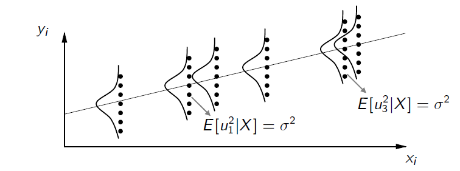
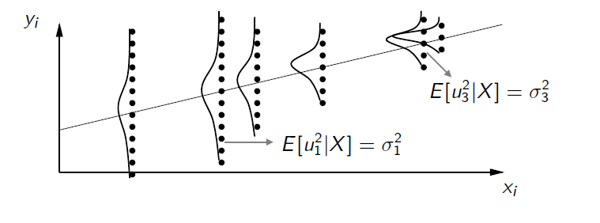

<!-- ARCHIVO GENERADO por tools/clases.py a partir de las diapositivas oficiales. No editar a mano: modifica tools/clases.py o el .tex y vuelve a generar. -->

# Clase 5 · Propiedades estadísticas del estimador MCO

<div class="usm-session-meta">
<span>📅 Viernes 13 de noviembre de 2026</span>
<span>⏱️ 18:40 – 21:25</span>
<span class="usm-tag-gold">Semana 5 · Contenido 5 · Análisis de regresión múltiple</span>
</div>

!!! info "Contenido oficial de la semana"
    Esta página reproduce **íntegras y en orden** las diapositivas de la cátedra del viernes de la
    semana 5 (`sem5/clase6.tex`, 19 láminas). Los bloques **Interactivo**, los casos y las preguntas
    son material adicional para estudiar.

!!! example "Cómo estudiar esta página"
    La clase está ordenada en **7 temas**. Cada tema parte con una **pregunta guía**, sigue con las láminas
    y los simuladores, y termina con **✍️ preguntas de selección múltiple** (cada alternativa incorrecta explica
    por qué no lo es) y, en casi todos, un **🧪 ejercicio de R** que puedes editar y ejecutar aquí mismo, sin instalar nada.
    Los 6 ejercicios de R en un solo archivo: [📥 clase5.R](../r/clase5.R).

## 🎯 Objetivos de la sesión

- Enunciar los **cinco supuestos clásicos** del modelo de regresión múltiple y reconocer cuándo se violan.
- Demostrar que, bajo los supuestos 1 a 4, $\hat{\beta}$ es **insesgado**.
- Obtener la matriz de varianzas y covarianzas $\text{Var}(\hat{\beta} \mid X) = \sigma^2 (X^\top X)^{-1}$ y estimarla con $\hat{\sigma}^2$.
- Calcular e interpretar los **errores estándar** de cada $\hat{\beta}_j$.

## 🗓️ Agenda de la cátedra (viernes 18:40 – 21:25)

Haz clic en un tema para ir directo a él.

<ol class="econ-ruta">
<li><span class="econ-ruta-h">18:40</span><a class="econ-ruta-a" href="#tema-1"><span class="econ-ruta-n">1</span><span class="econ-ruta-t">¿Qué hace bueno a un estimador?</span><span class="econ-ruta-l">láminas 1–2 · ✍️ 2 preguntas</span></a></li>
<li><span class="econ-ruta-h">19:00</span><a class="econ-ruta-a" href="#tema-2"><span class="econ-ruta-n">2</span><span class="econ-ruta-t">Supuestos 1 a 3: linealidad, muestra aleatoria e identificación</span><span class="econ-ruta-l">láminas 3–5 · ✍️ 2 preguntas · 🧪 R</span></a></li>
<li><span class="econ-ruta-h">19:25</span><a class="econ-ruta-a" href="#tema-3"><span class="econ-ruta-n">3</span><span class="econ-ruta-t">Supuesto 4: ortogonalidad, el supuesto crítico</span><span class="econ-ruta-l">láminas 6–7 · ✍️ 2 preguntas · 🧪 R</span></a></li>
<li><span class="econ-ruta-h">19:40</span><a class="econ-ruta-a" href="#tema-4"><span class="econ-ruta-n">4</span><span class="econ-ruta-t">Supuesto 5: homocedasticidad, y el resumen</span><span class="econ-ruta-l">láminas 8–10 · ✍️ 2 preguntas · 🧪 R</span></a></li>
<li class="is-break"><span class="econ-ruta-h">19:55</span><span class="econ-ruta-t">☕ Receso</span></li>
<li><span class="econ-ruta-h">20:05</span><a class="econ-ruta-a" href="#tema-5"><span class="econ-ruta-n">5</span><span class="econ-ruta-t">Insesgamiento y varianza de β̂</span><span class="econ-ruta-l">láminas 11–13 · ✍️ 2 preguntas · 🧪 R</span></a></li>
<li><span class="econ-ruta-h">20:35</span><a class="econ-ruta-a" href="#tema-6"><span class="econ-ruta-n">6</span><span class="econ-ruta-t">Estimar σ² y los errores estándar</span><span class="econ-ruta-l">láminas 14–18 · ✍️ 2 preguntas · 🧪 R</span></a></li>
<li><span class="econ-ruta-h">21:05</span><a class="econ-ruta-a" href="#tema-7"><span class="econ-ruta-n">7</span><span class="econ-ruta-t">¿Qué hace más preciso a β̂?</span><span class="econ-ruta-l">lámina 19 · ✍️ 2 preguntas · 🧪 R</span></a></li>
<li class="is-break"><span class="econ-ruta-h">21:20</span><span class="econ-ruta-t">✅ Ideas clave, autoevaluación y cierre</span></li>
</ol>

## Propiedades estadísticas del estimador MCO { .econ-parte data-eyebrow="Parte 1 · Cátedra" data-toc-label="Parte 1 · Propiedades estadísticas del estimador MCO" }

<p class="econ-source">📄 Diapositivas: <code>sem5/clase6.tex</code> · 19 láminas</p>

### ¿Qué hace bueno a un estimador? { #tema-1 .econ-tema data-num="1" data-laminas="láminas 1–2" data-toc-label="Tema 1 · ¿Qué hace bueno a β̂?" }

<p class="econ-tema-q">Ya sabemos calcular β̂. ¿Cómo sabemos si es un buen estimador de β?</p>

<div class="econ-lamina" markdown>

#### Resumen clase anterior { data-lamina="Lámina 1" }

<!-- sem5/clase6.tex · lámina 1 -->

-   Vimos la forma matricial del modelo de regresión lineal múltiple: $y = X\beta + u$

-   Demostramos que por MCO se puede obtener: $\hat{\beta} = \begin{bmatrix} \hat{\beta}_0 \\ \hat{\beta}_1 \\ \hat{\beta}_2 \\ \vdots \\ \hat{\beta}_k \end{bmatrix} = (X^\top X)^{-1}X^\top y$

Interpretación $\hat{\beta}_i$: Cuando cambia $x_i$ en una unidad, en promedio $y$ cambia $\hat{\beta}_i$ unidades, manteniendo todas las demás variables explicativas ($x_{-i}$) constantes.

</div>

<div class="econ-lamina" markdown>

#### Supuestos Clásicos { data-lamina="Lámina 2" }

<!-- sem5/clase6.tex · lámina 2 -->

¿$\hat{\beta}$ es un buen estimador para $\beta$? ¿Qué significa que sea bueno?<br>

***Supuestos clásicos:***

1.  Linealidad en parámetros

2.  Muestra aleatoria

3.  Condición de identificación

4.  Ortogonalidad

5.  Homocedasticidad

</div>

<div class="econ-practica" id="practica-1">
<p class="econ-practica-t"><span>✍️ Practica · Tema 1</span></p>
<div class="econ-quiz">
<p class="econ-quiz-q">¿Qué significa que β̂ sea un estimador <em>insesgado</em> de β?</p>
<div class="econ-quiz-opts">
<button class="econ-quiz-opt" data-correct>Que el promedio de β̂ sobre todas las muestras posibles es igual a β.</button>
<button class="econ-quiz-opt" data-why="Cada muestra da un β̂ distinto; el insesgamiento habla del promedio.">Que en cada muestra β̂ = β.</button>
<button class="econ-quiz-opt" data-why="El R² mide ajuste dentro de la muestra, no si β̂ acierta en promedio.">Que el R² es alto.</button>
</div>
<p class="econ-quiz-fb">✅ Es lo que se demuestra en la lámina 12.</p>
</div>
<div class="econ-quiz">
<p class="econ-quiz-q">¿Cuántos supuestos clásicos enumera la lámina 2?</p>
<div class="econ-quiz-opts">
<button class="econ-quiz-opt" data-why="Faltan ortogonalidad y homocedasticidad.">Tres</button>
<button class="econ-quiz-opt" data-correct>Cinco</button>
<button class="econ-quiz-opt" data-why="La normalidad no está en la lista: se agrega como supuesto 6 en la Clase 7.">Uno: que u sea normal</button>
</div>
<p class="econ-quiz-fb">✅ Linealidad, muestra aleatoria, identificación, ortogonalidad y homocedasticidad.</p>
</div>
</div>

### Supuestos 1 a 3: linealidad, muestra aleatoria e identificación { #tema-2 .econ-tema data-num="2" data-laminas="láminas 3–5" data-toc-label="Tema 2 · Supuestos 1 a 3" }

<p class="econ-tema-q">¿Qué le pedimos al modelo, a los datos y a la matriz X?</p>

<div class="econ-lamina" markdown>

#### Supuesto 1: Linealidad en Parámetros { data-lamina="Lámina 3" }

<!-- sem5/clase6.tex · lámina 3 -->

-   La relación poblacional entre las variables sigue un modelo lineal:

    $$
    y = X \beta + u \quad (1)
    $$

    $$
    = \beta_0 + \beta_1 x_1 + \beta_2 x_2 + \ldots + \beta_k x_k + u \quad (2)
    $$

    donde $\beta_0, \beta_1, \ldots, \beta_k$ son parámetros desconocidos y $u$ es una variable no observable llamada término de error o perturbación.

-   Si el modelo analítico no es lineal en los parámetros, hay que linealizarlo, en la medida de lo posible.

-   Por ejemplo:

    $$
    Y = A K^{\alpha_1} Q^{\alpha_2} L^{\alpha_3}
    $$

    se lineariza como

    $$
    \log Y = \log A + \alpha_1 \log K + \alpha_2 \log Q + \alpha_3 \log L
    $$

</div>

<div class="econ-lamina" markdown>

#### Supuesto 2: Muestra Aleatoria { data-lamina="Lámina 4" }

<!-- sem5/clase6.tex · lámina 4 -->

-   Las $n$ observaciones provienen de una muestra aleatoria de la población,

    $$
    \{(x_{i1}, x_{i2}, \ldots, x_{ik}, y_i) : i = 1, 2, \ldots, n\}
    $$

-   Esto significa que las observaciones son independientes unas de otras, lo que implica que

    $$
    \text{cov}(u_i, u_j|X) = 0 \quad \forall i \neq j
    $$

-   En series de tiempo lo anterior implica que los errores no tienen autocorrelación.

</div>

<div class="econ-lamina" markdown>

#### Supuesto 3: Condición de Identificación (No multicolinealidad perfecta) { data-lamina="Lámina 5" }

<!-- sem5/clase6.tex · lámina 5 -->

-   $X$ tiene rango columna completo $k + 1$.

-   No hay relaciones lineales exactas entre las variables independientes.

-   Esto implica:

    -   Las columnas de $X$ son linealmente independientes.

    -   Existe la inversa de $X^{\top}X$.

    -   $n \geq k + 1$.

**Ejemplo de violación a este supuesto**: $x_2 = 2x_1$. La fila 2 es linealmente dependiente de la 1.

</div>

<div class="econ-widget" data-widget="multicolinealidad"></div>

<div class="econ-practica" id="practica-2">
<p class="econ-practica-t"><span>✍️ Practica · Tema 2</span></p>
<div class="econ-quiz">
<p class="econ-quiz-q">¿Cuál de estos modelos <strong>no</strong> es lineal en los parámetros, aunque se pueda linealizar?</p>
<div class="econ-quiz-opts">
<button class="econ-quiz-opt" data-why="Es lineal en β₀, β₁ y β₂: x² es solo otra variable.">y = β₀ + β₁x + β₂x² + u</button>
<button class="econ-quiz-opt" data-correct>Y = A·K^α₁·Q^α₂·L^α₃</button>
<button class="econ-quiz-opt" data-why="Es lineal en β₀ y β₁: los logaritmos están en las variables.">log y = β₀ + β₁ log x + u</button>
</div>
<p class="econ-quiz-fb">✅ La función de producción se linealiza tomando logaritmos (lámina 3).</p>
</div>
<div class="econ-quiz">
<p class="econ-quiz-q">Incluyes x₂ = 2·x₁ en la regresión. ¿Qué pasa?</p>
<div class="econ-quiz-opts">
<button class="econ-quiz-opt" data-correct>X no tiene rango completo y XᵀX no tiene inversa: MCO no tiene solución única.</button>
<button class="econ-quiz-opt" data-why="Ni siquiera se pueden calcular ambos: se viola el supuesto 3.">β̂₂ es exactamente el doble de β̂₁.</button>
<button class="econ-quiz-opt" data-why="Con una relación lineal exacta no existe (XᵀX)⁻¹.">Nada, solo aumenta el R².</button>
</div>
<p class="econ-quiz-fb">✅ Es el ejemplo de violación de la lámina 5. Pruébalo con ρ = 1 en el simulador de multicolinealidad.</p>
</div>
</div>

<div class="econ-r" markdown>

<p class="econ-r-t">🧪 Practica en R · Multicolinealidad perfecta</p>

Construye una variable que es exactamente el doble de otra y mira cómo responden `lm()` y `solve()`.

```r
set.seed(5)
n  <- 50
x1 <- rnorm(n)
x2 <- 2 * x1                       # relación lineal exacta: viola el supuesto 3
y  <- 1 + 2 * x1 + rnorm(n)

coef(lm(y ~ x1 + x2))              # R no puede estimar x2: entrega NA

X <- cbind(1, x1, x2)
qr(X)$rank                         # rango 2, no k + 1 = 3
try(solve(t(X) %*% X))             # XᵀX no tiene inversa
```

**🎯 Reto:** cambia `2 * x1` por `2 * x1 + rnorm(n, sd = 0.01)`. ¿Se puede estimar ahora? ¿Qué pasa con los errores estándar?
{: .econ-r-reto }

</div>

### Supuesto 4: ortogonalidad, el supuesto crítico { #tema-3 .econ-tema data-num="3" data-laminas="láminas 6–7" data-toc-label="Tema 3 · Supuesto 4: ortogonalidad" }

<p class="econ-tema-q">¿Por qué este supuesto, y no otro, decide si podemos interpretar β causalmente?</p>

<div class="econ-lamina" markdown>

#### Supuesto 4: Ortogonalidad (Exogeneidad) { data-lamina="Láminas 6–7" }

<!-- sem5/clase6.tex · lámina 6 -->

-   $E[u|X] = E(u|x_1, x_2, \ldots, x_k) = 0$.

-   Esto implica que:

    -   $E[X^{\top}u] = 0$: la covarianza entre las $x$ y el error es cero.

    -   $E(y|X) = E(X\beta + u|X) = X\beta$.

Vamos a ver que este supuesto va a ser el supuesto clave para interpretar causalmente los coeficientes.

<!-- sem5/clase6.tex · lámina 7 -->

-   $E[u|X] = E(u|x_1, x_2, \ldots , x_k) = 0$.

-   Esto implica que:

    -   $E[X^{\top}u] = 0$: la covarianza entre las $x$ y el error es cero.

    -   $E(y|X) = E(X\beta + u|X) = X\beta$.

-   Vamos a ver que este supuesto va a ser el supuesto clave para interpretar causalmente los coeficientes.

-   Este supuesto puede no cumplirse por varias razones:

    -   Omisión de una variable que está correlacionada con alguna $x$.

    -   Errores de medición en los regresores.

-   Por desgracia, muy pocas veces se sabe con seguridad si el valor promedio de los factores no observables de hecho no está relacionado con las variables explicativas. **Pero este es el supuesto crítico.**

</div>

<div class="econ-practica" id="practica-3">
<p class="econ-practica-t"><span>✍️ Practica · Tema 3</span></p>
<div class="econ-quiz">
<p class="econ-quiz-q">¿Cuál de estas situaciones viola E[u | X] = 0?</p>
<div class="econ-quiz-opts">
<button class="econ-quiz-opt" data-correct>Se omite una variable que afecta a y y está correlacionada con alguna x.</button>
<button class="econ-quiz-opt" data-why="Eso viola el supuesto 5 (homocedasticidad), no el 4.">La varianza de u crece con x.</button>
<button class="econ-quiz-opt" data-why="Un R² bajo solo dice que u tiene mucha varianza, no que esté relacionado con X.">El R² es bajo.</button>
</div>
<p class="econ-quiz-fb">✅ Lámina 7: omisión de variables y errores de medición en los regresores.</p>
</div>
<div class="econ-quiz">
<p class="econ-quiz-q">¿Qué implica E[u | X] = 0 sobre la covarianza entre las x y el error?</p>
<div class="econ-quiz-opts">
<button class="econ-quiz-opt" data-correct>Que es cero: E[Xᵀu] = 0.</button>
<button class="econ-quiz-opt" data-why="La ortogonalidad implica covarianza nula.">Que es positiva.</button>
<button class="econ-quiz-opt" data-why="La lámina 6 lo deriva explícitamente.">Nada: son conceptos independientes.</button>
</div>
<p class="econ-quiz-fb">✅ Además implica E(y | X) = Xβ.</p>
</div>
</div>

<div class="econ-r" markdown>

<p class="econ-r-t">🧪 Practica en R · Lo que pasa cuando falla el supuesto 4</p>

La habilidad queda en el error y se relaciona con la educación. Compara la regresión con y sin ella.

```r
set.seed(4)
n <- 2000
habilidad <- rnorm(n)                       # no la observamos
educ      <- 12 + 2 * habilidad + rnorm(n)  # se relaciona con la educación
salario   <- 1 + 0.5 * educ + 1 * habilidad + rnorm(n)

coef(lm(salario ~ educ))               # habilidad en u: E[u | X] ≠ 0
coef(lm(salario ~ educ + habilidad))   # si pudiéramos incluirla: ≈ 0.5
cor(educ, habilidad)
```

**🎯 Reto:** cambia `2 * habilidad` por `0 * habilidad` en la educación. ¿Sigue habiendo sesgo?
{: .econ-r-reto }

</div>

### Supuesto 5: homocedasticidad, y el resumen { #tema-4 .econ-tema data-num="4" data-laminas="láminas 8–10" data-toc-label="Tema 4 · Supuesto 5 y resumen" }

<p class="econ-tema-q">¿Importa que el ruido sea más grande para algunas personas que para otras?</p>

<div class="econ-lamina" markdown>

#### Supuesto 5: Homocedasticidad y no autocorrelación { data-lamina="Lámina 8" }

<!-- sem5/clase6.tex · lámina 8 -->

-   La varianza del error no depende de $X$:

    $$
    \text{Var}(u_i|x_1, \ldots , x_k) = E[u_i^2|x] = \sigma^2
    $$

-   En caso de que el supuesto no se cumpla, se dice que el modelo presenta heterocedasticidad.

-   Ejemplo donde no se cumpliría esta condición: si tenemos salario en función de años de escolaridad, la varianza de $u$ es probablemente menor para escolaridades pequeñas.

-   Con esto, la varianza condicional del vector $u$ queda: $\text{Var}(u|X) = \sigma^2I$.

-   La covarianza de los errores es cero:

    $$
    \text{Covar}(u_i,u_j|x_1, \ldots , x_k) = 0
    $$

</div>

<div class="econ-lamina" markdown>

#### Supuesto 5: Homocedasticidad { data-lamina="Lámina 9" }

<!-- sem5/clase6.tex · lámina 9 -->

-   Homocedasticidad en un modelo simple (mismo $\sigma$).

    { .econ-slide-img }

-   Heterocedasticidad en un modelo simple.

    { .econ-slide-img }

</div>

<div class="econ-lamina" markdown>

#### Resumen Supuestos { data-lamina="Lámina 10" }

<!-- sem5/clase6.tex · lámina 10 -->

1.  Linealidad en parámetros ($y = X\beta + u$).

2.  Muestra aleatoria.

3.  $X$ tiene rango completo ($k+1$), es decir, todas las variables son linealmente independientes.

4.  Ortogonalidad: $E[u|X] = 0$.

5.  Homocedasticidad y no-autocorrelación: $V(u|X) = \sigma^2I$

</div>

<div class="econ-widget" data-widget="supuestos-mlc"></div>

<div class="econ-practica" id="practica-4">
<p class="econ-practica-t"><span>✍️ Practica · Tema 4</span></p>
<div class="econ-quiz">
<p class="econ-quiz-q">Var(u | X) = σ²I significa que…</p>
<div class="econ-quiz-opts">
<button class="econ-quiz-opt" data-correct>…todos los errores tienen la misma varianza y no están correlacionados entre sí.</button>
<button class="econ-quiz-opt" data-why="Habla de la varianza de u, no de su valor.">…los errores son todos iguales a σ.</button>
<button class="econ-quiz-opt" data-why="La normalidad es otro supuesto (el 6, en la Clase 7).">…u se distribuye normal.</button>
</div>
<p class="econ-quiz-fb">✅ Homocedasticidad (diagonal constante) y no autocorrelación (fuera de la diagonal, ceros).</p>
</div>
<div class="econ-quiz">
<p class="econ-quiz-q">En la lámina 9, ¿qué distingue el gráfico de heterocedasticidad?</p>
<div class="econ-quiz-opts">
<button class="econ-quiz-opt" data-correct>La dispersión de los puntos alrededor de la recta cambia con x.</button>
<button class="econ-quiz-opt" data-why="La pendiente no tiene relación con la homocedasticidad.">La recta tiene pendiente negativa.</button>
<button class="econ-quiz-opt" data-why="Eso sería un problema de forma funcional, no de varianza.">Los puntos forman una curva.</button>
</div>
<p class="econ-quiz-fb">✅ Con homocedasticidad la nube tiene el mismo ancho para todo x.</p>
</div>
</div>

<div class="econ-r" markdown>

<p class="econ-r-t">🧪 Practica en R · El abanico de la heterocedasticidad</p>

Simula salarios cuya varianza crece con la educación (el ejemplo de la lámina 8) y grafica los residuos.

```r
set.seed(8)
n       <- 300
educ    <- runif(n, 6, 20)
u       <- rnorm(n, sd = 0.4 * educ)   # la varianza crece con la educación
salario <- 2 + 0.8 * educ + u
m <- lm(salario ~ educ)

plot(educ, resid(m), pch = 19, col = "steelblue",
     main = "Residuos: el abanico se abre", ylab = "residuo")
abline(h = 0, lty = 2)
tapply(resid(m), cut(educ, 3), sd)     # dispersión por tramo de educación
```

**🎯 Reto:** cambia `sd = 0.4 * educ` por `sd = 4`. ¿Cómo se ve ahora el gráfico de residuos?
{: .econ-r-reto }

</div>

### Insesgamiento y varianza de β̂ { #tema-5 .econ-tema data-num="5" data-laminas="láminas 11–13" data-toc-label="Tema 5 · Insesgamiento y varianza" }

<p class="econ-tema-q">¿Acierta MCO en promedio? ¿Y cuánto se equivoca de muestra en muestra?</p>

<div class="econ-lamina" markdown>

#### Propiedades Estadísticas de los Estimadores $\hat{\beta}$ { data-lamina="Lámina 11" data-toc-label="Propiedades Estadísticas de los Estimadores hatβ" }

<!-- sem5/clase6.tex · lámina 11 -->

Bajo los supuestos clásicos, los estimadores MCO cumplen lo siguiente:

1.  $\hat{\beta}$ es insesgado: $E(\hat{\beta}) = \beta$.

2.  $V(\hat{\beta}|X) = (X^{\top}X)^{-1}\sigma^2$.

3.  Teorema de Gauss-Markov: $\hat{\beta}$ es el estimador lineal insesgado de menor varianza (MELI-BLUE).

</div>

<div class="econ-lamina" markdown>

#### El Estimador MCO es Insesgado { data-lamina="Lámina 12" }

<!-- sem5/clase6.tex · lámina 12 -->

-   Teorema: Bajo los supuestos 1 a 4, el estimador MCO de $\beta$ es insesgado.

-   Demostración:

    $$
    \begin{aligned}
    \hat{\beta} &= (X^{\top}X)^{-1}X^{\top}y \quad \text{(3)} \\
    &= (X^{\top}X)^{-1}X^{\top}(X\beta + u) \quad \text{(4)} \\
    &= \beta + (X^{\top}X)^{-1}X^{\top}u \quad \text{(5)} \\
    E(\hat{\beta}|X) &= \beta + (X^{\top}X)^{-1}X^{\top}E(u|X) \quad \text{(6)} \\
    &= \beta \quad \text{(7)}
    
    \end{aligned}
    $$

-   Esto implica que el promedio de los estimadores $\hat{\beta}$ obtenidos con todas las muestras aleatorias posibles es igual a $\beta$.

</div>

<div class="econ-lamina" markdown>

#### Varianza del Estimador MCO { data-lamina="Lámina 13" }

<!-- sem5/clase6.tex · lámina 13 -->

-   Teorema: Bajo los supuestos 1 a 5, la varianza del estimador MCO de $\beta$ es $\text{Var}(\hat{\beta}|X) = \sigma^2(X^{\top}X)^{-1}$.

-   Demostración:

    $$
    \begin{aligned}
    \text{Var}(\hat{\beta}|X) &= E[(\hat{\beta} - E(\hat{\beta}))(\hat{\beta} - E(\hat{\beta}))^{\top}|X] \quad \text{(8)} \\
    &= E[(\hat{\beta} - \beta)(\hat{\beta} - \beta)^{\top}|X] \quad \text{(9)} \\
    &= E[(X^{\top}X)^{-1}X^{\top}u \, u^{\top}X(X^{\top}X)^{-1}|X] \quad \text{(10)} \\
    &= (X^{\top}X)^{-1}X^{\top}E[u \, u^{\top}|X]X(X^{\top}X)^{-1} \quad \text{(11)} \\
    &= (X^{\top}X)^{-1}X^{\top}\sigma^2IX(X^{\top}X)^{-1} \quad \text{(12)} \\
    &= \sigma^2(X^{\top}X)^{-1}(X^{\top}X)(X^{\top}X)^{-1} \quad \text{(13)} \\
    &= \sigma^2(X^{\top}X)^{-1} \quad \text{(14)}
    
    \end{aligned}
    $$

-   nota: $\hat{\beta}=\beta+(X^{T}X)^{-1}X^{T}u$

</div>

<div class="econ-widget" data-widget="lab-supuestos"></div>

<div class="econ-practica" id="practica-5">
<p class="econ-practica-t"><span>✍️ Practica · Tema 5</span></p>
<div class="econ-quiz">
<p class="econ-quiz-q">¿Qué supuestos se usan para demostrar que β̂ es insesgado?</p>
<div class="econ-quiz-opts">
<button class="econ-quiz-opt" data-correct>Del 1 al 4.</button>
<button class="econ-quiz-opt" data-why="La homocedasticidad no se necesita para el insesgamiento; sí para la fórmula de la varianza.">Del 1 al 5.</button>
<button class="econ-quiz-opt" data-why="El paso clave es E(u | X) = 0, que es el supuesto 4.">Solo el 5.</button>
</div>
<p class="econ-quiz-fb">✅ Lámina 12: el paso (6) usa E(u | X) = 0.</p>
</div>
<div class="econ-quiz">
<p class="econ-quiz-q">En la demostración de la varianza, ¿en qué paso se usa la homocedasticidad?</p>
<div class="econ-quiz-opts">
<button class="econ-quiz-opt" data-correct>Al reemplazar E[uuᵀ | X] por σ²I.</button>
<button class="econ-quiz-opt" data-why="Ese paso solo usa y = Xβ + u.">Al escribir β̂ = β + (XᵀX)⁻¹Xᵀu.</button>
<button class="econ-quiz-opt" data-why="La demostración termina en σ²(XᵀX)⁻¹, sin raíces.">Al tomar la raíz de la varianza.</button>
</div>
<p class="econ-quiz-fb">✅ Lámina 13, paso (12).</p>
</div>
</div>

<div class="econ-r" markdown>

<p class="econ-r-t">🧪 Practica en R · Insesgamiento y σ²(XᵀX)⁻¹ por simulación</p>

Deja X fija, genera 5 000 muestras de y y compara el promedio y la varianza de β̂ con lo que dicen las láminas 12 y 13.

```r
set.seed(12)
n     <- 50
sigma <- 2
X     <- cbind(1, x1 = rnorm(n), x2 = rnorm(n))   # X fija entre muestras
beta  <- c(1, 2, 1.5)

b_hat <- replicate(5000, {
  y <- X %*% beta + rnorm(n, sd = sigma)
  drop(solve(t(X) %*% X) %*% t(X) %*% y)          # (XᵀX)⁻¹Xᵀy
})
rowMeans(b_hat)                  # ≈ (1, 2, 1.5): insesgado (lámina 12)
round(var(t(b_hat)), 4)          # varianza simulada
round(sigma^2 * solve(t(X) %*% X), 4)   # σ²(XᵀX)⁻¹ (lámina 13)
```

**🎯 Reto:** cambia `sigma <- 2` por `sigma <- 4`. ¿Cuánto crece la varianza? ¿Cambia el promedio?
{: .econ-r-reto }

</div>

### Estimar σ² y los errores estándar { #tema-6 .econ-tema data-num="6" data-laminas="láminas 14–18" data-toc-label="Tema 6 · σ̂² y errores estándar" }

<p class="econ-tema-q">σ² no se observa. ¿Cómo obtenemos, entonces, la precisión de cada β̂ⱼ?</p>

<div class="econ-lamina" markdown>

#### Estimador MCO de $\sigma^2$ { data-lamina="Láminas 14–15" data-toc-label="Estimador MCO de σ²" }

<!-- sem5/clase6.tex · lámina 14 -->

La matriz de varianzas-covarianzas viene dada por:

$$
\text{Var}(\hat{\beta}|X) = \sigma^2(X^{\top}X)^{-1}
$$

Notar que $(X^{\top}X)^{-1}$ es una matriz que se observa en los datos.

Pero, $\sigma^2$ es la varianza del error poblacional. NO es observable.

<!-- sem5/clase6.tex · lámina 15 -->

El estimador $\hat{\sigma}^2$ de $\sigma^2$:

$$
\hat{\sigma}^2 = \frac{\sum_{i=1}^{n} \hat{u}_i^2 }{n-k-1}= \frac{SSR}{n - k - 1}
$$

-   El término n - k - 1 son los grados de libertad (gl) para el problema general de MCO con n observaciones y k variables independientes.

-   Como en un modelo de regresión con k variables independientes y un intercepto hay k + 1 parámetros.

-   gl = (observaciones) - (cantidad de parámetros estimados).

-   Bajo los supuestos del teorema de Gauss-Markov se cumple que $E[\hat{\sigma}^2|X] = \sigma^2$.

</div>

<div class="econ-lamina" markdown>

#### Varianza Estimada de Cada Estimador $\hat{\beta}_j$ { data-lamina="Lámina 16" data-toc-label="Varianza Estimada de Cada Estimador hatβj" }

<!-- sem5/clase6.tex · lámina 16 -->

$$
\hat{\text{Var}}(\hat{\beta}|X) = \hat{\sigma}^2(X^{\top}X)^{-1}
$$

Matriz de $(k + 1) \times (k + 1)$ de varianzas-covarianzas, tal que:

-   El elemento de la diagonal $a_{1,1}$ es $\hat{\text{Var}}(\hat{\beta}_0)$.

-   El elemento de la diagonal $a_{2,2}$ es $\hat{\text{Var}}(\hat{\beta}_1)$.

-   Generalizando: el elemento de la diagonal $a_{j+1,j+1}$ es $\hat{\text{Var}}(\hat{\beta}_j)$.

</div>

<div class="econ-lamina" markdown>

#### Varianza del Estimador MCO: Ejemplo { data-lamina="Láminas 17–18" }

<!-- sem5/clase6.tex · lámina 17 -->

-   Supuestos clásicos $\Rightarrow \hat{V}(\hat{\beta}|X) = \hat{\sigma}^2(X^{\top}X)^{-1}$.

-   De los datos obtenemos:

    $$
    (X^{\top}X)^{-1} =
    \begin{bmatrix}
    0.05987 & -0.00177 & -0.00035 \\
    -0.00177 & 0.00030 & -0.00002 \\
    -0.00035 & -0.00002 & 0.00001 \\
    \end{bmatrix};
    $$

    $$
    \hat{\sigma}^2 = \frac{SSR}{n-k-1} =141925
    $$

<!-- sem5/clase6.tex · lámina 18 -->

-   Supuestos clásicos $\Rightarrow \hat{V}(\hat{\beta}) = \hat{\sigma}^2(X^{\top}X)^{-1}$.

-   De los datos obtenemos:

    $$
    (X^{\top}X)^{-1} =
    \begin{bmatrix}
    0.05987 & -0.00177 & -0.00035 \\
    -0.00177 & 0.00030 & -0.00002 \\
    -0.00035 & -0.00002 & 0.00001 \\
    \end{bmatrix}; \quad \hat{\sigma}^2 = 141925
    $$

-   Entonces, podemos calcular:

    $$
    \hat{V}(\hat{\beta}) = \hat{\sigma}^2(X^{\top}X)^{-1} =
    \begin{bmatrix}
    8497.57 & -250.80 & -49.04 \\
    -250.80 & 42.90 & -3.22 \\
    -49.04 & -3.22 & 0.91 \\
    \end{bmatrix}
    $$

-   En la diagonal principal, tienen la varianza de cada uno de los estimadores.

-   Ejemplo: $\hat{V}(\hat{\beta}_1) = 42.6$. Es decir, los $\hat{se}(\hat{\beta}_1) = \sqrt{\hat{V}(\hat{\beta}_1)} = 6.53$

</div>

!!! tip "Complemento · ¿Por qué 42.6 y 42.90?"
    La matriz $(X^\top X)^{-1}$ de la lámina está redondeada a cinco decimales: $141\,925 \times 0.00030 = 42.58$, que la lámina aproxima a $42.6$ y da $\hat{se}(\hat{\beta}_1) = 6.53$. Con la matriz sin redondear se obtiene $42.90$ y $6.55$, el error estándar que reporta Stata para la misma regresión (salario en educación e IQ, $n = 935$) en la lámina 13 de la Clase 7.

<div class="econ-widget" data-widget="vcov"></div>

<div class="econ-practica" id="practica-6">
<p class="econ-practica-t"><span>✍️ Practica · Tema 6</span></p>
<div class="econ-quiz">
<p class="econ-quiz-q">Con n = 935 y k = 2 variables explicativas, ¿cuántos grados de libertad tiene σ̂²?</p>
<div class="econ-quiz-opts">
<button class="econ-quiz-opt" data-why="Hay que descontar los parámetros estimados.">935</button>
<button class="econ-quiz-opt" data-why="Faltó descontar el intercepto: son k + 1 parámetros.">933</button>
<button class="econ-quiz-opt" data-correct>932</button>
</div>
<p class="econ-quiz-fb">✅ gl = n − k − 1 = 935 − 2 − 1 = 932 (lámina 15).</p>
</div>
<div class="econ-quiz">
<p class="econ-quiz-q">En V̂(β̂) = σ̂²(XᵀX)⁻¹, ¿dónde está la varianza de β̂₁?</p>
<div class="econ-quiz-opts">
<button class="econ-quiz-opt" data-correct>En el elemento (2, 2) de la diagonal.</button>
<button class="econ-quiz-opt" data-why="Ese corresponde a β̂₀, el intercepto.">En el elemento (1, 1).</button>
<button class="econ-quiz-opt" data-why="Fuera de la diagonal están las covarianzas entre estimadores.">Fuera de la diagonal.</button>
</div>
<p class="econ-quiz-fb">✅ Lámina 16: el elemento a(j+1, j+1) es la varianza de β̂ⱼ.</p>
</div>
</div>

<div class="econ-r" markdown>

<p class="econ-r-t">🧪 Practica en R · Errores estándar a mano</p>

Reproduce la matriz de la lámina 18 y, después, calcula σ̂² y los errores estándar a mano en una regresión simulada.

```r
# 1) Con los números de las láminas 17 y 18
XtX_inv <- matrix(c( 0.05987, -0.00177, -0.00035,
                    -0.00177,  0.00030, -0.00002,
                    -0.00035, -0.00002,  0.00001), 3, 3, byrow = TRUE)
V <- 141925 * XtX_inv
round(V, 2)
sqrt(diag(V))                       # errores estándar

# 2) Con datos simulados: σ̂² = SSR / (n − k − 1)
set.seed(16)
n  <- 100
x1 <- rnorm(n)
x2 <- rnorm(n)
y  <- 1 + 2 * x1 + 1.5 * x2 + rnorm(n, sd = 3)
m  <- lm(y ~ x1 + x2)
X  <- model.matrix(m)
sigma2_hat <- sum(resid(m)^2) / (n - 2 - 1)
c(a_mano = sigma2_hat, lm = summary(m)$sigma^2)
cbind(a_mano = sqrt(diag(sigma2_hat * solve(t(X) %*% X))),
      lm     = coef(summary(m))[, "Std. Error"])
```

**🎯 Reto:** cambia `sd = 3` por `sd = 6` en la línea de `y`. ¿Cuánto cambian los errores estándar?
{: .econ-r-reto }

</div>

### ¿Qué hace más preciso a β̂? { #tema-7 .econ-tema data-num="7" data-laminas="lámina 19" data-toc-label="Tema 7 · Precisión de β̂" }

<p class="econ-tema-q">Si pudieras diseñar tu estudio, ¿qué cambiarías para estimar β con más precisión?</p>

<div class="econ-lamina" markdown>

#### El Caso Particular de Regresión con una Sola Variable Independiente { data-lamina="Lámina 19" }

<!-- sem5/clase6.tex · lámina 19 -->

En el modelo de regresión simple $y = \beta_0 + \beta_1 x + u$, sigue cumpliéndose lo anterior.

$$
\hat{Var}(\hat{\beta}_1) = {\frac{{\hat{\sigma}}^2}{\sum_{i=1}^{n}(x_i - \bar{x})^2}}
$$

-   Si $x$ tiene más variabilidad, hace que $\hat{\beta}$ sea más preciso (tengo más información).

-   Si la varianza del residuo es más grande, mi estimador es menos preciso. Mi modelo no explica mucho de $y$.

</div>

<div class="econ-practica" id="practica-7">
<p class="econ-practica-t"><span>✍️ Practica · Tema 7</span></p>
<div class="econ-quiz">
<p class="econ-quiz-q">¿Cuál de estos cambios hace <strong>menos</strong> preciso a β̂₁?</p>
<div class="econ-quiz-opts">
<button class="econ-quiz-opt" data-why="Más variación en x aumenta Σ(xᵢ − x̄)² y reduce la varianza.">Que x tenga más variabilidad.</button>
<button class="econ-quiz-opt" data-correct>Que el error tenga más varianza.</button>
<button class="econ-quiz-opt" data-why="Más datos aumentan Σ(xᵢ − x̄)² y reducen la varianza.">Tener más observaciones.</button>
</div>
<p class="econ-quiz-fb">✅ Lámina 19: si la varianza del residuo es más grande, el estimador es menos preciso.</p>
</div>
<div class="econ-quiz">
<p class="econ-quiz-q">Dos estudios estiman el retorno a la educación. En el A todos tienen entre 11 y 13 años de estudio; en el B, entre 6 y 20. ¿Cuál será más preciso (con igual n y σ²)?</p>
<div class="econ-quiz-opts">
<button class="econ-quiz-opt" data-correct>El B, porque hay más variación en x.</button>
<button class="econ-quiz-opt" data-why="Datos parecidos en x dan poca información para medir la pendiente.">El A, porque los datos son más parecidos.</button>
<button class="econ-quiz-opt" data-why="La varianza depende de Σ(xᵢ − x̄)².">Igual de precisos.</button>
</div>
<p class="econ-quiz-fb">✅ Más variabilidad en x, más información (lámina 19).</p>
</div>
</div>

<div class="econ-r" markdown>

<p class="econ-r-t">🧪 Practica en R · Tres formas de ganar precisión</p>

Compara el error estándar de β̂₁ al aumentar la variación de x, el ruido y el tamaño muestral.

```r
set.seed(19)
se_beta1 <- function(n, sd_x, sigma) {
  x <- rnorm(n, sd = sd_x)
  y <- 1 + 2 * x + rnorm(n, sd = sigma)
  coef(summary(lm(y ~ x)))["x", "Std. Error"]
}
round(c(base            = se_beta1(100, 1, 2),
        mas_variacion_x = se_beta1(100, 3, 2),
        mas_ruido       = se_beta1(100, 1, 6),
        mas_datos       = se_beta1(400, 1, 2)), 3)
```

**🎯 Reto:** ¿cuántas observaciones necesitas para que el error estándar sea la mitad que en `base`? Pruébalo.
{: .econ-r-reto }

</div>

---

!!! abstract "🧠 Ideas clave"
    - Los **supuestos clásicos**: linealidad, muestra aleatoria, identificación (rango completo), ortogonalidad $E[u \mid X] = 0$ y homocedasticidad $V(u \mid X) = \sigma^2 I$.
    - Con los supuestos **1 a 4**, $\hat{\beta}$ es **insesgado**; la ortogonalidad es el supuesto crítico.
    - Con los supuestos **1 a 5**, $\text{Var}(\hat{\beta} \mid X) = \sigma^2 (X^\top X)^{-1}$, y por Gauss-Markov MCO es el estimador lineal insesgado de menor varianza.
    - Como $\sigma^2$ no se observa, se usa $\hat{\sigma}^2 = SSR/(n-k-1)$; la raíz de la diagonal de $\hat{\sigma}^2 (X^\top X)^{-1}$ da los **errores estándar**.

## ✅ Autoevaluación

<div class="econ-quiz">
<p class="econ-quiz-q">Con heterocedasticidad (y los supuestos 1 a 4 cumplidos), ¿qué le pasa a β̂?</p>
<div class="econ-quiz-opts">
<button class="econ-quiz-opt" data-correct>Sigue siendo insesgado, pero la fórmula σ²(XᵀX)⁻¹ ya no describe bien su varianza.</button>
<button class="econ-quiz-opt" data-why="El insesgamiento solo requiere los supuestos 1 a 4.">Queda sesgado.</button>
<button class="econ-quiz-opt" data-why="Se calcula igual; lo que falla es la fórmula de su varianza.">No se puede calcular.</button>
</div>
<p class="econ-quiz-fb">✅ Míralo en el laboratorio de supuestos: el histograma sigue centrado en 2.</p>
</div>

<div class="econ-quiz">
<p class="econ-quiz-q">Con σ̂² = 141 925 y un elemento diagonal de (XᵀX)⁻¹ igual a 0.00030, ¿cuál es el error estándar aproximado?</p>
<div class="econ-quiz-opts">
<button class="econ-quiz-opt" data-correct>6.5</button>
<button class="econ-quiz-opt" data-why="Esa es la varianza; el error estándar es su raíz.">42.6</button>
<button class="econ-quiz-opt" data-why="Esa es la raíz de 0.00030; falta multiplicar por σ̂² antes.">0.017</button>
</div>
<p class="econ-quiz-fb">✅ √(141 925 × 0.00030) = √42.58 ≈ 6.5 (láminas 17 y 18).</p>
</div>

<div class="econ-quiz">
<p class="econ-quiz-q">¿Qué dice el teorema de Gauss-Markov?</p>
<div class="econ-quiz-opts">
<button class="econ-quiz-opt" data-correct>Que, bajo los supuestos 1 a 5, MCO es el estimador lineal insesgado de menor varianza.</button>
<button class="econ-quiz-opt" data-why="Solo entre los lineales e insesgados.">Que MCO es el estimador de menor varianza entre todos los estimadores posibles.</button>
<button class="econ-quiz-opt" data-why="La normalidad requiere un supuesto adicional (Clase 7).">Que β̂ es normal.</button>
</div>
<p class="econ-quiz-fb">✅ Lámina 11, propiedad 3: MELI o BLUE.</p>
</div>

## 📚 Para la próxima clase

- **Wooldridge**, capítulo 3, secciones 3.3 a 3.5 (valor esperado y varianza de MCO, teorema de Gauss-Markov).
- 📝 El **lunes 16 de noviembre** es el **Certamen 1** (lectura: Miguel y Kremer, 2004).
- Próxima clase: **Interpretación: logaritmos, formas cuadráticas e interacciones**.
