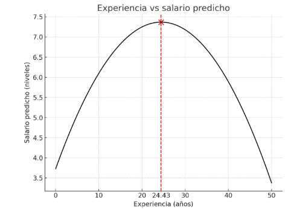

<!-- ARCHIVO GENERADO por tools/clases.py a partir de las diapositivas oficiales. No editar a mano: modifica tools/clases.py o el .tex y vuelve a generar. -->

# Clase 6 · Interpretación: logaritmos, cuadráticas e interacciones

<div class="usm-session-meta">
<span>📅 Viernes 20 de noviembre de 2026</span>
<span>⏱️ 18:40 – 21:25</span>
<span class="usm-tag-gold">Semana 6 · Contenido 5 · Análisis de regresión múltiple</span>
<span class="usm-tag-red">📝 Semana del Certamen 1 (lunes 16)</span>
</div>

!!! info "Contenido oficial de la semana"
    Esta página reproduce **íntegras y en orden** las diapositivas de la cátedra del viernes de la
    semana 6 (`sem6/clase7.tex`, 13 láminas). Los bloques **Interactivo**, los casos y las preguntas
    son material adicional para estudiar.

!!! example "Cómo estudiar esta página"
    La clase está ordenada en **4 temas**. Cada tema parte con una **pregunta guía**, sigue con las láminas
    y los simuladores, y termina con **✍️ preguntas de selección múltiple** (cada alternativa incorrecta explica
    por qué no lo es) y un **🧪 ejercicio de R** que puedes editar y ejecutar aquí mismo, sin instalar nada.
    Los 4 ejercicios de R en un solo archivo: [📥 clase6.R](../r/clase6.R).

## 🎯 Objetivos de la sesión

- Interpretar coeficientes en modelos **nivel-nivel, log-nivel, nivel-log y log-log**, incluida la elasticidad.
- Usar **formas cuadráticas** para efectos parciales que cambian con el nivel de $x$, y encontrar su punto de inflexión.
- Interpretar **términos de interacción** y evaluarlos en valores relevantes.
- Predecir cómo cambian los coeficientes, sus errores estándar y los tests al **reescalar** variables.

## 🗓️ Agenda de la cátedra (viernes 18:40 – 21:25)

Haz clic en un tema para ir directo a él.

<ol class="econ-ruta">
<li><span class="econ-ruta-h">18:40</span><a class="econ-ruta-a" href="#tema-1"><span class="econ-ruta-n">1</span><span class="econ-ruta-t">Logaritmos: porcentajes y elasticidades</span><span class="econ-ruta-l">láminas 1–4 · ✍️ 2 preguntas · 🧪 R</span></a></li>
<li><span class="econ-ruta-h">19:20</span><a class="econ-ruta-a" href="#tema-2"><span class="econ-ruta-n">2</span><span class="econ-ruta-t">Formas cuadráticas</span><span class="econ-ruta-l">láminas 5–7 · ✍️ 2 preguntas · 🧪 R</span></a></li>
<li class="is-break"><span class="econ-ruta-h">19:55</span><span class="econ-ruta-t">☕ Receso</span></li>
<li><span class="econ-ruta-h">20:05</span><a class="econ-ruta-a" href="#tema-3"><span class="econ-ruta-n">3</span><span class="econ-ruta-t">Términos de interacción</span><span class="econ-ruta-l">láminas 8–9 · ✍️ 2 preguntas · 🧪 R</span></a></li>
<li><span class="econ-ruta-h">20:40</span><a class="econ-ruta-a" href="#tema-4"><span class="econ-ruta-n">4</span><span class="econ-ruta-t">Reescalar variables y resumen</span><span class="econ-ruta-l">láminas 10–13 · ✍️ 2 preguntas · 🧪 R</span></a></li>
<li class="is-break"><span class="econ-ruta-h">21:15</span><span class="econ-ruta-t">✅ Ideas clave, autoevaluación y cierre</span></li>
</ol>

## Interpretación: no linealidades, interacciones y escala { .econ-parte data-eyebrow="Parte 1 · Cátedra" data-toc-label="Parte 1 · Interpretación: no linealidades, interacciones y escala" }

<p class="econ-source">📄 Diapositivas: <code>sem6/clase7.tex</code> · 13 láminas</p>

### Logaritmos: porcentajes y elasticidades { #tema-1 .econ-tema data-num="1" data-laminas="láminas 1–4" data-toc-label="Tema 1 · Logaritmos" }

<p class="econ-tema-q">¿Cómo cambia la lectura de β cuando hay logaritmos en el modelo?</p>

<div class="econ-lamina" markdown>

#### Incorporación de no-linealidades { data-lamina="Lámina 1" }

<!-- sem6/clase7.tex · lámina 1 -->

1.  **Variable dependiente e independiente en niveles:**

    $E(y_i \mid x_{1,i}, \ldots) = \beta_0 + \beta_1 x_{1,i} + \ldots$

    -   → **Ejemplo:** $E(salario_i \mid educ_i) = \beta_0 + \beta_1 educ_i$

    -   $\beta_1 = \dfrac{\Delta E(y \mid x_{1})}{\Delta x_1}$

    -   Por cada año más de educación se obtiene, en promedio, $\beta_1$ dólares más de salario.

2.  **Variable dependiente en log e independiente en niveles:**

    $E(\log(y_i) \mid x_{1,i}, \ldots) = \beta_0 + \beta_1 x_{1,i} + \ldots$

    -   → **Ejemplo:** $E(\log(salario_i) \mid educ_i) = \beta_0 + \beta_1 educ_i$

    -   $\beta_1 = \dfrac{\Delta E(\log(y) \mid x_{1})}{\Delta x_1}\approx \dfrac{\Delta \% y}{100\Delta x_1}$

    -   Por cada año más de educación se obtiene, en promedio, un aumento de $100 \cdot \beta_1 \%$ del salario, manteniendo todas las demás variables constantes.

3.  **Variable dependiente e independiente en logs:**

    $E(\log(y_i) \mid x_{1,i}, \ldots) = \beta_0 + \beta_1 \log(x_{1,i}) + \ldots$

    -   → **Ejemplo:** $E(\log(salario_i) \mid educ_i) = \beta_0 + \beta_1 \log(educ_i)$

    -   $\beta_1 = \dfrac{\Delta E(\log(y) \mid x_{1})}{\Delta \log x_1}\approx \dfrac{\Delta\% y}{ \Delta\% x_1}$

    -   Un aumento de 1% de los años de educación implica, en promedio, un aumento de $\beta_1 \%$ del salario manteniendo todas las demás variables constantes. Es decir, representa una **elasticidad**.

</div>

<div class="econ-lamina" markdown>

#### Variables en logaritmo { data-lamina="Lámina 2" }

<!-- sem6/clase7.tex · lámina 2 -->

-   Diferencias logarítmicas:

    $$
    \Delta \log(X)= \log(X_1)-\log(X_0)= \log\left (\frac{ X_1}{X_0}\right )=\log\left(1+{\Delta X\over X_0} \right)
    $$

-   Recuerde que en nuestro curso y en el libro $log(X)=ln(X)$.

-   Sabemos que[^1]:

    $$
    \log(1+x) \approx x
    $$

</div>

<div class="econ-lamina" markdown>

#### Variables en logaritmo: Caso 1 { data-lamina="Lámina 3" }

<!-- sem6/clase7.tex · lámina 3 -->

$$
\hat{\log(salario)} = 0{,}584 + 0{,}083 \cdot educ
$$

-   Cada año adicional de educación se asocia con un incremento de $8{,}3\,\%$ del salario.

-   Como el cambio porcentual es el mismo por cada año adicional de educación, el cambio en el salario en dólares ($e^{\log(salario)}$) por un año más de educación aumenta a medida que la educación lo hace.

<svg class="econ-tikz-svg econ-tikz-plot" viewBox="0 0 300 210" role="img" aria-label="Gráfico de log(salario) contra educacion"><text x="150.0" y="16" text-anchor="middle" font-weight="700" fill="currentColor">log(salario)</text><line x1="40" x2="290.0" y1="176.0" y2="176.0" stroke="currentColor" stroke-opacity="0.15"/><text x="36" y="179.0" text-anchor="end" font-size="9" fill="currentColor">0</text><line x1="40" x2="290.0" y1="151.0" y2="151.0" stroke="currentColor" stroke-opacity="0.15"/><text x="36" y="154.0" text-anchor="end" font-size="9" fill="currentColor">0.5</text><line x1="40" x2="290.0" y1="126.0" y2="126.0" stroke="currentColor" stroke-opacity="0.15"/><text x="36" y="129.0" text-anchor="end" font-size="9" fill="currentColor">1</text><line x1="40" x2="290.0" y1="101.0" y2="101.0" stroke="currentColor" stroke-opacity="0.15"/><text x="36" y="104.0" text-anchor="end" font-size="9" fill="currentColor">1.5</text><line x1="40" x2="290.0" y1="76.0" y2="76.0" stroke="currentColor" stroke-opacity="0.15"/><text x="36" y="79.0" text-anchor="end" font-size="9" fill="currentColor">2</text><line x1="40" x2="290.0" y1="51.0" y2="51.0" stroke="currentColor" stroke-opacity="0.15"/><text x="36" y="54.0" text-anchor="end" font-size="9" fill="currentColor">2.5</text><line x1="40" x2="290.0" y1="26.0" y2="26.0" stroke="currentColor" stroke-opacity="0.15"/><text x="36" y="29.0" text-anchor="end" font-size="9" fill="currentColor">3</text><text x="49.6" y="188" text-anchor="middle" font-size="9" fill="currentColor">1</text><text x="68.8" y="188" text-anchor="middle" font-size="9" fill="currentColor">3</text><text x="88.1" y="188" text-anchor="middle" font-size="9" fill="currentColor">5</text><text x="107.3" y="188" text-anchor="middle" font-size="9" fill="currentColor">7</text><text x="126.5" y="188" text-anchor="middle" font-size="9" fill="currentColor">9</text><text x="145.8" y="188" text-anchor="middle" font-size="9" fill="currentColor">11</text><text x="165.0" y="188" text-anchor="middle" font-size="9" fill="currentColor">13</text><text x="184.2" y="188" text-anchor="middle" font-size="9" fill="currentColor">15</text><text x="203.5" y="188" text-anchor="middle" font-size="9" fill="currentColor">17</text><text x="222.7" y="188" text-anchor="middle" font-size="9" fill="currentColor">19</text><text x="241.9" y="188" text-anchor="middle" font-size="9" fill="currentColor">21</text><text x="261.2" y="188" text-anchor="middle" font-size="9" fill="currentColor">23</text><text x="280.4" y="188" text-anchor="middle" font-size="9" fill="currentColor">25</text><text x="165.0" y="204" text-anchor="middle" font-size="10" fill="currentColor">educacion</text><text transform="translate(11,101.0) rotate(-90)" text-anchor="middle" font-size="10" fill="currentColor">log(salario)</text><line x1="40" y1="176" x2="294.8" y2="176" stroke="currentColor" stroke-opacity="0.5"/><line x1="40" y1="176" x2="40" y2="22" stroke="currentColor" stroke-opacity="0.5"/><path d="M49.6,142.7 L280.4,43.1" fill="none" stroke="#1d4ed8" stroke-width="2.4"/><text x="198.7" y="98.5" font-size="10" fill="currentColor">pendiente: 0.083</text></svg>
<svg class="econ-tikz-svg econ-tikz-plot" viewBox="0 0 300 210" role="img" aria-label="Gráfico de salario contra educacion"><text x="150.0" y="16" text-anchor="middle" font-weight="700" fill="currentColor">salario</text><line x1="40" x2="290.0" y1="176.0" y2="176.0" stroke="currentColor" stroke-opacity="0.15"/><text x="36" y="179.0" text-anchor="end" font-size="9" fill="currentColor">0</text><line x1="40" x2="290.0" y1="154.6" y2="154.6" stroke="currentColor" stroke-opacity="0.15"/><text x="36" y="157.6" text-anchor="end" font-size="9" fill="currentColor">2</text><line x1="40" x2="290.0" y1="133.1" y2="133.1" stroke="currentColor" stroke-opacity="0.15"/><text x="36" y="136.1" text-anchor="end" font-size="9" fill="currentColor">4</text><line x1="40" x2="290.0" y1="111.7" y2="111.7" stroke="currentColor" stroke-opacity="0.15"/><text x="36" y="114.7" text-anchor="end" font-size="9" fill="currentColor">6</text><line x1="40" x2="290.0" y1="90.3" y2="90.3" stroke="currentColor" stroke-opacity="0.15"/><text x="36" y="93.3" text-anchor="end" font-size="9" fill="currentColor">8</text><line x1="40" x2="290.0" y1="68.9" y2="68.9" stroke="currentColor" stroke-opacity="0.15"/><text x="36" y="71.9" text-anchor="end" font-size="9" fill="currentColor">10</text><line x1="40" x2="290.0" y1="47.4" y2="47.4" stroke="currentColor" stroke-opacity="0.15"/><text x="36" y="50.4" text-anchor="end" font-size="9" fill="currentColor">12</text><line x1="40" x2="290.0" y1="26.0" y2="26.0" stroke="currentColor" stroke-opacity="0.15"/><text x="36" y="29.0" text-anchor="end" font-size="9" fill="currentColor">14</text><text x="49.6" y="188" text-anchor="middle" font-size="9" fill="currentColor">1</text><text x="68.8" y="188" text-anchor="middle" font-size="9" fill="currentColor">3</text><text x="88.1" y="188" text-anchor="middle" font-size="9" fill="currentColor">5</text><text x="107.3" y="188" text-anchor="middle" font-size="9" fill="currentColor">7</text><text x="126.5" y="188" text-anchor="middle" font-size="9" fill="currentColor">9</text><text x="145.8" y="188" text-anchor="middle" font-size="9" fill="currentColor">11</text><text x="165.0" y="188" text-anchor="middle" font-size="9" fill="currentColor">13</text><text x="184.2" y="188" text-anchor="middle" font-size="9" fill="currentColor">15</text><text x="203.5" y="188" text-anchor="middle" font-size="9" fill="currentColor">17</text><text x="222.7" y="188" text-anchor="middle" font-size="9" fill="currentColor">19</text><text x="241.9" y="188" text-anchor="middle" font-size="9" fill="currentColor">21</text><text x="261.2" y="188" text-anchor="middle" font-size="9" fill="currentColor">23</text><text x="280.4" y="188" text-anchor="middle" font-size="9" fill="currentColor">25</text><text x="165.0" y="204" text-anchor="middle" font-size="10" fill="currentColor">educacion</text><text transform="translate(11,101.0) rotate(-90)" text-anchor="middle" font-size="10" fill="currentColor">salario</text><line x1="40" y1="176" x2="294.8" y2="176" stroke="currentColor" stroke-opacity="0.5"/><line x1="40" y1="176" x2="40" y2="22" stroke="currentColor" stroke-opacity="0.5"/><path d="M49.6,155.1 L68.8,151.4 L88.1,146.9 L107.3,141.7 L126.5,135.4 L145.8,128.1 L165.0,119.5 L184.2,109.3 L203.5,97.2 L222.7,83.0 L241.9,66.2 L261.2,46.4 L280.4,23.0" fill="none" stroke="#1d4ed8" stroke-width="2.4"/></svg>

</div>

<div class="econ-lamina" markdown>

#### Variables en logaritmo: Caso 2 - Elasticidad { data-lamina="Lámina 4" }

<!-- sem6/clase7.tex · lámina 4 -->

-   Cuando $x_j$ e $y$ se encuentran en logaritmo: un cambio de un 1% en $x_j$ se asocia a un cambio de $\beta_j$% en $y$.

-   Por ejemplo, se estima la elasticidad de la demanda de vino en Chile.

    $$
    \hat{\log(\text{cantidad vino})} = 6 - 0,2 \log(\text{precio vino})
    $$

-   Un aumento de un 1% en el precio del vino corresponde a una caída del 0,2% en la cantidad consumida de vino.

-   Se interpreta como una elasticidad. Por ejemplo, la elasticidad de la demanda de vino con respecto al precio es 0,2.

</div>

<div class="econ-widget" data-widget="log-modelos"></div>

<div class="econ-practica" id="practica-1">
<p class="econ-practica-t"><span>✍️ Practica · Tema 1</span></p>
<div class="econ-quiz">
<p class="econ-quiz-q">En log(salario) = 0.584 + 0.083·educ, ¿qué significa 0.083?</p>
<div class="econ-quiz-opts">
<button class="econ-quiz-opt" data-correct>Un año más de educación se asocia con un salario aproximadamente 8.3% mayor.</button>
<button class="econ-quiz-opt" data-why="Eso sería en un modelo nivel-nivel.">Un año más de educación aumenta el salario en 0.083 dólares.</button>
<button class="econ-quiz-opt" data-why="Eso sería en un modelo log-log.">Un 1% más de educación aumenta el salario en 0.083%.</button>
</div>
<p class="econ-quiz-fb">✅ Lámina 3: modelo log-nivel, 100·β₁ % por unidad de x.</p>
</div>
<div class="econ-quiz">
<p class="econ-quiz-q">En log(cantidad de vino) = 6 − 0.2·log(precio), si el precio sube 10%, la cantidad…</p>
<div class="econ-quiz-opts">
<button class="econ-quiz-opt" data-correct>…cae aproximadamente 2%.</button>
<button class="econ-quiz-opt" data-why="Eso es para un aumento de 1% en el precio.">…cae 0.2%.</button>
<button class="econ-quiz-opt" data-why="−0.2 × 10% = −2%.">…cae 20%.</button>
</div>
<p class="econ-quiz-fb">✅ Es una elasticidad: β₁ × Δ%x (lámina 4).</p>
</div>
</div>

<div class="econ-r" markdown>

<p class="econ-r-t">🧪 Practica en R · Log-nivel y log-log</p>

Simula salarios como los de la lámina 3 y la demanda de vino de la lámina 4, y recupera la semielasticidad y la elasticidad.

```r
set.seed(3)
n       <- 500
educ    <- sample(6:20, n, replace = TRUE)
salario <- exp(0.584 + 0.083 * educ + rnorm(n, sd = 0.4))   # como la lámina 3
m <- lm(log(salario) ~ educ)
coef(m)
100 * coef(m)["educ"]                 # % por año, aproximado
100 * (exp(coef(m)["educ"]) - 1)      # % por año, exacto

# Log-log: elasticidad de la demanda de vino (lámina 4)
precio   <- runif(n, 3000, 15000)
cantidad <- exp(6 - 0.2 * log(precio) + rnorm(n, sd = 0.1))
coef(lm(log(cantidad) ~ log(precio)))
```

**🎯 Reto:** cambia `0.083` por `0.3`. ¿Qué tanto se alejan ahora la aproximación 100·β y el porcentaje exacto?
{: .econ-r-reto }

</div>

### Formas cuadráticas { #tema-2 .econ-tema data-num="2" data-laminas="láminas 5–7" data-toc-label="Tema 2 · Formas cuadráticas" }

<p class="econ-tema-q">¿Y si el efecto de un año más de experiencia no es siempre el mismo?</p>

<div class="econ-lamina" markdown>

#### Formas cuadráticas { data-lamina="Lámina 5" }

<!-- sem6/clase7.tex · lámina 5 -->

-   El Modelo de Regresión Lineal se refiere a una relación lineal entre los coeficientes que acompañan a los regresores $X$. Pero las $X$ pueden tomar cualquier forma.

-   Considere el modelo:

    $$
    y = \beta_0 + \beta_1 x + \beta_2 x^2 + u
    $$

-   ¿Cuál es la interpretación de $\beta_1$ y $\beta_2$?

-   **Siempre piensen en términos de derivadas parciales con respecto a la variable explicativa.**

-   En este caso, la predicción de $y$ es:

    $$
    \hat{y} = \hat{\beta}_0 + \hat{\beta}_1 x + \hat{\beta}_2 x^2
    $$

    Lo que implica que:

    $$
    \Delta \hat{y} \approx (\hat{\beta}_1 + 2 \hat{\beta}_2 x) \Delta x \Rightarrow \frac{\Delta \hat{y}}{\Delta x} \approx \hat{\beta}_1 + 2 \hat{\beta}_2 x
    $$

-   Noten que ahora un cambio en $x$ genera un cambio esperado en $y$ que depende del nivel de $x$: el efecto parcial de $x$ en $y$ es variable.

-   $\hat{\beta}_1$ es aproximadamente la pendiente de la relación entre $x$ y $y$ cuando $x = 0$.

</div>

<div class="econ-lamina" markdown>

#### Ejemplo: efecto de experiencia en salario { data-lamina="Lámina 6" }

<!-- sem6/clase7.tex · lámina 6 -->

-   Considere la siguiente ecuación:

    $$
    \hat{salario} = 3.73 + 0.298\text{exper} - 0.0061\text{exper}^2
    $$

-   La experiencia tiene un efecto positivo en el salario pero este efecto va cayendo para niveles altos de experiencia ($\hat{\beta}_2$ negativo).

-   ¿Tiene sentido económico esto?

-   Específicamente, el efecto parcial de la experiencia en el salario es:

    $$
    \triangle \hat{salario} / \triangle \text{exper} = 0.298 - 2 \cdot 0.0061 \text{exper}
    $$

-   Cuando $\beta_1$ y $\beta_2$ tienen distinto signo, hay un valor de $x$ a partir del cual el efecto *ceteris paribus* de $x$ en $y$ cambia de dirección.

-   En el ejemplo, este valor es $x = \left|\frac{\beta_1}{2\beta_2}\right| = 24.4$ años.

-   Otros polinomios de mayor grado también pueden ser incluidos en un MRL.

</div>

<div class="econ-lamina" markdown>

#### Ejemplo: experiencia y salario { data-lamina="Lámina 7" }

<!-- sem6/clase7.tex · lámina 7 -->

Si bien los coeficientes son lineales, la relación entre experiencia y salario deja de ser lineal.

{ .econ-slide-img }

</div>

<div class="econ-widget" data-widget="cuadratica"></div>

<div class="econ-practica" id="practica-2">
<p class="econ-practica-t"><span>✍️ Practica · Tema 2</span></p>
<div class="econ-quiz">
<p class="econ-quiz-q">Con salario = 3.73 + 0.298·exper − 0.0061·exper², ¿cuál es el efecto de un año más con 10 años de experiencia?</p>
<div class="econ-quiz-opts">
<button class="econ-quiz-opt" data-correct>0.298 − 2·0.0061·10 = 0.176</button>
<button class="econ-quiz-opt" data-why="Ese es el efecto cuando exper = 0.">0.298</button>
<button class="econ-quiz-opt" data-why="La derivada de β₂x² es 2β₂x.">0.298 − 0.0061·10 = 0.237</button>
</div>
<p class="econ-quiz-fb">✅ Lámina 6: Δsalario/Δexper = 0.298 − 2·0.0061·exper.</p>
</div>
<div class="econ-quiz">
<p class="econ-quiz-q">¿A partir de qué experiencia el efecto se vuelve negativo según la lámina 6?</p>
<div class="econ-quiz-opts">
<button class="econ-quiz-opt" data-correct>24.4 años</button>
<button class="econ-quiz-opt" data-why="Es |β₁/(2β₂)|, no |β₁/β₂|.">48.9 años</button>
<button class="econ-quiz-opt" data-why="Como β₁ &gt; 0 y β₂ &lt; 0 hay un punto donde el efecto cambia de dirección.">Nunca</button>
</div>
<p class="econ-quiz-fb">✅ x = |0.298 / (2·0.0061)| = 24.4.</p>
</div>
</div>

<div class="econ-r" markdown>

<p class="econ-r-t">🧪 Practica en R · La curva de la experiencia</p>

Simula datos con la ecuación de la lámina 6, estímala con `I(exper^2)` y encuentra el punto de quiebre.

```r
set.seed(6)
n       <- 500
exper   <- runif(n, 0, 45)
salario <- 3.73 + 0.298 * exper - 0.0061 * exper^2 + rnorm(n, sd = 1.5)
m <- lm(salario ~ exper + I(exper^2))
b <- coef(m)
b
unname(-b["exper"] / (2 * b["I(exper^2)"]))       # punto de quiebre (≈ 24.4)
b["exper"] + 2 * b["I(exper^2)"] * c(5, 20, 35)   # efecto de un año más

plot(exper, salario, pch = 19, col = "grey70")
curve(b[1] + b[2] * x + b[3] * x^2, add = TRUE, lwd = 3, col = "steelblue")
```

**🎯 Reto:** cambia `- 0.0061` por `+ 0.0061`. ¿Existe todavía un máximo?
{: .econ-r-reto }

</div>

### Términos de interacción { #tema-3 .econ-tema data-num="3" data-laminas="láminas 8–9" data-toc-label="Tema 3 · Interacciones" }

<p class="econ-tema-q">¿Vale lo mismo un dormitorio extra en una casa chica que en una grande?</p>

<div class="econ-lamina" markdown>

#### Términos de interacción { data-lamina="Láminas 8–9" }

<!-- sem6/clase7.tex · lámina 8 -->

-   En ciertas ocasiones el efecto parcial de un regresor $x$ en la variable dependiente $y$ puede depender del valor de otro regresor $z$.

-   En este caso, se incluye en la regresión un término de interacción $x \times z$.

-   Ejemplo: suponga el siguiente modelo para el precio de una vivienda

    $$
    \text{precio} = \beta_0 + \beta_1\text{msq} + \beta_2\text{dorm} + \beta_3\text{msq} \cdot \text{dorm} + u
    $$

    donde msq son los metros cuadrados de la vivienda y dorm el número de dormitorios.

-   En este caso se cumple que

    $$
    \frac{\triangle E(\text{precio}|msq,dorm)}{\triangle \text{dorm}} = \beta_2 + \beta_3\text{msq}
    $$

-   Si $\beta_2 > 0$ y $\beta_3 > 0$, la ecuación implica que un dormitorio adicional se relaciona con un incremento en el valor de la vivienda, y estos incrementos son mayores en viviendas de más metros cuadrados msq.

<!-- sem6/clase7.tex · lámina 9 -->

-   Para resumir el efecto de dorm en precio se puede evaluar en valores interesantes de msq, como su media, mediana o algún percentil extremo.

-   Por ejemplo, sea el tamaño de la casa promedio $\bar{msq}$, el efecto de un dorm más:

    $$
    \frac{\triangle \text{precio}}{\triangle \text{dorm}} = \beta_2 + \beta_3\bar{\text{msq}}. \quad
    $$

</div>

<div class="econ-widget" data-widget="interaccion"></div>

<div class="econ-practica" id="practica-3">
<p class="econ-practica-t"><span>✍️ Practica · Tema 3</span></p>
<div class="econ-quiz">
<p class="econ-quiz-q">En precio = β₀ + β₁msq + β₂dorm + β₃msq·dorm, ¿cuál es el efecto de un dormitorio más?</p>
<div class="econ-quiz-opts">
<button class="econ-quiz-opt" data-correct>β₂ + β₃·msq</button>
<button class="econ-quiz-opt" data-why="Solo si β₃ = 0, o si msq = 0.">β₂</button>
<button class="econ-quiz-opt" data-why="β₃ mide cuánto cambia el efecto del dormitorio por cada m² adicional.">β₃</button>
</div>
<p class="econ-quiz-fb">✅ Lámina 8.</p>
</div>
<div class="econ-quiz">
<p class="econ-quiz-q">Para resumir el efecto de dorm, la lámina 9 sugiere evaluar β₂ + β₃·msq en…</p>
<div class="econ-quiz-opts">
<button class="econ-quiz-opt" data-correct>…valores interesantes de msq, como su media o mediana.</button>
<button class="econ-quiz-opt" data-why="Una casa de 0 m² no existe: β₂ solo, rara vez es interesante.">…msq = 0.</button>
<button class="econ-quiz-opt" data-why="Puede usarse un percentil extremo, pero lo típico es la media o la mediana.">…el máximo de msq solamente.</button>
</div>
<p class="econ-quiz-fb">✅ Por ejemplo, β₂ + β₃·msq̄ para la casa promedio.</p>
</div>
</div>

<div class="econ-r" markdown>

<p class="econ-r-t">🧪 Practica en R · Interacción en R</p>

Simula precios de viviendas con interacción, estima `msq * dorm` y evalúa el efecto de un dormitorio en distintos tamaños.

```r
set.seed(9)
n      <- 400
msq    <- runif(n, 40, 200)
dorm   <- sample(1:5, n, replace = TRUE)
precio <- 10 + 0.9 * msq - 2 * dorm + 0.05 * msq * dorm + rnorm(n, sd = 8)

m <- lm(precio ~ msq * dorm)            # = msq + dorm + msq:dorm
b <- coef(m)
b
b["dorm"] + b["msq:dorm"] * mean(msq)   # efecto de un dormitorio, casa promedio
b["dorm"] + b["msq:dorm"] * c(60, 160)  # casa chica y casa grande
```

**🎯 Reto:** cambia `0.05 * msq * dorm` por `0 * msq * dorm`. ¿Qué pasa con el efecto del dormitorio en casas chicas y grandes?
{: .econ-r-reto }

</div>

### Reescalar variables y resumen { #tema-4 .econ-tema data-num="4" data-laminas="láminas 10–13" data-toc-label="Tema 4 · Reescalar y resumen" }

<p class="econ-tema-q">Si cambio de dólares a pesos, ¿cambian mis conclusiones?</p>

<div class="econ-lamina" markdown>

#### Reescalando variables { data-lamina="Lámina 10" }

<!-- sem6/clase7.tex · lámina 10 -->

¿Qué pasa si re-escalamos $X$ o $Y$? Por ejemplo, para cambiar su unidad de medida?

-   Los coeficientes estimados, sus varianzas, estadísticos $t$ y $F$, cambian de manera tal que se preservan los efectos medidos y los resultados de los tests.

-   En general, se reescalan variables por motivos estéticos, como reducir el número de ceros en los decimales de una estimación de un coeficiente.

-   Este procedimiento es usual con variables económicas cuando los montos medidos son grandes o para transformar entre monedas de diferentes países.

</div>

<div class="econ-lamina" markdown>

#### Ejemplo: reescalando $Y$ { data-lamina="Lámina 11" data-toc-label="Ejemplo: reescalando Y" }

<!-- sem6/clase7.tex · lámina 11 -->

-   Considere el siguiente modelo:

    $$
    {salario_{us\$}} = \beta_0 + \beta_1\text{educacion} + u
    $$

    donde ${salario_{us\$}}$ es medido en dólares.

-   Quiero estimarlo en pesos a TC=1000 (i.e. ${salario_{chile}} = 1000 \cdot {salario_{us\$}}$).

-   Al multiplicar el modelo de los dos lados se obtiene

    $$
    1000 \cdot {salario_{us\$}} = 1000 \beta_0 + 1000 \beta_1 \text{educ} + 1000 \cdot u \quad
    $$

    $$
    {salario_{chile}} = \tilde{\beta}_0 + \tilde{\beta}_1 \text{educ} + \tilde{u} \quad
    $$

    donde **$\tilde{\beta}_j = 1000 \beta_j$.**

-   Interpretación. Asuma $\beta_j = 20$

    1.  Modelo original: un aumento de un año de educación implica un aumento de 20 dólares en el salario promedio.

    2.  Modelo nuevo: un aumento de un año de educación implica un aumento de 20000 pesos en el salario promedio.

</div>

<div class="econ-lamina" markdown>

#### Reescalando un regresor X { data-lamina="Lámina 12" }

<!-- sem6/clase7.tex · lámina 12 -->

$$
y = \beta_0 + \beta_1 x + u
$$

Si re-escala la variable $x$ por $\tilde{x} = \alpha x$ se estima:

$$
y = \beta_0 + \tilde{\beta}_1 \tilde{x} + u
$$

$\Rightarrow$

-   $\hat{\tilde{\beta}}_1 = \frac{\hat{\beta}_1}{\alpha}$

-   $\text{Var}(\hat{\tilde{\beta}}_1) = ?$

-   $\hat{\sigma}^2$, SSR, SST, $R^2$

</div>

<div class="econ-widget" data-widget="reescalar"></div>

<div class="econ-lamina" markdown>

#### En resumen { data-lamina="Lámina 13" }

<!-- sem6/clase7.tex · lámina 13 -->

| Modelo      | Var. dependiente | Var. independiente |            Interpretación $\beta$             |
|:------------|:----------------:|:------------------:|:---------------------------------------------:|
| Nivel-nivel |       $y$        |        $x$         |        $E\Delta y = \beta_i \Delta x$         |
| Nivel-log   |       $y$        |      $log(x)$      | $E\Delta y = \frac{\beta_i}{100} \Delta \% x$ |
| Log-nivel   |     $log(y)$     |        $x$         |    $E\Delta\% y = (100 \beta_i) \Delta x$     |
| Log-log     |     $log(y)$     |      $log(x)$      |      $E\Delta \% y = \beta_i \Delta \%x$      |

[^1]: Serie de Taylor centrada en 0, es decir, es una buena aproximación para x cercanos a 0.

</div>

<div class="econ-practica" id="practica-4">
<p class="econ-practica-t"><span>✍️ Practica · Tema 4</span></p>
<div class="econ-quiz">
<p class="econ-quiz-q">Si el salario pasa de dólares a pesos (× 1 000), ¿qué pasa con el estadístico t de la educación?</p>
<div class="econ-quiz-opts">
<button class="econ-quiz-opt" data-correct>No cambia.</button>
<button class="econ-quiz-opt" data-why="β̂ y su error estándar se multiplican por 1 000: el cociente queda igual.">Se multiplica por 1 000.</button>
<button class="econ-quiz-opt" data-why="El test no puede depender de la moneda.">Se divide por 1 000.</button>
</div>
<p class="econ-quiz-fb">✅ Lámina 10: se preservan los efectos medidos y los resultados de los tests.</p>
</div>
<div class="econ-quiz">
<p class="econ-quiz-q">Si x se reescala como x̃ = α·x, entonces β̂₁ del modelo nuevo es…</p>
<div class="econ-quiz-opts">
<button class="econ-quiz-opt" data-correct>β̂₁ / α</button>
<button class="econ-quiz-opt" data-why="Si x se agranda, el efecto por unidad se achica.">α·β̂₁</button>
<button class="econ-quiz-opt" data-why="Cambian las unidades de x, así que cambia su coeficiente.">β̂₁</button>
</div>
<p class="econ-quiz-fb">✅ Lámina 12.</p>
</div>
</div>

<div class="econ-r" markdown>

<p class="econ-r-t">🧪 Practica en R · Mismo modelo, otras unidades</p>

Estima la misma regresión con el salario en dólares, en pesos y con la educación en meses. Compara β̂, s.e., t y R².

```r
set.seed(10)
n           <- 200
educ        <- sample(8:20, n, replace = TRUE)
salario_usd <- 150 + 20 * educ + rnorm(n, sd = 90)
salario_clp <- 1000 * salario_usd          # TC = 1000 (lámina 11)

coefs <- function(m) round(coef(summary(m))[2, 1:3], 3)  # β̂, s.e., t
rbind(dolares    = coefs(lm(salario_usd ~ educ)),
      pesos      = coefs(lm(salario_clp ~ educ)),
      x_en_meses = coefs(lm(salario_usd ~ I(12 * educ))))   # lámina 12

c(R2_dolares = summary(lm(salario_usd ~ educ))$r.squared,
  R2_pesos   = summary(lm(salario_clp ~ educ))$r.squared)
```

**🎯 Reto:** agrega una fila con el salario en miles de dólares (`salario_usd / 1000`). ¿Qué esperas antes de ejecutar?
{: .econ-r-reto }

</div>

---

!!! abstract "🧠 Ideas clave"
    - **Log-nivel:** un aumento de una unidad en $x$ se asocia con un cambio aproximado de $100\beta\%$ en $y$. **Log-log:** $\beta$ es una **elasticidad**.
    - Con $x$ y $x^2$, el efecto parcial $\beta_1 + 2\beta_2 x$ **depende del nivel** de $x$; si los signos difieren, cambia de dirección en $|\beta_1 / 2\beta_2|$.
    - Con una **interacción** $x \cdot z$, el efecto de $x$ depende de $z$: se reporta evaluado en valores interesantes, como la media.
    - **Reescalar** cambia coeficientes y errores estándar en la misma proporción: $t$, $F$ y $R^2$ no cambian.

## ✅ Autoevaluación

<div class="econ-quiz">
<p class="econ-quiz-q">En un modelo nivel-log, y = β₀ + β₁·log(x), con β₁ = 50, si x aumenta 1%…</p>
<div class="econ-quiz-opts">
<button class="econ-quiz-opt" data-correct>…y aumenta en 0.5 unidades.</button>
<button class="econ-quiz-opt" data-why="Eso sería un modelo log-log con β = 50.">…y aumenta 50%.</button>
<button class="econ-quiz-opt" data-why="Sería si log(x) aumentara en una unidad, no x en 1%.">…y aumenta en 50 unidades.</button>
</div>
<p class="econ-quiz-fb">✅ Tabla de la lámina 13: Δy = (β/100)·Δ%x = 50/100 = 0.5.</p>
</div>

<div class="econ-quiz">
<p class="econ-quiz-q">En salario = β₀ + β₁·educ + β₂·exper + β₃·educ·exper, con β₃ > 0, ¿qué significa?</p>
<div class="econ-quiz-opts">
<button class="econ-quiz-opt" data-correct>El retorno a la educación es mayor para quienes tienen más experiencia.</button>
<button class="econ-quiz-opt" data-why="La interacción describe cómo cambia un efecto, no la correlación entre las x.">La educación y la experiencia están correlacionadas.</button>
<button class="econ-quiz-opt" data-why="El efecto es β₁ + β₃·exper: depende de la experiencia.">La educación no tiene efecto.</button>
</div>
<p class="econ-quiz-fb">✅ Igual que con los dormitorios y los metros cuadrados.</p>
</div>

<div class="econ-quiz">
<p class="econ-quiz-q">Reescalas el ingreso de pesos a millones de pesos (x ÷ 1 000 000) en una regresión. ¿Qué pasa con su coeficiente y su R²?</p>
<div class="econ-quiz-opts">
<button class="econ-quiz-opt" data-correct>El coeficiente se multiplica por 1 000 000 y el R² no cambia.</button>
<button class="econ-quiz-opt" data-why="Si x se achica, el efecto por unidad se agranda.">El coeficiente se divide por 1 000 000.</button>
<button class="econ-quiz-opt" data-why="El R² no depende de las unidades.">Cambia el R².</button>
</div>
<p class="econ-quiz-fb">✅ Es la lámina 12 con α = 1/1 000 000.</p>
</div>

## 📚 Para la próxima clase

- **Wooldridge**, capítulo 6, secciones 6.1 y 6.2 (efectos de la escala, formas funcionales e interacciones).
- Próxima clase: **Inferencia sobre un parámetro**: el test t y los intervalos de confianza para $\beta_j$.
