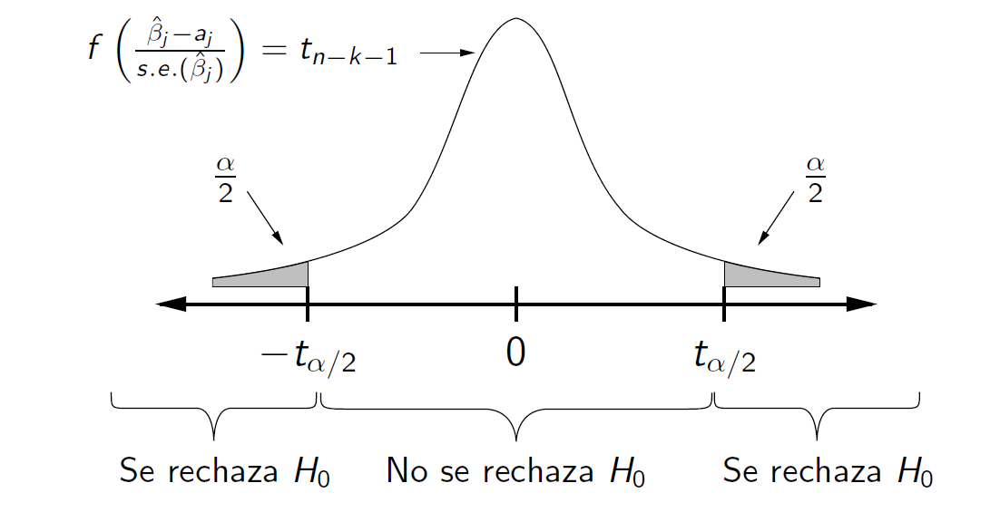
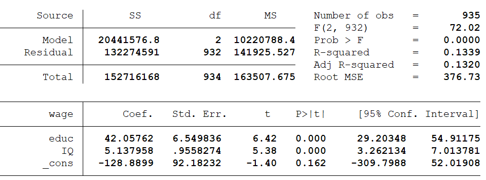
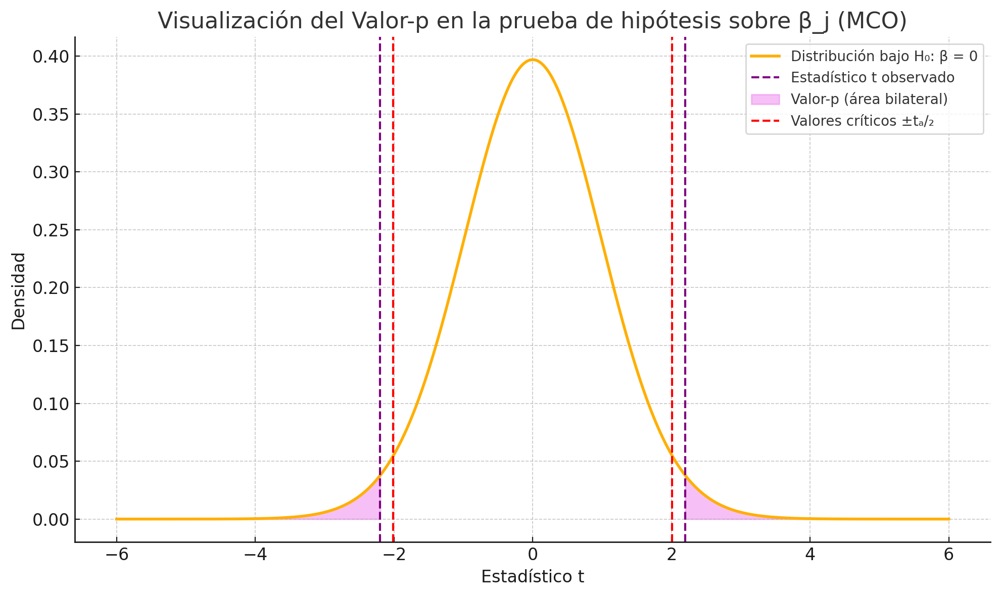
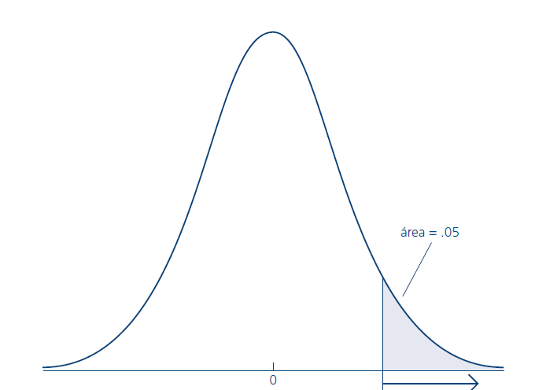
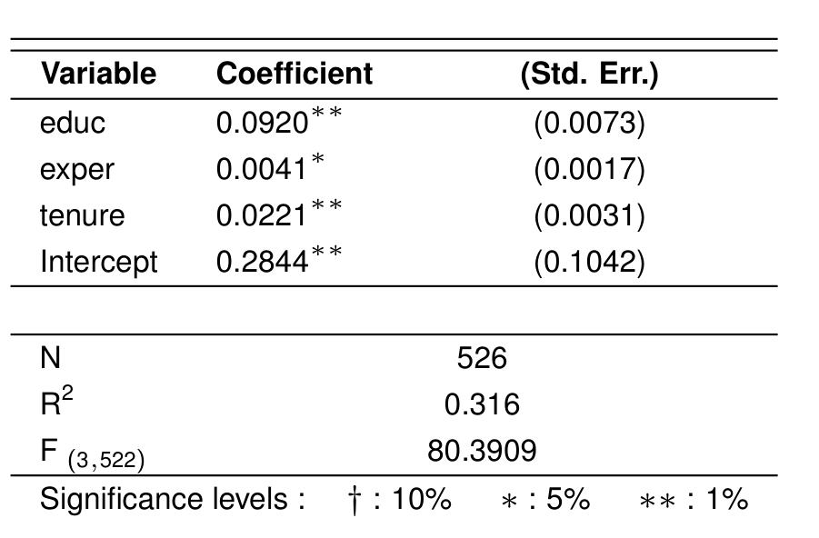

<!-- ARCHIVO GENERADO por tools/clases.py a partir de las diapositivas oficiales. No editar a mano: modifica tools/clases.py o el .tex y vuelve a generar. -->

# Clase 7 · Inferencia sobre un parámetro

<div class="usm-session-meta">
<span>📅 Viernes 27 de noviembre de 2026</span>
<span>⏱️ 18:40 – 21:25</span>
<span class="usm-tag-gold">Semana 7 · Contenido 5 · Análisis de regresión múltiple</span>
</div>

!!! info "Contenido oficial de la semana"
    Esta página reproduce **íntegras y en orden** las diapositivas de la cátedra del viernes de la
    semana 7 (`sem7/Clase8.tex`, 21 láminas). Los bloques **Interactivo**, los casos y las preguntas
    son material adicional para estudiar.

!!! example "Cómo estudiar esta página"
    La clase está ordenada en **6 temas**. Cada tema parte con una **pregunta guía**, sigue con las láminas
    y los simuladores, y termina con **✍️ preguntas de selección múltiple** (cada alternativa incorrecta explica
    por qué no lo es) y un **🧪 ejercicio de R** que puedes editar y ejecutar aquí mismo, sin instalar nada.
    Los 6 ejercicios de R en un solo archivo: [📥 clase7.R](../r/clase7.R).

## 🎯 Objetivos de la sesión

- Enunciar el teorema de **Gauss-Markov** y el supuesto de **normalidad** del modelo lineal clásico.
- Usar la distribución $t_{n-k-1}$ de $(\hat{\beta}_j - \beta_j)/se(\hat{\beta}_j)$ para hacer **tests de hipótesis** sobre un parámetro.
- Distinguir los **errores tipo I y II**, y construir **intervalos de confianza** para $\beta_j$.
- Calcular e interpretar el **valor-p**, y hacer **tests de una cola**.

## 🗓️ Agenda de la cátedra (viernes 18:40 – 21:25)

Haz clic en un tema para ir directo a él.

<ol class="econ-ruta">
<li><span class="econ-ruta-h">18:40</span><a class="econ-ruta-a" href="#tema-1"><span class="econ-ruta-n">1</span><span class="econ-ruta-t">Gauss-Markov, normalidad y la distribución de β̂</span><span class="econ-ruta-l">láminas 1–5 · ✍️ 2 preguntas · 🧪 R</span></a></li>
<li><span class="econ-ruta-h">19:10</span><a class="econ-ruta-a" href="#tema-2"><span class="econ-ruta-n">2</span><span class="econ-ruta-t">Tests de hipótesis y los dos tipos de error</span><span class="econ-ruta-l">láminas 6–9 · ✍️ 2 preguntas · 🧪 R</span></a></li>
<li><span class="econ-ruta-h">19:35</span><a class="econ-ruta-a" href="#tema-3"><span class="econ-ruta-n">3</span><span class="econ-ruta-t">La regla de rechazo y los intervalos de confianza</span><span class="econ-ruta-l">láminas 10–12 · ✍️ 2 preguntas · 🧪 R</span></a></li>
<li class="is-break"><span class="econ-ruta-h">19:55</span><span class="econ-ruta-t">☕ Receso</span></li>
<li><span class="econ-ruta-h">20:05</span><a class="econ-ruta-a" href="#tema-4"><span class="econ-ruta-n">4</span><span class="econ-ruta-t">Ejemplo: educación e IQ</span><span class="econ-ruta-l">láminas 13–15 · ✍️ 2 preguntas · 🧪 R</span></a></li>
<li><span class="econ-ruta-h">20:30</span><a class="econ-ruta-a" href="#tema-5"><span class="econ-ruta-n">5</span><span class="econ-ruta-t">El valor-p</span><span class="econ-ruta-l">láminas 16–17 · ✍️ 2 preguntas · 🧪 R</span></a></li>
<li><span class="econ-ruta-h">20:50</span><a class="econ-ruta-a" href="#tema-6"><span class="econ-ruta-n">6</span><span class="econ-ruta-t">Tests de una cola y conclusiones</span><span class="econ-ruta-l">láminas 18–21 · ✍️ 2 preguntas · 🧪 R</span></a></li>
<li class="is-break"><span class="econ-ruta-h">21:15</span><span class="econ-ruta-t">✅ Ideas clave, autoevaluación y cierre</span></li>
</ol>

## Inferencia sobre un parámetro { .econ-parte data-eyebrow="Parte 1 · Cátedra" data-toc-label="Parte 1 · Inferencia sobre un parámetro" }

<p class="econ-source">📄 Diapositivas: <code>sem7/Clase8.tex</code> · 21 láminas</p>

### Gauss-Markov, normalidad y la distribución de β̂ { #tema-1 .econ-tema data-num="1" data-laminas="láminas 1–5" data-toc-label="Tema 1 · Normalidad y distribución de β̂" }

<p class="econ-tema-q">Para hacer tests no basta con la media y la varianza de β̂. ¿Qué más necesitamos?</p>

<div class="econ-lamina" markdown>

#### Teorema de Gauss-Markov { data-lamina="Lámina 1" }

<!-- sem7/Clase8.tex · lámina 1 -->

-   **Teorema:** Bajo los supuestos 1 a 5, el estimador de Mínimos Cuadrados Ordinarios (MCO) de $\beta$ es de mínima varianza entre los estimadores lineales insesgados de $\beta$.

-   El estimador MCO es el estimador lineal insesgado de menor varianza (MELI / BLUE).

</div>

<div class="econ-lamina" markdown>

#### Supuesto 6: Normalidad de $u$ { data-lamina="Lámina 2" data-toc-label="Supuesto 6: Normalidad de u" }

<!-- sem7/Clase8.tex · lámina 2 -->

-   Las perturbaciones $u$ se distribuyen como $u \sim N(0, \sigma^2)$.

-   Este supuesto es importante porque para realizar inferencia acerca de los $\beta$ y la construcción de intervalos de confianza se necesita la distribución de sus estimadores $\hat{\beta}$ (no basta con conocer su esperanza y varianza).

</div>

<div class="econ-lamina" markdown>

#### Normalidad { data-lamina="Lámina 3" }

<!-- sem7/Clase8.tex · lámina 3 -->

-   Como u es la suma de muchos factores distintos no observados que afectan a y, se puede apelar al teorema del límite central (TLC) para concluir que u tiene una distribución aproximadamente normal.

-   Se asume que todos los factores no observados afectan a y por separado en forma aditiva. Si u es una función no aditiva de los factores no observados, entonces el argumento del TLC no puede emplearse.

</div>

<div class="econ-lamina" markdown>

#### Supuestos del modelo lineal clásico (MLC) { data-lamina="Lámina 4" }

<!-- sem7/Clase8.tex · lámina 4 -->

-   Consisten en todos los supuestos de Gauss-Markov más el supuesto del error distribuido normalmente.

-   Si se satisfacen los supuestos del MCL los estimadores de MCO son insesgados de varianza mínima, no es ya necesario restringir la comparación a estimadores lineales en y.

$$
y|X\sim N(\beta_0+\beta_1x_1+...+\beta_kx_k, \sigma^2)
$$

</div>

<div class="econ-lamina" markdown>

#### Distribución del estimador de MCO { data-lamina="Lámina 5" }

<!-- sem7/Clase8.tex · lámina 5 -->

-   Teorema: bajo los supuestos 1 a 6 se cumple $\hat{\beta}_j|X \sim N(\beta_j, \text{Var}(\hat{\beta}_j|X))$.

-   Esto implica que, condicional en las variables regresoras $X$,

    $$
    \frac{\hat{\beta}_j - \beta_j}{\sqrt{\text{Var}(\hat{\beta}_j|X)}} \sim N(0, 1).
    $$

-   Pero, recuerden que no conocemos $\text{Var}(\hat{\beta}_j)$ porque no conocemos $\sigma^2$.

-   En su lugar, vamos a usar la estimación: $\hat{\text{Var}}(\hat{\beta}_j)$.

-   Nos queda que:

    $$
    \color{red}t_{\hat{\beta_j}}=\frac{\hat{\beta}_j - \beta_j}{\text{s.e.}(\hat{\beta}_j)} \sim t_{n-k-1}
    $$

    donde $\text{s.e.}(\hat{\beta}_j) = \sqrt{\hat{\text{Var}}(\hat{\beta}_j|X)}$.

-   **El término en rojo va a ser clave para hacer inferencia y construir intervalos de confianza.**

</div>

<div class="econ-practica" id="practica-1">
<p class="econ-practica-t"><span>✍️ Practica · Tema 1</span></p>
<div class="econ-quiz">
<p class="econ-quiz-q">¿Por qué se agrega el supuesto 6, u ~ N(0, σ²)?</p>
<div class="econ-quiz-opts">
<button class="econ-quiz-opt" data-correct>Para conocer la distribución de β̂ y poder hacer tests e intervalos de confianza.</button>
<button class="econ-quiz-opt" data-why="El insesgamiento ya se tiene con los supuestos 1 a 4.">Para que β̂ sea insesgado.</button>
<button class="econ-quiz-opt" data-why="Eso ya se tiene con los supuestos 1 a 5.">Para que la varianza sea σ²(XᵀX)⁻¹.</button>
</div>
<p class="econ-quiz-fb">✅ Lámina 2: no basta con la esperanza y la varianza.</p>
</div>
<div class="econ-quiz">
<p class="econ-quiz-q">¿Por qué el estadístico usa la t de Student y no la normal?</p>
<div class="econ-quiz-opts">
<button class="econ-quiz-opt" data-correct>Porque se reemplaza la varianza verdadera, desconocida, por su estimación σ̂².</button>
<button class="econ-quiz-opt" data-why="Justamente se supone normal (supuesto 6).">Porque u no es normal.</button>
<button class="econ-quiz-opt" data-why="Con n grande la t se parece a la normal, pero la razón es estimar σ².">Porque la muestra es pequeña siempre.</button>
</div>
<p class="econ-quiz-fb">✅ Lámina 5: con s.e.(β̂ⱼ) en vez de la desviación verdadera, se obtiene t con n − k − 1 gl.</p>
</div>
</div>

<div class="econ-r" markdown>

<p class="econ-r-t">🧪 Practica en R · ¿De dónde sale la t?</p>

Simula 10 000 estadísticos (β̂ − β)/s.e. con n = 15 y compáralos con la t de 13 gl y con la normal.

```r
set.seed(1)
n <- 15
t_stats <- replicate(10000, {
  x <- rnorm(n)
  y <- 1 + 0.5 * x + rnorm(n)
  s <- coef(summary(lm(y ~ x)))
  (s["x", "Estimate"] - 0.5) / s["x", "Std. Error"]   # (β̂ − β) / s.e.
})
hist(t_stats, breaks = 60, freq = FALSE, xlim = c(-5, 5),
     main = "t simulados (barras) y t con 13 gl (rojo)")
curve(dt(x, df = n - 2), add = TRUE, lwd = 3, col = "firebrick")
curve(dnorm(x), add = TRUE, lwd = 2, lty = 2)
c(t_13gl = qt(0.975, 13), normal = qnorm(0.975), t_932gl = qt(0.975, 932))
```

**🎯 Reto:** cambia `n <- 15` por `n <- 200`. ¿Cuánto se parecen ahora la t y la normal?
{: .econ-r-reto }

</div>

### Tests de hipótesis y los dos tipos de error { #tema-2 .econ-tema data-num="2" data-laminas="láminas 6–9" data-toc-label="Tema 2 · Tests y errores tipo I y II" }

<p class="econ-tema-q">Si decidimos con datos, ¿de qué formas nos podemos equivocar?</p>

<div class="econ-lamina" markdown>

#### Test de hipótesis sobre un parámetro individual { data-lamina="Láminas 6–7" }

<!-- sem7/Clase8.tex · lámina 6 -->

-   Tenemos el modelo poblacional

    $$
    Y_i = \beta_0 + \beta_1X_{i1} + \ldots + \beta_kX_{ik} + u_i
    $$

-   Hasta aquí, aprendimos a encontrar el estimador $\hat{\beta}$ de los $\beta$.

-   Además, aprendimos a estimar su varianza y su función de distribución.

-   Ahora queremos usar todo esto para testear hipótesis acerca del valor de $\beta$.

<!-- sem7/Clase8.tex · lámina 7 -->

-   Suponga que quiere testear si el coeficiente $\beta_j$ que acompaña a $x_j$ es significativamente distinto al valor $a_j$. Donde $a_j$ es una constante (un número). Es decir:

    $$
    \begin{aligned}
    H_0 &: \beta_j = a_j \\
    H_1 &: \beta_j \neq a_j
    
    \end{aligned}
    $$

-   Para el caso particular de $a_j = 0$, el test busca determinar si la variable $x_j$ es significativa o relevante para el modelo.

    Si se rechaza $H_0$, entonces $x_j$ es estadísticamente significativa.

-   Para el test se usa el siguiente estadístico $t$ construido bajo la hipótesis nula:

    $$
    t_{\hat{\beta}_j} = \frac{\hat{\beta}_j - a_j}{s.e.(\hat{\beta}_j)} \sim t_{n-k-1}
    $$

-   $t_{\hat{\beta}_j}$ mide en cuántas desviaciones estándar estimadas de $\hat{\beta}_j$, se aleja $\hat{\beta}_j$ de $a_j$. Valores de $t_{\hat{\beta}_j}$ alejados de $a_j$ son evidencia en contra de la hipótesis nula.

</div>

<div class="econ-lamina" markdown>

#### Error tipo I y Error tipo II { data-lamina="Lámina 8" }

<!-- sem7/Clase8.tex · lámina 8 -->

| **Realidad**    | **Decisión**        |    **Resultado**    |      **Tipo de error**      |
|:----------------|:--------------------|:-------------------:|:---------------------------:|
| $H_0$ verdadera | No se rechaza $H_0$ |  Decisión correcta  |             --              |
| $H_0$ verdadera | Se rechaza $H_0$    | Decisión incorrecta | **Error tipo I ($\alpha$)** |
| $H_0$ falsa     | No se rechaza $H_0$ | Decisión incorrecta | **Error tipo II ($\beta$)** |
| $H_0$ falsa     | Se rechaza $H_0$    |  Decisión correcta  |             --              |

</div>

<div class="econ-lamina" markdown>

#### Errores tipo I y II { data-lamina="Lámina 9" }

<!-- sem7/Clase8.tex · lámina 9 -->

| **Característica** | **Error Tipo I**                                                | **Error Tipo II**                                                      |
|:-------------------|:----------------------------------------------------------------|:-----------------------------------------------------------------------|
| Definición         | Rechazar $H_0$ cuando en realidad es verdadera.                 | No rechazar $H_0$ cuando en realidad es falsa.                         |
| Probabilidad       | $\alpha = P(\text{rechazar } H_0 \mid H_0 \text{ verdadera})$   | $\beta = P(\text{no rechazar } H_0 \mid H_0 \text{ falsa})$            |
| Control            | $\alpha$ se fija de antemano: es el **nivel de significancia**. | $\beta$ disminuye al aumentar $n$. El **poder** del test es $1-\beta$. |
| Consecuencia       | Concluir efectos inexistentes.                                  | No detectar un efecto real.                                            |

</div>

<div class="econ-widget" data-widget="errores-tipo"></div>

<div class="econ-practica" id="practica-2">
<p class="econ-practica-t"><span>✍️ Practica · Tema 2</span></p>
<div class="econ-quiz">
<p class="econ-quiz-q">Rechazas H₀: β₁ = 0 cuando en realidad β₁ = 0. ¿Qué error cometiste?</p>
<div class="econ-quiz-opts">
<button class="econ-quiz-opt" data-correct>Error tipo I</button>
<button class="econ-quiz-opt" data-why="El tipo II es no rechazar una H₀ falsa.">Error tipo II</button>
<button class="econ-quiz-opt" data-why="Un valor-p chico puede ocurrir por azar aunque H₀ sea cierta: eso es el error tipo I.">Ninguno, si el valor-p era chico.</button>
</div>
<p class="econ-quiz-fb">✅ Su probabilidad es α, el nivel de significancia (lámina 9).</p>
</div>
<div class="econ-quiz">
<p class="econ-quiz-q">¿Qué pasa con la probabilidad de error tipo II si aumenta n?</p>
<div class="econ-quiz-opts">
<button class="econ-quiz-opt" data-correct>Disminuye: el test gana poder.</button>
<button class="econ-quiz-opt" data-why="Con más datos el test detecta mejor los efectos reales.">Aumenta.</button>
<button class="econ-quiz-opt" data-why="El investigador fija α (tipo I), no β.">No cambia: la fija el investigador.</button>
</div>
<p class="econ-quiz-fb">✅ Lámina 9: el poder del test es 1 − β. Pruébalo en el simulador.</p>
</div>
</div>

<div class="econ-r" markdown>

<p class="econ-r-t">🧪 Practica en R · Error tipo I y poder por simulación</p>

Repite 2 000 veces un test con H₀ verdadera y con H₀ falsa, y cuenta cuántas veces se rechaza.

```r
set.seed(2)
rechaza <- function(beta1, n = 30, alpha = 0.05) {
  x <- rnorm(n)
  y <- 1 + beta1 * x + rnorm(n)
  coef(summary(lm(y ~ x)))["x", "Pr(>|t|)"] < alpha
}
c(error_tipo_I    = mean(replicate(2000, rechaza(0))),         # ≈ α
  poder_beta_0.3  = mean(replicate(2000, rechaza(0.3))),
  poder_con_n_120 = mean(replicate(2000, rechaza(0.3, n = 120))))
```

**🎯 Reto:** cambia `alpha = 0.05` por `alpha = 0.01`. ¿Qué pasa con el error tipo I? ¿Y con el poder?
{: .econ-r-reto }

</div>

### La regla de rechazo y los intervalos de confianza { #tema-3 .econ-tema data-num="3" data-laminas="láminas 10–12" data-toc-label="Tema 3 · Regla de rechazo e IC" }

<p class="econ-tema-q">¿Qué tan lejos de aⱼ tiene que estar β̂ⱼ para rechazar?</p>

<div class="econ-lamina" markdown>

#### Test de hipótesis sobre un parámetro individual { data-lamina="Láminas 10–11" }

<!-- sem7/Clase8.tex · lámina 10 -->

-   **Supongamos que se fija la probabilidad de cometer error tipo I en $\alpha$. Nivel de significancia o probabilidad de rechazar $H_0$ cuando en realidad es verdadera.**

-   **Sea $t_{\alpha/2}$ el percentil $(1 - \frac{\alpha}{2})100$ de la distribución t-Student de $n - k - 1$ grados de libertad.**

-   Si $\left|\frac{\hat{\beta}_j - a_j}{s.e.(\hat{\beta}_j)}\right| \geq t_{\alpha/2}$, se rechaza $H_0$.

{ .econ-slide-img }

<!-- sem7/Clase8.tex · lámina 11 -->

-   El anterior corresponde a un test de dos colas.

-   Un nivel de significancia del $5\%$ es el valor más común.

-   Esto significa que de todas las muestras aleatorias que se pueden tomar, en un $5\%$ de ellas se rechaza equivocadamente la hipótesis nula.

-   Si se rechaza $H_0$ a un nivel de significancia de $\alpha$, entonces también se rechaza para niveles de significancia más altos. Por ejemplo, si una variable es significativa al $1\%$, entonces también lo es al $5\%$, al $10\%$, $20\%$, etc.

-   **Recuerde que $t_n \rightarrow N(0, 1)$ cuando $n \rightarrow \infty$.**

</div>

<div class="econ-lamina" markdown>

#### Intervalos de Confianza para un Parámetro Individual { data-lamina="Lámina 12" }

<!-- sem7/Clase8.tex · lámina 12 -->

-   El intervalo de confianza al $(1-\alpha)100\%$ para $\beta_j$ es:

    $$
    \hat{\beta}_j - t_{\alpha/2} \text{s.e.}(\hat{\beta}_j) \leq \beta_j \leq \hat{\beta}_j + t_{\alpha/2} \text{s.e.}(\hat{\beta}_j)
    $$

-   Esto nos indica que con un $(1 - \alpha)100\%$ de confianza, $\beta_j$ estará dentro de ese intervalo.

-   Si $\beta_j$ no está en el intervalo, entonces se rechaza la hipótesis nula al $(\alpha 100\%)$ de significancia.

</div>

<div class="econ-widget" data-widget="ic-beta"></div>

<div class="econ-practica" id="practica-3">
<p class="econ-practica-t"><span>✍️ Practica · Tema 3</span></p>
<div class="econ-quiz">
<p class="econ-quiz-q">Una variable es significativa al 1%. ¿Lo es también al 5%?</p>
<div class="econ-quiz-opts">
<button class="econ-quiz-opt" data-correct>Sí: si se rechaza con α = 1%, también se rechaza con niveles mayores.</button>
<button class="econ-quiz-opt" data-why="El valor crítico al 5% es menor que al 1%: si |t| supera el del 1%, supera el del 5%.">No necesariamente.</button>
<button class="econ-quiz-opt" data-why="Vale para cualquier n.">Solo si n es grande.</button>
</div>
<p class="econ-quiz-fb">✅ Lámina 11.</p>
</div>
<div class="econ-quiz">
<p class="econ-quiz-q">El IC de 95% para β₁ es (0.12; 0.48). ¿Qué concluyes sobre H₀: β₁ = 0 al 5%?</p>
<div class="econ-quiz-opts">
<button class="econ-quiz-opt" data-correct>Se rechaza, porque 0 no está en el intervalo.</button>
<button class="econ-quiz-opt" data-why="Si el valor de H₀ queda fuera del intervalo, se rechaza (lámina 12).">No se rechaza.</button>
<button class="econ-quiz-opt" data-why="El intervalo ya contiene la información del test.">No se puede saber sin el estadístico t.</button>
</div>
<p class="econ-quiz-fb">✅ Intervalo y test de dos colas al mismo α dan la misma conclusión.</p>
</div>
</div>

<div class="econ-r" markdown>

<p class="econ-r-t">🧪 Practica en R · El intervalo y el test dicen lo mismo</p>

Calcula el IC de 95% para β₁ a mano y con `confint()`, y comprueba la regla de rechazo.

```r
set.seed(7)
n <- 60
x <- rnorm(n)
y <- 2 + 0.4 * x + rnorm(n)
m <- lm(y ~ x)
b  <- coef(summary(m))["x", "Estimate"]
se <- coef(summary(m))["x", "Std. Error"]
t_crit <- qt(0.975, df = n - 2)

c(b - t_crit * se, b + t_crit * se)    # IC 95% a mano (lámina 12)
confint(m)["x", ]                       # lo mismo con R
abs(b / se) > t_crit                    # ¿se rechaza H0: β1 = 0? (lámina 10)
```

**🎯 Reto:** cambia `0.4 * x` por `0.1 * x`. ¿Contiene ahora el intervalo al cero? ¿Qué dice el test?
{: .econ-r-reto }

</div>

### Ejemplo: educación e IQ { #tema-4 .econ-tema data-num="4" data-laminas="láminas 13–15" data-toc-label="Tema 4 · Ejemplo: educación e IQ" }

<p class="econ-tema-q">Después de controlar por IQ, ¿sigue importando la educación para el salario?</p>

<div class="econ-lamina" markdown>

#### Ejemplo: Datos { data-lamina="Lámina 13" }

<!-- sem7/Clase8.tex · lámina 13 -->

Consideremos el modelo de regresión lineal:

$$
y_i = \beta_0 + \beta_1 \text{educ}_i + \beta_2 \text{IQ}_i + u_i
$$

donde queremos evaluar la hipótesis de que, después de tener en cuenta el IQ, la educación no tiene efecto en el salario.

{ .econ-slide-img }

Número de observaciones=935

</div>

<div class="econ-lamina" markdown>

#### Ejemplo de Test de Hipótesis { data-lamina="Lámina 14" }

<!-- sem7/Clase8.tex · lámina 14 -->

1.  **Paso 1:** Planteamos las hipótesis:

    $$
    H_0 : \beta_1 = 0 \quad \text{vs} \quad H_1 : \beta_1 \neq 0
    $$

2.  **Paso 2:** Calculamos el estadístico t:

    $$
    t_{\hat{\beta}_1} = \frac{42.0576 - 0}{6.5498} = 6.4212
    $$

3.  **Paso 3:** Regla $\Rightarrow$ rechazamos $H_0$ si $|6.42| > t_{2.5}$, con gl=932.

4.  **Paso 4:** Dado que $|6.42| \geq 1.96$, rechazamos $H_0$. Con un nivel de significatividad del $5\%$, concluimos que $\beta_1$ es significativamente diferente de cero.

</div>

<div class="econ-lamina" markdown>

#### Ejemplo { data-lamina="Lámina 15" }

<!-- sem7/Clase8.tex · lámina 15 -->

-   Tomemos $\alpha 100 = 5\% \rightarrow t_{\alpha/2} =  1.96$

-   Recordando la fórmula:

    $$
    \hat{\beta}_1 - t_{\alpha/2} \text{s.e.}(\hat{\beta}_1) < \beta_1 < \hat{\beta}_1 + t_{\alpha/2} \text{s.e.}(\hat{\beta}_1)
    $$

-   Reemplazando:

    $$
    42.0576 - 1.96 \times 6.5498 < \beta_1 < 42.0576 + 1.96 \times 6.5498
    $$

-   Entonces:

    $$
    29.22 < \beta_1 < 54.895
    $$

-   Esto significa que con 95% de confianza, $\beta_1$ está entre esos valores.

[LINK ejercicio](https://colab.research.google.com/drive/1ofQHrMDZSBYgfbw7JEjXtWvevykkMNX_?usp=sharing#scrollTo=9Fdx9GNkxGIF).

</div>

<div class="econ-practica" id="practica-4">
<p class="econ-practica-t"><span>✍️ Practica · Tema 4</span></p>
<div class="econ-quiz">
<p class="econ-quiz-q">En la lámina 14, t = 42.0576 / 6.5498 = 6.42. ¿Qué mide ese número?</p>
<div class="econ-quiz-opts">
<button class="econ-quiz-opt" data-correct>Cuántos errores estándar se aleja β̂₁ del valor de H₀ (0).</button>
<button class="econ-quiz-opt" data-why="Ese es β̂₁ = 42.06.">El efecto de la educación en el salario.</button>
<button class="econ-quiz-opt" data-why="El estadístico t no es una probabilidad.">La probabilidad de que H₀ sea cierta.</button>
</div>
<p class="econ-quiz-fb">✅ Lámina 7: t mide la distancia en desviaciones estándar estimadas.</p>
</div>
<div class="econ-quiz">
<p class="econ-quiz-q">El IC de 95% de la lámina 15 es (29.22; 54.895). ¿Qué afirmación es correcta?</p>
<div class="econ-quiz-opts">
<button class="econ-quiz-opt" data-correct>Con 95% de confianza, un año más de educación se asocia con entre 29 y 55 unidades más de salario, con IQ constante.</button>
<button class="econ-quiz-opt" data-why="El intervalo es para el parámetro β₁, no para los salarios.">El 95% de las personas gana entre 29.22 y 54.895.</button>
<button class="econ-quiz-opt" data-why="El 95% es una propiedad del procedimiento, como en la Ayudantía 1.">β₁ está entre esos valores con probabilidad exacta de 95%.</button>
</div>
<p class="econ-quiz-fb">✅ Y como el 0 no está en el intervalo, se rechaza H₀: β₁ = 0.</p>
</div>
</div>

<div class="econ-r" markdown>

<p class="econ-r-t">🧪 Practica en R · El ejemplo de las láminas 13 a 15</p>

Con los números de la salida de Stata, calcula el estadístico t, el valor crítico y el intervalo de confianza. Con el valor crítico exacto (1.9625) el intervalo coincide con el de Stata, de 29.20 a 54.91; la lámina 15 usa 1.96 y obtiene 29.22 a 54.895.

```r
# Lámina 13: salario en educación e IQ (n = 935, gl = 932)
b  <- 42.0576
se <- 6.5498
gl <- 932

t <- (b - 0) / se
t                                        # 6.42 (lámina 14)
qt(0.975, gl)                            # valor crítico ≈ 1.96
b + c(-1, 1) * qt(0.975, gl) * se        # IC 95% (lámina 15)
```

**🎯 Reto:** testea H₀: β₁ = 50 en vez de 0. ¿Se rechaza al 5%?
{: .econ-r-reto }

</div>

### El valor-p { #tema-5 .econ-tema data-num="5" data-laminas="láminas 16–17" data-toc-label="Tema 5 · Valor-p" }

<p class="econ-tema-q">¿Cuál es el nivel de significancia más pequeño al que habríamos rechazado?</p>

<div class="econ-lamina" markdown>

#### Valor-p (p-value) { data-lamina="Lámina 16" }

<!-- sem7/Clase8.tex · lámina 16 -->

¿Cuál es el menor nivel de significancia al que se habría rechazado la hipótesis nula?

**Este nivel se conoce como el valor-p de la prueba.**

El valor-p es la probabilidad de observar un estadístico t tan extremo como el que se encontró si la hipótesis nula es verdadera.

Esto significa que valores-p pequeños son evidencia contra la hipótesis nula.

</div>

<div class="econ-lamina" markdown>

#### Valor-p { data-lamina="Lámina 17" }

<!-- sem7/Clase8.tex · lámina 17 -->

{ .econ-slide-img }

</div>

<div class="econ-widget" data-widget="t-test"></div>

<div class="econ-practica" id="practica-5">
<p class="econ-practica-t"><span>✍️ Practica · Tema 5</span></p>
<div class="econ-quiz">
<p class="econ-quiz-q">Un coeficiente tiene valor-p = 0.03. ¿Qué concluyes?</p>
<div class="econ-quiz-opts">
<button class="econ-quiz-opt" data-correct>Se rechaza H₀ al 5% y al 10%, pero no al 1%.</button>
<button class="econ-quiz-opt" data-why="El valor-p se calcula suponiendo que H₀ es cierta; no es la probabilidad de H₀.">H₀ es verdadera con probabilidad 3%.</button>
<button class="econ-quiz-opt" data-why="0.03 &gt; 0.01.">Se rechaza H₀ al 1%.</button>
</div>
<p class="econ-quiz-fb">✅ Lámina 16: el valor-p es el menor nivel de significancia al que se rechaza.</p>
</div>
<div class="econ-quiz">
<p class="econ-quiz-q">En el gráfico de la lámina 17, ¿qué representa el área rosada?</p>
<div class="econ-quiz-opts">
<button class="econ-quiz-opt" data-correct>La probabilidad de observar un t tan extremo como el obtenido si H₀ es verdadera.</button>
<button class="econ-quiz-opt" data-why="La zona de rechazo la marcan los valores críticos (líneas rojas).">La zona de rechazo.</button>
<button class="econ-quiz-opt" data-why="El tipo II se calcula suponiendo que H₀ es falsa.">La probabilidad de error tipo II.</button>
</div>
<p class="econ-quiz-fb">✅ Es el valor-p bilateral.</p>
</div>
</div>

<div class="econ-r" markdown>

<p class="econ-r-t">🧪 Practica en R · Calcular valores-p</p>

Obtén el valor-p del ejemplo y el de varios estadísticos t con `pt()`.

```r
gl <- 932
2 * pt(-abs(6.4212), gl)                 # valor-p del ejemplo: casi 0

# Valor-p de dos colas para distintos estadísticos t
t <- c(1, 1.96, 2.2, 3)
round(2 * pt(-abs(t), gl), 4)
```

**🎯 Reto:** ¿qué valor de t da un valor-p de exactamente 0.05 con 932 gl? Usa `qt()`.
{: .econ-r-reto }

</div>

### Tests de una cola y conclusiones { #tema-6 .econ-tema data-num="6" data-laminas="láminas 18–21" data-toc-label="Tema 6 · Tests de una cola" }

<p class="econ-tema-q">¿Y si solo nos interesa saber si el efecto es positivo?</p>

<div class="econ-lamina" markdown>

#### Tests de una cola { data-lamina="Lámina 18" }

<!-- sem7/Clase8.tex · lámina 18 -->

-   Estos tests consideran hipótesis del tipo:

    -   $H_0 : \beta_j = a_j$

    -   $H_1 : \beta_j > a_j$

-   Valores negativos del estadístico $t _{\hat{\beta}_j}$ no representan evidencia en contra de la hipótesis nula.

{ .econ-slide-img }

</div>

<div class="econ-lamina" markdown>

#### Ejemplo: ecuación de salarios { data-lamina="Láminas 19–20" }

<!-- sem7/Clase8.tex · lámina 19 -->

Consideremos el modelo

$$
\log(\text{wage}) = \beta_0 + \beta_1 \text{educ} + \beta_2 \text{exper} + \beta_3 \text{tenure} + u
$$

donde **educ** son años de educación, **exper** son años de experiencia y **tenure** son años de permanencia en la firma.

{ .econ-slide-img }

<!-- sem7/Clase8.tex · lámina 20 -->

Se busca testear si hay retornos positivos a la experiencia.

-   Paso 1: $H_0: \beta_2 =0$, $H_1: \beta_2 > 0$

-   Paso 2: El estadístico $t$ es $t_{\hat{\beta}_2} = \frac{0.0041}{0.0017} \approx 2.41$

-   Paso 3: Comparar $t_{\hat{\beta}_2}$ contra $t_{0.05}$. En este caso hay $n - k - 1 = 522$ gl, por lo que podemos usar valores de la normal. El valor crítico a un nivel de significancia del 5% es 1.645.

-   Paso 4: Por lo tanto, $2.41 > 1.645$ y se concluye que $\beta_2$ es estadísticamente mayor que 0 con un nivel de significancia del 5%.

</div>

<div class="econ-lamina" markdown>

#### Conclusiones { data-lamina="Lámina 21" }

<!-- sem7/Clase8.tex · lámina 21 -->

-   Hemos visto cómo se puede hacer tests de hipótesis simples sobre estimadores del MCO.

-   El test más importante es determinar si el parámetro es significativamente diferente de cero.

</div>

<div class="econ-practica" id="practica-6">
<p class="econ-practica-t"><span>✍️ Practica · Tema 6</span></p>
<div class="econ-quiz">
<p class="econ-quiz-q">En H₀: β₂ = 0 vs. H₁: β₂ > 0, obtienes t = −3. ¿Qué concluyes?</p>
<div class="econ-quiz-opts">
<button class="econ-quiz-opt" data-correct>No se rechaza H₀: los valores negativos de t no son evidencia a favor de H₁.</button>
<button class="econ-quiz-opt" data-why="En una cola derecha solo cuentan los t grandes y positivos.">Se rechaza H₀, porque |t| = 3 es grande.</button>
<button class="econ-quiz-opt" data-why="Esa no es la alternativa planteada.">Se rechaza H₀ a favor de β₂ < 0.</button>
</div>
<p class="econ-quiz-fb">✅ Lámina 18.</p>
</div>
<div class="econ-quiz">
<p class="econ-quiz-q">Con 522 gl y α = 5%, ¿qué valor crítico se usa en el test de una cola de la lámina 20?</p>
<div class="econ-quiz-opts">
<button class="econ-quiz-opt" data-correct>1.645</button>
<button class="econ-quiz-opt" data-why="Ese es para dos colas (2.5% en cada cola).">1.96</button>
<button class="econ-quiz-opt" data-why="Ese es el estadístico t calculado, no el valor crítico.">2.41</button>
</div>
<p class="econ-quiz-fb">✅ Con tantos grados de libertad se puede usar la normal.</p>
</div>
</div>

<div class="econ-r" markdown>

<p class="econ-r-t">🧪 Practica en R · Una cola contra dos colas</p>

Reproduce el test de la lámina 20 y compara el valor-p de una y de dos colas.

```r
# Lámina 20: retornos a la experiencia (n − k − 1 = 522)
t <- 0.0041 / 0.0017
t                                        # ≈ 2.41
qt(0.95, 522)                            # valor crítico de una cola ≈ 1.645
pt(t, 522, lower.tail = FALSE)           # valor-p de una cola
2 * pt(-abs(t), 522)                     # el de dos colas, para comparar
```

**🎯 Reto:** si el estadístico fuera 1.8, ¿se rechazaría con una cola? ¿Y con dos?
{: .econ-r-reto }

</div>

---

!!! abstract "🧠 Ideas clave"
    - Con los supuestos 1 a 6 (modelo lineal clásico), $\dfrac{\hat{\beta}_j - \beta_j}{se(\hat{\beta}_j)} \sim t_{n-k-1}$.
    - Se rechaza $H_0: \beta_j = a_j$ si $|t| \geq t_{\alpha/2}$; $\alpha$ es la probabilidad de **error tipo I**, y el **poder** $1 - \beta$ sube con $n$.
    - El **IC** al $(1-\alpha)$ es $\hat{\beta}_j \pm t_{\alpha/2}\, se(\hat{\beta}_j)$: si $a_j$ queda fuera, se rechaza $H_0$.
    - El **valor-p** es el menor nivel de significancia al que se rechaza. En una **cola**, solo cuentan los valores de $t$ en la dirección de $H_1$.

## ✅ Autoevaluación

<div class="econ-quiz">
<p class="econ-quiz-q">β̂ⱼ = 1.2, s.e. = 0.5, n − k − 1 = 100. ¿Se rechaza H₀: βⱼ = 0 al 5% (dos colas)?</p>
<div class="econ-quiz-opts">
<button class="econ-quiz-opt" data-correct>Sí: t = 2.4 > 1.98.</button>
<button class="econ-quiz-opt" data-why="t = β̂ / s.e. = 1.2 / 0.5, no al revés.">No: t = 0.42.</button>
<button class="econ-quiz-opt" data-why="Basta con comparar |t| con el valor crítico.">No se puede saber sin el valor-p.</button>
</div>
<p class="econ-quiz-fb">✅ Pruébalo en la calculadora del test t.</p>
</div>

<div class="econ-quiz">
<p class="econ-quiz-q">Bajas α de 5% a 1%. ¿Qué pasa?</p>
<div class="econ-quiz-opts">
<button class="econ-quiz-opt" data-correct>Baja la probabilidad de error tipo I, pero sube la de error tipo II.</button>
<button class="econ-quiz-opt" data-why="Con n fijo, hay un trade-off entre ambos.">Bajan ambos errores.</button>
<button class="econ-quiz-opt" data-why="Cambia el valor crítico y, con él, la regla de rechazo.">No cambia nada.</button>
</div>
<p class="econ-quiz-fb">✅ Míralo en el simulador de errores tipo I y II.</p>
</div>

<div class="econ-quiz">
<p class="econ-quiz-q">Un coeficiente no es estadísticamente significativo. ¿Qué significa?</p>
<div class="econ-quiz-opts">
<button class="econ-quiz-opt" data-correct>Que los datos no dan evidencia suficiente para afirmar que es distinto de cero.</button>
<button class="econ-quiz-opt" data-why="No rechazar H₀ no es lo mismo que demostrarla.">Que el efecto es exactamente cero.</button>
<button class="econ-quiz-opt" data-why="Puede ser relevante por teoría o para evitar sesgo por variable omitida.">Que la variable debe eliminarse siempre.</button>
</div>
<p class="econ-quiz-fb">✅ Ausencia de evidencia no es evidencia de ausencia.</p>
</div>

## 📚 Para la próxima clase

- **Wooldridge**, capítulo 4, secciones 4.1 a 4.3 (distribución de los estimadores, test t e intervalos de confianza).
- Próxima clase: **Inferencia sobre un conjunto de parámetros**.
