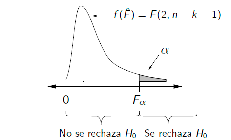
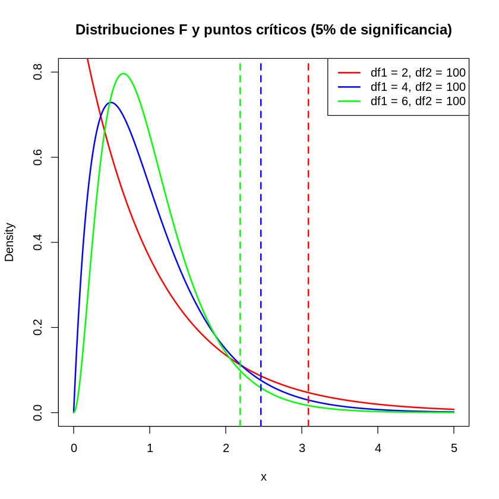
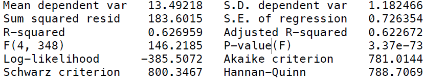
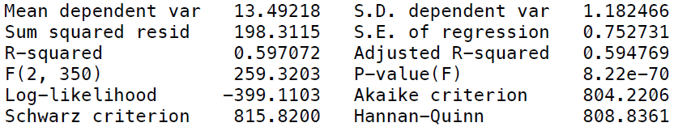
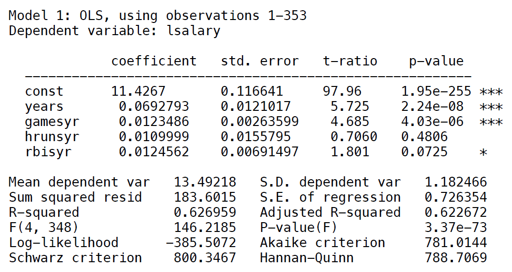

<!-- ARCHIVO GENERADO por tools/clases.py a partir de las diapositivas oficiales. No editar a mano: modifica tools/clases.py o el .tex y vuelve a generar. -->

# Clase 9 · Inferencia sobre un conjunto de parámetros: el test F

<div class="usm-session-meta">
<span>📅 Viernes 11 de diciembre de 2026</span>
<span>⏱️ 18:40 – 21:25</span>
<span class="usm-tag-gold">Semana 9 · Contenido 5 · Análisis de regresión múltiple</span>
<span class="usm-tag-red">📝 Semana del Control 2</span>
</div>

!!! info "Contenido oficial de la semana"
    Esta página reproduce **íntegras y en orden** las diapositivas de la cátedra del viernes de la
    semana 9 (`sem9/Clase10.tex`, 20 láminas). Los bloques **Interactivo**, los casos y las preguntas
    son material adicional para estudiar.

!!! example "Cómo estudiar esta página"
    La clase está ordenada en **5 temas**. Cada tema parte con una **pregunta guía**, sigue con las láminas
    y los simuladores, y termina con **✍️ preguntas de selección múltiple** (cada alternativa incorrecta explica
    por qué no lo es) y un **🧪 ejercicio de R** que puedes editar y ejecutar aquí mismo, sin instalar nada.
    Los 5 ejercicios de R en un solo archivo: [📥 clase9.R](../r/clase9.R).

## 🎯 Objetivos de la sesión

- Plantear hipótesis sobre **varios parámetros a la vez**, como $H_0: \beta_3 = \beta_4 = 0$.
- Construir el estadístico $F$ comparando el modelo **restringido** y el **no restringido**, con SSR o con $R^2$.
- Decidir con la distribución $F(j, n-k-1)$ y entender por qué el test conjunto puede rechazar aunque ninguna $t$ lo haga.
- Hacer la prueba de **significancia global** de una regresión.

## 🗓️ Agenda de la cátedra (viernes 18:40 – 21:25)

Haz clic en un tema para ir directo a él.

<ol class="econ-ruta">
<li><span class="econ-ruta-h">18:40</span><a class="econ-ruta-a" href="#tema-1"><span class="econ-ruta-n">1</span><span class="econ-ruta-t">Varios parámetros a la vez</span><span class="econ-ruta-l">láminas 1–4 · ✍️ 2 preguntas · 🧪 R</span></a></li>
<li><span class="econ-ruta-h">19:05</span><a class="econ-ruta-a" href="#tema-2"><span class="econ-ruta-n">2</span><span class="econ-ruta-t">Modelo restringido y el estadístico F</span><span class="econ-ruta-l">láminas 5–10 · ✍️ 3 preguntas · 🧪 R</span></a></li>
<li><span class="econ-ruta-h">19:35</span><a class="econ-ruta-a" href="#tema-3"><span class="econ-ruta-n">3</span><span class="econ-ruta-t">La zona de rechazo y la distribución F</span><span class="econ-ruta-l">láminas 11–12 · ✍️ 2 preguntas · 🧪 R</span></a></li>
<li class="is-break"><span class="econ-ruta-h">19:55</span><span class="econ-ruta-t">☕ Receso</span></li>
<li><span class="econ-ruta-h">20:05</span><a class="econ-ruta-a" href="#tema-4"><span class="econ-ruta-n">4</span><span class="econ-ruta-t">Ejemplo: rendimiento y salario en el baseball</span><span class="econ-ruta-l">láminas 13–18 · ✍️ 2 preguntas · 🧪 R</span></a></li>
<li><span class="econ-ruta-h">20:50</span><a class="econ-ruta-a" href="#tema-5"><span class="econ-ruta-n">5</span><span class="econ-ruta-t">F, multicolinealidad y significancia global</span><span class="econ-ruta-l">láminas 19–20 · ✍️ 2 preguntas · 🧪 R</span></a></li>
<li class="is-break"><span class="econ-ruta-h">21:15</span><span class="econ-ruta-t">✅ Ideas clave, autoevaluación y cierre</span></li>
</ol>

## Inferencia sobre un conjunto de parámetros: el test F { .econ-parte data-eyebrow="Parte 1 · Cátedra" data-toc-label="Parte 1 · Inferencia sobre un conjunto de parámetros: el test F" }

<p class="econ-source">📄 Diapositivas: <code>sem9/Clase10.tex</code> · 20 láminas</p>

### Varios parámetros a la vez { #tema-1 .econ-tema data-num="1" data-laminas="láminas 1–4" data-toc-label="Tema 1 · Varios parámetros a la vez" }

<p class="econ-tema-q">¿Cómo testear si dos variables, juntas, no aportan nada?</p>

<div class="econ-lamina" markdown>

#### Test de hipótesis sobre un conjunto de parámetros { data-lamina="Lámina 1" }

<!-- sem9/Clase10.tex · lámina 1 -->

-   A menudo estamos interesados en testear hipótesis para varios parámetros a la vez.

-   Por ejemplo si dos coeficientes son 0 al mismo tiempo.

-   En ese caso, las hipótesis se verían de la siguiente forma:

    $$
    \begin{aligned}
    H_0 & : \beta_{\text{1}} = \beta_{\text{2}} = 0 \\
    H_1 & :  \text{Al menos uno }\neq 0
    \end{aligned}
    $$

-   Cuando se rechaza la hipótesis nula se dice que $x_1$ y $x_2$ son conjuntamente significativas al correspondiente nivel de significancia.

-   Noten que en este caso, el test NO dice cuál de las variables tiene un efecto en $y$. Puede ser una sola, varias o todas.

-   Para esto vamos a usar un estadístico F.

</div>

<div class="econ-lamina" markdown>

#### Repaso relevante para esta clase { data-lamina="Lámina 2" }

<!-- sem9/Clase10.tex · lámina 2 -->

Partiendo de $y = \beta_0 + \beta_1 x_1 + \beta_2 x_2 + \ldots + \beta_k x_k + u$, calculo por MCO y obtengo la predicción: $\hat{y}$. Definiciones:

$SST : \sum_i (y_i - \bar{y})^2$ $\rightarrow$ variabilidad de $y$<br>
$SSE : \sum_i (\hat{y}_i - \bar{y})^2$ $\rightarrow$ lo explicado por mi modelo<br>
$SSR : \sum_i \hat{u}_i^2$ $\rightarrow$ lo que mi modelo no explica/se equivoca<br>
$SST : SSE + SSR$ $\rightarrow$ lo que explico + lo que no explico con mi modelo<br>
$R^2 : 1 - \frac{SSR}{SST}$ $\rightarrow$ fracción de la variabilidad de $y$ que es explicada por mi modelo

</div>

<div class="econ-lamina" markdown>

#### Repaso: Si agrego variables relevantes, cae mi SSR { data-lamina="Láminas 3–4" }

<!-- sem9/Clase10.tex · lámina 3 -->

Supongan que parto estimando $y = \beta_0 + \beta_1 x_1 + u$.

-   SST = SSE + SSR

-   SST = lo que explico + lo que no explico con el modelo

-   $R^2 = 1 - \frac{SSR}{SST}$<br>
    *el % de la variabilidad de y que es explicada por mi modelo*

¿Qué pasa si agrego a mi modelo una variable $x_2$ relevante para explicar $y$?

<!-- sem9/Clase10.tex · lámina 4 -->

Supongan que parto estimando $y = \beta_0 + \beta_1 x_1 + u$.

-   SST = SSE + SSR

-   SST = lo que explico + lo que no explico con el modelo

-   $R^2 = 1 - \frac{SSR}{SST}$<br>
    *el % de la variabilidad de y que es explicada por mi modelo*

¿Qué pasa si agrego a mi modelo una variable $x_2$ relevante para explicar $y$? Cae mi $SSR$ y aumenta mi $R^2$.

$$
\text{SST} = \textcolor{red}{\uparrow \text{SSE}} + \textcolor{red}{\downarrow \text{SSR}}
$$

$$
\textcolor{red}{\uparrow} R^2 = 1 - \frac{\textcolor{red}{\downarrow \text{SSR}}}{\text{SST}}
$$

</div>

<div class="econ-practica" id="practica-1">
<p class="econ-practica-t"><span>✍️ Practica · Tema 1</span></p>
<div class="econ-quiz">
<p class="econ-quiz-q">Se rechaza H₀: β₁ = β₂ = 0. ¿Qué podemos concluir?</p>
<div class="econ-quiz-opts">
<button class="econ-quiz-opt" data-correct>Que al menos uno de los dos coeficientes es distinto de cero.</button>
<button class="econ-quiz-opt" data-why="El test no dice cuál: puede ser uno, el otro o ambos (lámina 1).">Que ambos coeficientes son distintos de cero.</button>
<button class="econ-quiz-opt" data-why="Esa es otra hipótesis: la igualdad de parámetros de la Clase 8.">Que β₁ = β₂.</button>
</div>
<p class="econ-quiz-fb">✅ Se dice que x₁ y x₂ son <em>conjuntamente</em> significativas.</p>
</div>
<div class="econ-quiz">
<p class="econ-quiz-q">Al agregar una variable relevante al modelo, ¿qué pasa con la SSR?</p>
<div class="econ-quiz-opts">
<button class="econ-quiz-opt" data-correct>Baja, y el R² sube.</button>
<button class="econ-quiz-opt" data-why="Con una variable más, MCO ajusta al menos igual de bien: la SSR no puede subir.">Sube, y el R² baja.</button>
<button class="econ-quiz-opt" data-why="Si la variable aporta, la SSR baja.">No cambia.</button>
</div>
<p class="econ-quiz-fb">✅ Láminas 3 y 4: SST = ↑SSE + ↓SSR.</p>
</div>
</div>

<div class="econ-r" markdown>

<p class="econ-r-t">🧪 Practica en R · La SSR baja al agregar una variable</p>

Compara la SSR y el R² de un modelo sin y con una variable relevante.

```r
set.seed(1)
n  <- 100
x1 <- rnorm(n)
x2 <- rnorm(n)
y  <- 1 + 0.8 * x1 + 0.6 * x2 + rnorm(n)

m1 <- lm(y ~ x1)            # sin x2
m2 <- lm(y ~ x1 + x2)       # agregando x2, que es relevante
c(SSR_sin_x2 = sum(resid(m1)^2), SSR_con_x2 = sum(resid(m2)^2))
c(R2_sin_x2 = summary(m1)$r.squared, R2_con_x2 = summary(m2)$r.squared)
```

**🎯 Reto:** cambia `0.6 * x2` por `0 * x2` (x₂ irrelevante). ¿Baja igual la SSR? ¿Cuánto?
{: .econ-r-reto }

</div>

### Modelo restringido y el estadístico F { #tema-2 .econ-tema data-num="2" data-laminas="láminas 5–10" data-toc-label="Tema 2 · Restringido y no restringido" }

<p class="econ-tema-q">¿Cuánto tiene que aumentar la SSR al imponer H₀ para rechazarla?</p>

<div class="econ-lamina" markdown>

#### Test de hipótesis y modelo restringido { data-lamina="Lámina 5" }

<!-- sem9/Clase10.tex · lámina 5 -->

-   Entonces, una buena forma de testear si variables son irrelevantes para explicar la variable $y$ (tienen $\beta's = 0$) es:

    → Mirar las diferencias entre el SSR de un modelo que las incluye (modelo unrestricted: $SSR_{ur}$) y el SSR de un modelo que no las incluye (modelo restricted: $SSR_{r}$).

-   Cuanto más grande sea la diferencia $SSR_{r} - SSR_{ur}$ más seguros estaremos de que las variables en cuestión son relevantes para explicar $y$.

-   ¿Cuál es el signo de esta diferencia $SSR_{r} - SSR_{ur}$?

-   $SSR_{r} - SSR_{ur} \geq 0$

</div>

<div class="econ-lamina" markdown>

#### Test: Definiciones { data-lamina="Láminas 6–7" }

<!-- sem9/Clase10.tex · lámina 6 -->

-   Sea el modelo: $y = \beta_0 + \beta_1 x_1 + \beta_2 x_2 + \beta_3 x_3 + u$

-   Nos interesa testear si $x_2$ o $x_3$ o ambas son relevantes para el modelo. Es decir: $H_0: \beta_2 = \beta_3 = 0$, $H_1: Al menos uno \neq 0$

<!-- sem9/Clase10.tex · lámina 7 -->

-   Sea el modelo: $y = \beta_0 + \beta_1 x_1 + \beta_2 x_2 + \beta_3 x_3 + u$

-   Nos interesa testear si $x_2$ o $x_3$ o ambas son relevantes para el modelo. Es decir: $H_0: \beta_2 = \beta_3 = 0$, $H_1: \beta_2 \neq 0$ o $\beta_3 \neq 0$.

    **Modelo no restringido (UR)**: se incluyen todas las variables.

    -   Estimando el modelo no restringido por MCO, $y = \beta_0 + \beta_1 x_1 + \beta_2 x_2 + \beta_3 x_3 + u$ $\rightarrow$ **obtenemos $SSR_{ur}$**

    **Modelo Restringido (R)**: se asume $H_0$ verdadera y se estima el modelo:

    -   $y = \beta_0 + \beta_1 x_1 + u$ $\rightarrow$ **obtenemos $SSR_r$**

-   Rechazamos $H_0$ a medida que $SSR_r - SSR_{ur}$ sea mayor. Si se cumpliera $H_0$, es decir las variables $x_2$ y $x_3$ fueran totalmente irrelevantes, esa diferencia sería cercana a 0.

</div>

<div class="econ-lamina" markdown>

#### Test de hipótesis y modelo restringido { data-lamina="Láminas 8–9" }

<!-- sem9/Clase10.tex · lámina 8 -->

-   Podemos pensar el test de hipótesis como la comparación entre el modelo original y el modelo restringido (cuando se cumple la $H_0$).

-   Entonces, se puede demostrar que:

$$
F = \frac{SSR_{r} - SSR_{ur}}{SSR_{ur}} \cdot \frac{n - k - 1}{j} \sim F(j, n - k - 1)
$$

$$
{ \frac{SSR_r - SSR_{ur}}{j}\over {\frac{SSR_{ur}}{n - k - 1}}}
$$

<!-- sem9/Clase10.tex · lámina 9 -->

-   Podemos pensar el test de hipótesis como la comparación entre el modelo original y el modelo restringido (cuando se cumple la $H_0$).

-   Entonces, se puede demostrar que:

$$
F = \frac{\textcolor{red}{SSR_{r} - SSR_{ur}}}{SSR_{ur}} \cdot \frac{n - k - 1}{j} \sim F(j, n - k - 1)
$$

-   **Donde $j$ son las restricciones de exclusión.**

-   Note que $SSR_{r} \geq SSR_{ur}$.

-   Note que $SSR_{r} - SSR_{ur}$ va a ser más grande cuanto más importantes son las variables testeadas.

-   **El test sobre un conjunto de parámetros se reduce a responder si la disminución relativa en SSR de pasar del modelo restringido al no-restringido es suficientemente grande.**

</div>

<div class="econ-lamina" markdown>

#### Otra forma de escribirlo { data-lamina="Lámina 10" }

<!-- sem9/Clase10.tex · lámina 10 -->

Note que usando $R^2 = 1 - \frac{SSR}{SST}$, el estadístico $F$ también se puede escribir como (demostrar de tarea):

$$
F = \frac{(R^2_{ur} - R^2_{r})}{(1 - R^2_{ur})} \cdot \frac{n - k - 1}{j} \sim F(j, n - k - 1)
$$

-   ¿Cómo lo interpretan?

-   Cuanto más relevantes las variables que estoy testeando, más diferencia va a haber entre el porcentaje explicado por el UR y el explicado por el R.

</div>

<div class="econ-practica" id="practica-2">
<p class="econ-practica-t"><span>✍️ Practica · Tema 2</span></p>
<div class="econ-quiz">
<p class="econ-quiz-q">En y = β₀ + β₁x₁ + β₂x₂ + β₃x₃ + u, para testear H₀: β₂ = β₃ = 0, ¿cuál es el modelo restringido?</p>
<div class="econ-quiz-opts">
<button class="econ-quiz-opt" data-correct>y = β₀ + β₁x₁ + u</button>
<button class="econ-quiz-opt" data-why="El restringido impone H₀: saca las variables cuyos coeficientes se suponen cero.">y = β₀ + β₂x₂ + β₃x₃ + u</button>
<button class="econ-quiz-opt" data-why="Ese sería el restringido de la significancia global, no de esta hipótesis.">y = β₀ + u</button>
</div>
<p class="econ-quiz-fb">✅ Lámina 7: se asume H₀ verdadera y se estima el modelo sin x₂ ni x₃.</p>
</div>
<div class="econ-quiz">
<p class="econ-quiz-q">¿Qué representa j en F = [(SSR_r − SSR_ur)/SSR_ur]·[(n − k − 1)/j]?</p>
<div class="econ-quiz-opts">
<button class="econ-quiz-opt" data-correct>El número de restricciones que impone H₀.</button>
<button class="econ-quiz-opt" data-why="j cuenta las restricciones de exclusión, no las variables que quedan.">El número de variables del modelo restringido.</button>
<button class="econ-quiz-opt" data-why="Esos son n − k − 1.">Los grados de libertad del modelo no restringido.</button>
</div>
<p class="econ-quiz-fb">✅ Lámina 9. En el ejemplo del baseball, j = 2.</p>
</div>
<div class="econ-quiz">
<p class="econ-quiz-q">¿Por qué SSR_r − SSR_ur nunca es negativo?</p>
<div class="econ-quiz-opts">
<button class="econ-quiz-opt" data-correct>Porque el modelo no restringido incluye todas las variables del restringido, así que ajusta al menos igual de bien.</button>
<button class="econ-quiz-opt" data-why="Los residuos pueden ser negativos; lo que se compara son sumas de cuadrados.">Porque los residuos siempre son positivos.</button>
<button class="econ-quiz-opt" data-why="No hay valor absoluto: es una consecuencia de MCO.">Por convención, se toma el valor absoluto.</button>
</div>
<p class="econ-quiz-fb">✅ Láminas 5 y 9.</p>
</div>
</div>

<div class="econ-r" markdown>

<p class="econ-r-t">🧪 Practica en R · El F a mano y con anova()</p>

Estima el modelo restringido y el no restringido, calcula el F con la fórmula de la lámina 8 y compáralo con `anova()`.

```r
set.seed(9)
n  <- 120
x1 <- rnorm(n); x2 <- rnorm(n); x3 <- rnorm(n)
y  <- 1 + 0.5 * x1 + 0.4 * x2 + 0.3 * x3 + rnorm(n)

ur <- lm(y ~ x1 + x2 + x3)     # no restringido
r  <- lm(y ~ x1)               # restringido: H0: beta2 = beta3 = 0
SSR_ur <- sum(resid(ur)^2)
SSR_r  <- sum(resid(r)^2)
j <- 2; k <- 3

F <- (SSR_r - SSR_ur) / SSR_ur * (n - k - 1) / j
c(F = F, critico = qf(0.95, j, n - k - 1),
  valor_p = pf(F, j, n - k - 1, lower.tail = FALSE))
anova(r, ur)                   # R hace el mismo test
```

**🎯 Reto:** cambia `0.4 * x2 + 0.3 * x3` por `0 * x2 + 0 * x3` (H₀ verdadera). ¿Se rechaza?
{: .econ-r-reto }

</div>

### La zona de rechazo y la distribución F { #tema-3 .econ-tema data-num="3" data-laminas="láminas 11–12" data-toc-label="Tema 3 · Distribución F" }

<p class="econ-tema-q">¿Qué valores de F son evidencia contra H₀?</p>

<div class="econ-lamina" markdown>

#### Zona de rechazo { data-lamina="Lámina 11" }

<!-- sem9/Clase10.tex · lámina 11 -->

-   Sea $\alpha$ el nivel de significancia, si $F_{\text{estadístico}} > F_{\alpha; j; n - k - 1}$ se rechaza $H_0$.

    { .econ-slide-img }

    Cuanto más grande sea la diferencia entre los modelos, más extremo será el $F_{\text{empírico}}$ y más probable que rechacemos la $H_0$.

</div>

<div class="econ-lamina" markdown>

#### Distribución F { data-lamina="Lámina 12" }

<!-- sem9/Clase10.tex · lámina 12 -->

{ .econ-slide-img }

</div>

<div class="econ-practica" id="practica-3">
<p class="econ-practica-t"><span>✍️ Practica · Tema 3</span></p>
<div class="econ-quiz">
<p class="econ-quiz-q">Con α = 5%, ¿cuándo se rechaza H₀ en el test F?</p>
<div class="econ-quiz-opts">
<button class="econ-quiz-opt" data-correct>Cuando F supera el valor crítico F(α; j, n − k − 1).</button>
<button class="econ-quiz-opt" data-why="1.96 es de la normal en un test de dos colas; el F usa su propia distribución.">Cuando |F| es mayor que 1.96.</button>
<button class="econ-quiz-opt" data-why="F no puede ser negativo: es un cociente de sumas de cuadrados.">Cuando F es negativo.</button>
</div>
<p class="econ-quiz-fb">✅ Lámina 11: solo valores grandes de F son evidencia contra H₀ (una cola).</p>
</div>
<div class="econ-quiz">
<p class="econ-quiz-q">Si las variables testeadas son muy relevantes, el F tiende a ser…</p>
<div class="econ-quiz-opts">
<button class="econ-quiz-opt" data-correct>…grande.</button>
<button class="econ-quiz-opt" data-why="Cercano a cero ocurre cuando las variables no aportan: SSR_r ≈ SSR_ur.">…cercano a cero.</button>
<button class="econ-quiz-opt" data-why="No hay un valor fijo: depende de cuánto baja la SSR.">…cercano a 1.96.</button>
</div>
<p class="econ-quiz-fb">✅ Cuanto más grande la diferencia entre los modelos, más extremo el F.</p>
</div>
</div>

<div class="econ-r" markdown>

<p class="econ-r-t">🧪 Practica en R · Valores críticos de la F</p>

Calcula el valor crítico de la F al 5% con distintos grados de libertad y grafica la F(2, 348) del ejemplo.

```r
# Valores críticos de la F al 5% para distintos grados de libertad
gl <- c(10, 30, 100, 348, 1000)
round(sapply(gl, function(d) qf(0.95, df1 = 2, df2 = d)), 3)

curve(df(x, 2, 348), from = 0, to = 6, lwd = 3, col = "goldenrod",
      main = "Distribución F(2, 348)", ylab = "densidad")
abline(v = qf(0.95, 2, 348), col = "firebrick", lty = 2)   # zona de rechazo a la derecha
```

**🎯 Reto:** calcula el valor crítico al 1% con `qf(0.99, 2, 348)`. ¿Es mayor o menor que al 5%?
{: .econ-r-reto }

</div>

### Ejemplo: rendimiento y salario en el baseball { #tema-4 .econ-tema data-num="4" data-laminas="láminas 13–18" data-toc-label="Tema 4 · Ejemplo: baseball" }

<p class="econ-tema-q">¿Importa el rendimiento de un jugador para su salario?</p>

<div class="econ-lamina" markdown>

#### Ejemplo: rendimiento y salario en el baseball { data-lamina="Lámina 13" }

<!-- sem9/Clase10.tex · lámina 13 -->

-   Se tiene el siguiente modelo para los salarios de los jugadores de baseball:

    $$
    \log(\text{salary}) = \beta_0 + \beta_1 \text{years} + \beta_2 \text{gamesyr} + \beta_3 \text{hrunsyr} + \beta_4 \text{rbisyr} + u
    $$

    donde <u>years</u> es el número de años en la liga, <u>gamesyr</u> el promedio de juegos anuales, <u>hrunsyr</u> el número de home runs y <u>rbisyr</u> el número de corridas gracias a su bateo.

-   Se quiere testear que el rendimiento de los jugadores no influye en sus salarios, es decir,

    $$
    H_0 : \beta_3 = \beta_4 = 0
    $$

    $$
    H_1 : \text{.Al  menos uno es} \ \neq 0
    $$

</div>

<div class="econ-lamina" markdown>

#### Ejemplo: rendimiento y salario en el baseball (n=353) { data-lamina="Lámina 14" }

<!-- sem9/Clase10.tex · lámina 14 -->

-   **Step 1:** $H_0: \beta_3 = \beta_4 = 0$, $H_1: \beta_3 \neq 0$ o $\beta_4 \neq 0$

-   **Step 2:**

    1.  **Modelo no restringido:**

        $$
        \log(\text{salary}) = \beta_0 + \beta_1 \text{years} + \beta_2 \text{gamesyr} + \beta_3 \text{hrunsyr} + \beta_4 \text{rbisyr} + u
        $$

        **obtenemos $SSR_{ur}$.**

    2.  **Modelo restringido:**

        $$
        \log(\text{salary}) = \gamma_0 + \gamma_1 \text{years} + \gamma_2 \text{gamesyr} + e
        $$

        **obtenemos $SSR_{r}$.**

-   **Step 3:** Calcular $F_{\text{estadístico}} = \frac{(SSR_{r} - SSR_{ur})}{SSR_{ur}} \cdot \frac{353 - 5}{2}$

-   **Step 4:** Comparar con el $F$ de la distribución $F(2, 348)$ para 5% de significatividad.

</div>

<div class="econ-lamina" markdown>

#### Ejemplo: rendimiento y salario en el baseball { data-lamina="Láminas 15–16" }

<!-- sem9/Clase10.tex · lámina 15 -->

-   **Resultados modelo no restringido: $\log(\text{salary}) = \beta_0 + \beta_1 \text{years} + \beta_2 \text{gamesyr} + \beta_3 \text{hrunsyr} + \beta_4 \text{rbisyr} + u$**

    { .econ-slide-img }

-   **Resultados modelo restringido:<br>
    $\log(\text{salary}) = \gamma_0 + \gamma_1 \text{years} + \gamma_2 \text{gamesyr} + u$**

    { .econ-slide-img }

<!-- sem9/Clase10.tex · lámina 16 -->

-   **Resultados modelo no restringido: $\log(\text{salary}) = \beta_0 + \beta_1 \text{years} + \beta_2 \text{gamesyr} + \beta_3 \text{hrunsyr} + \beta_4 \text{rbisyr} + u$**

    { .econ-slide-img }

-   **Resultados modelo restringido: $\log(\text{salary}) = \gamma_0 + \gamma_1 \text{years} + \gamma_2 \text{gamesyr} + u$**

    { .econ-slide-img }

-   Test de hipótesis conjunto para $H_0 : \beta_3 = \beta_4 = 0$

    $$
    F = \frac{(198.31 - 183.60)}{183.60} \cdot \frac{353-4-1}{2} = 13.94
    $$

-   Comparamos con el punto crítico de $F(2, 348)$ con 5% de significancia que es 3.02, por lo que rechazamos la hipótesis nula. Es decir, los home runs o las corridas son importantes para explicar el salario.

</div>

<div class="econ-lamina" markdown>

#### Ejercicio { data-lamina="Lámina 17" }

<!-- sem9/Clase10.tex · lámina 17 -->

Use los datos de las tablas anteriores para comprobar que uno también puede calcular el $F$-estadístico usando la fórmula con los $R^2$ de los modelos restringidos y no restringidos:

$$
F = \frac{(0.6270 - 0.5971)}{(1 - 0.6270)} \cdot \frac{353 - 4 - 1}{2} = 13.94
$$

</div>

<div class="econ-lamina" markdown>

#### Ejemplo: rendimiento y salario en el baseball { data-lamina="Lámina 18" }

<!-- sem9/Clase10.tex · lámina 18 -->

{ .econ-slide-img }

-   Noten que si bien encontramos que los coeficientes conjuntamente son diferentes a 0, los coeficientes para <u>hrunsyr</u> y <u>rbisyr</u> son positivos, sin embargo, no es posible rechazar la insignificancia individual de cada uno de ellos (con $\alpha = 5\%$).

</div>

<div class="econ-widget" data-widget="f-test"></div>

<div class="econ-practica" id="practica-4">
<p class="econ-practica-t"><span>✍️ Practica · Tema 4</span></p>
<div class="econ-quiz">
<p class="econ-quiz-q">En el ejemplo, F = 13.94 y el valor crítico al 5% de F(2, 348) es 3.02. ¿Qué concluyes?</p>
<div class="econ-quiz-opts">
<button class="econ-quiz-opt" data-correct>Los home runs o las carreras impulsadas son importantes para explicar el salario.</button>
<button class="econ-quiz-opt" data-why="13.94 &gt; 3.02: se rechaza H₀.">Ninguna medida de rendimiento importa.</button>
<button class="econ-quiz-opt" data-why="El F no dice eso; de hecho, ninguna t individual rechaza (lámina 18).">Ambas medidas son individualmente significativas.</button>
</div>
<p class="econ-quiz-fb">✅ Lámina 16.</p>
</div>
<div class="econ-quiz">
<p class="econ-quiz-q">En la fórmula del ejemplo aparece (353 − 4 − 1)/2. ¿Por qué 4?</p>
<div class="econ-quiz-opts">
<button class="econ-quiz-opt" data-correct>Porque el modelo no restringido tiene 4 variables explicativas (k = 4).</button>
<button class="econ-quiz-opt" data-why="Se testean 2 restricciones (β₃ = β₄ = 0): j = 2.">Porque se testean 4 restricciones.</button>
<button class="econ-quiz-opt" data-why="Los grados de libertad se calculan con el modelo no restringido.">Porque el modelo restringido tiene 4 parámetros.</button>
</div>
<p class="econ-quiz-fb">✅ n − k − 1 = 353 − 4 − 1 = 348.</p>
</div>
</div>

<div class="econ-r" markdown>

<p class="econ-r-t">🧪 Practica en R · El ejemplo del baseball</p>

Reproduce el F de la lámina 16 con las SSR y el de la lámina 17 con los R², y obtén el valor crítico y el valor-p.

```r
# Láminas 16 y 17: salarios en el baseball (n = 353, k = 4, j = 2)
n <- 353; k <- 4; j <- 2
F_ssr <- (198.31 - 183.60) / 183.60 * (n - k - 1) / j
F_r2  <- (0.6270 - 0.5971) / (1 - 0.6270) * (n - k - 1) / j
c(F_con_SSR = F_ssr, F_con_R2 = F_r2)
qf(0.95, j, n - k - 1)                         # valor crítico ≈ 3.02
pf(F_ssr, j, n - k - 1, lower.tail = FALSE)    # valor-p
```

**🎯 Reto:** ¿qué valor de SSR restringido haría que F quedara justo en el valor crítico? Pruébalo.
{: .econ-r-reto }

</div>

### F, multicolinealidad y significancia global { #tema-5 .econ-tema data-num="5" data-laminas="láminas 19–20" data-toc-label="Tema 5 · Multicolinealidad y F global" }

<p class="econ-tema-q">¿Cómo puede el F rechazar si ninguna t lo hace?</p>

<div class="econ-lamina" markdown>

#### F-test y el problema de multi-colinealidad { data-lamina="Lámina 19" }

<!-- sem9/Clase10.tex · lámina 19 -->

-   Noten que en el ejemplo anterior, no podíamos rechazar que cada coeficiente era diferente de 0 por separado.

-   Sin embargo, el $F$ nos dice que al menos uno de ellos sí lo es. ¿Por qué?

-   Las variables *hrunsyr* y *rbisyr* están muy correlacionadas y esta multicolinealidad dificulta descubrir el efecto parcial de cada variable (dejando la otra fija). Esto se refleja en altas varianzas de los estimadores y bajos estadísticos $t$ individuales.

-   Recuerden que si tengo mucha correlación entre dos variables, la varianza de sus estimadores aumenta, haciendo más fácil no rechazar la nula.

-   Sin embargo, el $F$-test al considerarlas juntas, no tiene ese problema y por eso es bueno para probar la exclusión de un conjunto de variables.

-   Por ejemplo, suponga que quieren ver si el desempeño de una empresa afecta sueldos de CEOs. Hay muchas medidas para medir desempeño y seguramente están correlacionadas (e.g., profits, ventas, etc.). Entonces puede emplearse una prueba $F$ para determinar si, como grupo, las variables de desempeño de la empresa afectan el sueldo.

</div>

<div class="econ-widget" data-widget="f-vs-t"></div>

<div class="econ-lamina" markdown>

#### Caso particular: Prueba de significancia global { data-lamina="Lámina 20" }

<!-- sem9/Clase10.tex · lámina 20 -->

-   Prueba de significación global.

-   La hipótesis nula es que el modelo entero no explica $y$:

    $$
    H_0 : \beta_1 = \cdots = \beta_k = 0
    $$

-   En este caso, el modelo restringido es: $y = \beta_0 + u$.

-   El valor de $R^2_r$ para el modelo restringido es cero. ¿Por qué?

-   Entonces el estadístico

    $$
    F = \frac{\textcolor{red}{(R^2_{ur} - R^2_{r}})}{(1 - R^2_{ur})} \cdot \frac{n - k - 1}{k} \sim F(k, n - k - 1)
    $$

-   se reduce a

    $$
    F = \frac{R^2}{1 - R^2} \cdot \frac{n - k - 1}{k}
    $$

-   donde $R^2$ es el valor obtenido en el modelo sin restringir.

</div>

<div class="econ-practica" id="practica-5">
<p class="econ-practica-t"><span>✍️ Practica · Tema 5</span></p>
<div class="econ-quiz">
<p class="econ-quiz-q">Dos variables muy correlacionadas tienen t individuales no significativas, pero su F conjunto sí lo es. ¿Por qué?</p>
<div class="econ-quiz-opts">
<button class="econ-quiz-opt" data-correct>La multicolinealidad infla los errores estándar individuales, pero el F evalúa ambas juntas y no tiene ese problema.</button>
<button class="econ-quiz-opt" data-why="Es un resultado esperable con regresores muy correlacionados (lámina 19).">El F está mal calculado.</button>
<button class="econ-quiz-opt" data-why="Las t funcionan bien sin multicolinealidad fuerte.">Las t individuales siempre son menos confiables que el F.</button>
</div>
<p class="econ-quiz-fb">✅ Lámina 19.</p>
</div>
<div class="econ-quiz">
<p class="econ-quiz-q">En la prueba de significancia global, ¿cuál es el modelo restringido?</p>
<div class="econ-quiz-opts">
<button class="econ-quiz-opt" data-correct>y = β₀ + u</button>
<button class="econ-quiz-opt" data-why="Ese restringe solo algunas variables; el global restringe todas.">y = β₀ + β₁x₁ + u</button>
<button class="econ-quiz-opt" data-why="El intercepto se mantiene: H₀ es β₁ = … = βₖ = 0.">El mismo modelo sin intercepto.</button>
</div>
<p class="econ-quiz-fb">✅ Su R² es cero, por eso F = [R²/(1 − R²)]·[(n − k − 1)/k] (lámina 20).</p>
</div>
</div>

<div class="econ-r" markdown>

<p class="econ-r-t">🧪 Practica en R · Multicolinealidad y F global</p>

Simula dos regresores muy correlacionados, revisa las t individuales y el F de significancia global, y calcula el F con la fórmula del R².

```r
set.seed(19)
n  <- 60
x1 <- rnorm(n)
x2 <- 0.95 * x1 + sqrt(1 - 0.95^2) * rnorm(n)   # muy correlacionadas
y  <- 1 + 0.3 * x1 + 0.3 * x2 + rnorm(n)
m  <- lm(y ~ x1 + x2)

round(coef(summary(m)), 3)      # las t individuales
summary(m)$fstatistic           # el F de significancia global (lámina 20)
R2 <- summary(m)$r.squared
R2 / (1 - R2) * (n - 2 - 1) / 2  # el mismo F con la fórmula del R²
```

**🎯 Reto:** cambia `0.95` por `0` (regresores independientes). ¿Qué pasa con las t individuales?
{: .econ-r-reto }

</div>

---

!!! abstract "🧠 Ideas clave"
    - Para testear varias restricciones a la vez se compara el modelo **restringido** (impone $H_0$) con el **no restringido**.
    - $F = \dfrac{SSR_r - SSR_{ur}}{SSR_{ur}} \cdot \dfrac{n-k-1}{j} = \dfrac{R^2_{ur} - R^2_r}{1 - R^2_{ur}} \cdot \dfrac{n-k-1}{j} \sim F(j, n-k-1)$; se rechaza si supera el valor crítico.
    - Con regresores muy correlacionados, el $F$ puede rechazar aunque ninguna $t$ individual lo haga.
    - La **significancia global** usa $F = \dfrac{R^2}{1-R^2} \cdot \dfrac{n-k-1}{k}$.

## ✅ Autoevaluación

<div class="econ-quiz">
<p class="econ-quiz-q">Con n = 100, k = 5 y j = 3, SSR_r = 240 y SSR_ur = 200. ¿Cuánto vale F?</p>
<div class="econ-quiz-opts">
<button class="econ-quiz-opt" data-correct>6.27</button>
<button class="econ-quiz-opt" data-why="Falta dividir por j = 3.">18.8</button>
<button class="econ-quiz-opt" data-why="Ese es solo (SSR_r − SSR_ur)/SSR_ur; falta multiplicar por (n − k − 1)/j = 94/3.">0.2</button>
</div>
<p class="econ-quiz-fb">✅ F = (40/200)·(94/3) = 0.2·31.33 = 6.27.</p>
</div>

<div class="econ-quiz">
<p class="econ-quiz-q">¿Puede el F ser negativo?</p>
<div class="econ-quiz-opts">
<button class="econ-quiz-opt" data-correct>No: SSR_r ≥ SSR_ur, así que el numerador nunca es negativo.</button>
<button class="econ-quiz-opt" data-why="El signo de los coeficientes no importa: se comparan sumas de cuadrados.">Sí, si las variables tienen efecto negativo.</button>
<button class="econ-quiz-opt" data-why="Eso no puede ocurrir: el no restringido incluye las variables del restringido.">Sí, si el R² del modelo restringido es mayor.</button>
</div>
<p class="econ-quiz-fb">✅ Lámina 9.</p>
</div>

<div class="econ-quiz">
<p class="econ-quiz-q">En una regresión con k = 3, n = 54 y R² = 0.25, ¿cuál es el F de significancia global?</p>
<div class="econ-quiz-opts">
<button class="econ-quiz-opt" data-correct>5.56</button>
<button class="econ-quiz-opt" data-why="Ese es R²/(1 − R²); falta multiplicar por (n − k − 1)/k = 50/3.">0.33</button>
<button class="econ-quiz-opt" data-why="Ese es (n − k − 1)/k; falta multiplicar por R²/(1 − R²).">16.67</button>
</div>
<p class="econ-quiz-fb">✅ F = (0.25/0.75)·(50/3) = 5.56.</p>
</div>

## 📚 Para la próxima clase

- **Wooldridge**, capítulo 4, sección 4.5 (pruebas de restricciones lineales múltiples: el test F).
- Próxima clase: **Inferencia sobre un conjunto de parámetros: el test F**.
